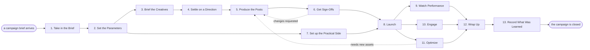

# Reference process: Run Social Media Campaign

`ref/mkt/social-campaign v1`

**value stream:** [Brief-to-Results](../../streams/marketing/brief-to-results.md)
A social media manager takes an approved brief, gets creative made and
signed off, launches it across the chosen channels, tends it while it is
live, and reports how it did against what the brief asked for.

## The activities

| # | Activity | What happens | Agents |
|---|---|---|---|
| 1 | Take in the Brief | work out what the campaign must accomplish | [campaign-manager](../../agents/campaign-manager.md) |
| 2 | Set the Parameters | platforms, audience, dates, budget | campaign-manager · leadership (person) |
| 3 | Brief the Creatives | say what is needed and by when | campaign-manager · [copywriter](../../agents/copywriter.md) · [designer](../../agents/designer.md) · [video-editor](../../agents/video-editor.md) |
| 4 | Settle on a Direction | weigh concepts until one is worth backing | campaign-manager · copywriter · designer · video-editor |
| 5 | Produce the Posts | copy, images, video, sized per platform | copywriter · designer · video-editor |
| 6 | Get Sign-Offs | brand and legal approve the material | [brand-check](../../agents/brand-check.md) · legal reviewer (person) |
| 7 | Set up the Practical Side | tracking, landing pages, ad setup, schedule | [media-buyer](../../agents/media-buyer.md) · campaign-manager |
| 8 | Launch | posts go out, the ads start | campaign-manager |
| 9 | Watch Performance | track results against the brief | [analytics](../../agents/analytics.md) · campaign-manager |
| 10 | Engage | answer comments and messages | [community-manager](../../agents/community-manager.md) |
| 11 | Optimize | move ad money, swap stale creative | media-buyer · campaign-manager |
| 12 | Wrap Up | ads off, numbers pulled, reported | campaign-manager · analytics |
| 13 | Record What Was Learned | what to repeat, what to avoid | campaign-manager |

## The graph



## The document, with the blanks marked

```
PROCESS: social campaign              id: <team>/social-campaign   v1
from: ref/mkt/social-campaign v1
owner: <who>                          effective: <date>
trigger: a campaign brief is approved in <your planning process>
concurrency: runs may overlap - <how many> live at once
goal: a campaign launched on every channel the brief names, run for its
      window, and reported against what the brief asked for
phases:
  take-in-brief    - human: read the brief, pull out what the campaign
                     must accomplish
                     owner: campaign-manager   after: trigger
                     automation: <level>
  set-parameters   - human: pick platforms, audience and dates, and put
                     a number on it. <who> confirms the budget
                     owner: campaign-manager   after: take-in-brief
                     automation: <level>
  brief-creatives  - convenes briefing: the team hears what is needed
                     and by when, together
                     owner: campaign-manager   after: set-parameters
                     automation: <level>
  settle-direction - convenes bake-off: two or three concepts, one
                     chosen, with the reasons said out loud
                     owner: campaign-manager   after: brief-creatives
                     by: <days>                automation: <level>
  produce-posts    - runs build-by-talent: copy, images and video,
                     each sized and worded for its platform
                     owner: campaign-manager   after: settle-direction
                     by: <days>                automation: <level>
  get-sign-offs    - convenes approval: brand and legal sign, as named
                     signers, against a version of the posts
                     owner: <your legal role>  after: produce-posts
                     by: <days>                automation: never
  practical-side   - human: tracking links, the landing page check, the
                     ad campaigns, the posting schedule
                     owner: media-buyer        after: set-parameters
                     by: launch                automation: <level>
  launch           - human: the manager says go. The scheduler and the
                     ad platforms take it from there
                     owner: campaign-manager
                     after: get-sign-offs + practical-side
                     automation: <level>
  watch            - human: track results against the brief
                     owner: analytics          after: launch
                     automation: <level>
  engage           - human: answer comments and messages, flag what
                     needs the manager
                     owner: community-manager  after: launch
                     automation: <level>
  optimize         - human: move ad money toward what works, swap
                     creative that has gone stale
                     owner: media-buyer        after: launch
                     automation: <level>
  wrap-up          - runs collect-and-report: the numbers from every
                     channel, reported against the brief
                     owner: campaign-manager
                     after: watch + engage + optimize
                     automation: <level>
  record-learnings - convenes debrief: what to repeat, what to avoid
                     owner: campaign-manager   after: wrap-up
                     automation: <level>
run-scoped:
  spend  - runs allocate-and-reconcile        owner: campaign-manager
           from: set-parameters   until: run close
  status - runs collect-and-report            owner: analytics
           every: <cadence>
           from: launch   until: run close
handoffs:
  take-in-brief -> set-parameters: the goal, stated in one line that
    every later decision can be tested against
  set-parameters -> brief-creatives: the channels, audience, dates and
    budget
  set-parameters -> practical-side: the same parameters. Both branches
    read one record
  settle-direction -> produce-posts: the chosen concept, and why it won
  produce-posts -> get-sign-offs: the posts at a version
  get-sign-offs -> launch: the approved posts at the signed version. A
    later change voids the approval and sign-offs run again
  practical-side -> launch: tracking, ads and schedule, ready to fire
  wrap-up -> record-learnings: the report, as delivered
bindings:
  roster:  <who holds each role - agents claiming the abstract agents
           above, and named people for the human roles>
  systems: scheduler (write), ad platforms (write, cap: <n>/day),
           CMS (write), analytics (read)
  data:    brand guidelines <version>, <your claims register>,
           the campaign brief
policy:
  no claim ships without a citation in <your claims register>
  sign-off is a human gate and is never delegated to an agent
  a post changed after sign-off goes back through sign-offs
measures:
  cycle time: <target> from the brief to launch
  volume: <runs per period>
  quality gate: nothing publishes unsigned
```

## The failure edges

- **A sign-off comes back with changes.** The run returns to
  produce-posts, and only the piece the signers named reopens.
- **Creative goes stale mid-flight.** Optimize sends the run back to
  produce-posts while the campaign is live, and the replacements get a
  new version like any other assets.
- **The trigger fires while runs are in flight.** Campaigns overlap
  normally; the concurrency line says how many, and runs share their
  reference data read-only.
- **A run is abandoned.** Scheduled posts have to be pulled and the ads
  turned off, and the spend line reconciles anyway.

A worked version of this process, with every blank filled in and one run
played as a simulation, is at
[agentprocesses.ai](https://agentprocesses.ai/social-campaign.html).
