# Reference process: Secure Speaking Engagement

`ref/mkt/speaking-engagement v1`

**value stream:** [Story-to-Coverage](../../streams/marketing/story-to-coverage.md)
A submissions manager takes an open call for papers or an invitation to
speak, gets a named person committed and a proposal written, files it
before the organizer's deadline, and follows the decision. When the
proposal is accepted, the run settles the terms with the organizer and
then has the talk shaped, built, signed off and rehearsed. The speaker
delivers it, and the recording, the slides and the write-up go out
afterwards under the terms that were agreed. The run stays open past
the talk, because the manager still owes a report on what the
engagement was worth.

## The activities

| # | Activity | What happens | Agents |
|---|---|---|---|
| 1 | Take in the Call | what the event is, who attends, when it closes | [submissions-manager](../../agents/submissions-manager.md) · [researcher](../../agents/researcher.md) |
| 2 | Pick the Speaker | a named person agrees to speak on a named topic | submissions-manager · leadership (person) · spokesperson (person) |
| 3 | Write the Proposal | the title, the abstract, the outline and the bio | [copywriter](../../agents/copywriter.md) · spokesperson (person) · submissions-manager |
| 4 | Clear the Proposal | brand and legal read what the abstract promises | [brand-check](../../agents/brand-check.md) · legal reviewer (person) |
| 5 | Submit the Proposal | filed before the deadline and chased to a decision | submissions-manager · outside contact (person) |
| 6 | Settle the Terms | the speaker agreement and the recording rights | submissions-manager · legal reviewer (person) · rights approver (person) |
| 7 | Shape the Talk | the argument, the running order and the evidence | [editor](../../agents/editor.md) · spokesperson (person) · researcher · subject matter expert (person) |
| 8 | Build the Deck | slides, diagrams and the demo the talk needs | [designer](../../agents/designer.md) · copywriter · spokesperson (person) |
| 9 | Get Sign-Offs | brand, legal and rights approve the talk | brand-check · brand owner (person) · legal reviewer (person) · rights approver (person) |
| 10 | Rehearse the Talk | run it to time and fix what falls flat | spokesperson (person) · editor · submissions-manager |
| 11 | Handle the Arrangements | organizer deadlines, audio-visual, travel and room | [event-operations](../../agents/event-operations.md) · submissions-manager · outside contact (person) |
| 12 | Deliver the Talk | the speaker gives the talk and it is recorded | spokesperson (person) · event staff (person) |
| 13 | Reuse the Talk | clips, a written version, the slides to share | [video-editor](../../agents/video-editor.md) · copywriter · designer · editor |
| 14 | Publish the Material | the recording, the slides and the write-up go out | [web-producer](../../agents/web-producer.md) · [campaign-manager](../../agents/campaign-manager.md) · [community-manager](../../agents/community-manager.md) |
| 15 | Report the Result | audience, reach and what the talk brought in | [analytics](../../agents/analytics.md) · [coverage-monitor](../../agents/coverage-monitor.md) · submissions-manager |
| 16 | Record What Was Learned | what to repeat, what to avoid | submissions-manager |

## The graph

```mermaid
flowchart LR
  T([a call for papers opens or an invitation arrives]) --> A1[1. Take in the Call]
  A1 --> A2[2. Pick the Speaker]
  A2 --> A3[3. Write the Proposal]
  A3 --> A4[4. Clear the Proposal]
  A4 -. changes requested .-> A3
  A4 --> A5[5. Submit the Proposal]
  A5 -. the proposal is turned down .-> A16[16. Record What Was Learned]
  A5 --> A6[6. Settle the Terms]
  A6 -. the terms are refused .-> A16
  A6 --> A7[7. Shape the Talk]
  A6 --> A11[11. Handle the Arrangements]
  A7 --> A8[8. Build the Deck]
  A8 --> A9[9. Get Sign-Offs]
  A9 -. changes requested .-> A7
  A9 -. changes requested .-> A8
  A9 --> A10[10. Rehearse the Talk]
  A10 -. the talk does not hold up .-> A7
  A10 --> A12[12. Deliver the Talk]
  A11 -. the speaker drops out .-> A2
  A11 --> A12
  A12 --> A13[13. Reuse the Talk]
  A13 --> A14[14. Publish the Material]
  A14 --> A15[15. Report the Result]
  A15 --> A16
  A16 --> DONE([the talk is delivered and the run is closed])
```



## The document, with the blanks marked

```
PROCESS: speaking engagement          id: <team>/speaking-engagement   v1
from: ref/mkt/speaking-engagement v1
owner: <who>                          effective: <date>
trigger: a call for papers opens, or an invitation to speak arrives
         watch: record=<a call or an invitation>
                system=<your submissions record>
                change=<a call for papers opens, or an invitation to
                speak arrives>
concurrency: runs overlap - <how many> open engagements at once
goal: a proposal filed before the organizer's deadline, a talk given on
      the day it was accepted for, and the recording, the slides and the
      write-up published under the terms that were agreed
phases:
  take-in-call     - human: read the call or the invitation and write
                     down what the event is, who attends, what the
                     organizer requires, and when it closes
                     owner: submissions-manager after: trigger
                     automation: <level>
  pick-speaker     - convenes decide-and-announce: a named person
                     agrees to speak on a named topic, and <who>
                     commits their time and their travel
                     owner: submissions-manager after: take-in-call
                     by: <days>                automation: never
  write-proposal   - runs build-by-talent: the title, the abstract, the
                     outline and the speaker bio, in the format the
                     organizer requires
                     owner: submissions-manager after: pick-speaker
                     by: <days>                automation: <level>
  clear-proposal   - convenes approval: brand and legal read what the
                     abstract promises, because a filed abstract cannot
                     be taken back
                     owner: <your legal role>  after: write-proposal
                     by: <days>                automation: never
  submit-proposal  - human: file the proposal in the organizer's system
                     before the deadline, answer what the reviewers ask,
                     and chase the decision until it arrives
                     owner: submissions-manager after: clear-proposal
                     by: the organizer's deadline
                     automation: <level>
  settle-terms     - human: the speaker agreement, the fee or the
                     expenses, and what may be recorded, kept and
                     republished afterwards
                     owner: <your legal role>  after: submit-proposal
                     by: <days>                automation: never
  shape-talk       - convenes decide-and-announce: what the talk argues,
                     the order it argues it in, and the evidence under
                     each claim
                     owner: editor             after: settle-terms
                     by: <days>                automation: <level>
  build-deck       - runs build-by-talent: the slides, the diagrams and
                     the demo the talk needs, inside the template and
                     the file limits the organizer set
                     owner: designer           after: shape-talk
                     by: <days>                automation: <level>
  get-sign-offs    - convenes approval: brand, legal and rights sign, as
                     named signers, against a version of the talk
                     owner: <your legal role>  after: build-deck
                     by: <days>                automation: never
  rehearse         - human: the talk is run to time in front of people
                     who will say what falls flat
                     owner: submissions-manager after: get-sign-offs
                     by: <days>                automation: never
  arrangements     - human: the organizer's deadlines for the bio, the
                     headshot and the slide file, the audio-visual
                     requirements, the travel and the room
                     owner: event-operations   after: settle-terms
                     by: the organizer's deadlines
                     automation: <level>
  deliver          - human: the speaker gives the talk, it is recorded,
                     and the questions from the room are written down
                     owner: <your speaker>
                     after: rehearse + arrangements
                     automation: never
  reuse            - runs build-by-talent: the clips, the written
                     version and the slide file that may be shared
                     owner: editor             after: deliver
                     by: <days>                automation: <level>
  publish          - human: the recording, the slides and the write-up
                     go out on the channels the terms allow
                     owner: web-producer       after: reuse
                     automation: <level>
  report-result    - runs collect-and-report: the audience in the room,
                     what was published about the talk, and what the
                     engagement brought in
                     owner: analytics          after: publish
                     by: <weeks>               automation: <level>
  record-learnings - convenes debrief: what to repeat, what to avoid
                     owner: submissions-manager after: report-result
                     automation: <level>
run-scoped:
  status   - runs roll-call                  owner: submissions-manager
             every: <cadence>
             from: take-in-call   until: deliver
  coverage - runs collect-and-report         owner: coverage-monitor
             every: <cadence>
             from: publish   until: run close
  spend    - runs allocate-and-reconcile     owner: event-operations
             from: settle-terms   until: run close
handoffs:
  take-in-call -> pick-speaker [event-details]: what the event is, who
    is in the room, what the organizer requires, and the date the call
    closes
  pick-speaker -> write-proposal [speaker-commitment]: the named
    speaker, the topic they agreed to, and the commitment of their time
    and travel
  write-proposal -> clear-proposal [proposal-draft]: the proposal at a
    version, in the format the organizer requires
  clear-proposal -> submit-proposal [cleared-proposal]: the approved
    proposal at the signed version, with the record of who signed it
  submit-proposal -> settle-terms [acceptance]: the acceptance as the
    organizer sent it, with the slot, the length and the date
  settle-terms -> shape-talk [talk-terms]: what the talk has to cover,
    how long it runs, and what may be said about customers and products
  settle-terms -> arrangements [terms-for-arrangements]: the same
    terms. Both branches read one record
  shape-talk -> build-deck [talk-argument]: the argument and the
    running order, with the source under every claim
  get-sign-offs -> rehearse [signed-talk]: the approved talk at the
    signed version. A later change voids the approval and sign-offs run
    again
  rehearse -> deliver [rehearsed-talk]: the talk as it will be given,
    timed, with the slide file in the format the organizer asked for
  arrangements -> deliver [room-and-travel]: the room, the equipment
    and the travel, confirmed against the organizer's schedule
  deliver -> reuse [recording-and-questions]: the recording, the slides
    as they were shown, and the questions the room asked
  settle-terms -> publish [republication-terms]: what may be
    republished, on which channels, and after what date
  report-result -> record-learnings [engagement-report]: the report, as
    delivered
deviations:
  clear-proposal -> write-proposal [proposal-changes-requested]: brand
    or legal will not clear what the abstract promises, so the proposal
    is written again before it is filed
  submit-proposal -> record-learnings [proposal-turned-down]: the
    organizer turns the proposal down, so there is no talk to settle
    terms for, shape, build, rehearse or give, and the run goes
    straight to the record with what the organizer said
  settle-terms -> record-learnings [terms-refused]: the organizer's
    terms cannot be agreed, so the talk is not shaped, built or given,
    and the run goes straight to the record with the reason
  get-sign-offs -> shape-talk [talk-changes-requested]: a signer asks
    for changes to the argument, and only the part they named reopens
  get-sign-offs -> build-deck [deck-changes-requested]: a signer asks
    for changes to the deck, and only the deck reopens
  rehearse -> shape-talk [talk-does-not-hold-up]: the talk does not
    hold up when it is run to time, so the argument is shaped again and
    the sign-offs run on what comes out
  arrangements -> pick-speaker [speaker-drops-out]: the named speaker
    can no longer give the talk, so a speaker is picked again and the
    organizer has to agree to the substitute
bindings:
  roster:  <who holds each role - agents claiming the abstract agents
           above, and named people for the speaker, leadership, legal,
           brand and rights>
  systems: the submissions record (write), the asset store (write),
           the order and contract record (write),
           supplier ordering and booking systems (write, cap: <n>),
           the website (write), the community platform (write),
           analytics (read), the coverage record (write)
  data:    brand guidelines <version>, <your claims register>,
           <your style guide> <version>, the call or the invitation as
           the organizer published it, the signed speaker agreement
policy:
  no proposal is filed until a named person has agreed to give the talk
  sign-off is a human gate and is never delegated to an agent
  a talk changed after sign-off goes back through sign-offs
  every claim in the talk carries a source recorded against it
  nothing from the talk is republished beyond what the speaker
    agreement allows
  a customer is named on stage only where <who> has cleared it in
    writing
measures:
  cycle time: <target> from the call arriving to the proposal filed
  acceptance: <share of proposals accepted per period>
  volume: <talks per period>
  quality gate: nothing is filed or published unsigned
```

## The failure edges

- **The proposal is turned down.** Most proposals are turned down, and
  the process treats that as an ordinary ending. The run goes straight
  to record-learnings, and the abstract, the outline and the bio stay in
  the asset store at their versions so the next call can start from
  them. The submissions record keeps what the organizer said about the
  entry.
- **The organizer's terms are unacceptable.** The terms are settled
  before the talk is built, because the organizer may keep the recording
  or limit what can be republished, and that decides how much of the
  work after the talk is worth doing. If the terms cannot be agreed, the
  run closes at settle-terms and goes to record-learnings with the
  reason.
- **A sign-off comes back with changes.** The run returns to the
  argument or to the deck, and only the part the signers named reopens.
  The signers see the changed version before the speaker stands up with
  it.
- **The talk does not hold up in the rehearsal.** The run goes back to
  shape-talk, and the sign-offs run again on whatever comes out of that.
  A rehearsal that ends with problems still open is recorded that way,
  and <who> decides whether the talk goes ahead.
- **The speaker drops out.** The run goes back to pick-speaker. The
  organizer accepted a named person, so the organizer has to agree to
  the substitute, and the agreement is read again in case it named the
  original speaker.
- **The organizer changes the slot, the length or the date.** The
  arrangements branch reworks the travel and the room, and shape-talk
  reopens if the talk no longer fits the time it has been given.
- **The recording never arrives.** The reuse phase runs on whatever the
  organization captured itself, within what the terms allow. The report
  says plainly that there is no recording, and the run closes on its own
  schedule.
- **The trigger fires while runs are in flight.** Engagements overlap
  normally, and the concurrency line says how many. Two runs that need
  the same speaker on the same dates go to <who>, because a person
  decides which event gets them.
- **A run is abandoned.** The proposal and the deck stay at their
  versions for a later call. Anything already booked is cancelled before
  its cancellation deadline passes, the organizer is told the talk is
  being withdrawn, and the spend line reconciles anyway.
