# Reference process: Build Target Audience Segment

`ref/mkt/target-audience-segment v1`

**value stream:** [Plan-to-Reconcile](../../streams/marketing/plan-to-reconcile.md)
An audience manager takes a targeting need, confirms which consent and
retention rules apply to it, checks which traits the contact database
actually holds, and writes the rule that says who is in the segment and
who is held out of it. The audience operator runs that rule against the
database, the consent manager takes out every record the consent record
does not cover for this use, and a person signs before any contact data
leaves the organization. The audience handover agent delivers the list
to each platform, collects a receipt, and reports how much of the list
each platform could match. Which segments are worth going after was
settled before this run started, so nothing here argues about that. The
run closes when the list has reached every destination and the
definition has been written down where the next campaign can find it.

## The activities

| # | Activity | What happens | Agents |
|---|---|---|---|
| 1 | Take in the Targeting Need | what the segment is for and when it is needed | [audience-manager](../../agents/audience-manager.md) · [campaign-manager](../../agents/campaign-manager.md) |
| 2 | Confirm the Rules in Force | the consent, retention and sharing rules, at their versions | [consent-manager](../../agents/consent-manager.md) · legal reviewer (person) |
| 3 | Check the Data on Hand | which traits exist and how complete each one is | [analytics](../../agents/analytics.md) · audience-manager |
| 4 | Write the Membership Rule | the conditions a record must meet to be in | audience-manager · analytics |
| 5 | Name the Exclusions | who is kept out, and which segments must not overlap | audience-manager · campaign-manager · [media-buyer](../../agents/media-buyer.md) |
| 6 | Size the Segment | how many records match before consent is applied | analytics · audience-manager |
| 7 | Brief the Build | everyone hears the same request at once | audience-manager · [audience-operator](../../agents/audience-operator.md) · consent-manager · analytics · media-buyer · [audience-handover](../../agents/audience-handover.md) |
| 8 | Build the List | the rule and the exclusions run against the database | audience-operator |
| 9 | Apply Consent and Suppression | everyone the consent record does not cover comes out | consent-manager · audience-operator |
| 10 | Check the Built List | a sample read back against the rule it was built from | audience-manager · analytics |
| 11 | Score the Finished List | every removal cited to the rule that required it | consent-manager |
| 12 | Approve the Release | a person approves the list leaving the organization | audience-manager · legal reviewer (person) |
| 13 | Hand the List to the Platforms | formatted for each platform, delivered and confirmed | audience-handover · media-buyer |
| 14 | Confirm the Match | how much of the list each platform could match | audience-handover · media-buyer · analytics |
| 15 | Set the Refresh Schedule | how often the list is rebuilt and delivered again | audience-manager · audience-handover |
| 16 | Record the Segment | the definition, the counts and the destinations | audience-manager |

## The graph

```mermaid
flowchart LR
  T([a targeting need is raised]) --> A1[1. Take in the Targeting Need]
  A1 --> A2[2. Confirm the Rules in Force]
  A1 --> A3[3. Check the Data on Hand]
  A2 --> A4[4. Write the Membership Rule]
  A3 --> A4
  A4 --> A5[5. Name the Exclusions]
  A5 --> A6[6. Size the Segment]
  A6 -. too few records match the rule .-> A4
  A6 --> A7[7. Brief the Build]
  A7 --> A8[8. Build the List]
  A8 --> A9[9. Apply Consent and Suppression]
  A9 -. too few left to be worth buying .-> A4
  A9 --> A10[10. Check the Built List]
  A10 -. records the rule does not cover .-> A8
  A10 --> A11[11. Score the Finished List]
  A11 -. a removal with no rule behind it .-> A9
  A11 --> A12[12. Approve the Release]
  A12 -. changes requested .-> A5
  A12 --> A13[13. Hand the List to the Platforms]
  A13 -. a destination took only part of the list .-> A8
  A13 --> A14[14. Confirm the Match]
  A14 -. too small for a platform to serve .-> A4
  A14 --> A15[15. Set the Refresh Schedule]
  A15 --> A16[16. Record the Segment]
  A16 --> DONE([the segment is built and synced to the ad platforms])
```



## The document, with the blanks marked

```
PROCESS: build target audience segment id: <team>/target-audience-segment   v1
from: ref/mkt/target-audience-segment v1
owner: <who>                          effective: <date>
trigger: a targeting need is raised in <your campaign or program
         process>
         watch: record=<targeting need>
                system=<your campaign or program process>
                change=<a targeting need is raised>
concurrency: runs may overlap - <how many> segments in build at once
goal: a segment built from a written rule, cleared against the consent
      record, signed for by a person, delivered to every platform that
      will act on it, and recorded with its counts and its destinations
phases:
  take-in-need      - human: read the targeting need and write down what
                      the segment is for, which campaign or program will
                      use it, and the date it is needed
                      owner: audience-manager    after: trigger
                      automation: <level>
  confirm-rules     - human: the consent, retention and data sharing
                      rules that cover this segment and the platforms it
                      will be sent to, named at the versions in force
                      and confirmed by <your legal role>
                      owner: <your legal role>   after: take-in-need
                      by: <days>                 automation: never
  check-data        - runs collect-and-report: which traits the database
                      actually holds, and how many records carry each
                      one well enough to target on
                      owner: analytics           after: take-in-need
                      by: <days>                 automation: <level>
  write-rule        - human: the conditions a record has to meet to be
                      in the segment, written so that two people reading
                      it would build the same list
                      owner: audience-manager
                      after: confirm-rules + check-data
                      by: <days>                 automation: <level>
  name-exclusions   - human: who is held out of this segment, and which
                      other live segments it must not overlap with
                      owner: audience-manager    after: write-rule
                      automation: <level>
  size-segment      - runs collect-and-report: how many records match
                      the rule and the exclusions, before the consent
                      record is applied
                      owner: analytics           after: name-exclusions
                      by: <days>                 automation: <level>
  brief-build       - convenes briefing: the rule, the exclusions, the
                      size and the destinations, heard by every agent at
                      once
                      owner: audience-manager    after: size-segment
                      automation: <level>
  build-list        - human: the rule and the exclusions run against the
                      contact database, with the counts before and after
                      and the copy that puts the change back
                      owner: audience-operator   after: brief-build
                      by: <days>                 automation: <level>
  apply-consent     - human: every record the consent record does not
                      cover for this use comes out, and the suppression
                      lists are read as they stand at this moment
                      owner: consent-manager     after: build-list
                      automation: <level>
  check-list        - runs assessment: a sample of the built list read
                      back against the rule it was built from
                      owner: audience-manager    after: apply-consent
                      by: <days>                 automation: <level>
  score-list        - runs assessment: every removal scored against the
                      rule that required it, and every record still in
                      the list scored against the consent record
                      owner: consent-manager     after: check-list
                      by: <days>                 automation: <level>
  approve-release   - convenes approval: a named signer approves contact
                      data leaving the organization, against a version
                      of the list and the fields going with it
                      owner: <your legal role>   after: score-list
                      by: <days>                 automation: never
  hand-to-platforms - human: the list cut to the approved fields,
                      formatted the way each destination requires, sent,
                      and the receipt collected from each one
                      owner: audience-handover   after: approve-release
                      by: <days>                 automation: <level>
  confirm-match     - runs collect-and-report: how much of the list each
                      destination could match against its own users
                      owner: audience-handover
                      after: hand-to-platforms
                      by: <days>                 automation: <level>
  set-refresh       - human: how often the list is rebuilt and delivered
                      again, and what would make it be rebuilt sooner
                      owner: audience-manager    after: confirm-match
                      automation: <level>
  record-segment    - human: the definition at a version, the counts at
                      each stage, and every destination it went to
                      owner: audience-manager    after: set-refresh
                      automation: <level>
run-scoped:
  status      - runs roll-call                  owner: audience-manager
                every: <cadence>
                from: brief-build   until: approve-release
  withdrawals - human: an opt-out arriving after delivery is written
                into every destination the list went to
                owner: consent-manager
                from: hand-to-platforms   until: the segment is retired
  match       - runs collect-and-report         owner: audience-handover
                every: <cadence>
                from: confirm-match   until: the segment is retired
handoffs:
  take-in-need -> write-rule [segment-purpose]: what the segment is
    for, in one line the rule can be tested against
  confirm-rules -> write-rule [rules-in-force]: the consent, retention
    and data sharing rules at the versions in force, and which traits
    may be targeted on
  check-data -> write-rule [available-traits]: the traits the database
    holds and how many records carry each one, so that the rule is
    written on traits that exist
  write-rule -> name-exclusions [membership-rule]: the conditions, at a
    version
  name-exclusions -> size-segment [rule-with-exclusions]: the rule and
    the exclusions together, because a count means nothing with only
    one of them applied
  size-segment -> brief-build [pre-consent-count]: the count, and the
    date it was taken
  brief-build -> build-list [build-request]: the rule, the exclusions
    and the destinations, as every agent heard them, and what each
    destination requires before it will take a list
  build-list -> apply-consent [built-list]: the built list at a
    version, with the count it started from
  apply-consent -> check-list [cleared-list]: the cleared list, the
    count the consent record took out, and the rule behind each removal
  score-list -> approve-release [removal-verdicts]: a verdict per
    removal citing the rule and its version, and the fields proposed
    for each destination
  approve-release -> hand-to-platforms [approved-list]: the approved
    list at the signed version, and the fields the signer approved for
    each destination
  hand-to-platforms -> confirm-match [delivery-receipts]: the receipt
    from each destination, naming what was sent and what was accepted
  confirm-match -> set-refresh [match-figures]: the match figure for
    each destination, with the date it was read
  set-refresh -> record-segment [refresh-schedule]: how often the list
    is rebuilt, and what makes it be rebuilt sooner
deviations:
  size-segment -> write-rule [too-few-match]: too few records match the
    rule, so the conditions are written again before anything is built
  apply-consent -> write-rule [too-few-after-consent]: the consent
    record leaves too few contacts to be worth buying against, so the
    rule is widened and the list is built again
  check-list -> build-list [records-off-rule]: the sample reads back
    records the rule does not cover, so the list is built again
  score-list -> apply-consent [removal-without-a-rule]: a removal has
    no rule behind it, so the consent pass is run again and the record
    is either taken out with its rule cited or put back
  approve-release -> name-exclusions [release-changes-asked-for]: the
    signer asks for changes, usually to the exclusions or the fields
    going to a destination, so those are named again
  hand-to-platforms -> build-list [part-of-the-list-refused]: a
    destination took only part of the list, so the records it refused
    are corrected or dropped and the list is built again
  confirm-match -> write-rule [under-the-platform-floor]: the cleared
    list is smaller than a platform will serve against, so the rule is
    written again
bindings:
  roster:  <who holds each role - agents claiming the abstract agents
           above, and a named person for legal and for the signer who
           approves the release>
  systems: the contact database (write, cap: <n> records per change),
           the consent record (write), the suppression lists (write),
           the destination systems (write, cap: <n> records per
           transfer), the transfer record (write), the change record
           store (write), the program plan and its schedule (write),
           the live sends (trigger), analytics (read),
           ad platforms (read)
  data:    <your consent rules> <version>, <your retention rules>
           <version>, the agreements covering each destination,
           the agreed segments <version>, the targeting need
policy:
  no list leaves the organization without a person's signature against
    the version being sent
  the consent record is applied to the transfer itself as well as to
    the segment the list was built from
  a rule changed after the approval voids the approval, and the list is
    built, scored and signed again
  a destination with no agreement in force receives nothing
  a segment that has not been rebuilt within <how long> is not sent
    against until it has been rebuilt
measures:
  cycle time: <target> from the targeting need to the segment synced
  volume: <segments per period>
  quality gate: every removal carries the rule that required it, and
                every destination carries a receipt
```

## The failure edges

- **Consent takes the list below what the buy needs.** The size taken at
  size-segment is a count before the consent record is applied, and the
  cleared list can come out much smaller. The run goes back to
  write-rule, the audience-manager widens the conditions or drops an
  exclusion, and the list is built and cleared again. Sending against a
  list that is too small is not one of the choices, because the campaign
  planned on it will not reach the audience it was budgeted for.
- **The check reads back records the rule does not cover.** The findings
  go to build-list with the condition each record fails named on them.
  The audience-operator builds the list again, and the same check runs
  on the list that comes back.
- **The scoring pass finds a removal with no rule behind it.** The run
  returns to apply-consent, and the removal is either made again with
  its rule cited or the record goes back into the list. The
  consent-manager lets no removal stand on nothing, because a record
  taken out by mistake is missing from every delivery that follows and
  nothing later in the run would notice it had gone.
- **The approval comes back with changes.** Only the part the signer
  named reopens, which is usually the exclusions or the fields going to
  a destination. The signer sees the changed version before anything
  leaves the organization.
- **A destination accepts only part of the list.** The audience-handover
  agent records what was accepted and what was rejected with the reason
  the destination gave, and the run goes back to build-list so that the
  records that failed are corrected or dropped. A partly delivered list
  is recorded as partly delivered.
- **A platform will not serve a list that small.** Every platform sets a
  floor below which it will not run against an uploaded audience. The
  audience-handover agent says what each floor is at the briefing, and
  says so again at confirm-match when a cleared list lands under one.
  The run returns to write-rule.
- **An opt-out arrives after the list has been delivered.** The
  withdrawals line writes it into every destination the list went to and
  waits for each one to confirm. A destination that cannot be confirmed
  goes to a person by name with the contact and the destination on it.
- **The match figure falls between deliveries.** The audience-handover
  agent reports the drop against the earlier figure. The
  audience-manager decides whether the segment is rebuilt early, and the
  media-buyer hears it before the next buy is planned on a figure that
  no longer holds.
- **The trigger fires while runs are in flight.** Segments overlap
  normally, and the concurrency line says how many. Two runs writing
  segments over the same records wait for each other, because a rebuild
  in one run can move records the other run has already delivered.
- **A run is abandoned.** A list built and not delivered stays in the
  database at its version and is not sent against, because nothing has
  scored it. A list already delivered to a destination stays where it
  was sent, so the audience-handover agent asks each destination to
  delete it and records the date the deletion was asked for and the date
  it was confirmed.
