# Reference process: Test Ad Creative

`ref/mkt/test-ad-creative v1`

**value stream:** [Plan-to-Reconcile](../../streams/marketing/plan-to-reconcile.md)
A performance question about the running paid creative comes in, and the
team answers it by running a comparison. They read what the creative
delivers now, pick the one element to change, work out how the traffic
splits between the variants, and write down how much evidence a call
will take before any money is spent. The makers produce the variants, a
check confirms that each one differs from the running creative in that
single element, brand and legal clear them, and the measurement is wired
so that each variant's results can be told apart. The variants run at the
agreed split until the evidence bar is met, the numbers are read against
the bar that was written before launch, and the run ends with the winner
replacing the running creative in every placement.

Four conditions decide whether there is enough evidence to call a
winner, and all four are written down before launch. Every variant has
to have been shown at least the minimum number of times the bar names,
counted where the conversion is measured from. The test has to have run
at least the minimum length the bar names, long enough to cover the
strong days and the weak days together. The gap between the leading
variant and the running creative has to be larger than the week-to-week
variation the running creative already shows on its own. The conversion
being counted has to be the one that was defined before launch, unchanged
for the whole run. A variant that is ahead before all four conditions are
met is not a winner, and the run keeps going. If the bar is met and no
variant clears the gap, the run records that the change made no
difference, which is an answer worth keeping. The reference process
leaves the numbers behind the bar blank, because the minimum exposure,
the minimum run length and the size of the gap are the adopting
organization's decision.

## The activities

| # | Activity | What happens | Agents |
|---|---|---|---|
| 1 | Take in the Question | what the question is and what an answer would change | [campaign-manager](../../agents/campaign-manager.md) · [analytics](../../agents/analytics.md) |
| 2 | Read the Current Performance | what the running creative delivers now, by placement | analytics · [media-buyer](../../agents/media-buyer.md) |
| 3 | Name the Change to Test | the one element to change and what it should improve | campaign-manager · [creative-producer](../../agents/creative-producer.md) · media-buyer |
| 4 | Design the Comparison | how many variants, how traffic splits, where they run | media-buyer · analytics |
| 5 | Set the Evidence Bar | how much exposure, how long, and how big a gap counts | analytics · media-buyer · campaign-manager |
| 6 | Commit the Test Budget | what the exposure costs, and whether to pay for it | campaign-manager · [media-planner](../../agents/media-planner.md) · leadership (person) |
| 7 | Brief the Makers | every maker hears the one element under test | creative-producer · campaign-manager · [copywriter](../../agents/copywriter.md) · [designer](../../agents/designer.md) · [video-editor](../../agents/video-editor.md) |
| 8 | Produce the Variants | each variant made and sized for its placement | copywriter · designer · video-editor · creative-producer |
| 9 | Check the Variant Set | each variant changes only the element under test | [buy-check](../../agents/buy-check.md) · creative-producer |
| 10 | Get Sign-Offs | brand, disclosure and legal clear every variant | [brand-check](../../agents/brand-check.md) · [disclosure-check](../../agents/disclosure-check.md) · legal reviewer (person) |
| 11 | Wire up the Measurement | one conversion, and a tag that separates variants | [conversion-tracker](../../agents/conversion-tracker.md) · media-buyer |
| 12 | Check the Test Before Switch-On | the split, the tags and the variants match the design | buy-check · media-buyer |
| 13 | Launch the Test | the variants go live at the agreed split | media-buyer · campaign-manager |
| 14 | Watch Delivery | the split holds and every variant is still running | buy-check · analytics · media-buyer |
| 15 | Read the Result | exposure, run length and the gap between variants | analytics |
| 16 | Call the Winner | a winner, no difference, or the test keeps running | campaign-manager · media-buyer |
| 17 | Roll out the Winner | the winner replaces the running creative, losers off | media-buyer · campaign-manager |
| 18 | Record What Was Learned | what the test settled and what to test next | campaign-manager · analytics |

## The graph

```mermaid
flowchart LR
  T([a performance question about the running creative]) --> A1[1. Take in the Question]
  A1 --> A2[2. Read the Current Performance]
  A2 --> A3[3. Name the Change to Test]
  A3 --> A4[4. Design the Comparison]
  A4 --> A5[5. Set the Evidence Bar]
  A5 --> A6[6. Commit the Test Budget]
  A6 --> A7[7. Brief the Makers]
  A6 --> A11[11. Wire up the Measurement]
  A7 --> A8[8. Produce the Variants]
  A8 --> A9[9. Check the Variant Set]
  A9 -. a variant changes more than one element .-> A8
  A9 --> A10[10. Get Sign-Offs]
  A10 -. changes requested .-> A8
  A10 --> A12[12. Check the Test Before Switch-On]
  A11 --> A12
  A12 -. a variant carries the wrong tag .-> A11
  A12 -. a platform rejects a variant .-> A8
  A12 --> A13[13. Launch the Test]
  A13 --> A14[14. Watch Delivery]
  A14 -. the platform stopped serving a variant .-> A13
  A14 --> A15[15. Read the Result]
  A15 --> A16[16. Call the Winner]
  A16 -. the bar has not been met yet .-> A14
  A16 -. no variant beat the running creative .-> A18[18. Record What Was Learned]
  A16 --> A17[17. Roll out the Winner]
  A17 --> A18
  A18 --> DONE([the winning variant is live])
```



## The document, with the blanks marked

```
PROCESS: test ad creative              id: <team>/test-ad-creative   v1
from: ref/mkt/test-ad-creative v1
owner: <who>                          effective: <date>
trigger: a performance question is raised against creative that is
         already running in <your paid channels>
         watch: record=<running creative> system=<your paid channels>
                change=<a performance question is raised against
                creative that is already running>
concurrency: runs may overlap - <how many> live at once, and
             <how many> against one audience
goal: one element of the running creative tested against variants of
      it, and a winner, a no difference, or an unfinished test recorded
      against the evidence bar that was written before launch
phases:
  take-in-question  - human: write down the performance question and
                      what a clear answer would change
                      owner: campaign-manager    after: trigger
                      automation: <level>
  read-current      - runs collect-and-report: what the running creative
                      delivers now, placement by placement, and how much
                      it varies from week to week
                      owner: analytics           after: take-in-question
                      by: <days>                 automation: <level>
  name-the-change   - convenes decide-and-announce: the one element the
                      test changes and what it is meant to improve
                      owner: campaign-manager    after: read-current
                      by: <days>                 automation: <level>
  design-comparison - human: how many variants, how the traffic splits
                      between them, and which placements carry the test
                      owner: media-buyer         after: name-the-change
                      by: <days>                 automation: <level>
  set-evidence-bar  - human: the minimum exposure per variant, the
                      minimum length of the run, the size of difference
                      that counts, and the conversion it is read from
                      owner: analytics
                      after: design-comparison
                      by: <days>                 automation: <level>
  commit-budget     - human: what buying that much exposure costs, and
                      whether the answer is worth the money. <who>
                      commits it
                      owner: campaign-manager    after: set-evidence-bar
                      automation: <level>
  brief-makers      - convenes briefing: every maker hears the same
                      description of the one element under test and what
                      has to stay identical to the running creative
                      owner: creative-producer   after: commit-budget
                      automation: <level>
  produce-variants  - runs build-by-talent: each variant made and sized
                      for every placement the test covers
                      owner: creative-producer   after: brief-makers
                      by: <days>                 automation: <level>
  check-variant-set - runs assessment: each variant read against the
                      test design, to find any variant that differs from
                      the running creative in more than one element
                      owner: buy-check           after: produce-variants
                      by: <days>                 automation: <level>
  get-sign-offs     - convenes approval: brand, disclosure and legal
                      sign, as named signers, against a version of every
                      variant in the set
                      owner: <your legal role>
                      after: check-variant-set
                      by: <days>                 automation: never
  wire-measurement  - human: one conversion, defined once, and a tag on
                      each variant that keeps its results separate for
                      the whole run
                      owner: conversion-tracker  after: commit-budget
                      by: launch                 automation: <level>
  check-before-on   - runs assessment: the configured test read against
                      the design, covering the split, the placements,
                      the variants loaded and the tag on each of them
                      owner: buy-check
                      after: get-sign-offs + wire-measurement
                      by: launch                 automation: <level>
  launch-test       - human: the buyer turns the variants on at the
                      agreed split, and the run records the date and
                      hour the exposure count starts from
                      owner: media-buyer         after: check-before-on
                      automation: <level>
  watch-delivery    - runs assessment: what each variant was actually
                      served, read against the split the design set
                      owner: buy-check           after: launch-test
                      every: <cadence>           automation: <level>
  read-the-result   - runs collect-and-report: exposure per variant, the
                      length of the run so far, and each variant's
                      conversion rate with its source beside it
                      owner: analytics           after: watch-delivery
                      every: <cadence>           automation: <level>
  call-the-winner   - convenes decide-and-announce: the numbers read
                      against the bar, ending in a winner, a recorded no
                      difference, or a decision to keep running
                      owner: campaign-manager    after: read-the-result
                      automation: <level>
  roll-out-winner   - human: the winning variant replaces the running
                      creative in every placement the test covered, and
                      the losing variants come off
                      owner: media-buyer         after: call-the-winner
                      by: <days>                 automation: <level>
  record-learnings  - convenes debrief: what was changed, what it cost,
                      what the test settled, and what to test next
                      owner: campaign-manager    after: roll-out-winner
                      automation: <level>
run-scoped:
  spend    - runs allocate-and-reconcile       owner: media-buyer
             cap: <n>/day
             from: launch-test   until: run close
  delivery - runs collect-and-report           owner: analytics
             every: <cadence>
             from: launch-test   until: run close
handoffs:
  take-in-question -> read-current [performance-question]: the
    question, written so that a number can answer it
  read-current -> name-the-change [current-performance]: what the
    running creative delivers now and how much it moves week to week,
    which is the figure the gap in the bar is set against
  name-the-change -> design-comparison [element-under-test]: the one
    element under test and what it is meant to improve
  design-comparison -> set-evidence-bar [comparison-design]: the number
    of variants, the split and the placements, because how much
    exposure the test needs depends on all three
  set-evidence-bar -> commit-budget [evidence-bar]: the minimum
    exposure, the minimum run length, the size of the gap and the
    conversion, at a version
  commit-budget -> brief-makers / wire-measurement [committed-test]:
    the same committed test. Both branches read one record
  brief-makers -> produce-variants [variant-brief]: the element that
    changes, and everything that has to stay identical to the running
    creative
  produce-variants -> check-variant-set [variant-set]: every variant at
    a version, beside the running creative it is being compared with
  check-variant-set -> get-sign-offs [variant-scores]: the scored set,
    with the design line behind every failure
  get-sign-offs -> check-before-on [approved-variants]: the approved
    variants at the signed version. A variant changed afterward voids
    the approval and sign-offs run again
  wire-measurement -> check-before-on [measurement-setup]: the
    conversion definition and the tag each variant carries
  check-before-on -> launch-test [checked-configuration]: the scored
    configuration, with the design line or the rule behind every
    failure
  launch-test -> watch-delivery [switch-on-record]: the date and hour
    the count starts from, and the split as configured
  watch-delivery -> read-the-result [served-split]: what each variant
    was served, so the result is read only over the period the split
    actually held
  read-the-result -> call-the-winner [result-reading]: exposure per
    variant, run length and conversion rate, each line attributed to
    its source
  call-the-winner -> roll-out-winner [winning-variant]: the winning
    variant at its signed version, and the placements it replaces the
    running creative in
  call-the-winner -> record-learnings [the-call-and-the-bar]: the call,
    its date, and the four parts of the bar with what each one stood at
    when the call was made
deviations:
  check-variant-set -> produce-variants [more-than-one-difference]: a
    variant differs from the running creative in more than the element
    under test, so it is made again
  get-sign-offs -> produce-variants [sign-off-changes]: a signer asks
    for changes, so the variants they named are made again and go back
    through the check on the set
  check-before-on -> wire-measurement [wrong-tag]: a variant carries
    the wrong tag, so the measurement is wired again before anything
    switches on
  check-before-on -> produce-variants [variant-rejected]: a platform
    rejects a variant on policy, so it is rewritten or that arm of the
    test is dropped
  watch-delivery -> launch-test [split-does-not-hold]: the platform
    stopped serving the variants at the agreed split, so the buyer
    resets it and the exposure count starts again from the moment the
    split holds
  call-the-winner -> watch-delivery [bar-not-met-yet]: not every part
    of the bar has been met, so the test keeps running and the numbers
    are read again
  call-the-winner -> record-learnings [no-variant-won]: the bar is met
    and no variant beat the running creative, so the run records a no
    difference and passes over the roll-out, leaving the running
    creative in every placement it already had
bindings:
  roster:  <who holds each role - agents claiming the abstract agents
           above, and named people for the budget, brand and legal
           agents>
  systems: ad platforms (write, cap: <n>/day),
           analytics (write: the conversion definition and the variant
           tags; read: reporting),
           the asset store (write),
           the media plan record (read),
           the placement and delivery record (read),
           the test record (write)
  data:    brand guidelines <version>, <your claims register>,
           the disclosure rules for <each market the ads run in>
           <version>, the running creative and what it delivers now,
           the test design and the evidence bar at their versions
policy:
  the evidence bar is written down before any money is spent, and no
    agent changes it once the test is live
  a variant that differs from the running creative in more than the
    element under test never launches
  sign-off is a human gate and is never delegated to an agent
  a variant changed after sign-off goes back through sign-offs
  the conversion the result is read from is never redefined while the
    test is running
  a winner is called only when all four parts of the bar have been met
  no more than <how many> tests run against one audience at once
  a test that runs out of budget before the bar is met is recorded as
    unfinished, and its numbers are never reported as a result
measures:
  cycle time: <target> from the question to the winner being live
  exposure: impressions per variant when the call was made, against <n>
  run length: days live when the call was made, against <n>
  decisiveness: the share of tests ending in a winner or a recorded no
                difference, against <target>
  quality gate: no winner is called before the bar is met
```

## The failure edges

- **A variant changes more than the element under test.** The check on
  the set sends the run back to production with the offending variants
  named, and the test does not launch until every variant differs from
  the running creative in that one element only. A comparison carrying
  two differences settles nothing, because the result cannot say which
  difference caused it.
- **A sign-off comes back with changes.** The run returns to production,
  and only the variants the signers named reopen. Every changed variant
  goes back through the check on the set as well, because a change made
  for brand or legal reasons can introduce a second difference.
- **A platform rejects a variant on policy.** The buyer escalates the
  rejection, and a person decides whether to contest it, rewrite the
  variant, or drop that arm of the test. A test that loses an arm runs
  with the arms that remain, and the run records which variant never
  ran and why.
- **The platform stops serving the variants evenly.** Many platforms
  move budget toward whichever variant leads early. That ends the
  comparison, because the leader then gets more exposure than the design
  gave it and its lead reflects that extra exposure as much as the
  creative. The check on delivery sends the run back to the launch
  settings, the buyer resets the split, and the exposure count starts
  again from the moment the split holds.
- **Somebody wants an answer before the bar is met.** The run reports
  where each part of the bar stands and how much longer the test needs,
  and no winner is called. Stopping a test early and acting on the
  leader is a decision a person makes and signs for, and the run records
  it as a call made against an unmet bar.
- **The bar is met and no variant beats the running creative.** The run
  records that the change made no difference and keeps the running
  creative. That answer is worth as much as a winner, because it stops
  the department paying to ask the same question again, and the debrief
  names what to test next.
- **The budget runs out before the bar is met.** The run is recorded as
  unfinished and its numbers are never reported as a result. A person
  decides whether to buy the rest of the exposure or to close the test
  with what it cost and what it did not settle.
- **The conversion definition changes while the test is live.** The
  numbers from before the change and after it stop being comparable, so
  the conversion-tracker escalates and the run either restarts the count
  from the change or closes as unfinished.
- **The trigger fires while runs are in flight.** Tests overlap normally
  and the concurrency line says how many. Two tests running over the
  same audience at the same time make both results harder to believe, so
  a new test is read against the tests already live before it launches,
  and the concurrency line carries a separate number for one audience.
- **A run is abandoned.** Somebody has to turn the variants off, because
  an abandoned test goes on spending and on showing creative nobody
  chose. The running creative goes back to carrying the placements on
  its own, the variants stay in the asset store at their versions, and
  the spend line reconciles anyway.
