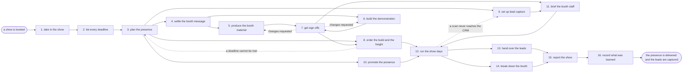

# Reference process: the trade show

`ref/mkt/trade-show v1`

A show is booked, and the organization has to arrive at it with a stand
that is built, a message that has been approved, a demonstration that
works, and people who know what to say. An event manager holds the
deadline list the show sets, gets the booth message and the material
made and signed, has the space and the freight ordered, sets up the way
visitors are recorded, briefs the people who will stand in the booth,
and reports what the show produced against what it was asked to
produce. The run stays open past the last show day, because the leads
still have to reach their owners and the show still has to be reported.

## The activities

| # | Activity | What happens | Seats |
|---|---|---|---|
| 1 | take in the show | what this show has to deliver, and by when | [event-manager](../../agents/event-manager.md) · leadership (person) |
| 2 | list every deadline | the exhibitor rules, the space limits, every due date | [event-operations](../../agents/event-operations.md) · event-manager |
| 3 | plan the presence | the booth, the staffing and the show-day schedule | event-manager · event-operations · leadership (person) |
| 4 | settle the booth message | the existing story cut down to booth size | [copywriter](../../agents/copywriter.md) · event-manager · subject matter expert (person) |
| 5 | produce the booth material | graphics, signage, handouts and the screen loop | [creative-producer](../../agents/creative-producer.md) · copywriter · [designer](../../agents/designer.md) · [video-editor](../../agents/video-editor.md) |
| 6 | build the demonstration | what a visitor is actually shown at the booth | creative-producer · designer · video-editor · subject matter expert (person) |
| 7 | get sign-offs | brand and legal approve the booth material | [brand-check](../../agents/brand-check.md) · brand owner (person) · legal reviewer (person) · rights approver (person) |
| 8 | order the build and the freight | the stand, the freight, power, internet, furniture | event-operations · finance (person) |
| 9 | set up lead capture | the scan, the fields, and the path into the CRM | [conversion-tracker](../../agents/conversion-tracker.md) · [lead-scorer](../../agents/lead-scorer.md) |
| 10 | promote the presence | say where the booth is and what is happening there | [campaign-manager](../../agents/campaign-manager.md) · [email-producer](../../agents/email-producer.md) · [community-manager](../../agents/community-manager.md) · account owner (person) |
| 11 | brief the booth staff | the pitch, the qualifying questions, the scan steps | event-manager · copywriter · event staff (person) |
| 12 | run the show days | the booth is staffed and every visitor is recorded | event staff (person) · event-manager · community-manager |
| 13 | hand over the leads | scored, routed, and the owner told the same day | lead-scorer · account owner (person) |
| 14 | break down the booth | teardown, return freight, and what is kept | event-operations |
| 15 | report the show | results set against what the show was meant to do | [analytics](../../agents/analytics.md) · event-manager |
| 16 | record what was learned | what to repeat, what to avoid | event-manager |

## The graph



## The document, with the blanks marked

```
PROCESS: trade show                   id: <team>/trade-show   v1
from: ref/mkt/trade-show v1
owner: <who>                          effective: <date>
trigger: a show is booked in <your event planning process>
concurrency: runs overlap - <how many> shows in preparation at once
goal: a stand that opens on time with signed material on it, a
      demonstration that works, briefed people in the booth, every
      visitor recorded, and a report against what the show was booked
      to deliver
phases:
  take-in-show     - human: read the booking and write down what this
                     show has to deliver, for whom, and by when
                     owner: event-manager       after: trigger
                     automation: <level>
  list-deadlines   - human: read the exhibitor rules onto a calendar -
                     every order date, space limit and shipping window
                     owner: event-operations    after: take-in-show
                     by: <days>                 automation: <level>
  plan-presence    - convenes decide-and-announce: the booth, the
                     staffing and the show-day schedule, told to
                     everyone at once against the deadline list
                     owner: event-manager       after: list-deadlines
                     automation: <level>
  settle-message   - convenes decide-and-announce: the existing
                     positioning cut down to what fits on a stand and
                     what a visitor hears in thirty seconds
                     owner: event-manager       after: plan-presence
                     by: <days>                 automation: <level>
  produce-material - runs build-by-talent: the graphics, the signage,
                     the handouts and the screen loop, each made to the
                     size the exhibitor rules allow
                     owner: creative-producer   after: settle-message
                     by: <days>                 automation: <level>
  build-demo       - runs build-by-talent: what a visitor is shown at
                     the booth, and the recorded version that runs when
                     the live one will not
                     owner: creative-producer   after: settle-message
                     by: <days>                 automation: <level>
  get-sign-offs    - convenes approval: brand, legal and rights sign,
                     as named signers, against a version of the booth
                     material and the demonstration
                     owner: <your legal seat>
                     after: produce-material + build-demo
                     by: <days>                 automation: never
  order-build      - human: the space, the stand, the freight, the
                     power, the internet and the furniture, each
                     ordered before the date the rules set
                     owner: event-operations
                     after: plan-presence + get-sign-offs
                     by: <days>                 automation: <level>
  lead-capture     - human: the scanning, the fields it writes, and the
                     path from a scan into the CRM, with one real scan
                     put through the whole path
                     owner: conversion-tracker  after: plan-presence
                     by: show open              automation: <level>
  promote-presence - human: the audience is told where the booth is and
                     what is happening there, and named customers are
                     asked for a meeting at the show
                     owner: campaign-manager    after: plan-presence
                     by: show open              automation: <level>
  brief-staff      - convenes briefing: the pitch, the qualifying
                     questions and the scan steps, heard by everyone
                     who will stand in the booth at once
                     owner: event-manager
                     after: get-sign-offs + lead-capture
                     by: show open              automation: <level>
  show-days        - human: the booth is staffed on the published
                     schedule, the demonstration runs, and every
                     visitor worth following up is scanned and noted
                     owner: event-manager
                     after: order-build + promote-presence + brief-staff
                     automation: never
  hand-over-leads  - human: every scan scored, routed to an owner, and
                     the owner told while the show is still on
                     owner: lead-scorer         after: show-days
                     by: <hours>                automation: <level>
  break-down       - human: the teardown, the return freight, and what
                     is kept for the next show
                     owner: event-operations    after: show-days
                     by: <days>                 automation: <level>
  report-show      - runs collect-and-report: the leads, the meetings,
                     the cost and the coverage, set against what the
                     show was booked to deliver
                     owner: event-manager
                     after: hand-over-leads + break-down
                     by: <weeks>                automation: <level>
  record-learnings - convenes debrief: what to repeat, what to avoid
                     owner: event-manager       after: report-show
                     automation: <level>
run-scoped:
  status - runs roll-call                       owner: event-manager
           every: <cadence>
           from: plan-presence   until: show open
  spend  - runs allocate-and-reconcile          owner: event-operations
           from: order-build   until: run close
  leads  - runs collect-and-report              owner: analytics
           every: <cadence>
           from: show-days   until: run close
handoffs:
  take-in-show -> list-deadlines: what the show has to deliver, in one
    line that every later decision can be tested against
  list-deadlines -> plan-presence: every due date, space limit and
    shipping window, each naming the rule it comes from
  plan-presence -> settle-message / order-build / lead-capture /
    promote-presence: the booth, the staffing and the schedule. Four
    branches read one plan
  settle-message -> produce-material: what the stand says, at the sizes
    the rules allow
  settle-message -> build-demo: what a visitor is shown, and the claims
    it is allowed to make
  produce-material + build-demo -> get-sign-offs: the material and the
    demonstration at a version
  get-sign-offs -> order-build: the approved graphics at the signed
    version, in time for the printing date, because print ships with
    the stand
  get-sign-offs -> brief-staff: the approved message, in the words the
    people in the booth will actually use
  lead-capture -> brief-staff: the scan steps, and what the person
    scanning has to say about consent
  brief-staff -> show-days: the pitch, the qualifying questions and the
    shift schedule, confirmed by each person who took a shift
  show-days -> hand-over-leads: every scan, with the note the person
    who took it wrote
  show-days -> break-down: what leaves the floor, and where it goes
  report-show -> record-learnings: the report, as delivered
bindings:
  roster:  <who holds each seat - agents claiming the abstract agents
           above, and named people for leadership, legal, brand,
           rights, finance, the account owners, and everyone standing
           in the booth>
  systems: the event record and its deadline list (write),
           the asset store (write),
           the ordering and shipment record (write, cap: <amount>),
           the lead capture system (read), the CRM (write),
           the scheduler (write), analytics (read)
  data:    the exhibitor rules for this show, the booking and what it
           cost, brand guidelines <version>, <your claims register>,
           the positioning document at a version
policy:
  nothing goes on the stand unsigned
  sign-off is a human gate and is never delegated to an agent
  material changed after sign-off goes back through sign-offs
  a visitor is told what the organization will do with their details
    before the scan, and a scan taken without that goes no further
  a deadline in the exhibitor rules is missed only when <who> accepts
    the cost of missing it, and the acceptance is recorded
  every shift in the booth has a named person on it before the show
    opens
measures:
  cycle time: <target> from the booking to the stand opening
  volume: <shows per period>
  lead handling: every scan reaches its owner within <hours>
  quality gate: nothing on the stand is unsigned, and no scan is
                loaded without its consent record
```

## The failure edges

- **A sign-off comes back with changes.** The run returns to the
  material or to the demonstration, and only the piece the signers
  named reopens. If the change lands after the print files went to the
  stand builder, the reprint cost and the shipping date go to <who>
  before anything is remade.
- **A deadline in the exhibitor rules cannot be met.** The run goes
  back to plan-presence, and the presence shrinks to what the remaining
  time and the late fees allow. The missed deadline is recorded against
  the plan, so the next show is planned from the real dates.
- **The freight does not arrive.** Event operations reports it the
  moment the tracking stops moving rather than on show morning, and
  <who> decides between a replacement stand, a smaller presence, and a
  reprint bought locally.
- **A scan never reaches the CRM.** The run goes back to lead-capture
  while the show is still running. Every scan taken during the outage
  is held and loaded once the path works again, and the report says how
  many were affected.
- **The demonstration breaks on the floor.** The booth falls back to
  the recorded version, the people in the booth are told what they may
  claim while it is down, and the failure goes into the report.
- **Nobody covers a shift.** The event manager escalates on the day the
  schedule shows the hole, because filling it is a person's decision
  and it should be made while travel can still be booked.
- **The show is cancelled or the organization withdraws.** Every order
  is cancelled against its own cancellation deadline, the spend line
  reconciles what cannot be recovered, and the material stays at its
  signed versions so a later show can use it.
- **The trigger fires while runs are in flight.** Shows overlap
  normally, and the concurrency line says how many. The event-manager
  seat takes one show at a time, so every run in flight needs its own
  holder of that seat, and the runs share their reference data
  read-only.
- **A run is abandoned.** The stand and the material stay at their
  versions, the orders are cancelled or held against their deadlines,
  any promotion already booked is pulled, and the spend line reconciles
  anyway.
