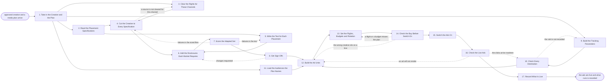

# Reference process: Traffic Ad Creative

`ref/mkt/traffic-ad-creative v1`

**value stream:** [Plan-to-Reconcile](../../streams/marketing/plan-to-reconcile.md)
An ad operations team takes creative that has already been approved and a
media plan that says which channels run when, and turns the two of them
into the ad units that actually serve. The creative is cut to every
placement's specification, the text is written inside each placement's
limits, the disclosures each market requires are added, and the adapted
versions are signed. The ads are then built in the platforms against the
plan's lines, with the tracking parameters and the audiences attached,
and one check reads every ad against the plan and the rules before
anything is switched on. That check is what stops money going out against
a broken link, a missing disclosure or the wrong creative on the wrong
line. The run closes once the ads are serving and somebody has written
down which creative is running where.

## The activities

| # | Activity | What happens | Agents |
|---|---|---|---|
| 1 | Take in the Creative and the Plan | which plan lines this creative has to fill | [media-buyer](../../agents/media-buyer.md) · [campaign-manager](../../agents/campaign-manager.md) |
| 2 | Read the Placement Specifications | the sizes, lengths and limits each placement takes | media-buyer · [creative-producer](../../agents/creative-producer.md) |
| 3 | Clear the Rights for These Channels | the sources are licensed for the channels in the plan | [rights-register](../../agents/rights-register.md) · rights approver (person) |
| 4 | Cut the Creative to Every Specification | one approved master becomes every size and length | creative-producer · [designer](../../agents/designer.md) · [video-editor](../../agents/video-editor.md) |
| 5 | Write the Text for Each Placement | headlines and body inside each placement's limits | [copywriter](../../agents/copywriter.md) |
| 6 | Add the Disclosures Each Market Requires | the line a market requires appears in the ad itself | copywriter · designer · [disclosure-check](../../agents/disclosure-check.md) |
| 7 | Score the Adapted Set | the sized set read against the standards and the rules | [brand-check](../../agents/brand-check.md) · disclosure-check · [accessibility-check](../../agents/accessibility-check.md) |
| 8 | Get Sign-Offs | named people sign the versions that will run | brand owner (person) · legal reviewer (person) |
| 9 | Build the Tracking Parameters | every ad carries the parameters its report reads | [conversion-tracker](../../agents/conversion-tracker.md) · media-buyer |
| 10 | Check Every Destination | the page each ad points at loads and records the visit | conversion-tracker · [web-producer](../../agents/web-producer.md) |
| 11 | Load the Audiences the Plan Names | the audiences reach the platforms with consent applied | [audience-handover](../../agents/audience-handover.md) · [audience-operator](../../agents/audience-operator.md) · [consent-manager](../../agents/consent-manager.md) |
| 12 | Build the Ad Units | campaigns, ad sets and ads, named to their plan line | media-buyer |
| 13 | Set the Flights, Budgets and Rotation | dates, daily money, and how the versions rotate | media-buyer · [media-planner](../../agents/media-planner.md) |
| 14 | Check the Buy Before Switch-On | every ad read against the plan line and the rules | [buy-check](../../agents/buy-check.md) · media-buyer |
| 15 | Switch the Ads On | the manager says go and the ads start serving | media-buyer · campaign-manager |
| 16 | Check the Live Ads | the ads render and the clicks reach the destination | buy-check · conversion-tracker · [analytics](../../agents/analytics.md) |
| 17 | Record What Is Live | which creative runs on which line, at a version | campaign-manager · media-buyer |

## The graph



## The document, with the blanks marked

```
PROCESS: traffic ad creative          id: <team>/traffic-ad-creative   v1
from: ref/mkt/traffic-ad-creative v1
owner: <who>                          effective: <date>
trigger: creative is approved against a media plan line in <your
         creative process>
concurrency: runs may overlap - <how many> live at once
goal: every plan line carrying ads that are sized to their placement,
      signed at the version that runs, pointed at a destination that
      records the visit, and checked against the plan before any of
      them serves
phases:
  take-in-creative   - human: read the approved creative and the plan,
                       and write down which lines this creative fills
                       and what each line is bought to do
                       owner: media-buyer         after: trigger
                       automation: <level>
  placement-specs    - human: the file sizes, the aspect ratios, the
                       durations and the character limits each
                       placement in the plan will take
                       owner: media-buyer         after: take-in-creative
                       by: <days>                 automation: <level>
  clear-rights       - runs assessment: every source under the creative
                       read against the channels and territories the
                       plan names, at the license versions in force
                       owner: rights-register     after: take-in-creative
                       by: <days>                 automation: <level>
  cut-the-set        - runs build-by-talent: the approved master cut to
                       every size and length the placements take,
                       without changing what the signers approved
                       owner: creative-producer
                       after: placement-specs + clear-rights
                       by: <days>                 automation: <level>
  write-the-text     - human: the headlines, the body text and the
                       calls to action, written inside each placement's
                       character limits
                       owner: copywriter          after: placement-specs
                       by: <days>                 automation: <level>
  add-disclosures    - human: the wording each market requires beside
                       the claim, the price or the offer, placed in the
                       ad itself where the rule says it has to appear
                       owner: copywriter
                       after: cut-the-set + write-the-text
                       by: <days>                 automation: <level>
  score-the-set      - runs assessment: the brand and claims pass, the
                       disclosure pass for each market, and the
                       accessibility pass on captions and contrast
                       owner: <your review role>  after: add-disclosures
                       by: <days>                 automation: <level>
  get-sign-offs      - convenes approval: brand and legal sign, as named
                       signers, against the adapted versions that will
                       actually run
                       owner: <your legal role>   after: score-the-set
                       by: <days>                 automation: never
  build-tracking     - human: the parameters each ad carries so that its
                       clicks arrive under the line it was bought on,
                       and the conversions that count for this run
                       owner: conversion-tracker  after: take-in-creative
                       by: <days>                 automation: <level>
  check-destinations - human: every destination opened as a visitor
                       opens it, with one real visit put through and
                       read back in the reporting
                       owner: conversion-tracker  after: build-tracking
                       by: switch-on              automation: <level>
  load-audiences     - human: the audiences the plan names, delivered
                       into the platforms with the consent record
                       applied and the match rate recorded
                       owner: audience-operator   after: take-in-creative
                       by: switch-on              automation: <level>
  build-ad-units     - human: the campaigns, the ad sets and the ads,
                       each named so that a person can tell which plan
                       line it belongs to without opening it
                       owner: media-buyer
                       after: get-sign-offs + check-destinations +
                              load-audiences
                       by: <days>                 automation: <level>
  set-flights        - human: the start and end dates, the daily money,
                       the bid and how the versions rotate against one
                       another, taken from the plan line
                       owner: media-buyer         after: build-ad-units
                       by: switch-on              automation: <level>
  check-the-buy      - runs assessment: every ad as configured read
                       against its plan line and the rules the buy was
                       placed under, before anything is switched on
                       owner: buy-check           after: set-flights
                       by: switch-on              automation: <level>
  switch-on          - human: the manager says go and the buyer turns
                       the ads on
                       owner: media-buyer         after: check-the-buy
                       automation: <level>
  check-live-ads     - runs assessment: the ads as they actually
                       served, read within <how long> of switch-on for
                       rendering, links and arriving conversions
                       owner: buy-check           after: switch-on
                       by: <hours>                automation: <level>
  record-live-set    - human: which creative runs on which line, with
                       its tracking, its audience and its flight,
                       written down at a version
                       owner: campaign-manager    after: check-live-ads
                       automation: <level>
run-scoped:
  status - runs roll-call                     owner: media-buyer
           every: <cadence>
           from: take-in-creative   until: switch-on
  spend  - runs allocate-and-reconcile        owner: media-buyer
           cap: <n>/day
           from: switch-on   until: run close
handoffs:
  take-in-creative -> placement-specs: the plan lines this creative
    fills, each with the channel, the dates and the audience it was
    bought against
  take-in-creative -> build-tracking: the same lines, so that the
    parameters are built against the plan while the ads are still being
    made
  take-in-creative -> load-audiences: the audience each line is bought
    against, at the version the plan named
  placement-specs -> cut-the-set: every placement's file size, aspect
    ratio, duration and safe area, in one list
  placement-specs -> write-the-text: every placement's character limits,
    field by field
  clear-rights -> cut-the-set: the verdict on each source, naming the
    channels and territories it is cleared for
  cut-the-set -> add-disclosures: the sized files at a version, with
    the space each required line will occupy
  write-the-text -> add-disclosures: the text at a version, field by
    field, inside the limits it was written to
  add-disclosures -> score-the-set: the adapted set at a version, with
    the market list each piece will run in
  score-the-set -> get-sign-offs: the scored list, with the rule and the
    market behind every failure
  get-sign-offs -> build-ad-units: the approved versions at the signed
    version. A piece changed afterward voids the approval and sign-offs
    run again
  build-tracking -> check-destinations: the parameters and the
    destinations they hang on, while the pages can still be changed
  check-destinations -> build-ad-units: a dated record showing a real
    visit arriving through each destination
  load-audiences -> build-ad-units: the audiences as loaded, with the
    count sent, the count accepted and the match rate
  build-ad-units -> set-flights: the units as built, each carrying the
    plan line it belongs to
  set-flights -> check-the-buy: the buy as configured, against the plan
    version it was placed under
  check-the-buy -> switch-on: the scored list, with the plan line or the
    rule behind every failure
  check-live-ads -> record-live-set: what actually served in the first
    hours, beside what was ordered
bindings:
  roster:  <who holds each role - agents claiming the abstract agents
           above, and named people for the brand, legal and rights
           agents>
  systems: ad platforms (write, cap: <n>/day),
           the audience tools in the ad platforms (write),
           the live campaigns (trigger),
           the asset store (write),
           tracking and URL tooling (write),
           analytics (write),
           the media plan record (read),
           the rights record (read),
           the consent record (read),
           the review record (write),
           the website (read)
  data:    brand guidelines <version>, <your claims register>,
           the disclosure rules for <each market the ads run in>
           <version>, <your accessibility standard> <version>,
           the approved creative at the version it was signed,
           the media plan <version>
policy:
  sign-off is a human gate and is never delegated to an agent
  an ad changed after sign-off goes back through sign-offs
  no ad switches on carrying a version the signers have not seen
  no ad switches on pointing at a destination that has not recorded a
    test visit
  an ad missing a disclosure its market requires does not run in that
    market
  a size cut for a channel the sources under it were never cleared for
    does not run on that channel
  a buy with a known failure switches on only when <who> accepts the
    failure in writing, and the acceptance is recorded with the failure
  every ad carries the tracking parameters for the line it runs on
measures:
  cycle time: <target> from the approved creative to the ads serving
  rework: ads rebuilt after the check before switch-on, against <n>
  volume: <ad units per period>
  quality gate: nothing switches on unsigned, pointed at a destination
                nobody has tested, or against a line the check could
                not match it to
```

## The failure edges

- **A sign-off comes back with changes.** The run returns to the
  disclosures, and where the signers named a file or a line of text it
  returns to the cut or to the writing. Only the pieces the signers
  named reopen, and the signers see the changed versions before any of
  them is loaded against a campaign.
- **A source turns out not to be cleared for a channel.** Cutting the
  set sends the run back to the rights check with the source and the
  channel named. The rights approver either clears it for that channel
  or the piece comes out of that channel's set, and the plan line loses
  a size until somebody decides what fills it.
- **A destination does not record the test visit.** The run goes back to
  the tracking parameters, and the ads pointing at that destination stay
  unbuilt until a visit arrives and is read back in the reporting. An ad
  that serves against a destination nobody has tested spends money the
  run cannot account for afterwards.
- **The check before switch-on finds a failure.** The findings go back
  with the plan line or the rule attached to each one. A wrong flight or
  a wrong budget goes back to the flights, and the wrong creative on a
  line goes back to the ad units. The buyer fixes what the findings name
  and the same check runs again on the fixed configuration. Switching on
  with a known failure is a decision a person makes and signs for.
- **An ad will not render once it is live.** The check on the live ads
  sends the run back to the ad units with the placement and the ad
  named. The buyer pauses that ad while it is rebuilt, because a
  placement that serves a broken ad keeps charging for it.
- **A required disclosure leaves no room in the layout.** The
  disclosure-check reports the rule and the market, and a person decides
  whether the layout changes, the claim comes out, or the ad stays out
  of that market. Running it without the line is not one of the choices.
- **The plan changes while the ads are being built.** A line whose
  dates, money or audience moved goes back through the flights and the
  check before switch-on, against the new plan version, and any ad
  already serving on that line is read against the new line within <how
  long>.
- **The trigger fires while runs are in flight.** Runs overlap normally
  and the concurrency line says how many. Two runs building against the
  same plan line will fight over its money, so the check before
  switch-on reads every run pointed at a line together.
- **A run is abandoned.** Somebody has to turn off whatever is already
  serving, because an abandoned run goes on spending until a person
  stops it. The sized files, the text and the loaded audiences stay
  where they are at their versions so a later run can pick them up, the
  tracking parameters stay in place so the clicks already bought can be
  counted, and the spend line reconciles anyway.
