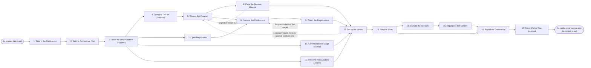

# Reference process: Host User Conference

`ref/mkt/user-conference v1`

**value stream:** [Story-to-Coverage](../../streams/marketing/story-to-coverage.md)
An event manager takes the date the company has committed to and works
out what this year's conference has to accomplish, settles the theme,
the format, the attendance target and the budget, and has the venue and
the suppliers booked under signed contracts. An event program manager
runs the call for sessions, picks the talks, builds the agenda and holds
every speaker to the deadline for their material. Registration opens, a
campaign fills the agents, and the reporters and the industry analysts
who cover the company are invited and booked into briefings. The
conference runs for its days, the sessions are recorded, and the talks
become articles, clips, posts and a page that holds them together. The
run stays open well past the last day, because the manager still owes a
report on what the conference produced and the recordings still have to
be turned into published material. Two parts of the work around a
conference are run by other processes. The sponsors and the exhibitors
on the floor run through the trade show process, because a sponsor at
this conference is an exhibitor doing exactly what that process
describes. Preparing a keynote speaker runs through the speaking
engagement process, and this process only makes sure the deck arrives on
time and clears the checks it has to clear.

## The activities

| # | Activity | What happens | Agents |
|---|---|---|---|
| 1 | Take in the Conference | what this year's conference has to accomplish | [event-manager](../../agents/event-manager.md) · leadership (person) |
| 2 | Set the Conference Plan | the theme, the format, the target and the budget | event-manager · leadership (person) · finance (person) |
| 3 | Book the Venue and the Suppliers | the space, the dates and the signed contracts | [event-operations](../../agents/event-operations.md) · event-manager · finance (person) · legal reviewer (person) |
| 4 | Open the Call for Sessions | customers and staff are asked to propose talks | [event-program](../../agents/event-program.md) · [advocacy-manager](../../agents/advocacy-manager.md) · [copywriter](../../agents/copywriter.md) |
| 5 | Choose the Program | keynotes settled, talks picked, the agenda built | event-program · event-manager · leadership (person) · subject matter expert (person) |
| 6 | Clear the Speaker Material | decks in on time, scored, and signed where needed | event-program · [brand-check](../../agents/brand-check.md) · legal reviewer (person) · rights approver (person) |
| 7 | Open Registration | the site, the sign-up and the tracking go live | event-manager · [web-producer](../../agents/web-producer.md) · [designer](../../agents/designer.md) · copywriter · [conversion-tracker](../../agents/conversion-tracker.md) · [accessibility-check](../../agents/accessibility-check.md) |
| 8 | Promote the Conference | email, social and paid work to fill the agents | [campaign-manager](../../agents/campaign-manager.md) · [email-producer](../../agents/email-producer.md) · [media-buyer](../../agents/media-buyer.md) · [community-manager](../../agents/community-manager.md) · copywriter |
| 9 | Watch the Registrations | the pace against the target, week by week | [analytics](../../agents/analytics.md) · event-manager |
| 10 | Commission the Stage Material | the set, the signage and the stage video | [creative-producer](../../agents/creative-producer.md) · event-operations |
| 11 | Invite the Press and the Analysts | reporters and analysts booked in and briefed | [press-relations](../../agents/press-relations.md) · event-manager |
| 12 | Set up the Venue | load in, dress the rooms, test the tech, rehearse | event-operations · event-program · event-manager · event staff (person) |
| 13 | Run the Show | the sessions run and someone fixes what breaks | event-manager · event-operations · community-manager · press-relations · event staff (person) |
| 14 | Capture the Sessions | recordings, photographs, quotes and notes collected | [video-editor](../../agents/video-editor.md) · [researcher](../../agents/researcher.md) · event-operations |
| 15 | Repurpose the Content | talks become pieces, clips, posts and a hub page | [content-manager](../../agents/content-manager.md) · creative-producer · campaign-manager · web-producer |
| 16 | Report the Conference | attendance, coverage and pipeline against the plan | analytics · event-manager · [coverage-monitor](../../agents/coverage-monitor.md) |
| 17 | Record What Was Learned | what to repeat, what to avoid | event-manager |

## The graph



## The document, with the blanks marked

```
PROCESS: user conference              id: <team>/user-conference   v1
from: ref/mkt/user-conference v1
owner: <who>                          effective: <date>
trigger: the annual date is set in <your planning process>
concurrency: one conference at a time - <what may overlap with the
             next one's planning>
goal: a conference that runs on its dates, fills the agents it planned
      for, gives the press and the analysts something worth writing
      about, and leaves behind material that keeps working afterwards
phases:
  take-in-date      - human: read the date and write down what this
                      year's conference has to accomplish and for whom
                      owner: event-manager       after: trigger
                      automation: <level>
  set-plan          - convenes decide-and-announce: the theme, the
                      format, the attendance target and the budget,
                      heard by every branch at once. <who> confirms
                      the budget
                      owner: event-manager       after: take-in-date
                      by: <months before>        automation: <level>
  book-venue        - human: the quotes, the orders and the contracts
                      for the space and the suppliers, each recorded
                      with the date it must be cancelled by
                      owner: event-operations    after: set-plan
                      by: <months before>        automation: <level>
  call-sessions     - human: the call says what a proposal has to
                      contain and the date it closes
                      owner: event-program       after: book-venue
                      by: <weeks>                automation: <level>
  choose-program    - runs assessment: every proposal scored against
                      the selection criteria at their version, and the
                      chosen sessions put in an order
                      owner: event-program       after: call-sessions
                      by: <weeks>                automation: <level>
  clear-material    - runs collect-and-report: every deck, bio and
                      signed permission chased to its deadline, scored
                      against brand and claims, and signed by a person
                      where the talk announces something
                      owner: event-program       after: choose-program
                      by: <weeks before>         automation: <level>
  open-registration - human: the registration site, the sign-up form,
                      the tracking into the CRM, and the accessibility
                      and technical check on the finished page
                      owner: web-producer        after: book-venue
                      by: <months before>        automation: <level>
  promote           - human: the invitations, the social posts and the
                      paid distribution that fill the agents
                      owner: campaign-manager
                      after: open-registration + choose-program
                      automation: <level>
  watch-signups     - runs collect-and-report: registrations against
                      the target, on the cadence the process sets
                      owner: analytics           after: promote
                      automation: <level>
  stage-material    - runs build-by-talent: the set, the signage, the
                      slide template and the stage video
                      owner: creative-producer   after: book-venue
                      by: <weeks before>         automation: <level>
  invite-press      - human: which reporters and analysts are invited,
                      what each of them is told, and the briefings
                      booked around the sessions
                      owner: press-relations     after: book-venue
                      by: <weeks before>         automation: <level>
  set-up-venue      - human: the load-in, the rooms, the badges, the
                      equipment test and the speaker rehearsal
                      owner: event-operations
                      after: clear-material + watch-signups +
                             stage-material + invite-press
                      automation: <level>
  run-show          - human: the sessions run, and the manager makes
                      the calls when something has to change
                      owner: event-manager       after: set-up-venue
                      automation: <level>
  capture-sessions  - runs build-by-talent: the recordings, the
                      photographs, the quotes and the notes, each one
                      attributed to the session it came from
                      owner: event-operations    after: run-show
                      by: <days>                 automation: <level>
  repurpose         - human: the talks become articles, clips and
                      posts, and a page that holds them together
                      owner: content-manager
                      after: capture-sessions
                      by: <weeks>                automation: <level>
  report-conference - runs collect-and-report: attendance, coverage
                      and pipeline set against what the conference was
                      asked to deliver
                      owner: event-manager
                      after: run-show + repurpose
                      by: <weeks>                automation: <level>
  record-learnings  - convenes debrief: what to repeat, what to avoid
                      owner: event-manager
                      after: report-conference
                      automation: <level>
run-scoped:
  status   - runs roll-call                    owner: event-manager
             every: <cadence>
             from: set-plan   until: run-show
  spend    - runs allocate-and-reconcile       owner: event-operations
             from: book-venue   until: run close
  coverage - runs collect-and-report           owner: coverage-monitor
             every: <cadence>
             from: invite-press   until: run close
handoffs:
  take-in-date -> set-plan: what the conference has to accomplish and
    for whom, in one line every later decision can be tested against
  set-plan -> book-venue: the dates, the format, the attendance target
    and the budget a person confirmed
  book-venue -> call-sessions / open-registration / stage-material /
    invite-press: the venue, the dates and the deadline list. Four
    branches read one record
  book-venue -> set-up-venue: the load-in window, the room list, and
    every deadline the venue's own rules impose
  call-sessions -> choose-program: every proposal that arrived, with
    the verdict it was given and the criterion behind that verdict
  choose-program -> clear-material: the chosen sessions, each with its
    speaker, its room, its time slot and what that speaker owes
  choose-program -> promote: the agenda at a version, and what the
    campaign may say about it
  clear-material -> set-up-venue: each deck at the version that was
    scored and signed, and the signed permission to record the session
  promote -> watch-signups: what went out, on which channel, and when
  watch-signups -> set-up-venue: the headcount the catering, the badges
    and the room sets are built from
  invite-press -> run-show: who is coming, what each of them was told,
    and what each of them asked for
  run-show -> capture-sessions: the sessions as they were actually
    given, with what was recorded and what was not
  capture-sessions -> repurpose: the recordings, the photographs, the
    quotes and the notes, each attributed to its session, and the
    permission that covers each one
  run-show -> report-conference: attendance against the target, and
    every call that was made on the day
  repurpose -> report-conference: what was published out of the
    conference, where it went, and how it performed
  report-conference -> record-learnings: the report, as delivered
bindings:
  roster:  <who holds each role - agents claiming the abstract agents
           above, and named people for leadership, finance, legal, the
           expert, the rights approver and the staff on site>
  systems: the event plan and its schedule (write),
           the invitation and attendance record (write),
           the order and contract record (write),
           supplier ordering and booking systems (write, cap: <n>),
           the session proposal store (write),
           the agenda and its schedule (write),
           the speaker record (write), the website (write),
           the sending system (write),
           the live sends (trigger, cap: <n> contacts),
           ad platforms (write, cap: <n>/day), the CRM (write),
           analytics (read), the asset store (write),
           the recording store (write),
           the press and analyst contact record (write),
           the coverage record (write)
  data:    brand guidelines <version>, <your claims register>,
           <your accessibility standard> <version>, the venue and
           supplier contracts, the exhibitor and venue rules at the
           version the venue published, <your session selection
           criteria> <version>, the conference plan at a version
policy:
  nothing customer-facing publishes unsigned, and a deck given from
    the main stage counts as customer-facing
  sign-off is a human gate and is never delegated to an agent
  a talk that announces something is read by a legal reviewer before
    it is given
  no order is placed and no contract is signed past <the limit>
    without a person approving it first
  a session is recorded and published only where the speaker signed a
    permission that covers it
  cancelling or postponing the conference is a person's decision, and
    the decision is recorded with the reason for it
  a change of date reaches every branch on the day it is made
measures:
  cycle time: <months> from the date being set to the doors opening
  attendance: <target> registered, <target> in the room
  content: <n> sessions published within <weeks> of the last day
  quality gate: every session that was permitted is recorded, and the
                report is delivered within <days> of the last day
```

## The failure edges

- **Registration is behind the target.** The agents watching the
  registrations send the run back to promote the conference as soon as
  the pace says the target is out of reach, and <who> decides whether
  more money goes into filling agents or the plan changes. Finding it
  out in the last two weeks is the failure this activity exists to
  prevent.
- **A speaker drops out.** The run goes back to choose the program,
  which either replaces the speaker or cuts the session and closes the
  gap in the agenda. Every speaker whose slot moves is told on the day
  it moves.
- **A deck fails its score or its sign-off.** The findings go back to
  the speaker with the rule attached to each one, and the same check
  runs again on what comes back. A deck that never clears means the
  session is cut, and that decision belongs to a person.
- **The venue cannot host the program as planned.** A room that turns
  out to be the wrong size or the wrong shape sends the run back to
  choose the program, the agenda changes, and every speaker and every
  registrant hears about the change.
- **A supplier misses its date.** The operations agent says so on the
  day it becomes clear instead of on the day of the event, and a person
  decides whether to reorder, replace the supplier, or run the
  conference without what was ordered.
- **Something goes wrong during the show.** The manager makes the call
  and records what was decided and when. An injury, a security problem,
  or anything that could reach the press goes to a person immediately,
  before anybody says anything in public.
- **A speaker will not let their session be published.** The session
  stays out of the repurposing, the report says so, and nobody publishes
  it on the strength of a permission that was never given.
- **The conference is cancelled or postponed.** A person makes that
  call. Every order that can still be cancelled is cancelled inside its
  deadline, the registrants and the speakers are told, the press
  invitations are withdrawn, and the spend line reconciles what was
  already committed anyway.
- **A run is abandoned.** The agenda, the speaker material and the
  recordings stay where they are at their versions, so a later run can
  pick them up. Any promotion already booked is cancelled, the
  registration page comes down and its address is released, and the
  books close on what was spent.
