# Reference process: Verify Ad Placement Quality

`ref/mkt/verify-ad-placement v1`

**value stream:** [Plan-to-Reconcile](../../streams/marketing/plan-to-reconcile.md)
Somebody raises a concern that the ads did not run where they were meant
to, and this process finds out where they actually ran. The audit sets
out which accounts, campaigns, channels and dates it covers, reads the
placement rules at the version in force, and pulls two records: every
site, app and channel the ads served on, and the delivery quality
figures for those impressions. Every placement gets a verdict against a
rule, and each flagged placement is captured as the ad appeared, so that
the person deciding sees the content the ad ran beside. Named people
then decide which placements are excluded, which are contested with the
seller, and which are accepted with the reason written down. The
exclusions go into the ad platforms, a later reading confirms the ads
have stopped serving in those places, the wasted spend goes back to
whoever billed it, and the agreed exclusions are issued as a new version
of the standing lists so that every future buy reads them.

## The activities

| # | Activity | What happens | Agents |
|---|---|---|---|
| 1 | Take in the Concern | what was seen, where it ran, and what raised it | [media-buyer](../../agents/media-buyer.md) · [buy-check](../../agents/buy-check.md) |
| 2 | Set What the Audit Covers | which accounts, campaigns, channels and dates | buy-check · media-buyer |
| 3 | Confirm the Rules in Force | the placement rules at the version that applies | [standards-keeper](../../agents/standards-keeper.md) · buy-check |
| 4 | Pull the Placement Record | every site, app and channel the ads actually ran on | [analytics](../../agents/analytics.md) · media-buyer |
| 5 | Pull the Delivery Quality Figures | viewability, measured share, and invalid traffic | analytics · buy-check |
| 6 | Score Every Placement | each placement gets a verdict citing a rule | buy-check |
| 7 | Look at the Flagged Placements | the ad captured on the page as it appeared | buy-check |
| 8 | Size What It Cost | impressions and money on the failing placements | buy-check · analytics |
| 9 | Decide What Happens to Each | exclude it, contest it, or accept it and say why | media-buyer · buy-check · brand owner (person) · legal reviewer (person) |
| 10 | Apply the Exclusions | block lists and inventory settings are changed | media-buyer |
| 11 | Confirm the Exclusions Hold | a later reading shows the ads gone from those places | buy-check · analytics |
| 12 | Claim Back the Wasted Spend | the failed impressions go back to whoever billed them | [spend-reconciler](../../agents/spend-reconciler.md) · media-buyer |
| 13 | Update the Standing Lists | the agreed exclusions are issued at a new version | standards-keeper · brand owner (person) |
| 14 | Report the Audit | what ran where, what failed, and what it cost | buy-check · analytics |
| 15 | Record What Was Learned | which channels and sellers to check first next time | buy-check · media-buyer |

## The graph

```mermaid
flowchart LR
  T([a brand safety or viewability concern]) --> A1[1. Take in the Concern]
  A1 --> A2[2. Set What the Audit Covers]
  A2 --> A3[3. Confirm the Rules in Force]
  A2 --> A4[4. Pull the Placement Record]
  A4 --> A5[5. Pull the Delivery Quality Figures]
  A3 --> A6[6. Score Every Placement]
  A4 --> A6
  A5 --> A6
  A6 --> A7[7. Look at the Flagged Placements]
  A7 -. the record does not cover the concern .-> A4
  A7 --> A8[8. Size What It Cost]
  A8 --> A9[9. Decide What Happens to Each]
  A9 -. a placement needs a closer look .-> A7
  A9 --> A10[10. Apply the Exclusions]
  A9 --> A12[12. Claim Back the Wasted Spend]
  A10 --> A11[11. Confirm the Exclusions Hold]
  A11 -. the ads are still serving there .-> A10
  A11 --> A13[13. Update the Standing Lists]
  A12 --> A14[14. Report the Audit]
  A13 --> A14
  A14 --> A15[15. Record What Was Learned]
  A15 --> DONE([the placements are audited and the exclusions applied])
```



## The document, with the blanks marked

```
PROCESS: verify ad placement quality  id: <team>/verify-ad-placement  v1
from: ref/mkt/verify-ad-placement v1
owner: <who>                          effective: <date>
trigger: a brand safety or viewability concern is raised about ads that
         are running or have already run
concurrency: <how many> audits at once, one per <account or market>
goal: every placement in scope carries a verdict against a rule, the
      failing placements are excluded and the exclusions confirmed, the
      wasted spend is claimed back, and the standing lists carry what
      was agreed
phases:
  take-in-concern    - human: write down what was seen, where it ran,
                       and what raised it
                       owner: media-buyer        after: trigger
                       automation: <level>
  set-the-scope      - human: the accounts, campaigns, channels and
                       dates this audit covers
                       owner: buy-check          after: take-in-concern
                       by: <days>                automation: <level>
  confirm-rules      - human: the placement rules and the exclusion
                       lists at the version in force on those dates
                       owner: standards-keeper   after: set-the-scope
                       automation: <level>
  pull-placements    - runs collect-and-report: every site, app and
                       channel the ads served on, from every platform
                       owner: analytics          after: set-the-scope
                       by: <days>                automation: <level>
  pull-quality       - runs collect-and-report: viewability, measured
                       share and invalid traffic for those impressions
                       owner: analytics          after: pull-placements
                       by: <days>                automation: <level>
  score-placements   - runs assessment: a verdict per placement, each
                       citing the rule and the version it was read at
                       owner: buy-check
                       after: confirm-rules + pull-placements
                              + pull-quality
                       by: <days>                automation: <level>
  view-flagged       - human: the ad captured as it appeared on the
                       page or in the video, beside its verdict
                       owner: buy-check          after: score-placements
                       automation: <level>
  size-the-waste     - human: the impressions and the money that went
                       to the failing placements
                       owner: buy-check          after: view-flagged
                       automation: <level>
  decide-each        - convenes approval: brand and legal decide each
                       flagged placement as named signers
                       owner: <your brand role>  after: size-the-waste
                       by: <days>                automation: never
  apply-exclusions   - human: the block lists and the inventory
                       settings in every platform the ads run on
                       owner: media-buyer        after: decide-each
                       by: <days>                automation: <level>
  confirm-exclusions - human: read the placement record again and say
                       whether the ads have stopped serving there
                       owner: buy-check
                       after: apply-exclusions
                       by: <days>                automation: <level>
  claim-the-spend    - human: the failing impressions go back to
                       whoever billed them, with the amount on each
                       owner: spend-reconciler   after: decide-each
                       automation: <level>
  update-lists       - convenes decide-and-announce: the agreed
                       exclusions are issued as a new version
                       owner: standards-keeper
                       after: confirm-exclusions
                       automation: <level>
  report-audit       - runs collect-and-report: what ran where, what
                       failed, what it cost, and what was excluded
                       owner: buy-check
                       after: update-lists + claim-the-spend
                       by: <days>                automation: <level>
  record-learnings   - convenes debrief: which channels and sellers to
                       check first next time
                       owner: buy-check          after: report-audit
                       automation: <level>
run-scoped:
  status - runs roll-call                   owner: buy-check
           every: <cadence>
           from: set-the-scope   until: run close
handoffs:
  take-in-concern -> set-the-scope: what was seen and where, in enough
    detail that somebody else can look for the same thing
  set-the-scope -> confirm-rules: the accounts, campaigns, channels and
    dates, and the dates the rules have to be read at
  set-the-scope -> pull-placements: the same scope. Both branches read
    one record
  confirm-rules -> score-placements: the placement rules and the
    exclusion lists at their versions
  pull-placements -> score-placements: every placement the ads served
    on, with the impressions and the spend against each one
  pull-quality -> score-placements: viewability, measured share and
    invalid traffic, each attributed to the source it came from
  score-placements -> view-flagged: the verdicts, each naming the rule
    and the version it was scored against
  view-flagged -> size-the-waste: the flagged placements, each with the
    capture of the ad as it appeared
  size-the-waste -> decide-each: the flagged placements with the
    impressions and the money on each one
  decide-each -> apply-exclusions: the placements to exclude, and which
    platform each one has to be excluded in
  decide-each -> claim-the-spend: the placements the buy will contest,
    with the amount at stake on each
  apply-exclusions -> confirm-exclusions: what was changed in each
    platform, and when the change took effect
  confirm-exclusions -> update-lists: the exclusions that hold, ready
    to be issued to every future buy
  update-lists -> report-audit: the new version of the lists and the
    date it takes effect
  report-audit -> record-learnings: the report, as delivered
bindings:
  roster:  <who holds each role - agents claiming the abstract agents
           above, and named people for the brand and legal agents>
  systems: ad platforms (write: exclusion lists and inventory settings;
           read: the placement and delivery record),
           the delivery verification record (read),
           analytics platforms (read),
           the audit record (write), the review record (write),
           the standards store (write),
           the media plan and its orders (read),
           the reconciliation record (write),
           the notification channel (write), the report store (write)
  data:    <your placement rules> <version>, <your exclusion lists>
           <version>, brand guidelines <version>, <your viewability
           floor and invalid traffic ceiling> <version>, the concern
           that opened the audit
policy:
  every placement in scope gets a verdict, and every verdict cites the
    rule and the version it was scored against
  the agent that bought the placements does not score them
  a flagged placement is accepted only when <who> accepts it in
    writing, and the reason is recorded against the placement
  an exclusion is not closed until a later reading shows the ads have
    stopped serving there
  a placement that raises a legal question goes to <your legal role>
    before it is contested or accepted
  a placement that breaks a rule goes to <who> on the day it is found,
    whatever the audit still has left to score
  the standing exclusion lists change only at a new version, approved
    by <who>, and every live buy is told what changed and from when
  a credit is agreed by a person and is never delegated to an agent
measures:
  cycle time: <target> from the concern to the exclusions in force
  coverage: <share> of the period's impressions carrying a placement
            record the audit could read
  waste: <target> share of spend on placements that failed a rule
  quality gate: no placement in scope closes without a verdict
```

## The failure edges

- **The placement record does not cover the concern.** The platform
  reports at a level too coarse to name the site or the app the ad ran
  on. The run goes back to pull-placements, the buying agent asks the
  platform for the detail while the money is still being spent, and the
  placements nobody can see are recorded as unverified.
- **A flagged placement turns out to be acceptable.** The signers accept
  it and write the reason against the placement, and a later audit does
  not flag the same placement again unless the rule has changed.
- **The exclusions do not hold.** The later reading shows ads still
  serving in a place that was excluded. The run returns to
  apply-exclusions, the buying agent applies the exclusion again at the
  level the platform actually enforces, and the reading runs a second
  time.
- **The seller will not accept the claim.** The contested line goes to
  `ref/mkt/reconcile-media-spend` as an open line with its amount, and
  finance decides there whether it is withheld, written off or paid.
  This process settles no money.
- **A new version of the lists fails a buy that is already running.**
  The standards-keeper agent tells every live buy what changed and from
  when, and <who> decides whether the running placements come off
  straight away or at the end of the flight.
- **The trigger fires while a run is in flight.** A second concern about
  the same accounts and dates joins the audit already open. A concern
  about different accounts opens its own run, and the runs read the
  placement rules and the exclusion lists read-only.
- **A run is abandoned.** The verdicts recorded so far stay at their
  version, so a later audit can start from them. Any exclusion already
  applied stays applied, and the placements that were decided but not
  yet excluded go to the buying agent as an open list.
