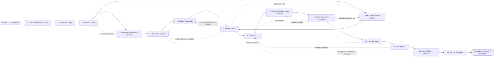

# Reference process: Produce Video Asset

`ref/mkt/video-asset v1`

**value stream:** [Idea-to-Asset](../../streams/marketing/idea-to-asset.md)
A creative producer takes a script or a brief, settles the words and the
shot list, has the rights on every source checked before anyone cuts,
gets the material recorded and assembled, sends the cut through a
review, a scoring and a sign-off, has the platform versions cut from the
signed master, and files the finished video in the library with the
sources it rests on recorded against it. The captions and the transcript
are written before the video is scored, because most of the audience
watches with the sound off and the captions are part of what gets
signed. A brief that asks for copy, images and video together runs
`ref/mkt/creative-assets`, and this process is what the video part of
that work expands into when a video is the whole job.

## The activities

| # | Activity | What happens | Agents |
|---|---|---|---|
| 1 | Take in the Script or Brief | work out what the video must do and how long | [creative-producer](../../agents/creative-producer.md) |
| 2 | Settle the Script | the words and the order, written or confirmed | creative-producer · [copywriter](../../agents/copywriter.md) · [editor](../../agents/editor.md) |
| 3 | Plan the Shots | every shot listed, and where it comes from | creative-producer · [video-editor](../../agents/video-editor.md) · [designer](../../agents/designer.md) |
| 4 | Check the Sources Can Be Used | clips, music and fonts checked before anyone cuts | [rights-register](../../agents/rights-register.md) · creative-producer |
| 5 | Record the Material | the shoot, the screen capture, the narration | creative-producer · video-editor · subject matter expert (person) |
| 6 | Build the Rough Cut | the shots in order, timed to the script | video-editor |
| 7 | Make the On-Screen Graphics | titles, lower thirds, motion and the end card | designer · video-editor |
| 8 | Review the Cut | what has to be re-cut, said item by item | creative-producer · editor · subject matter expert (person) |
| 9 | Finish the Cut | sound mixed, color and pacing settled | video-editor |
| 10 | Write the Captions and Transcript | captions timed to the audio, transcript written | video-editor · copywriter |
| 11 | Score against the Standards | brand, claims, captions and contrast, all cited | [brand-check](../../agents/brand-check.md) · [accessibility-check](../../agents/accessibility-check.md) |
| 12 | Clear the Rights | a person confirms every clip, track and face | rights approver (person) · creative-producer · rights-register |
| 13 | Get Sign-Offs | brand and legal approve the finished video | brand owner (person) · legal reviewer (person) |
| 14 | Cut the Platform Versions | each length and shape the brief asks for | video-editor |
| 15 | File It in the Library | the cuts filed with what each may be used for | creative-producer · rights-register |

## The graph



## The document, with the blanks marked

```
PROCESS: produce video asset          id: <team>/video-asset   v1
from: ref/mkt/video-asset v1
owner: <who>                          effective: <date>
trigger: a script or a brief is approved in <your requesting process>
concurrency: runs may overlap - <how many> videos in production at once
goal: a video that brand and legal have signed, captioned and
      transcribed, cut to every length and shape the brief asks for, and
      filed in the library with the sources under it recorded
phases:
  take-in-brief    - human: read the script or the brief and write down
                     what the video has to do, for whom, and how long it
                     can run
                     owner: creative-producer  after: trigger
                     automation: <level>
  settle-script    - human: the words and the order, written from the
                     brief or confirmed against the script that arrived
                     owner: creative-producer  after: take-in-brief
                     by: <days>                automation: <level>
  plan-shots       - human: every shot the script needs, listed with
                     where the material for it comes from
                     owner: creative-producer  after: settle-script
                     by: <days>                automation: <level>
  check-sources    - runs assessment: every proposed clip, track, font
                     and face, scored against what the licenses allow on
                     the channels this video will run on
                     owner: rights-register    after: plan-shots
                     by: <days>                automation: <level>
  record-material  - runs build-by-talent: the shoot, the screen
                     capture and the narration
                     owner: creative-producer  after: check-sources
                     by: <days>                automation: <level>
  make-graphics    - human: the titles, the lower thirds, the motion
                     and the end card
                     owner: designer           after: plan-shots
                     by: <days>                automation: <level>
  rough-cut        - human: the shots in the order the script sets,
                     timed to the narration
                     owner: video-editor       after: record-material
                     by: <days>                automation: <level>
  review-cut       - runs layered-passes: the editor pass on what the
                     cut says, and the expert pass on whether what it
                     shows is accurate
                     owner: creative-producer
                     after: rough-cut + make-graphics
                     by: <days>                automation: <level>
  finish-cut       - human: the sound mixed, the color settled and the
                     pacing tightened
                     owner: video-editor       after: review-cut
                     by: <days>                automation: <level>
  write-captions   - human: captions timed to the audio, and a
                     transcript of what is spoken and what is shown
                     owner: video-editor       after: finish-cut
                     by: <days>                automation: <level>
  score-standards  - runs assessment: brand and claims, and captions,
                     contrast and type size, every verdict citing the
                     rule it was scored on
                     owner: creative-producer  after: write-captions
                     automation: <level>
  clear-rights     - human: <who> confirms the organization holds every
                     clip, track, font and appearance in the cut
                     owner: <your rights approver>
                     after: score-standards    by: <days>
                     automation: never
  get-sign-offs    - convenes approval: brand and legal sign, as named
                     signers, against a version of the video
                     owner: <your legal role>  after: clear-rights
                     by: <days>                automation: never
  cut-versions     - runs build-by-talent: every length and aspect
                     ratio the brief asks for, cut from the signed
                     master
                     owner: video-editor       after: get-sign-offs
                     by: <days>                automation: <level>
  file-in-library  - human: every cut filed at its version, saying what
                     each may be used for and until when
                     owner: creative-producer  after: cut-versions
                     automation: <level>
run-scoped:
  status  - runs roll-call                     owner: creative-producer
            every: <cadence>
            from: plan-shots   until: file-in-library
  sources - runs collect-and-report            owner: rights-register
            every: <cadence>
            from: check-sources   until: file-in-library
handoffs:
  take-in-brief -> settle-script: what the video has to do, for whom,
    and the length it has to come in under
  settle-script -> plan-shots: the script at a version, which is what
    every later cut is timed against
  plan-shots -> check-sources: every shot, and the source the material
    for it would come from
  plan-shots -> make-graphics: the shots that carry a title, a lower
    third or a caption on screen
  check-sources -> record-material: a verdict per source, each citing
    the license term behind it, so nobody records against a refusal
  record-material -> rough-cut: the recorded material, with the take
    that was chosen for each shot
  rough-cut + make-graphics -> review-cut: the cut at a version, with
    the graphics placed
  review-cut -> finish-cut: the changes, item by item, in terms the
    video-editor can work through without coming back to ask
  finish-cut -> write-captions: the cut as it will be watched, because
    captions timed to a cut that still moves have to be timed again
  write-captions -> score-standards: the video, its captions and its
    transcript, all at one version
  score-standards -> clear-rights: the scores, so the people who sign
    read the exceptions instead of everything
  clear-rights -> get-sign-offs: every source in the cut, named, with
    the rights record entry that cleared it
  get-sign-offs -> cut-versions: the approved video at the signed
    version. A later change voids the approval and sign-offs run again
  cut-versions -> file-in-library: every platform version, named
    against the master it was cut from
bindings:
  roster:  <who holds each role - agents claiming the abstract agents
           above, and named people for the expert, rights, brand and
           legal>
  systems: the asset store (write), the rights record (write),
           licensed footage, music and font sources (read),
           the production plan (write), the review record (write)
  data:    the script or the brief, brand guidelines <version>,
           <your claims register>, <your accessibility standard>
           <version>, the licenses the organization holds
policy:
  no source is built on until the rights record says it may be used on
    the channels this video will run on
  nothing leaves this process without captions and a transcript
  a person signs, and the sign-off is never delegated to an agent
  a video changed after sign-off is scored again and signed again
  every claim spoken or shown on screen cites <your claims register>
  the expert the video rests on confirms it is accurate before it is
    signed
measures:
  cycle time: <target> from the brief to the video in the library
  volume: <videos per period>
  rework: <how many> videos come back from sign-off with changes
  quality gate: nothing files unsigned, nothing files without captions,
                and nothing files with a rights question still open
```

## The failure edges

- **A source is refused before production.** The rights register records
  the source as uncleared with the term that refuses it, and the run
  goes back to the shot plan. The producer finds material the
  organization holds, and the run does not settle it by recording
  against the source anyway. This check sits before the shoot on
  purpose, because a cut built around a track that cannot be licensed
  has to be built again.
- **A source is refused at the rights clearance.** The run goes back to
  recording the material, because replacing a clip or a face this late
  means something new has to be recorded. The refusal is recorded
  against the video, and the review and the scoring run again on what
  comes back.
- **The review sends the cut back.** Only the shots the review named
  reopen. When the review finds a shot nobody recorded, the run returns
  to recording that one shot and the rest of the cut stays where it is.
- **A standard fails.** Brand-check and accessibility-check report every
  failure with the rule attached. A caption failure goes back to the
  captions, a contrast or type failure goes back to the graphics, and
  everything else goes back to the finished cut. The same scoring runs
  again on the fix. Only a person can waive a finding, and that decision
  is recorded with the failure attached to it.
- **The expert will not confirm the video.** The run stops before the
  sign-offs and <who> decides whether the video is re-cut, held, or
  dropped. Publishing it while the expert says it is wrong is not one of
  the choices.
- **A length cannot carry the message.** The video-editor says which
  version cannot be cut to the length or the shape the brief asks for,
  and the run goes back to the finished cut so the message can be
  shortened in the master. Dropping that platform version instead is a
  person's decision.
- **A license behind a filed video runs out.** The rights register warns
  the agents that own the video before the date, and a person decides
  whether the license is renewed, the source is replaced, or the cuts
  come down. The library entry says what each cut may be used for and
  until when, so the question gets asked before anyone reuses it.
- **The trigger fires while runs are in flight.** Videos overlap
  normally, and the concurrency line says how many. Runs share the brand
  guidelines, the claims register, the accessibility standard and the
  rights record read-only.
- **A run is abandoned.** The recorded material, the rough cut and the
  graphics stay where they are at their versions, so a later run can
  start from them. The rights register keeps the verdicts it already
  gave and the dates it gave them on, and any source licensed for this
  video alone is reported to the person who pays for it.
