# Reference process: Produce Webinar

`ref/mkt/webinar v1`

**value stream:** [Brief-to-Results](../../streams/marketing/brief-to-results.md)
An event manager takes a topic and a date, settles what the session
covers and who presents it, has the broadcast set up and the
registration page built, fills the registration list, rehearses the
presenters, runs the session on the day, and hands off the recording and
the people who registered. The session can be a product demonstration, a
customer panel or a briefing with an outside expert, and the activities
are the same for all of them. The run stays open past the session,
because the manager still owes the follow-up, the recording and the
report.

## The activities

| # | Activity | What happens | Agents |
|---|---|---|---|
| 1 | Take in the Topic and Date | work out what the session must do and for whom | [event-manager](../../agents/event-manager.md) |
| 2 | Settle the Format and the Presenters | the session shape, its length, and who presents | event-manager · [event-program](../../agents/event-program.md) · subject matter expert (person) |
| 3 | Set up the Session in the Platform | the broadcast session and its registration form | [broadcast-operator](../../agents/broadcast-operator.md) · event-manager |
| 4 | Build the Registration Page | the page and the tracking on its form | [web-producer](../../agents/web-producer.md) · [conversion-tracker](../../agents/conversion-tracker.md) |
| 5 | Produce the Promotion Material | the invitation, the ads and the social posts | [creative-producer](../../agents/creative-producer.md) · [copywriter](../../agents/copywriter.md) · [designer](../../agents/designer.md) |
| 6 | Get Sign-Offs | brand and legal approve the material | [brand-check](../../agents/brand-check.md) · brand owner (person) · legal reviewer (person) |
| 7 | Build the Invitation Audience | who is invited, with the consent rules applied | [audience-manager](../../agents/audience-manager.md) · [consent-manager](../../agents/consent-manager.md) |
| 8 | Promote the Session | email, social and paid, pointed at registration | [campaign-manager](../../agents/campaign-manager.md) · [email-producer](../../agents/email-producer.md) · [media-buyer](../../agents/media-buyer.md) · [community-manager](../../agents/community-manager.md) |
| 9 | Work the Registration List | confirm, remind, and chase the number needed | email-producer · event-manager |
| 10 | Build the Presentation | the slides and the demo, built to the agenda | event-program · designer · subject matter expert (person) |
| 11 | Rehearse the Session | every presenter connects and runs their part | broadcast-operator · event-program · subject matter expert (person) |
| 12 | Run the Session | the broadcast goes live and keeps to time | broadcast-operator · event-manager · [moderator](../../agents/moderator.md) · subject matter expert (person) |
| 13 | Hand over What the Session Produced | the recording, attendance, polls and questions | broadcast-operator |
| 14 | Prepare the Recording for Reuse | the cut, the captions, and the page it sits on | [video-editor](../../agents/video-editor.md) · web-producer · [accessibility-check](../../agents/accessibility-check.md) · [content-librarian](../../agents/content-librarian.md) · [rights-register](../../agents/rights-register.md) |
| 15 | Follow up with the Registrants | the recording and answers to what was asked | email-producer · copywriter · [lifecycle-manager](../../agents/lifecycle-manager.md) |
| 16 | Hand off the Leads | scored, routed, and passed to who takes them | [lead-scorer](../../agents/lead-scorer.md) · conversion-tracker |
| 17 | Report How the Session Did | registrations, attendance, and what it produced | event-manager · [analytics](../../agents/analytics.md) |
| 18 | Record What Was Learned | what to repeat, what to avoid | event-manager |

## The graph

```mermaid
flowchart LR
  T([a topic and a date are set]) --> A1[1. Take in the Topic and Date]
  A1 --> A2[2. Settle the Format and the Presenters]
  A2 --> A3[3. Set up the Session in the Platform]
  A2 --> A5[5. Produce the Promotion Material]
  A2 --> A7[7. Build the Invitation Audience]
  A2 --> A10[10. Build the Presentation]
  A5 --> A6[6. Get Sign-Offs]
  A6 -. changes requested .-> A5
  A3 --> A4[4. Build the Registration Page]
  A6 --> A4
  A4 --> A8[8. Promote the Session]
  A7 --> A8
  A8 --> A9[9. Work the Registration List]
  A9 -. registration behind its number .-> A8
  A10 --> A11[11. Rehearse the Session]
  A11 -. the session has to be rebuilt .-> A10
  A11 -. a presenter drops out .-> A2
  A9 --> A12[12. Run the Session]
  A11 --> A12
  A12 --> A13[13. Hand over What the Session Produced]
  A13 --> A14[14. Prepare the Recording for Reuse]
  A14 -. the handover is incomplete .-> A13
  A13 --> A16[16. Hand off the Leads]
  A16 -. a registration never arrived .-> A4
  A13 --> A15[15. Follow up with the Registrants]
  A14 --> A15
  A14 --> A17[17. Report How the Session Did]
  A15 --> A17
  A16 --> A17
  A17 --> A18[18. Record What Was Learned]
  A18 --> DONE([the recording and the leads are handed off])
```



## The document, with the blanks marked

```
PROCESS: webinar                      id: <team>/webinar   v1
from: ref/mkt/webinar v1
owner: <who>                          effective: <date>
trigger: a topic and a date are set in <your planning process>
         watch: record=<session> system=<your planning process>
                change=<a topic and a date are set>
concurrency: runs overlap - <how many> sessions in flight at once
goal: a session that registers the number it was sized for, runs on its
      date, and hands off a published recording and the people who
      registered, reported against what it was asked to do
phases:
  take-in-topic      - human: read the topic and the date, and write
                       down what the session has to do and for whom
                       owner: event-manager      after: trigger
                       automation: <level>
  settle-format      - convenes decide-and-announce: the shape of the
                       session, how long it runs, and who presents
                       owner: event-manager      after: take-in-topic
                       by: <days>                automation: <level>
  set-up-session     - human: the session in the broadcast platform,
                       the fields the registration form asks for, and
                       the joining details each registrant is sent
                       owner: broadcast-operator after: settle-format
                       by: <days>                automation: <level>
  produce-material   - runs build-by-talent: the invitation, the ads
                       and the social posts
                       owner: creative-producer  after: settle-format
                       by: <days>                automation: <level>
  get-sign-offs      - convenes approval: brand and legal sign, as
                       named signers, against a version of the material
                       owner: <your legal role>  after: produce-material
                       by: <days>                automation: never
  registration-page  - human: the page, its address, and the tracking
                       on the form, tested with a real submission
                       owner: web-producer
                       after: set-up-session + get-sign-offs
                       by: <days>                automation: <level>
  build-audience     - human: who is invited, with the consent, opt-out
                       and suppression rules already applied
                       owner: audience-manager   after: settle-format
                       by: <days>                automation: <level>
  promote            - human: the invitation email, the social posts
                       and the paid distribution, pointed at the
                       registration page
                       owner: campaign-manager
                       after: registration-page + build-audience
                       automation: <level>
  work-the-list      - human: confirm the people who registered, remind
                       them on the schedule, and chase the number the
                       session needs
                       owner: event-manager      after: promote
                       automation: <level>
  build-presentation - runs build-by-talent: the slides, the demo and
                       the questions the session sets out to answer
                       owner: event-program      after: settle-format
                       by: <days>                automation: <level>
  rehearse           - human: every presenter connects on the platform
                       they will use and runs their part, before an
                       audience is watching
                       owner: broadcast-operator
                       after: build-presentation
                       by: <days>                automation: <level>
  run-session        - human: the broadcast goes live, the program runs
                       to time, and the questions are taken and
                       answered or written down
                       owner: event-manager
                       after: work-the-list + rehearse
                       automation: <level>
  hand-over          - human: the recording, the attendance record, the
                       poll answers and every question that was asked
                       owner: broadcast-operator after: run-session
                       automation: <level>
  prepare-recording  - human: the recording cut, captioned, checked
                       against the standards, and put on a page anyone
                       can watch it from
                       owner: video-editor       after: hand-over
                       by: <days>                automation: <level>
  follow-up          - human: the recording to everyone who registered,
                       the answers to the questions there was no time
                       for, and what each group is asked to do next
                       owner: event-manager
                       after: hand-over + prepare-recording
                       by: <days>                automation: <level>
  hand-off-leads     - human: the people who registered and the people
                       who attended, scored and passed to <who takes
                       them next>
                       owner: lead-scorer        after: hand-over
                       by: <days>                automation: <level>
  report-session     - runs collect-and-report: registrations,
                       attendance, cost and what the session produced,
                       set beside what the session was asked to do
                       owner: event-manager
                       after: prepare-recording + follow-up +
                              hand-off-leads
                       by: <weeks>               automation: <level>
  record-learnings   - convenes debrief: what to repeat, what to avoid
                       owner: event-manager      after: report-session
                       automation: <level>
run-scoped:
  status        - runs roll-call                owner: event-manager
                  every: <cadence>
                  from: settle-format   until: run-session
  registrations - runs collect-and-report       owner: event-manager
                  every: <cadence>
                  from: promote   until: run-session
  spend         - runs allocate-and-reconcile   owner: media-buyer
                  from: promote   until: run close
handoffs:
  take-in-topic -> settle-format [what-the-session-must-do]: what the
    session has to do and for whom, in one line that every later
    decision can be tested against
  settle-format -> set-up-session [date-and-length]: the date, the
    start time, the length and the time zones the session has to be
    reachable from
  settle-format -> produce-material [material-list]: what has to be
    written and designed, and when each piece is due
  settle-format -> build-audience [registration-target]: the number of
    people the session needs to register for it to be worth running
  settle-format -> build-presentation [agenda]: the agenda, the
    questions the session answers, and the date each presenter's
    material is due
  produce-material -> get-sign-offs [promotion-material]: the material
    at a version
  get-sign-offs -> registration-page [approved-material]: the approved
    material at the signed version. A later change voids the approval
    and sign-offs run again
  set-up-session -> registration-page [form-fields]: the fields the
    platform needs on the form, and where a completed form has to
    arrive
  build-audience -> promote [invitation-audience]: the audience for the
    invitation, with the consent, opt-out and suppression rules already
    applied
  registration-page -> promote [page-address]: the live address and the
    tracking parameters each channel uses
  build-presentation -> rehearse [presentation]: the slides and the
    demo at the version that will be shown
  work-the-list -> run-session [confirmed-list]: the confirmed number,
    and the joining details recorded as sent to each person
  rehearse -> run-session [run-of-show]: the run of show, with the
    fixes the rehearsal named already made
  run-session -> hand-over [session-as-it-ran]: the session as it ran,
    including anything that was promised to the audience while it was
    live
  hand-over -> prepare-recording [raw-recording]: the recording, at the
    length and the quality the platform produced it
  hand-over -> hand-off-leads [attendance-record]: who registered, who
    attended, how long each person stayed, and what they answered
  hand-over -> follow-up [questions-asked]: the questions that were
    asked and the ones there was no time to answer
  prepare-recording -> follow-up [published-recording]: the published
    recording at its address, and the version it was published at
  report-session -> record-learnings [session-report]: the report, as
    delivered
deviations:
  get-sign-offs -> produce-material [sign-off-changes]: a signer asks
    for changes, so the piece they named is made again and the
    registration page waits, because it carries the approved words
  work-the-list -> promote [registration-behind]: registration is
    behind the number the session needs, so the promotion runs again
    while there is still time to fix it
  rehearse -> build-presentation [session-has-to-be-rebuilt]: the
    rehearsal shows the session cannot run as it was built, so the
    presentation is built again
  rehearse -> settle-format [presenter-drops-out]: a presenter drops
    out, so the format and the presenters are settled again and
    everyone who registered is told what changed
  prepare-recording -> hand-over [handover-incomplete]: the handover
    from the platform is missing the recording, the attendance record,
    the poll answers or the questions, so it is handed over again
  hand-off-leads -> registration-page [registration-never-arrived]: a
    registration never reached the CRM, so a submission is put through
    the whole path again and what was lost is recovered from the
    platform's own record
bindings:
  roster:  <who holds each role - agents claiming the abstract agents
           above, and named people for the experts, the presenters,
           legal and brand>
  systems: the broadcast platform (write),
           the live session controls (trigger),
           the registration and attendance record (write),
           the asset store (write), the sending system (write),
           the live sends (trigger, cap: <n> contacts),
           the website (write), the video library (write),
           the content inventory (write), the rights record (write),
           analytics (write), the CRM (write),
           ad platforms (write, cap: <n>/day)
  data:    brand guidelines <version>, <your claims register>,
           <your accessibility standard> <version>,
           the consent record, the suppression lists,
           the contact records, the topic and the date
policy:
  sign-off is a human gate and is never delegated to an agent
  material changed after sign-off goes back through sign-offs
  nobody is registered for the session who did not ask to be
  an invitation goes only to contacts the consent record covers
  a presenter's words and picture are recorded and published only
    where that presenter agreed, and the agreement is recorded with
    what it covers
  the recording publishes with captions, unless <who> accepts the
    failure in writing and the acceptance is recorded
  cancelling or moving the session is a person's decision
  nothing is promised to the audience during the session that the
    organization has not already agreed to
  a question the session could not answer is answered in writing
    afterwards or recorded as declined, with the reason
measures:
  attendance: <target> of the people who registered attend
  cycle time: <target> from the date being set to registration opening
  volume: <sessions per period>
  quality gate: nothing goes out unsigned, and no recording publishes
                without the permission behind it
```

## The failure edges

- **A sign-off comes back with changes.** The run returns to
  produce-material, and only the piece the signers named reopens. The
  registration page waits, because it carries the approved words.
- **Registration falls behind the number the session needs.** The run
  goes back to promote while there is still time to fix it, and
  work-the-list chases the people who registered and have not confirmed.
  If the number is still short at <the date>, a person decides whether
  the session runs smaller, moves, or is cancelled.
- **A presenter drops out.** The run returns to settle-format, which
  either finds a replacement or changes the agenda. Everyone who
  registered is told what changed, and the promotion material goes back
  through sign-offs if it named the presenter who left.
- **The rehearsal shows the session cannot run as it was built.** The
  run goes back to build-presentation with the problems the rehearsal
  named, and the rehearsal runs again on what comes back.
- **The broadcast fails while the session is live.** The
  broadcast-operator agent says what the audience is told and on which
  channel, and a person decides whether the session continues, restarts,
  or is rescheduled. The registration list is used to tell everyone what
  happened, whether or not they were watching at the time.
- **A presenter refuses to have the recording published.** The recording
  comes out of prepare-recording and out of the follow-up material, and
  the refusal is written down against the person who gave it. The
  follow-up goes out with what remains.
- **The handover from the platform is incomplete.** The run returns to
  hand-over for the missing recording, attendance record, poll answers
  or questions. The follow-up and the lead handoff wait, because both
  are built from that record.
- **A registration never reached the CRM.** The run goes back to the
  registration page, the conversion-tracker agent puts a submission
  through the whole path again, and the registrations that were lost are
  recovered from the platform's own record.
- **The session is cancelled or moved.** A person makes that call.
  Everyone who registered is told, the promotion stops, the paid
  distribution is switched off, and the spend line reconciles what was
  already committed.
- **The trigger fires while runs are in flight.** Sessions overlap
  normally, and the concurrency line says how many. The event-manager
  agent takes one session at a time, so every run in flight needs its
  own holder of that role, and the runs share their reference data
  read-only.
- **A run is abandoned.** The material and the presentation stay where
  they are at their versions, so a later run can pick them up. The
  registration page comes down and its address is released, the session
  in the broadcast platform is closed, everyone who registered is told,
  and the spend line reconciles anyway.
