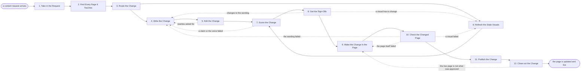

# Reference process: Update Website Content

`ref/mkt/website-content-update v1`

**value stream:** [Idea-to-Asset](../../streams/marketing/idea-to-asset.md)
Something on a page that is already live has to change. A content
manager takes the request in, a content librarian finds every live page
that says the thing being changed, and the two of them decide whether
the request is a small edit this process can carry or work that belongs
to a bigger process. That decision also names which reviewers the change
has to reach, and it names them before any writing starts. A copywriter
writes the new wording, an editor says what still has to change, and a
designer replaces any screenshot or diagram the change has made wrong.
The reviewers named at the start sign, a web producer makes the change
in the page, and the checking agents read the changed page before it
goes anywhere. The manager says go, the producer publishes, and the run
closes when the person who asked agrees the page now says what they
meant.

This process is deliberately smaller than publish landing page. It
creates no page and claims no address, so a request that turns out to
need a page nobody has built stops at the routing decision and goes to
publish landing page or to long-form content instead. There is no search
research here, because a page that is already live was built against
some set of terms already, and the search agent appears only to say
whether the change broke the title, the headings, the internal links or
the address. Nobody is briefed in a room, and the request travels as a
written record from the manager to the agents that act on it. The
process produces no creative set and installs no measurement, so a
request that needs a new form or a new conversion is also bigger than
this one. Nothing is handed to a campaign, and the media buyer agent
does not appear. The run closes once the change is live and recorded,
because watching a page afterwards belongs to whoever owns that page and
to refresh published content. This process also ends without the debrief
that the larger processes here close with, since a change that takes an
afternoon does not fill one.

## The activities

| # | Activity | What happens | Agents |
|---|---|---|---|
| 1 | Take in the Request | what has to change, on which page, and by when | [content-manager](../../agents/content-manager.md) · requester (person) |
| 2 | Find Every Page It Touches | the live pages that say the thing being changed | [content-librarian](../../agents/content-librarian.md) |
| 3 | Route the Change | a small edit or a bigger process, and who signs | content-manager · content-librarian |
| 4 | Write the Change | the new wording, with a source under a new claim | [copywriter](../../agents/copywriter.md) · [researcher](../../agents/researcher.md) |
| 5 | Edit the Change | the editor says what still has to change | [editor](../../agents/editor.md) · copywriter |
| 6 | Refresh the Stale Visuals | screenshots and diagrams the change makes wrong | [designer](../../agents/designer.md) |
| 7 | Score the Change | claims and voice, read at the versions in force | [brand-check](../../agents/brand-check.md) |
| 8 | Get the Sign-Offs | the reviewers named at intake sign the change | brand owner (person) · legal reviewer (person) · subject matter expert (person) · rights approver (person) |
| 9 | Make the Change in the Page | the approved wording goes in as a draft | [web-producer](../../agents/web-producer.md) |
| 10 | Check the Changed Page | links, headings, accessibility and the tracking | [accessibility-check](../../agents/accessibility-check.md) · [search-optimizer](../../agents/search-optimizer.md) · [conversion-tracker](../../agents/conversion-tracker.md) |
| 11 | Publish the Change | the owner says go and the page changes | content-manager · web-producer |
| 12 | Close out the Change | the requester agrees and the change is recorded | web-producer · content-manager · content-librarian · requester (person) |

## The graph



## The document, with the blanks marked

```
PROCESS: update website content       id: <team>/website-content-update   v1
from: ref/mkt/website-content-update v1
owner: <who>                          effective: <date>
trigger: someone asks for a change to a live page in <your intake
         channel>
         watch: record=<content request> system=<your intake channel>
                change=<a change to a live page is asked for>
concurrency: runs may overlap - <how many> at once, and no two runs
             hold the same page
goal: a live page changed to say what the request asked it to say,
      signed by the reviewers the change reached, and recorded against
      the page
phases:
  take-in-request  - human: read the request, work out what has to
                     change, on which page, and by when
                     owner: content-manager    after: trigger
                     automation: <level>
  find-pages       - system: every live page that says the thing being
                     changed, read from what the site actually serves
                     owner: content-librarian  after: take-in-request
                     automation: <level>
  route-change     - human: decide whether this is a small edit or work
                     for a bigger process, and name the reviewers the
                     change has to reach
                     owner: content-manager    after: find-pages
                     automation: never
  write-change     - human: the new wording, with a source under any
                     claim the change adds
                     owner: copywriter         after: route-change
                     by: <days>                automation: <level>
  edit-change      - runs draft-review-merge: the editor holds the
                     version and says what still has to change
                     owner: editor             after: write-change
                     by: <days>                automation: <level>
  refresh-visuals  - human: replace the screenshots and the diagrams
                     the change has made wrong
                     owner: designer           after: route-change
                     by: <days>                automation: <level>
  score-change     - runs assessment: every claim against <your claims
                     register> at its version, and the wording against
                     the brand guidelines at theirs
                     owner: brand-check
                     after: edit-change + refresh-visuals
                     automation: <level>
  get-sign-offs    - convenes approval: the reviewers named at
                     route-change sign, as named signers, against a
                     version
                     owner: <your legal role>  after: score-change
                     by: <days>                automation: never
  make-change      - human: the approved wording and visuals go into
                     the page as a draft, with a preview link
                     owner: web-producer       after: get-sign-offs
                     automation: <level>
  check-page       - runs layered-passes: accessibility and the
                     technical checks, then the title, the headings and
                     the internal links, then the tracking already on
                     the page
                     owner: content-manager    after: make-change
                     by: <days>                automation: <level>
  publish-change   - human: the named owner says go, and the producer
                     puts the change live
                     owner: content-manager    after: check-page
                     automation: <level>
  close-out        - human: the person who asked reads the live page
                     and says whether it means what they wanted, and
                     the change is written against the page
                     owner: content-manager    after: publish-change
                     automation: never
handoffs:
  take-in-request -> find-pages [what-has-to-change]: what has to
    change, said plainly enough that a search of the live site can find
    it
  find-pages -> route-change [pages-that-say-it]: every live page that
    says the thing being changed, with its address and the date it last
    changed
  route-change -> write-change [routing-decision]: the pages in scope,
    what each one has to say instead, and the reviewers the change has
    to reach
  route-change -> refresh-visuals [visuals-in-scope]: the same
    decision. Both branches read one record
  write-change -> edit-change [new-wording]: the new wording at a
    version, with a source line under any claim it adds
  edit-change -> score-change [edited-wording]: the wording the editor
    holds as finished
  refresh-visuals -> score-change [replaced-visuals]: the replaced
    screenshots and diagrams at their versions
  score-change -> get-sign-offs [change-scores]: the scores, each
    citing the standard, its version and the rule applied
  get-sign-offs -> make-change [approved-change]: the approved wording
    and visuals at the signed version. A later change voids the
    approval and sign-offs run again
  make-change -> check-page [staged-page]: the page as it is actually
    built, on staging, with the change in it
  check-page -> publish-change [page-checks]: the checks, each citing
    the standard it was scored against
  publish-change -> close-out [what-went-live]: the live address, the
    version that went live, and who said go
deviations:
  edit-change -> write-change [rewrite-asked-for]: the editor asks for
    a rewrite, so only the wording they named is written again
  score-change -> write-change [claim-or-voice-failed]: a claim or the
    voice failed its standard, so the wording is written again
  get-sign-offs -> write-change [wording-changes-asked-for]: a signer
    asks for a change to the wording, so it is written again and scored
    again before the same signers see it
  get-sign-offs -> refresh-visuals [visual-changes-asked-for]: a signer
    names a screenshot or a diagram, so it is replaced again
  check-page -> write-change [wording-failed-a-check]: a check fails on
    the wording, so it is written again
  check-page -> refresh-visuals [visual-failed-a-check]: a check fails
    on a visual, so it is replaced again
  check-page -> make-change [page-failed-a-check]: a check fails on the
    page itself, so the change is made in the page again
  close-out -> make-change [live-page-is-not-approved]: the live page
    is serving something other than the signed version, so the change
    is made and published again
bindings:
  roster:  <who holds each role - agents claiming the abstract agents
           above, named people for the reviewers, and the person who
           asked for the change>
  systems: the website's content system (write), the staging site
           (read), the content inventory (write), the asset store
           (write), analytics (read), the review record (write)
  data:    brand guidelines <version>, <your claims register>, <your
           accessibility standard> <version>, the request the change
           was asked for
policy:
  a change that reached a named reviewer does not publish unsigned
  a run that reaches no reviewer records who decided that no signature
    was required
  no claim the change adds ships without a citation in <your claims
    register>
  wording changed after sign-off goes back through the sign-offs
  no two runs hold the same page at once
  a request that needs a page nobody has built, a new form or a new
    conversion leaves this process at route-change
measures:
  cycle time: <target> from the request to live
  volume: <changes per period>
  quality gate: every published change is recorded against its page,
                with the version that went live and who asked for it
```

## The failure edges

- **The request is bigger than this process.** The routing decision
  finds that the change needs a page nobody has built, a new form, or a
  new conversion. The run stops there and the request goes to the
  process that can carry it, with the pages already found attached so
  that the finding is not done twice.
- **The edit asks for a rewrite.** The run returns to write-change, and
  only the wording the editor named reopens.
- **A sign-off comes back with changes.** The run returns to
  write-change when the signers named the wording, and to
  refresh-visuals when they named a screenshot or a diagram. The change
  is scored again and put back in front of the same signers.
- **A check comes back failed.** A failure in the wording sends the run
  back to write-change, a failure in a visual back to refresh-visuals,
  and a failure in the page itself back to make-change. No examiner
  waives its own findings, so the run moves on after the failure is
  fixed, or after a person records the decision to publish with the
  failure attached.
- **Nobody has to sign.** A run where the routing decision names no
  reviewer records that no signature was required and who decided that,
  so the skip stays visible to anyone reading the page's history later.
- **Two requests land on the same page.** No two runs hold the same page
  at once, because two runs changing one page produce a page neither of
  them meant to write. A second request for a page a run already holds
  either joins that run or waits for it.
- **The live page is not what was approved.** The close-out finds the
  page serving something other than the signed version. The run returns
  to make-change and publishes again, and what went wrong is written
  against the page.
- **The requester says the change misses the point.** The agents in this
  run can only confirm that the live page serves what was approved, so a
  change that is live and still wrong is a new request, taken in at
  activity 1 with what this run already learned attached to it.
- **A run is abandoned.** A change that never went live is left at its
  draft version with the reason written down, and the page keeps serving
  what it served before. A change already published stays published, and
  the record against the page says which parts of the request it covered
  and which parts it did not.
