# Reference process: the win-back campaign

`ref/mkt/win-back-campaign v1`

A campaign manager takes a segment of customers who have gone quiet and
works out what it would take to bring them back. An account monitor
reads the accounts behind that segment and says which of them may be
approached at all. The manager gets an offer approved by finance and
legal, and splits the segment into the contacts who receive a message
and the accounts that get a call from the person who owns them. A
copywriter and a designer make the messages, an email producer builds
the audience with the consent, opt-out and suppression rules applied,
and brand and legal sign the offer and the messages. The account owners
make their calls, the sequence goes out, and whatever comes back is
answered and given an owner. The run stays open until every contact in
the segment has either re-engaged or been formally retired, because a
win-back that leaves people undecided gets run again on the same names
a quarter later.

## The activities

| # | Activity | What happens | Seats |
|---|---|---|---|
| 1 | take in the lapsed segment | who lapsed, when, and what the run must recover | [campaign-manager](../../agents/campaign-manager.md) · [analytics](../../agents/analytics.md) |
| 2 | read the named accounts | whether each account may be approached at all | [account-monitor](../../agents/account-monitor.md) |
| 3 | set the parameters | channels, contact limits, dates, and the goal | campaign-manager · leadership (person) |
| 4 | settle the offer | what is offered to bring a lapsed customer back | campaign-manager · finance (person) · legal reviewer (person) |
| 5 | sort the segment into treatments | who gets a message, who gets a call, who is left alone | campaign-manager · [lifecycle-manager](../../agents/lifecycle-manager.md) · analytics |
| 6 | build the contact list | eligible contacts, with the suppressions applied | [email-producer](../../agents/email-producer.md) · legal reviewer (person) |
| 7 | brief the makers | everyone hears the offer and the segment at once | campaign-manager · [copywriter](../../agents/copywriter.md) · [designer](../../agents/designer.md) · email-producer · [conversion-tracker](../../agents/conversion-tracker.md) |
| 8 | write the sequence | the messages, in the order they will be sent | copywriter · designer |
| 9 | wire up the measurement | what counts as a return, and the path into the CRM | conversion-tracker |
| 10 | score the messages | brand, claims, rendering and accessibility checked | [brand-check](../../agents/brand-check.md) · [accessibility-check](../../agents/accessibility-check.md) |
| 11 | get sign-offs | brand and legal approve the offer and the messages | brand owner (person) · legal reviewer (person) |
| 12 | set up the sending | audience loaded, schedule set, paid push ready | email-producer · [media-buyer](../../agents/media-buyer.md) |
| 13 | call the named accounts | the account owner makes the contact in person | account owner (person) · campaign-manager |
| 14 | send the sequence | the owner says go and the messages go out | email-producer · campaign-manager |
| 15 | answer what comes back | replies and complaints answered or passed on | [community-manager](../../agents/community-manager.md) · lifecycle-manager |
| 16 | hand over the responders | a contact who responds gets an owner and a next step | [lead-scorer](../../agents/lead-scorer.md) · account owner (person) |
| 17 | watch the response | returns, complaints and opt-outs against the goal | analytics · media-buyer · campaign-manager |
| 18 | retire the ones who stayed silent | contacts that never answered are closed out | campaign-manager · email-producer · account owner (person) |
| 19 | report the win-back | what was recovered, set against what was promised | campaign-manager · analytics |
| 20 | record what was learned | what to repeat, what to avoid | campaign-manager |

## The graph

```mermaid
flowchart LR
  T([a lapsed segment is identified]) --> A1[1. take in the lapsed segment]
  A1 --> A2[2. read the named accounts]
  A1 --> A3[3. set the parameters]
  A2 --> A3
  A3 --> A4[4. settle the offer]
  A2 --> A5[5. sort the segment into treatments]
  A3 --> A5
  A4 --> A5
  A5 --> A6[6. build the contact list]
  A4 --> A7[7. brief the makers]
  A5 --> A7
  A7 --> A8[8. write the sequence]
  A7 --> A9[9. wire up the measurement]
  A8 --> A10[10. score the messages]
  A10 -. failures to fix .-> A8
  A10 --> A11[11. get sign-offs]
  A11 -. changes requested .-> A8
  A11 --> A12[12. set up the sending]
  A6 --> A12
  A9 --> A12
  A12 -. too few reachable contacts .-> A5
  A11 --> A13[13. call the named accounts]
  A12 --> A14[14. send the sequence]
  A13 --> A14
  A14 --> A15[15. answer what comes back]
  A14 --> A17[17. watch the response]
  A15 --> A16[16. hand over the responders]
  A17 -. complaints past the threshold .-> A14
  A16 --> A18[18. retire the ones who stayed silent]
  A17 --> A18
  A18 -. worth one more approach .-> A13
  A18 --> A19[19. report the win-back]
  A17 --> A19
  A19 --> A20[20. record what was learned]
  A20 --> DONE([every contact is re-engaged or retired])
```



## The document, with the blanks marked

```
PROCESS: win-back campaign            id: <team>/win-back-campaign   v1
from: ref/mkt/win-back-campaign v1
owner: <who>                          effective: <date>
trigger: a lapsed segment is identified in <your reporting process>
concurrency: runs may overlap - <how many> segments in flight at once
goal: every contact in the lapsed segment either re-engaged or formally
      retired, with what was recovered reported against what the run
      promised
phases:
  take-in-segment  - human: read the segment and write down who lapsed,
                     when they lapsed, and what the run has to recover
                     owner: campaign-manager     after: trigger
                     automation: <level>
  read-accounts    - human: for each named account, its standing, its
                     contract position, and whether it may be
                     approached at all
                     owner: account-monitor      after: take-in-segment
                     by: <days>                  automation: <level>
  set-parameters   - human: pick the channels, the contact limit per
                     person, the dates, and what counts as recovery.
                     <who> confirms the goal
                     owner: campaign-manager     after: take-in-segment
                     automation: <level>
  settle-offer     - convenes approval: what is offered to bring a
                     lapsed customer back, what it costs, and what the
                     law requires it to say
                     owner: campaign-manager     after: set-parameters
                     by: <days>                  automation: never
  sort-treatments  - convenes decide-and-announce: who gets a message,
                     who gets a call from the person who owns the
                     account, and who is left alone
                     owner: campaign-manager
                     after: read-accounts + set-parameters + settle-offer
                     automation: <level>
  build-list       - human: the eligible contacts, with consent,
                     opt-out and suppression applied, and the rule
                     behind every removal recorded
                     owner: email-producer       after: sort-treatments
                     by: <days>                  automation: <level>
  brief-makers     - convenes briefing: the offer, the treatment groups
                     and the dates, heard by every seat at once
                     owner: campaign-manager
                     after: settle-offer + sort-treatments
                     automation: <level>
  write-sequence   - runs build-by-talent: the messages in the order
                     they will be sent, each with its subject line, its
                     copy and its layout
                     owner: campaign-manager     after: brief-makers
                     by: <days>                  automation: <level>
  wire-measurement - human: what counts as a return, the tracked links,
                     and the path from a response into the CRM
                     owner: conversion-tracker   after: brief-makers
                     automation: <level>
  score-messages   - runs assessment: brand, claims, rendering and
                     accessibility, every item against its standard
                     owner: campaign-manager     after: write-sequence
                     by: <days>                  automation: <level>
  get-sign-offs    - convenes approval: brand and legal sign, as named
                     signers, against a version of the offer and the
                     messages
                     owner: <your legal seat>    after: score-messages
                     by: <days>                  automation: never
  set-up-sending   - human: the audience loaded at a version, the
                     schedule and send-time windows set, the proofs
                     out, and the matched-audience buy built
                     owner: email-producer
                     after: get-sign-offs + build-list + wire-measurement
                     by: send date               automation: <level>
  call-accounts    - human: the person who owns the account makes the
                     contact, before that account receives anything
                     addressed to a list
                     owner: <your account owner> after: get-sign-offs
                     by: send date               automation: never
  send-sequence    - human: the named owner says go and the sending
                     system takes it from there
                     owner: email-producer
                     after: set-up-sending + call-accounts
                     automation: <level>
  answer-replies   - human: answer what comes back, and pass on what
                     the approved material cannot support
                     owner: community-manager    after: send-sequence
                     automation: <level>
  hand-over        - human: a contact who responds gets an owner and a
                     next step, with the evidence attached
                     owner: lead-scorer          after: answer-replies
                     automation: <level>
  watch-response   - human: returns, complaints and opt-outs, read
                     against the goal and the contact limit
                     owner: analytics            after: send-sequence
                     automation: <level>
  retire-silent    - human: every contact that never answered is closed
                     out and suppressed from further approaches, with
                     the date recorded against each one
                     owner: campaign-manager
                     after: hand-over + watch-response
                     by: <days>                  automation: <level>
  report-win-back  - runs collect-and-report: what was recovered, what
                     it cost, and how many contacts were retired
                     owner: campaign-manager     after: retire-silent
                     by: <days>                  automation: <level>
  record-learnings - convenes debrief: what to repeat, what to avoid
                     owner: campaign-manager     after: report-win-back
                     automation: <level>
run-scoped:
  status - runs roll-call                       owner: campaign-manager
           every: <cadence>
           from: brief-makers   until: run close
  spend  - runs allocate-and-reconcile          owner: media-buyer
           from: set-up-sending   until: run close
  open   - runs collect-and-report              owner: lifecycle-manager
           every: <cadence>
           from: send-sequence   until: run close
handoffs:
  take-in-segment -> set-parameters: who lapsed, when each contact
    lapsed, and what the run has to recover, in one line that every
    later decision can be tested against
  take-in-segment -> read-accounts: the named accounts inside the
    segment, and the date the segment was drawn
  read-accounts -> sort-treatments: for each named account, whether it
    may be approached, with the systems that were read under the answer
  set-parameters -> settle-offer: the goal, the dates and the contact
    limit the offer has to work inside
  settle-offer -> brief-makers: the approved offer, what it is worth,
    who it applies to, and the words the law requires it to carry
  sort-treatments -> build-list: which contacts are being messaged and
    which are being left alone, with the reason for each group
  sort-treatments -> brief-makers: the groups, and what the messages
    have to do differently for each one
  brief-makers -> write-sequence: the offer, the groups, the dates, and
    how many messages the contact limit allows
  score-messages -> get-sign-offs: the scored list, with the rule
    behind every failure
  get-sign-offs -> set-up-sending: the approved messages at the signed
    version. A later change voids the approval and sign-offs run again
  get-sign-offs -> call-accounts: the same approved offer, so that the
    call and the message say the same thing
  build-list -> set-up-sending: the audience at a version, with the
    count before the rules were applied, the count after, and the rule
    behind every removal
  wire-measurement -> set-up-sending: the tracked links, and a dated
    test showing a response arriving in the CRM
  call-accounts -> send-sequence: which named accounts were reached,
    what each of them said, and which of them to hold back from the
    send
  answer-replies -> hand-over: the contacts who answered, and what each
    of them asked for
  hand-over -> retire-silent: the contacts that now have an owner, so
    that nobody who responded is retired by mistake
  watch-response -> retire-silent: who opened, who clicked, who
    complained, and who asked to be left alone
  report-win-back -> record-learnings: the report, as delivered
bindings:
  roster:  <who holds each seat - agents claiming the abstract agents
           above, and named people for the account owners, leadership,
           finance, legal and brand>
  systems: the sending system (write), the send record store (write),
           the consent record (read), the suppression lists (read),
           the contact database (read), the CRM (write),
           the account standing record (read), the asset store (write),
           analytics (read), ad platforms (write, cap: <n>/day)
  data:    brand guidelines <version>, <your claims register>,
           <your offer terms> <version>, and the lapsed segment as it
           was drawn, with the date it was drawn
policy:
  a contact who asks to be left alone is suppressed before the next
    message goes out, and that suppression outlives the run
  no contact receives more than the contact limit allows, counted
    across every channel the run uses
  the offer is signed by a person before it goes in front of a customer
  sign-off is a human gate and is never delegated to an agent
  a message changed after sign-off goes back through sign-offs
  a named account is called by the person who owns it before it
    receives anything addressed to a list
  an account that the account-monitor seat says should not be
    approached is not contacted, and only <who> may overrule that in
    writing, with the overruling recorded
  every contact in the segment ends the run recorded as re-engaged or
    as retired, with the date
measures:
  recovery: <target> share of the segment re-engaged
  cost: <target> cost for each contact recovered
  cycle time: <target> from the segment to the last send
  complaint rate: under <threshold> on every send
  quality gate: nothing sends unsigned, and no contact is left
                undecided at run close
```

## The failure edges

- **A sign-off comes back with changes.** The run returns to the
  sequence, and only the message the signers named reopens. The signers
  see the changed version before anything is sent.
- **Too few contacts survive the consent and suppression rules.** The
  audience the email-producer seat can lawfully reach is smaller than
  the goal needs, so the run goes back to the treatments and <who>
  decides whether to change the goal, widen the segment, or stop.
- **Complaints or bounces cross the threshold while the send is going
  out.** The remaining sends stop, and a person decides whether the run
  continues, what the people who already received the message are told,
  and whether the offer or the list caused it.
- **A named account asks not to be contacted again.** The account owner
  records the refusal, the account is suppressed for the rest of the
  run, and it is retired at the close whatever the numbers say.
- **The account-monitor seat says an account should not be approached.**
  The account comes out of every treatment group, and it goes back in
  only when <who> overrules that in writing.
- **A contact responds after being retired.** The retirement is
  reversed, the contact gets an owner like any other responder, and the
  report says how many contacts came back after the close.
- **The account owner wants one more approach.** An account the run was
  about to retire goes back to the call, once, and it is retired if
  that call goes unanswered by the date the run sets.
- **The trigger fires while runs are in flight.** Segments overlap
  normally, and the concurrency line says how many. A contact who
  appears in two live segments is approached by one of them, and the
  contact limit is counted across both.
- **A run is abandoned.** Scheduled sends are pulled, the buy comes
  off, and the spend line reconciles anyway. Every contact already
  approached is still recorded as re-engaged or retired, because
  leaving them undecided is what makes the next run repeat this one.
