# Reference process: Conduct Win/Loss Analysis

`ref/mkt/win-loss-analysis v1`

**value stream:** [Activity-to-Insight](../../streams/marketing/activity-to-insight.md)
A study manager takes the deals that closed over a period, draws a
sample of the ones the organization won and a sample of the ones it
lost, and interviews the buyers in both groups about how they decided.
Every closed deal already carries a reason in the organization's own
record, and that reason was written by somebody who works there. This
process asks the buyer. The run gets the samples and the questions
signed before anybody is approached, holds the interviews, sorts what
was said into themes, sets those themes against what the record says,
and delivers the themes with what each one asks somebody to change. The
buyers who did not buy are the harder half to reach, and that is the
half most organizations end up skipping, so the report says how many of
each half answered.

## The activities

| # | Activity | What happens | Seats |
|---|---|---|---|
| 1 | Take in the Period | which closed deals the run covers, and by when | [study-manager](../../agents/study-manager.md) · requester (person) |
| 2 | Pull the Closed Deals | every deal that closed, and the reason the record gives | [analytics](../../agents/analytics.md) · study-manager |
| 3 | Brief the Study | every seat hears the period and the question at once | study-manager · [statistician](../../agents/statistician.md) · [consent-manager](../../agents/consent-manager.md) · [audience-manager](../../agents/audience-manager.md) · [account-monitor](../../agents/account-monitor.md) · analytics |
| 4 | Say How Many Interviews It Needs | how many each half needs, before any are held | statistician |
| 5 | Draw Both Samples | who bought and who did not, drawn to match each other | study-manager · audience-manager |
| 6 | Check Who May Be Approached | consent applied, and each account's standing checked | consent-manager · account-monitor |
| 7 | Arrange the Outside Interviewer | buyers say more to somebody outside the deal | [supplier-manager](../../agents/supplier-manager.md) · [supplier-check](../../agents/supplier-check.md) |
| 8 | Cover What It Costs | the interviewer and the incentives, against what is left | [budget-keeper](../../agents/budget-keeper.md) · finance (person) |
| 9 | Write the Interview Guide | the questions both halves are asked, at a version | study-manager · subject matter expert (person) |
| 10 | Get Sign-Offs | legal and the owner sign before anybody is approached | legal reviewer (person) · leadership (person) |
| 11 | Invite the Buyers | the same ask goes to both halves | [audience-operator](../../agents/audience-operator.md) · study-manager |
| 12 | Hold the Interviews | what each buyer said, taken down as they said it | study-manager |
| 13 | Watch Both Halves Fill | how many of each half have answered so far | study-manager · statistician |
| 14 | Close the Interviews | asking stops and the responses are fixed | study-manager |
| 15 | Sort What Was Said into Themes | every remark filed under a theme, at a version | study-manager |
| 16 | Work out the Figures | how often each theme appears, with its range | statistician |
| 17 | Set the Themes against the Record | where the buyers and the record disagree | study-manager · analytics |
| 18 | Write the Findings | each theme with what it asks somebody to change | study-manager · [decision-coordinator](../../agents/decision-coordinator.md) |
| 19 | Check the Findings Hold | every figure read against its data and its method | statistician |
| 20 | Deliver the Themes and Recommendations | the themes go to the people who decide and act | study-manager · decision-coordinator · leadership (person) |
| 21 | Record What Was Learned | what to repeat, what to avoid | study-manager |

## The graph

```mermaid
flowchart LR
  T([a period of deals closes]) --> A1[1. Take in the Period]
  A1 --> A2[2. Pull the Closed Deals]
  A2 --> A3[3. Brief the Study]
  A3 --> A4[4. Say How Many Interviews It Needs]
  A3 --> A9[9. Write the Interview Guide]
  A4 --> A5[5. Draw Both Samples]
  A5 --> A6[6. Check Who May Be Approached]
  A5 --> A7[7. Arrange the Outside Interviewer]
  A6 -. too few may be approached .-> A5
  A7 --> A8[8. Cover What It Costs]
  A6 --> A10[10. Get Sign-Offs]
  A8 --> A10
  A9 --> A10
  A10 -. changes requested .-> A5
  A10 -. changes requested .-> A9
  A10 --> A11[11. Invite the Buyers]
  A11 --> A12[12. Hold the Interviews]
  A12 --> A13[13. Watch Both Halves Fill]
  A13 -. one half is filling short .-> A11
  A13 --> A14[14. Close the Interviews]
  A14 --> A15[15. Sort What Was Said into Themes]
  A15 --> A16[16. Work out the Figures]
  A16 -. a half fell short of its count .-> A11
  A16 --> A17[17. Set the Themes against the Record]
  A17 -. a deal has to be read again .-> A2
  A17 --> A18[18. Write the Findings]
  A18 --> A19[19. Check the Findings Hold]
  A19 -. a figure does not follow .-> A18
  A19 --> A20[20. Deliver the Themes and Recommendations]
  A20 --> A21[21. Record What Was Learned]
  A21 --> DONE([the themes and the recommendations are delivered])
```



## The document, with the blanks marked

```
PROCESS: win/loss analysis            id: <team>/win-loss-analysis   v1
from: ref/mkt/win-loss-analysis v1
owner: <who>                          effective: <date>
trigger: a period closes in <your revenue reporting>, or a run of
         losses in one segment is raised
concurrency: one run at a time over the same period of deals. Runs for
             different periods or different segments overlap - <how
             many> at once
goal: the themes behind the period's wins and losses, each carrying
      the interviews it rests on, delivered with what each theme asks
      somebody to change
phases:
  take-in-period      - human: read which deals the run covers, what
                        the run has to settle, and by when
                        owner: study-manager     after: trigger
                        automation: <level>
  pull-the-deals      - runs collect-and-report: every deal that closed
                        in the period, its value, its segment, its
                        stage at close and the reason recorded on it
                        owner: analytics         after: take-in-period
                        by: <days>               automation: <level>
  brief-the-study     - convenes briefing: the period, the question and
                        the due date, heard by every seat at once
                        owner: study-manager     after: pull-the-deals
                        automation: <level>
  size-interviews     - human: how many interviews each half needs, and
                        what those numbers were computed from
                        owner: statistician      after: brief-the-study
                        by: <days>               automation: <level>
  draw-samples        - human: the won deals and the lost deals sampled
                        separately, drawn to match each other on the
                        traits that would otherwise explain the result
                        owner: study-manager     after: size-interviews
                        by: <days>               automation: <level>
  check-the-sample    - runs assessment: every drawn buyer scored
                        against the consent rules in force, and every
                        account read for whether it may be approached
                        owner: consent-manager   after: draw-samples
                        automation: <level>
  outside-interviewer - runs assessment: the requirements written down
                        first, then every candidate scored against them
                        owner: supplier-manager  after: draw-samples
                        by: <days>               automation: <level>
  cover-the-cost      - runs allocate-and-reconcile: the interviewer
                        and the incentives, drawn against <which
                        allocation>
                        owner: budget-keeper
                        after: outside-interviewer
                        automation: <level>
  write-the-guide     - human: the questions both halves are asked, in
                        the order they are put, at a version
                        owner: study-manager     after: brief-the-study
                        by: <days>               automation: <level>
  get-sign-offs       - convenes approval: legal and the named owner
                        sign, as named signers, against a version of
                        the samples and a version of the guide
                        owner: <your legal seat>
                        after: check-the-sample + cover-the-cost +
                               write-the-guide
                        by: <days>               automation: never
  invite-the-buyers   - human: the same ask goes to both halves, saying
                        what the interview is for and what happens to
                        what the buyer says
                        owner: audience-operator after: get-sign-offs
                        by: <days>               automation: <level>
  hold-interviews     - human: the interview runs to the guide, and
                        what the buyer said is taken down as they said
                        it
                        owner: study-manager
                        after: invite-the-buyers
                        by: <days>               automation: <level>
  watch-both-halves   - runs roll-call: how many of each half have
                        answered, and what each half is waiting on
                        owner: study-manager     after: hold-interviews
                        every: <cadence>         automation: <level>
  close-interviews    - human: asking stops on the date or on the
                        count, and the interviews are fixed at a
                        version
                        owner: study-manager
                        after: watch-both-halves
                        automation: <level>
  sort-into-themes    - human: every remark filed under a theme, with
                        the theme list held at a version
                        owner: study-manager
                        after: close-interviews
                        by: <days>               automation: <level>
  work-out-figures    - human: how often each theme appears in each
                        half, each figure with its method, its
                        exclusions and the range around it
                        owner: statistician
                        after: sort-into-themes
                        by: <days>               automation: <level>
  set-against-record  - human: each theme set beside the reason the
                        record gives, deal by deal, with every place
                        the two disagree written down
                        owner: study-manager
                        after: work-out-figures
                        by: <days>               automation: <level>
  write-findings      - human: each theme with the interviews recorded
                        under it, and what the theme asks somebody to
                        change
                        owner: study-manager
                        after: set-against-record
                        by: <days>               automation: <level>
  check-findings      - runs layered-passes: the numbers pass, every
                        figure against the data and the method beside
                        it
                        owner: statistician      after: write-findings
                        by: <days>               automation: <level>
  deliver-themes      - convenes decide-and-announce: the themes and
                        what each one asks for, heard at the same time
                        by everybody who has to act on them
                        owner: decision-coordinator
                        after: check-findings
                        automation: <level>
  record-learnings    - convenes debrief: what to repeat, what to avoid
                        owner: study-manager     after: deliver-themes
                        automation: <level>
run-scoped:
  spend  - runs allocate-and-reconcile        owner: budget-keeper
           from: cover-the-cost   until: run close
  status - runs roll-call                     owner: study-manager
           every: <cadence>
           from: brief-the-study   until: deliver-themes
handoffs:
  take-in-period -> pull-the-deals: which deals the run covers, said as
    a period and a segment somebody can select on
  pull-the-deals -> brief-the-study: every closed deal in the period
    with its value, its segment, its stage at close and the reason
    recorded on it, and every deal whose reason was left empty
  brief-the-study -> size-interviews: the question, the size of the
    difference that would matter, and the confidence the study is being
    run to
  brief-the-study -> write-the-guide: the question as every seat heard
    it, and the guide the last run of this study used
  size-interviews -> draw-samples: how many interviews each half needs
    and what those numbers were computed from
  draw-samples -> check-the-sample: both samples, buyer by buyer, with
    the deal each buyer came from
  draw-samples -> outside-interviewer: what the interviews need
    somebody outside the organization to do, written as requirements
    before any candidate is looked at
  check-the-sample -> get-sign-offs: the buyers who may be approached,
    the count removed from each half, and the rule behind each removal
  outside-interviewer -> cover-the-cost: what each candidate would
    charge and what it would do
  cover-the-cost -> get-sign-offs: what the run will draw, and the
    allocation it draws against
  write-the-guide -> get-sign-offs: the guide at a version, in the
    order the questions are put
  get-sign-offs -> invite-the-buyers: the approved samples and the
    approved guide at their signed versions. A later change voids the
    approval and sign-offs run again
  invite-the-buyers -> hold-interviews: who accepted, from which half,
    and what each of them was told the interview is for
  hold-interviews -> watch-both-halves: what each buyer said, as they
    said it, marked with the version of the guide it answered
  watch-both-halves -> close-interviews: the count held in each half
    set against the count that half planned for, said on the day asking
    stops
  close-interviews -> sort-into-themes: the interviews fixed at a
    version, with every one that was left out and the rule that left it
    out
  sort-into-themes -> work-out-figures: the theme list at a version,
    and every remark under the theme it was filed under
  work-out-figures -> set-against-record: how often each theme appears
    in each half, with the method, the exclusions and the range
  set-against-record -> write-findings: each theme beside the reason
    the record gives, and every deal where the two disagree
  write-findings -> check-findings: the findings at a version, each
    theme carrying the interviews it rests on
  check-findings -> deliver-themes: the findings with every figure
    checked against the data and the method beside it, and every figure
    that could not be computed marked as such
  deliver-themes -> record-learnings: the themes and the
    recommendations, as delivered, and who took each one
bindings:
  roster:  <who holds each seat - agents claiming the abstract agents
           above, and named people for the requester, legal, finance
           and the expert>
  systems: the study record (write), the interview guide (write),
           the response record (write), the calculation record (write),
           the survey and interview system (trigger),
           the CRM (read), the customer and revenue record (read),
           the contact database (read), the consent record (read),
           the sending system (write), the meeting calendar (write),
           the supplier record (write), the budget record (write),
           the decision record (write), analytics platforms (read)
  data:    <your consent rules> <version>, the period the run covers,
           the guide the last run of this study used, the reasons the
           record carries at the versions they were recorded under
policy:
  the run covers the deals that were won and the deals that were lost,
    and every report says how many of each half answered against how
    many that half needed
  nobody is approached until the samples and the guide have been signed
  sign-off is a human gate and is never delegated to an agent
  the person who owned the deal does not hold the interview about it
  both halves are asked the same questions, so what one half said can
    be set beside what the other half said
  what a buyer said is attributed to that buyer inside the organization
    only when the buyer agreed to it, and the buyer is told that before
    the interview starts
  an incentive offered to a participant is approved by a person before
    anything is offered to anybody
  the reason on the record and what the buyer said are both reported
    when they disagree, and neither is edited to match the other
  every theme carries the interviews it rests on, and a theme resting
    on fewer interviews than the study needed says so
  every figure carries its method, its exclusions and the range around
    it
  a question in the guide is reworded only when <who> agrees, because
    the readings before and after the change stop being comparable
  a finding is never removed from the report because somebody asked.
    <who> decides, and the decision is recorded with the findings
measures:
  cycle time: <target> from the close of the period to the delivered
              themes
  coverage: <share> of the period's closed deals interviewed, said for
            each half on its own
  volume: <runs per period>
  quality gate: no theme is delivered without the interviews under it,
                and no report goes out without the count each half
                reached
```

## The failure edges

- **The buyers who did not buy will not answer.** The run goes back to
  invite-the-buyers, and the study manager widens that half of the
  sample, moves the asking to the outside interviewer, or raises the
  incentive. When the half still comes up short, the report says how
  many answered against how many it needed, on the same page as every
  theme that half fed. A run that reports the wins alone has answered a
  different question, and it leaves the organization confident about
  something it has never checked.
- **The record and the buyer disagree about why a deal was lost.** Both
  readings go into the findings, the record is left as it was recorded,
  and <who> decides what happens to the reasons already sitting in the
  record. The disagreement is one of the things the run exists to find,
  so it is reported as a finding and settled outside the run.
- **The person who owned the deal wants to hold the interview.** The
  study manager declines and the interview goes to a seat or a person
  with nothing riding on the answer. A buyer talking to the seller they
  turned down gives the polite answer, and the polite answer is usually
  price.
- **An account's standing rules a buyer out.** A buyer in a dispute, in
  collections, or in a deal that has reopened comes out of the sample,
  the reading that removed them is recorded, and the sample is drawn
  again to make up the count.
- **A sign-off comes back with changes.** The run returns to the
  samples or to the guide, and only the part the signers named reopens.
  A question changed after the interviews have started means the
  interviews already held answered a different guide, and the
  statistician says what that does to the reading before the run goes
  on.
- **A half closes short of what it needed.** The statistician says so
  before any figure from that half is read as a result, and <who>
  decides whether the run keeps asking, reports with the shortfall
  named against every theme that half fed, or is dropped.
- **A buyer says something that has to reach somebody outside the
  run.** A customer about to leave, a complaint about the product, or a
  legal or safety matter goes out the day it is heard and does not wait
  for the report.
- **A buyer withdraws after the findings are written.** Their interview
  comes out of the count, the statistician recomputes every figure that
  rested on it, and the findings are reissued at a new version to
  everybody who received the first one.
- **The trigger fires while a run is in flight.** One run at a time
  covers the same period of deals, because two runs would put the same
  questions to the same buyers. Runs over different periods or
  different segments overlap, and the concurrency line says how many.
- **A run is abandoned.** The interviews already held stay where they
  are at their versions, so a later run can read what was asked and
  what came back. Anybody already invited is told the run has stopped,
  an incentive already promised is still paid, and the spend line
  reconciles anyway.
