# Reference process: Allocate the Fund

`ref/prt/allocate-the-fund v1`

**value stream:** [Fund-to-Activity](../../streams/partners/fund-to-activity.md)
Money is approved for partners to spend on demand generation, and this
run turns it into an amount each partner can see and a rule each partner
can read. Last period's fund and what each partner delivered set the
rule, the rule sets the amounts, and a person signs them before any
partner hears a number. What the fund may and may not buy is published
with the amounts. The run stays open through the period, money that will
not be used is moved before the period closes, and the run ends when
where the money went has been reported.

## The activities

| # | Activity | What happens | Agents |
|---|---|---|---|
| 1 | Take in the Approved Budget | the amount, the period, and who it is for | [fund-allocator](../../agents/fund-allocator.md) |
| 2 | Read Last Period's Fund | what was allocated, claimed and left unspent | fund-allocator · [analytics](../../agents/analytics.md) |
| 3 | Read What Each Partner Delivered | leads, deals and activity, partner by partner | [partner-monitor](../../agents/partner-monitor.md) · analytics |
| 4 | Choose the Allocation Rule | the rule that turns delivery into an amount | fund-allocator · partner lead (person) |
| 5 | Set What the Fund May Buy | the eligible activities, and what is excluded | fund-allocator · marketing lead (person) |
| 6 | Set the Caps, the Match and the Pool | per partner, per activity, and the share each side pays | fund-allocator · finance partner (person) |
| 7 | Run the Rule against the Partners | each partner's amount, with the inputs recorded | fund-allocator |
| 8 | Check the Amounts against the Money | the amounts summed against the approved budget | fund-allocator · finance partner (person) |
| 9 | Check Each Partner Is Entitled | agreement in force, tier current, nothing owed | [partner-manager](../../agents/partner-manager.md) |
| 10 | Approve the Allocation | a person signs before any partner hears a number | finance partner (person) · partner lead (person) |
| 11 | Open the Fund on the Books | the amounts opened where claims will be paid from | fund-allocator · finance partner (person) |
| 12 | Publish the Rules Partners Can Read | eligibility, evidence and deadlines in one place | partner-manager · fund-allocator |
| 13 | Tell Each Partner What They Have | the amount, the rule behind it, and the dates | partner-manager |
| 14 | Watch the Fund as It Is Committed | what is approved, what is claimed, what is free | fund-allocator · partner-monitor |
| 15 | Move Money That Will Not Be Used | unused money moved before the period closes | fund-allocator · partner lead (person) |
| 16 | Report Where the Money Went | the fund set against what it was meant to buy | [reporting-manager](../../agents/reporting-manager.md) · analytics |
| 17 | Record What Was Learned | what the rule got wrong, before the next period | fund-allocator |

The activities the fund pays for are not run here. A partner event is a
run of `ref/mkt/field-event`, a joint campaign is a run of
`ref/mkt/co-marketing-campaign`, and a partner webinar is a run of
`ref/mkt/webinar`. This process decides the money, the eligibility and
the accounting behind those runs, because it is the partner
relationship that earns the fund.

## The graph

```mermaid
flowchart LR
  T([a partner marketing budget is approved for a period]) --> A1[1. Take in the Approved Budget]
  A1 --> A2[2. Read Last Period's Fund]
  A1 --> A3[3. Read What Each Partner Delivered]
  A2 --> A4[4. Choose the Allocation Rule]
  A3 --> A4
  A4 --> A5[5. Set What the Fund May Buy]
  A5 --> A6[6. Set the Caps, the Match and the Pool]
  A6 --> A7[7. Run the Rule against the Partners]
  A7 --> A8[8. Check the Amounts against the Money]
  A8 -. the amounts do not fit the budget .-> A6
  A8 --> A9[9. Check Each Partner Is Entitled]
  A9 -. a partner is not entitled .-> A7
  A9 --> A10[10. Approve the Allocation]
  A10 -. the amounts are not signed .-> A4
  A10 --> A11[11. Open the Fund on the Books]
  A11 --> A12[12. Publish the Rules Partners Can Read]
  A12 --> A13[13. Tell Each Partner What They Have]
  A13 --> A14[14. Watch the Fund as It Is Committed]
  A14 --> A15[15. Move Money That Will Not Be Used]
  A15 -. the partners whose amount changed must be told .-> A13
  A14 -. a partner disputes the rule behind their amount .-> A4
  A14 --> A16[16. Report Where the Money Went]
  A15 --> A16
  A16 --> A17[17. Record What Was Learned]
  A17 --> DONE([every partner knows what they have, and the fund is reported])
```



## The document, with the blanks marked

```
PROCESS: allocate the partner fund    id: <team>/allocate-the-fund   v1
from: ref/prt/allocate-the-fund v1
owner: <who>                          effective: <date>
trigger: a partner marketing budget is approved for a period in <your
         marketing budget process>
concurrency: one fund period is allocated by one run at a time, and
             <how many> periods are open at once
goal: every eligible partner told what they have, what it may buy, and
      by when, before <the date the period opens>, with the rule
      published beside the amounts
phases:
  take-in-budget    - human: read the approved amount, the period it
                      covers, and the partners it is meant for
                      owner: fund-allocator     after: trigger
                      automation: <level>
  read-last-period  - runs collect-and-report: what was allocated last
                      period, what was claimed against it, and what was
                      never spent
                      owner: fund-allocator     after: take-in-budget
                      by: <days>                automation: <level>
  read-delivered    - runs collect-and-report: what each partner
                      delivered over <the look-back period>, counted
                      the way <your partner performance process> counts
                      it
                      owner: partner-monitor    after: take-in-budget
                      by: <days>                automation: <level>
  choose-rule       - convenes decide-and-announce: the rule that turns
                      what a partner delivered into an amount, written
                      so a partner can apply it to themselves
                      owner: fund-allocator
                      after: read-last-period + read-delivered
                      automation: <level>
  set-eligible      - convenes decide-and-announce: what the fund may
                      buy and what it may not, activity by activity
                      owner: <your marketing lead role>
                      after: choose-rule        automation: <level>
  set-caps          - convenes decide-and-announce: the cap per
                      partner, the cap per activity, the share each
                      side pays, and how much is held back as a
                      discretionary pool
                      owner: fund-allocator     after: set-eligible
                      automation: <level>
  run-rule          - system: the rule applied to every partner, each
                      amount recorded with the inputs it came from and
                      the version of the rule that produced it
                      owner: fund-allocator     after: set-caps
                      automation: <level>
  check-money       - runs assessment: the amounts summed, the pool
                      added, and the total set against the approved
                      budget
                      owner: fund-allocator     after: run-rule
                      automation: <level>
  check-entitlement - runs assessment: agreement in force, tier
                      current, and nothing outstanding from the last
                      period, partner by partner
                      owner: partner-manager    after: check-money
                      automation: <level>
  approve-fund      - convenes approval: <who> signs the amounts as a
                      named signer, before any partner is told a number
                      owner: <your finance role>
                      after: check-entitlement  by: <days>
                      automation: never
  open-fund         - system: the signed amounts opened on the books as
                      the balance claims will be paid from
                      owner: fund-allocator     after: approve-fund
                      by: <days>                automation: <level>
  publish-rules     - human: eligibility, caps, evidence and deadlines
                      written in one place, at a version, where every
                      partner can read them
                      owner: partner-manager    after: open-fund
                      by: <days>                automation: <level>
  tell-partners     - convenes decide-and-announce: each partner hears
                      their amount, the rule behind it, the dates, and
                      where the rules are published
                      owner: partner-manager    after: publish-rules
                      by: <days>                automation: <level>
  watch-fund        - runs collect-and-report: what is approved, what
                      is claimed, and what is still free to spend, per
                      partner and for the fund
                      owner: fund-allocator     after: tell-partners
                      automation: <level>
  move-money        - convenes decide-and-announce: money that will not
                      be used moved to a partner or a purpose that will
                      use it
                      owner: fund-allocator     after: watch-fund
                      by: <days before the period closes>
                      automation: <level>
  report-fund       - runs collect-and-report: where the money went,
                      set against what it was meant to buy and what it
                      produced
                      owner: reporting-manager
                      after: watch-fund + move-money
                      by: <days>                automation: <level>
  record-learnings  - convenes debrief: which parts of the rule paid
                      for the wrong things, in time for the next period
                      owner: fund-allocator     after: report-fund
                      automation: <level>
run-scoped:
  commitment - runs allocate-and-reconcile      owner: fund-allocator
               from: open-fund     until: run close
  status     - runs roll-call                   owner: partner-manager
               every: <cadence>
               from: tell-partners  until: run close
  delivery   - runs collect-and-report          owner: partner-monitor
               every: <cadence>
               from: tell-partners  until: run close
handoffs:
  take-in-budget -> read-last-period: the approved amount, the period,
    and the list of partners it covers
  read-last-period -> choose-rule: last period's allocation, claims and
    unspent money, per partner, with the system each figure came from
  read-delivered -> choose-rule: what each partner delivered over the
    look-back period, dated, with the source of every count
  choose-rule -> set-eligible: the rule at a version, and the inputs it
    reads
  set-eligible -> set-caps: the activities the fund may buy, and the
    ones it may not, each with the reason
  set-caps -> run-rule: the caps, the match, and the size of the pool
  run-rule -> check-money: one amount per partner, each with the inputs
    and the rule version behind it
  check-money -> check-entitlement: the amounts, the total, and the
    distance from the approved budget
  check-entitlement -> approve-fund: the amounts, with every partner
    who may not be funded named and the reason attached
  approve-fund -> open-fund: the signed amounts. A later change to any
    amount voids the approval and it runs again
  open-fund -> publish-rules: the balance each partner now has, and the
    account it is paid from
  publish-rules -> tell-partners: the published rules at a version, and
    the address a partner reads them at
  tell-partners -> watch-fund: what each partner was told, on what date
  watch-fund -> move-money: what is committed, claimed and free, per
    partner, with the days left in the period
  move-money -> report-fund: every amount moved, from whom, to what,
    and who agreed it
  report-fund -> record-learnings: the report, as delivered
bindings:
  roster:  <who holds each role - agents claiming the abstract agents
           above, and named people for the partner lead, the marketing
           lead, the finance partner and the signer>
  systems: the fund record (write), the partner record (read),
           the agreement record (read), the ledger (write),
           the partner portal (write), the CRM (read),
           the notification channel (write), analytics (read)
  data:    <your partner tier model> <version>, the allocation rule at
           a version, the eligible activity list at a version, the
           approved budget, <your fiscal calendar>
policy:
  no partner hears an amount before the allocation is signed
  the rule is published with the amounts, and a partner can apply it to
    their own numbers and get the number they were told
  a change to the rule after partners are told is a new version, and
    every partner is told on the same day
  the fund pays for activity, never for a discount, a rebate or a fee
    the agreement already covers
  money is committed only against an approved request, and only up to
    <the cap per partner>
  unspent money is moved, not carried, unless <who> writes down that it
    carries and the amount it carries
  a partner with an expired agreement or an unresolved claim gets no
    allocation until <who> clears it
measures:
  cycle time: <days> from the approved budget to every partner told
  coverage: <target> share of the fund committed by <the date>
  volume: <partners funded per period>
  quality gate: the published rule and the allocated amounts agree for
                every partner, and the fund on the books equals the
                approved budget
```

## The failure edges

- **The amounts do not fit the budget.** The fund-allocator agent
  reports the distance rather than trimming the last partner on the
  list. The run goes back to the caps and the pool, the rule is applied
  again at its new version, and the amounts nobody had been told change
  quietly. Amounts partners have already heard do not.
- **A partner is not entitled.** The partner-manager agent finds an
  expired agreement, a tier that was never confirmed, or a claim from
  the last period still open. That partner's amount comes out, the rule
  runs again on the partners who remain, and the partner is told what
  they have to clear and by when.
- **The allocation is not signed.** The signer names which amounts they
  will not sign and why. The run goes back to the rule, because a rule
  argued with at the amount is a rule that has not been agreed, and
  changing one partner's number by hand is not one of the choices.
- **A partner disputes the amount they were told.** The rule is
  published, so the dispute is settled by applying it in front of them.
  If the rule produced the wrong number, that is a defect in the rule
  and every partner it touched is recalculated. If the rule produced
  the number it was meant to, the partner is told that, and the
  discretionary pool is where an exception is funded from.
- **The fund is barely committed halfway through the period.** The
  watch phase is the tripwire. The partner-monitor agent reports what
  is uncommitted per partner, the partner lead decides what moves, and
  the partners losing money are told before it is moved, not after.
- **Money is committed but never claimed.** The commitment sits against
  the fund until the request expires on its own date. When it expires
  the money is released back and the partner is told, so an activity
  that never happened stops holding money that another partner could
  have spent.
- **The eligible activity list and the marketing plan disagree.** The
  marketing lead owns what the fund may buy, and the list is fixed
  rather than argued at every request. A partner already approved
  against the old list keeps that approval at the version it was given.
- **The period closes with the fund overspent.** Claims already
  approved are paid, because the approval is the commitment. The
  overspend is reported as an overspend against the approved budget,
  the run does not close until finance has seen the number, and the
  cause goes into what was learned.
- **The trigger fires while a run is in flight.** One period is
  allocated by one run at a time. A budget change for a period already
  open joins the open run, the rule runs again on the new amount, and
  the partners whose amount changed are told.
- **A run is abandoned.** The fund is not opened on the books, no
  partner is told a number, and any partner already told is told the
  same day that the amount does not stand. Requests approved against a
  balance that never opened are withdrawn in writing before any partner
  books anything, and the approved budget goes back to whoever approved
  it with the run's state attached.
