# Reference process: Approve a Fund Request

`ref/prt/approve-a-fund-request v1`

**value stream:** [Fund-to-Activity](../../streams/partners/fund-to-activity.md)
A partner proposes an activity and needs an answer before the venue,
the list or the media has to be booked. The request is checked against
the agreement, the published eligibility rules and the money the
partner has left, and what the partner did with the last fund is read
beside it. Marketing says whether the activity fits what is already
planned, and the evidence the claim will have to carry is agreed before
anything is spent. A person signs anything above the threshold. The run
closes when the partner has an answer in writing and an approved
activity has been handed to the marketing process that runs it.

## The activities

| # | Activity | What happens | Agents |
|---|---|---|---|
| 1 | Take in the Request | the activity, the date, the amount, the partner | [partner-manager](../../agents/partner-manager.md) |
| 2 | Check the Request Is Complete | every field the form asks for is filled in | partner-manager |
| 3 | Check the Partner Is Entitled | agreement in force, tier current, nothing owed | partner-manager |
| 4 | Check the Activity Is Eligible | the activity against what the fund may buy | [fund-allocator](../../agents/fund-allocator.md) |
| 5 | Check the Money Is There | the amount against what the partner has left | fund-allocator |
| 6 | Read What the Partner Did Before | what they claimed before and what it produced | [partner-monitor](../../agents/partner-monitor.md) · [analytics](../../agents/analytics.md) |
| 7 | Ask Marketing Whether It Fits | the activity set beside what marketing plans | marketing lead (person) · partner-manager |
| 8 | Agree What Counts as Proof | the evidence the claim will have to carry | [claim-check](../../agents/claim-check.md) · partner-manager |
| 9 | Agree What the Activity Owes Back | the numbers it must produce, and by when | analytics · partner lead (person) |
| 10 | Price the Organization's Share | the match, the cap, and what the partner pays | fund-allocator · finance partner (person) |
| 11 | Ask for What Is Missing | one list of questions, sent once, with a date | partner-manager |
| 12 | Decide the Request | approved, approved smaller, or declined | partner lead (person) · fund-allocator |
| 13 | Sign Money above the Threshold | a person signs anything over the line | finance partner (person) |
| 14 | Commit the Money | the amount held against the partner's fund | fund-allocator |
| 15 | Answer the Partner | the decision in writing, before the booking date | partner-manager |
| 16 | Hand the Activity to Marketing | the activity enters marketing's own process | partner-manager · marketing lead (person) |
| 17 | Record the Decision | the decision and the reason, for the next request | fund-allocator · [reporting-manager](../../agents/reporting-manager.md) |

The activity itself is not run here. Once the money is approved, a
partner event runs as `ref/mkt/field-event`, a joint campaign as
`ref/mkt/co-marketing-campaign`, a webinar as `ref/mkt/webinar`, and a
stand at a show as `ref/mkt/trade-show`. This process decides whether
the money may be spent and what the partner will have to show for it.

## The graph

```mermaid
flowchart LR
  T([a partner proposes an activity to spend fund money on]) --> A1[1. Take in the Request]
  A1 --> A2[2. Check the Request Is Complete]
  A2 -. a field is missing .-> A11[11. Ask for What Is Missing]
  A2 --> A3[3. Check the Partner Is Entitled]
  A3 -. the agreement has lapsed .-> A12[12. Decide the Request]
  A3 --> A4[4. Check the Activity Is Eligible]
  A4 -. the activity is not on the list .-> A12
  A4 --> A5[5. Check the Money Is There]
  A5 -. the fund will not cover it .-> A12
  A5 --> A6[6. Read What the Partner Did Before]
  A6 --> A7[7. Ask Marketing Whether It Fits]
  A7 -. marketing asks for a change .-> A11
  A7 --> A8[8. Agree What Counts as Proof]
  A8 --> A9[9. Agree What the Activity Owes Back]
  A9 --> A10[10. Price the Organization's Share]
  A10 --> A12
  A11 -. the partner has answered .-> A3
  A12 --> A13[13. Sign Money above the Threshold]
  A13 -. the signer will not sign the amount .-> A12
  A13 --> A14[14. Commit the Money]
  A14 --> A15[15. Answer the Partner]
  A12 --> A15
  A15 --> A16[16. Hand the Activity to Marketing]
  A15 --> A17[17. Record the Decision]
  A16 --> A17
  A17 --> DONE([the partner has an answer, and an approved activity is with marketing])
```



## The document, with the blanks marked

```
PROCESS: approve a fund request       id: <team>/approve-a-fund-request   v1
from: ref/prt/approve-a-fund-request v1
owner: <who>                          effective: <date>
trigger: a partner submits a request to spend fund money, through <your
         partner portal>
concurrency: runs may overlap freely - one request is one run, and a
             partner may have <how many> requests open at once
goal: every request answered within <days> of arriving and never later
      than <days> before the activity has to be booked, with the amount
      committed and the evidence the claim must carry agreed up front
phases:
  take-in-request   - system: the request lands with the activity, the
                      date, the amount asked for and the partner
                      owner: partner-manager    after: trigger
                      automation: <level>
  check-complete    - runs assessment: every field the form asks for,
                      including the dates and the quoted costs
                      owner: partner-manager    after: take-in-request
                      automation: <level>
  check-entitlement - runs assessment: the agreement in force at the
                      activity date, the tier current, and nothing
                      outstanding from an earlier claim
                      owner: partner-manager    after: check-complete
                      automation: <level>
  check-eligible    - runs assessment: the activity scored against the
                      published eligible activity list at its version
                      owner: fund-allocator     after: check-entitlement
                      automation: <level>
  check-balance     - runs assessment: the amount asked for against
                      what the partner has left uncommitted, and
                      against <the cap per activity>
                      owner: fund-allocator     after: check-eligible
                      automation: <level>
  read-history      - runs collect-and-report: what this partner
                      claimed before, what the activity produced, and
                      what was cut from the last claim
                      owner: partner-monitor    after: check-balance
                      automation: <level>
  ask-marketing     - convenes briefing: the activity set beside the
                      campaigns and events already planned for that
                      market and that quarter
                      owner: <your marketing lead role>
                      after: read-history       by: <days>
                      automation: <level>
  agree-proof       - convenes decide-and-announce: the evidence the
                      claim will have to carry, item by item, named
                      before the money is spent
                      owner: claim-check        after: ask-marketing
                      automation: <level>
  agree-targets     - convenes decide-and-announce: what the activity
                      owes back, in numbers, and the date they are due
                      owner: <your partner lead role>
                      after: agree-proof        automation: <level>
  price-share       - human: the organization's share worked out from
                      the match, the caps and what the partner pays
                      owner: fund-allocator     after: agree-targets
                      automation: <level>
  ask-missing       - human: one list of questions to the partner, sent
                      once, with the date an answer is needed by
                      owner: partner-manager
                      after: check-complete or ask-marketing, whichever
                      could not finish
                      by: <days>                automation: <level>
  decide-request    - convenes decide-and-announce: approved, approved
                      at a smaller amount, or declined, with the reason
                      written in the terms of the published rules
                      owner: <your partner lead role>
                      after: price-share        by: <days>
                      automation: <level>
  approve-amount    - convenes approval: <who> signs any amount over
                      <the threshold>, as a named signer
                      owner: <your finance role>
                      after: decide-request     by: <days>
                      automation: never
  commit-money      - system: the amount held against the partner's
                      fund balance, with the expiry date on the hold
                      owner: fund-allocator     after: approve-amount
                      automation: <level>
  answer-partner    - human: the decision in writing, with the amount,
                      the conditions, the evidence required and the
                      claim deadline
                      owner: partner-manager
                      after: commit-money + decide-request
                      by: <days>                automation: <level>
  hand-to-marketing - convenes briefing: the approved activity handed
                      to the marketing process that runs it, with the
                      partner's obligations attached
                      owner: <your marketing lead role>
                      after: answer-partner     automation: <level>
  record-decision   - convenes debrief: the decision and the reason,
                      written where the next request can read it
                      owner: fund-allocator
                      after: answer-partner + hand-to-marketing
                      automation: <level>
run-scoped:
  clock  - runs roll-call                       owner: partner-manager
           every: <cadence>
           from: take-in-request  until: answer-partner
  budget - runs allocate-and-reconcile          owner: fund-allocator
           from: commit-money     until: run close
handoffs:
  take-in-request -> check-complete: the request as the partner wrote
    it, with the date it arrived and the date the activity must be
    booked by
  check-complete -> check-entitlement: the complete request, with every
    quoted cost and its supplier
  check-entitlement -> check-eligible: the agreement, the tier and any
    open claim, each read at a date
  check-eligible -> check-balance: the activity matched to a line on
    the eligible list, or the line it fails against
  check-balance -> read-history: what the partner has left, what is
    already committed, and the distance from the caps
  read-history -> ask-marketing: what this partner's last activities
    cost and what they produced, against what they promised
  ask-marketing -> agree-proof: whether the activity fits the plan,
    what marketing wants changed, and which marketing process will run
    it
  agree-proof -> agree-targets: the evidence list the claim will be
    checked against, at a version
  agree-targets -> price-share: the numbers the activity owes back and
    the date they are due
  price-share -> decide-request: the organization's share, the
    partner's share, and the caps each one was tested against
  ask-missing -> check-entitlement: the partner's answer, and the date
    it arrived, so the checks resume where they stopped
  decide-request -> approve-amount: the decision, the amount, and every
    condition attached to it
  approve-amount -> commit-money: the signed amount. A change to the
    activity, the date or the amount voids the signature
  commit-money -> answer-partner: the hold on the fund, its reference
    and the date it expires
  answer-partner -> hand-to-marketing: the approved activity, the
    money, the evidence required, and what the partner owes back
  hand-to-marketing -> record-decision: the marketing run the activity
    now belongs to, and its identifier
bindings:
  roster:  <who holds each role - agents claiming the abstract agents
           above, and named people for the partner lead, the marketing
           lead, the finance partner and the signer>
  systems: the fund record (write), the partner portal (write),
           the partner record (read), the agreement record (read),
           the CRM (read), the campaign plan (read),
           the notification channel (write), analytics (read)
  data:    the eligible activity list <version>, the published fund
           rules <version>, <your claims register>, <your brand
           guidelines> <version>, the partner's agreement at its
           current version
policy:
  a request is answered before the activity has to be booked, and a
    request that cannot be answered in time is declined rather than
    left open
  nothing is approved that the published eligible activity list does
    not cover, and the list is not reinterpreted per request
  the evidence the claim must carry is agreed before the money is
    spent, and it is not added to afterwards
  a decline names the published rule it rests on
  money above <the threshold> is signed by a person, and the signature
    is never delegated to an agent
  the partner is asked for missing information once, in one list, not
    in a series of questions
  no money is committed against an agreement that expires before the
    activity date
  an approval expires on its own date, and the money goes back to the
    fund when it does
measures:
  cycle time: <days> from the request arriving to the partner answered
  coverage: <target> share of requests answered before the booking date
  volume: <requests per period>
  quality gate: every approval names its evidence list and its expiry,
                and every decline names the rule behind it
```

## The failure edges

- **The request arrives incomplete.** It goes to the missing
  information list rather than into the checks, and the partner is
  asked once, in one list, with a date. The clock on the answer keeps
  running, because the booking date does not move while a partner
  thinks about a reply.
- **The partner is not entitled.** An expired agreement, an unconfirmed
  tier or an open claim from the last period sends the request straight
  to the decision as a decline, with what the partner has to clear
  written down. It is not held open in the hope the paperwork catches
  up.
- **The activity is not on the eligible list.** The fund-allocator
  agent names the line it fails against. The partner lead may fund it
  from the discretionary pool, and that is a decision recorded against
  the pool rather than a new reading of the list.
- **Marketing wants the activity changed.** The date clashes with a
  campaign, the message is off, or the same market is already covered.
  The change goes to the partner as one list, and the request comes
  back through the checks at its new shape, because a different
  activity is a different amount.
- **The money is not there.** The partner's balance, the cap per
  activity or the cap per partner blocks the amount. The request is
  decided at the smaller amount the fund can cover, and the partner is
  told what the smaller number is before they book anything.
- **The signer will not sign.** The run goes back to the decision with
  the lines the signer named. An amount already told to a partner is
  withdrawn in writing the same day, and the partner is told not to
  book against it.
- **The activity is booked before the answer arrives.** The partner
  carries that cost. The claim will be checked against the approval,
  and there is no approval, so this is written into the answer plainly
  rather than settled later at claim time.
- **The approved activity never happens.** The hold on the fund expires
  on its own date, the money returns to the fund, and the partner is
  told it has. A partner who wants the same activity later submits a
  new request.
- **The trigger fires while a run is in flight.** Requests overlap
  freely and one request is one run. Two requests from one partner for
  the same activity are treated as one, the later one is closed as a
  duplicate, and the partner is told which run holds their money.
- **A run is abandoned.** No money is committed and no partner is left
  waiting: the partner is told the request will not be answered and
  why, any hold already placed is released back to the fund, and the
  marketing process is told the activity is not coming. A partner who
  has already booked against a spoken assurance is escalated to the
  partner lead the same day.
