# Reference process: Certify a Partner

`ref/prt/certify-a-partner v1`

**value stream:** [Partner-to-Productive](../../streams/partners/partner-to-productive.md)
An onboarded partner names the people who will sell or deliver, and the
run trains and tests them before any of them is let near a customer
alone. What each role has to prove is written down before a course is
built, so the training answers a standard rather than a preference. The
people sit a written exam and a watched practical, and a person signs
every pass and every fail. Certificates carry a date and an expiry,
because a partner whose certified people have left is a partner who is
no longer certified.

## The activities

| # | Activity | What happens | Agents |
|---|---|---|---|
| 1 | Take in the Named People | who at the partner will sell or deliver | [partner-manager](../../agents/partner-manager.md) · [partner-onboarding-manager](../../agents/partner-onboarding-manager.md) · partner's practice lead (person) |
| 2 | Set What Each Role Must Prove | the skills each role has to prove | [curriculum-manager](../../agents/curriculum-manager.md) · partner-manager · enablement lead (person) |
| 3 | Check What They Already Know | prior experience and certificates already held | curriculum-manager · [partner-monitor](../../agents/partner-monitor.md) |
| 4 | Build the Curriculum | the courses each role takes, in order | curriculum-manager |
| 5 | Book the Sessions | dates, trainers and rooms agreed on both sides | curriculum-manager · trainer (person) · partner's practice lead (person) |
| 6 | Publish the Course Materials | decks, labs and recordings published at a version | [portal-keeper](../../agents/portal-keeper.md) · curriculum-manager |
| 7 | Run the Sales Training | the pitch, the price, the objections, the help | curriculum-manager · trainer (person) · partner's sales lead (person) |
| 8 | Run the Delivery Training | the product, the build and the common failures | curriculum-manager · trainer (person) · partner's practice lead (person) |
| 9 | Give the Hands-On Lab | they build the thing themselves, once | curriculum-manager · trainer (person) |
| 10 | Sit the Written Exam | scored against the question set at its version | [certification-check](../../agents/certification-check.md) |
| 11 | Assess the Practical | a mock pitch or a mock build, watched and scored | certification-check · assessor (person) |
| 12 | Decide Pass or Fail | a person signs every pass and every fail | certification-check · certification signer (person) |
| 13 | Retrain Whoever Failed | the gap named and the session run again | curriculum-manager · trainer (person) |
| 14 | Issue the Certificates | issued with a date and an expiry against each | certification-check · portal-keeper |
| 15 | Publish Who Is Certified | the list of certified people both sides can see | portal-keeper · partner-manager |
| 16 | Watch for Expiry and Drift | certificates lapse and certified people leave | partner-monitor · partner-manager |

Activity 2 comes before activity 4 on purpose. A curriculum built before
anybody wrote down what the role has to prove teaches what the trainer
knows rather than what the job needs. Activity 12 is a human gate and is
never delegated: a pass is the company saying this person may stand in
front of a customer, and that sentence needs a signature on it.

## The graph

```mermaid
flowchart LR
  T([an onboarded partner names who will sell or deliver]) --> A1[1. Take in the Named People]
  A1 --> A2[2. Set What Each Role Must Prove]
  A1 --> A3[3. Check What They Already Know]
  A3 -. nobody named holds the base skill .-> A1
  A2 --> A4[4. Build the Curriculum]
  A3 --> A4
  A4 --> A5[5. Book the Sessions]
  A4 --> A6[6. Publish the Course Materials]
  A5 --> A7[7. Run the Sales Training]
  A6 --> A7
  A5 --> A8[8. Run the Delivery Training]
  A6 --> A8
  A8 --> A9[9. Give the Hands-On Lab]
  A9 -. the lab shows the training did not land .-> A8
  A7 --> A10[10. Sit the Written Exam]
  A9 --> A10
  A10 --> A11[11. Assess the Practical]
  A11 --> A12[12. Decide Pass or Fail]
  A12 -. the exam questions are wrong, not the answers .-> A4
  A12 -. failed .-> A13[13. Retrain Whoever Failed]
  A13 -. the gap is closed .-> A10
  A12 --> A14[14. Issue the Certificates]
  A14 --> A15[15. Publish Who Is Certified]
  A15 --> A16[16. Watch for Expiry and Drift]
  A16 -. a certificate lapses or a person leaves .-> A5
  A16 --> DONE([the partner has certified people in every role])
```



## The document, with the blanks marked

```
PROCESS: certify a partner            id: <team>/certify-a-partner   v1
from: ref/prt/certify-a-partner v1
owner: <who>                          effective: <date>
trigger: an onboarded partner names the people who will sell or deliver
         in <your partner portal>
         watch: record=<partner record> system=<your partner portal>
                change=<an onboarded partner names the people who will
                sell or deliver>
concurrency: runs may overlap - <how many> certification runs open at
             once, and one partner is certified by one run at a time
goal: every named person passes the exam and the practical for their
      role within <weeks>, with a signed pass on file and a certificate
      carrying a date and an expiry
phases:
  take-in-people     - runs collect-and-report: who at the partner will
                       sell, who will deliver, what each one does today,
                       and how much of their time this gets
                       owner: partner-manager    after: trigger
                       by: <days>               automation: <level>
  set-requirements   - convenes decide-and-announce: what a certified
                       seller and a certified deliverer each have to
                       prove, written as things a person can be tested on
                       owner: <your enablement role>
                       after: take-in-people
                       by: <days>               automation: never
  read-prior-skill   - runs assessment: prior experience, certificates
                       already held and work already delivered, scored
                       against the requirements rather than admired
                       owner: curriculum-manager
                       after: take-in-people
                       by: <days>               automation: <level>
  build-curriculum   - runs build-by-talent: the courses each role
                       takes, in order, with the requirement each course
                       covers named against it
                       owner: curriculum-manager
                       after: set-requirements + read-prior-skill
                       by: <days>               automation: <level>
  book-sessions      - human: dates, trainers, rooms or links, and the
                       people expected at each session, agreed on both
                       sides and in diaries
                       owner: curriculum-manager
                       after: build-curriculum
                       by: <days>               automation: <level>
  publish-courseware - human: the decks, the labs, the sample data and
                       the recordings, published at a version where the
                       partner's people can reach them
                       owner: portal-keeper      after: build-curriculum
                       by: <days>               automation: <level>
  sales-training     - convenes briefing: the pitch, who it is for, the
                       price, the objections that actually come up, and
                       where to get help mid-deal
                       owner: <your enablement role>
                       after: book-sessions + publish-courseware
                       automation: <level>
  delivery-training  - convenes briefing: the product, the build, the
                       integration points and the failures that show up
                       in the first month of every deployment
                       owner: <your delivery role>
                       after: book-sessions + publish-courseware
                       automation: <level>
  hands-on-lab       - human: each person builds the thing themselves on
                       <your lab environment>, unaided, with the trainer
                       watching rather than typing
                       owner: curriculum-manager
                       after: delivery-training
                       by: <days>               automation: <level>
  written-exam       - runs assessment: scored against the question set
                       at its version, with the pass mark set before the
                       exam rather than after it
                       owner: certification-check
                       after: sales-training + hands-on-lab
                       automation: <level>
  practical          - runs assessment: a mock pitch or a mock build,
                       watched by an assessor and scored against <your
                       practical rubric> at a version
                       owner: certification-check
                       after: written-exam
                       by: <days>               automation: <level>
  decide-pass        - convenes approval: a named signer passes or fails
                       each person, and a fail names the requirement
                       that was not met
                       owner: <your certification signer role>
                       after: practical
                       by: <days>               automation: never
  retrain            - convenes briefing: the named gap taught again to
                       the people who failed it, and only that gap
                       owner: curriculum-manager after: decide-pass
                       by: <weeks>              automation: <level>
  issue-certificates - system: a certificate per person and per role,
                       carrying the date, the requirement version and
                       the expiry
                       owner: certification-check
                       after: decide-pass
                       by: <days>               automation: <level>
  publish-certified  - human: the list of who is certified in what,
                       visible to the partner and to our own people, so
                       nobody has to ask
                       owner: portal-keeper
                       after: issue-certificates
                       automation: <level>
  watch-expiry       - runs roll-call: certificates approaching expiry,
                       certified people who have left the partner, and
                       roles the partner no longer covers
                       owner: partner-monitor    after: publish-certified
                       by: <days>               automation: <level>
run-scoped:
  attendance - runs roll-call                 owner: curriculum-manager
               every: <cadence>
               from: book-sessions   until: decide-pass
  cost       - runs allocate-and-reconcile    owner: <your enablement role>
               from: book-sessions   until: run close
handoffs:
  take-in-people -> set-requirements [intended-roles]: the roles the
    partner intends to cover, and how many people they are putting
    behind each one
  take-in-people -> read-prior-skill [named-people]: the named people,
    with what each one claims to have done before
  set-requirements -> build-curriculum [role-requirements]: what each
    role has to prove, one testable line at a time, at a version
  read-prior-skill -> build-curriculum [exemptions]: what each person
    can be excused, with the evidence behind every exemption
  build-curriculum -> book-sessions [course-plan]: the courses, their
    length, and who has to be in each one
  build-curriculum -> publish-courseware [material-list]: the material
    each course needs and the version it is taught at
  book-sessions -> sales-training [sales-schedule]: the dates, the room
    and the people expected, confirmed by the partner
  book-sessions -> delivery-training [delivery-schedule]: the same
    schedule, so nobody is booked into two sessions at once
  publish-courseware -> sales-training [published-material]: the
    material at a version, at an address the partner's people can reach
  delivery-training -> hands-on-lab [taught-build]: the build as it was
    taught, and the environment each person will do it in
  hands-on-lab -> written-exam [lab-result]: what each person got
    working alone, and where the trainer had to step in
  sales-training -> written-exam [pitch-as-taught]: the pitch and the
    pricing as taught, so the exam tests what was actually covered
  written-exam -> practical [exam-scores]: the score per person, the
    question set version, and which requirement each wrong answer sits
    under
  practical -> decide-pass [practical-scores]: the assessor's score
    against the rubric, with a note on anything the score does not
    carry
  decide-pass -> issue-certificates [signed-passes]: the signed passes,
    per person and per role, with the date of the signature
  decide-pass -> retrain [named-fails]: the fails, each naming the
    requirement that was not met rather than a grade
  retrain -> written-exam [closed-gaps]: the gap taught again, and the
    date it was taught, so the retake is scored against the same
    requirements
  issue-certificates -> publish-certified [certificates]: the
    certificates as issued, each with its expiry
  publish-certified -> watch-expiry [certified-list]: the certified
    list as published, and who at the partner it covers
deviations:
  read-prior-skill -> take-in-people [no-base-skill]: nobody the
    partner named holds the base skill, so the partner names other
    people rather than the requirement being lowered for them
  hands-on-lab -> delivery-training [training-did-not-land]: people
    cannot build the thing they watched being built, so the part they
    could not do is taught again before the lab runs a second time
  decide-pass -> retrain [a-person-fails]: a person fails, so the
    requirement that was not met is taught again to them alone
  decide-pass -> build-curriculum [question-is-wrong]: everybody fails
    the same question, so the curriculum and the question set are
    worked again against the requirement each of them claims to test
  watch-expiry -> book-sessions [coverage-lapses]: a certificate lapses
    or a certified person leaves, so sessions are booked for the
    replacements and the partner is told which role is uncovered
bindings:
  roster:  <who holds each role - agents claiming the abstract agents
           above, and named people for the enablement lead, the
           trainers, the assessors, the certification signer, and the
           partner's practice lead and sales lead>
  systems: the learning system (write), the partner portal (write),
           the certification record (write), the lab environment
           (trigger, cap: <n> hours per person), the calendar (write),
           the partner record (read), the partner record (write)
  data:    <your role requirements> <version>, <your question set>
           <version>, <your practical rubric> <version>, <your course
           materials> <version>, the partner agreement and its tier
policy:
  what a role has to prove is written down before the curriculum is
    built, and a course that covers no requirement is not run
  the pass mark is set before the exam is sat and is not moved for a
    person or a partner
  a pass is signed by a named person and is never issued by an agent
    alone
  a fail names the requirement that was not met, and the person retakes
    only that part
  a person may retake <n> times, after which <who> decides whether they
    are certified at all
  a certificate carries an expiry of <months>, and an expired
    certificate does not count towards the partner's coverage
  a certified person who leaves the partner is removed from the
    published list within <days> of us being told
  nobody sells or delivers alone on a certificate they do not hold
measures:
  cycle time: <target> from the named people to the first signed pass
  pass rate: <target> at first attempt, reported per role
  coverage: <target> number of certified people per role the partner
            must hold to stay at their tier
  volume: <people certified per period>
  quality gate: no certificate is issued without a signed pass, and no
                pass is signed without a watched practical
```

## The failure edges

- **Nobody the partner named holds the base skill.** The prior-skill
  check finds people who cannot be trained to the requirement inside the
  run. The run goes back to the named people, the partner is told which
  role is uncovered, and the partner names somebody else rather than
  having the requirement lowered for them.
- **The partner will not release people for the sessions.** Bodies are
  named and never turn up. The attendance line shows it session by
  session, the partner's sponsor is told after <n> missed sessions, and
  the run holds rather than certifying people who were not trained.
- **The lab shows the training did not land.** People cannot build the
  thing they just watched somebody build. The run goes back to delivery
  training, the part they could not do is taught again, and the lab runs
  a second time before anybody sits an exam.
- **A person fails.** The signer names the requirement that was not met,
  the curriculum-manager agent teaches that gap alone, and the person
  retakes only that part. After <n> attempts the run stops trying and
  <who> decides whether the partner covers that role at all.
- **Everybody fails the same question.** That is a signal about the
  course or the question set, not about the people. The run goes back to
  the curriculum, the question is reviewed against the requirement it
  claims to test, and the change is recorded as a new version of the
  question set.
- **A certificate is issued on an exam nobody watched.** The practical
  was skipped for time. The certification-check agent refuses to issue
  against an unwatched practical, and the person stays uncertified until
  an assessor has watched them. Speed is not a reason recorded anywhere.
- **The certified people leave.** The partner's coverage falls below
  what their tier needs, and the watch line catches it rather than a
  customer catching it. The partner is told which role is now uncovered,
  and the run reopens at booking sessions for the replacements.
- **Certificates quietly expire.** Nobody notices until a deal is in
  flight. The watch line reports certificates approaching expiry ahead
  of the date, and an expired certificate stops counting towards
  coverage on the day it expires rather than when somebody complains.
- **The trigger fires while runs are in flight.** Certification runs
  overlap normally, and the concurrency line says how many. One partner
  is certified by one run, so additional people named by a partner
  already in a run join that run rather than starting another.
- **A run is abandoned.** Every person who passed keeps their
  certificate, because they earned it against a version that is on
  record. Everyone still mid-course is told the run stopped and where
  they got to, the booked sessions are cancelled and their cost
  reconciled, and the partner record shows the roles left uncovered
  rather than showing the partner as certified.
