# Reference process: Check and Pay a Claim

`ref/prt/check-and-pay-a-claim v1`

**value stream:** [Fund-to-Activity](../../streams/partners/fund-to-activity.md)
The activity has happened and the partner wants the money. The claim is
matched to the approval it rests on, the evidence is checked against
the list agreed before anything was spent, the invoices are checked
line by line, and what the activity produced is set against what it
promised. What the checks cannot settle goes to a person rather than
being waved through, and a person signs the amount before it leaves.
The run closes when the partner has been paid or told which lines were
cut and why, and the money that was not used is back in the fund.

## The activities

| # | Activity | What happens | Agents |
|---|---|---|---|
| 1 | Take in the Claim | the claim, the approval it rests on, the date | [partner-manager](../../agents/partner-manager.md) |
| 2 | Check the Claim Is Complete | every document the approval asked for is here | [claim-check](../../agents/claim-check.md) |
| 3 | Match the Claim to Its Approval | the activity claimed against the one approved | claim-check |
| 4 | Check the Evidence of the Activity | the proof, item by item, against the agreed list | claim-check |
| 5 | Check Each Cost Is Eligible | every line against what the fund may buy | claim-check · [fund-allocator](../../agents/fund-allocator.md) |
| 6 | Check the Invoices | amounts, dates, tax, and who was actually paid | claim-check · finance partner (person) |
| 7 | Check What the Activity Produced | the leads and registrations against what was promised | [analytics](../../agents/analytics.md) · [partner-monitor](../../agents/partner-monitor.md) |
| 8 | Check Nothing Is Claimed Twice | the same cost claimed again or paid elsewhere | claim-check |
| 9 | Ask the Partner for What Is Missing | one list of questions, sent once, with a date | partner-manager |
| 10 | Score the Claim | pays in full, pays in part, or does not pay | claim-check |
| 11 | Settle a Line the Checks Could Not | a person decides a line the rules do not reach | partner lead (person) · claim-check |
| 12 | Approve the Payment | a person signs the amount before it is paid | finance partner (person) · partner lead (person) |
| 13 | Pay the Partner | the payment made and its reference recorded | accounts payable (person) · fund-allocator |
| 14 | Release the Money Not Used | what was held and not paid goes back to the fund | fund-allocator |
| 15 | Tell the Partner What Was Paid | the amount, the lines cut, and the reason for each | partner-manager |
| 16 | Report the Claim into the Period | the claim in the fund's numbers for the period | [reporting-manager](../../agents/reporting-manager.md) · analytics |
| 17 | Record What Was Learned | what the checks keep catching, and what to fix | claim-check · partner-manager |

What the activity was is not re-argued here. The run that produced the
evidence is a run of `ref/mkt/field-event`,
`ref/mkt/co-marketing-campaign`, `ref/mkt/webinar` or
`ref/mkt/trade-show`, and where media was bought the placement evidence
comes from `ref/mkt/verify-ad-placement`. This process checks that what
was approved is what happened, and pays for it.

## The graph

```mermaid
flowchart LR
  T([a partner submits a claim against an approved activity]) --> A1[1. Take in the Claim]
  A1 --> A2[2. Check the Claim Is Complete]
  A2 -. a document is missing .-> A9[9. Ask the Partner for What Is Missing]
  A2 --> A3[3. Match the Claim to Its Approval]
  A3 -. the activity is not the one approved .-> A11[11. Settle a Line the Checks Could Not]
  A3 --> A4[4. Check the Evidence of the Activity]
  A4 -. the proof does not cover the activity .-> A9
  A4 --> A5[5. Check Each Cost Is Eligible]
  A5 --> A6[6. Check the Invoices]
  A6 -. an invoice does not match the claim .-> A9
  A6 --> A7[7. Check What the Activity Produced]
  A7 --> A8[8. Check Nothing Is Claimed Twice]
  A8 --> A10[10. Score the Claim]
  A9 -. the partner has answered .-> A2
  A10 --> A11
  A10 --> A12[12. Approve the Payment]
  A11 --> A12
  A12 -. the amount is not signed .-> A10
  A12 --> A13[13. Pay the Partner]
  A13 --> A14[14. Release the Money Not Used]
  A12 --> A14
  A14 --> A15[15. Tell the Partner What Was Paid]
  A15 -. the partner challenges a line that was cut .-> A11
  A15 --> A16[16. Report the Claim into the Period]
  A16 --> A17[17. Record What Was Learned]
  A17 --> DONE([the partner is paid or told why not, and the fund is square])
```



## The document, with the blanks marked

```
PROCESS: check and pay a partner claim  id: <team>/check-and-pay-a-claim   v1
from: ref/prt/check-and-pay-a-claim v1
owner: <who>                          effective: <date>
trigger: a partner submits a claim against an approved activity in
         <your partner portal>
concurrency: runs may overlap freely - one claim is one run, and one
             approval is claimed against once
goal: every claim settled within <days> of arriving, paid within <days>
      of approval, with every cut line naming the rule or the missing
      evidence behind it
phases:
  take-in-claim   - system: the claim lands and is joined to the
                    approval it rests on and the fund it is held against
                    owner: partner-manager    after: trigger
                    automation: <level>
  check-complete  - runs assessment: every document the approval asked
                    for, present and readable
                    owner: claim-check        after: take-in-claim
                    automation: <level>
  match-approval  - runs assessment: the activity, the date, the place
                    and the scope claimed, against the ones approved
                    owner: claim-check        after: check-complete
                    automation: <level>
  check-evidence  - runs assessment: the proof of the activity checked
                    item by item against the evidence list agreed at
                    approval
                    owner: claim-check        after: match-approval
                    automation: <level>
  check-costs     - runs assessment: every line scored against the
                    eligible activity list at the version the approval
                    was given under
                    owner: claim-check        after: check-evidence
                    automation: <level>
  check-invoices  - runs assessment: amounts, dates, tax treatment, the
                    supplier paid, and the currency each line is in
                    owner: <your finance role>
                    after: check-costs        automation: <level>
  check-produced  - runs collect-and-report: the leads, registrations
                    and meetings the activity produced, set against
                    what it owed back
                    owner: analytics          after: check-invoices
                    automation: <level>
  check-duplicate - runs assessment: the same cost claimed twice, split
                    across claims, or already paid under another
                    programme
                    owner: claim-check        after: check-produced
                    automation: <level>
  ask-missing     - human: one list of questions to the partner, sent
                    once, with the date an answer is needed by
                    owner: partner-manager
                    after: whichever check could not finish
                    by: <days>                automation: <level>
  score-claim     - runs assessment: the claim scored line by line into
                    pays, pays in part, and does not pay, each with the
                    rule or the missing evidence named
                    owner: claim-check        after: check-duplicate
                    automation: <level>
  settle-line     - human: a line the rules do not reach is decided by
                    a person, and what they decided is written down
                    owner: <your partner lead role>
                    after: score-claim        by: <days>
                    automation: never
  approve-payment - convenes approval: <who> signs the amount to be
                    paid, as a named signer, against the scored claim
                    owner: <your finance role>
                    after: score-claim + settle-line
                    by: <days>                automation: never
  pay-partner     - human: the payment made against the signed amount,
                    with the reference recorded against the claim
                    owner: <your accounts payable role>
                    after: approve-payment    by: <days>
                    automation: <level>
  release-fund    - system: the difference between what was held and
                    what was paid returned to the partner's balance
                    owner: fund-allocator     after: pay-partner
                    automation: <level>
  tell-partner    - human: the amount paid, every line cut, and the
                    rule or missing evidence behind each cut
                    owner: partner-manager    after: release-fund
                    by: <days>                automation: <level>
  report-claim    - runs collect-and-report: the claim carried into the
                    fund's numbers for the period, with what it produced
                    owner: reporting-manager  after: tell-partner
                    by: <days>                automation: <level>
  record-learning - convenes debrief: what the checks keep catching,
                    and what to say differently at approval next time
                    owner: claim-check        after: report-claim
                    automation: <level>
run-scoped:
  ageing  - runs roll-call                     owner: partner-manager
            every: <cadence>
            from: take-in-claim   until: pay-partner
  balance - runs allocate-and-reconcile        owner: fund-allocator
            from: score-claim     until: run close
handoffs:
  take-in-claim -> check-complete: the claim, the approval it rests on,
    the evidence list agreed at approval, and the date it arrived
  check-complete -> match-approval: the documents present, and every
    one the approval asked for that is not here
  match-approval -> check-evidence: the claimed activity set against
    the approved one, with every difference named
  check-evidence -> check-costs: each item of the evidence list marked
    met or not met, with what was supplied against it
  check-costs -> check-invoices: every line marked eligible or not,
    with the rule behind each refusal
  check-invoices -> check-produced: the invoices as read, the total
    claimed, and the currency and tax treatment of each line
  check-produced -> check-duplicate: what the activity produced,
    dated, from the system it was counted in
  check-duplicate -> score-claim: any cost seen twice, with both claims
    named
  ask-missing -> check-complete: the partner's answer and the date it
    arrived, so the checks resume from the one that stopped
  score-claim -> settle-line: the lines the rules could not reach, each
    with what is known about it
  score-claim -> approve-payment: the scored claim, the amount to pay,
    and every cut line with its reason
  settle-line -> approve-payment: the person's decision on each line,
    with the reason they gave
  approve-payment -> pay-partner: the signed amount, the payee, and the
    fund line it is paid from
  pay-partner -> release-fund: the payment reference and the date paid
  release-fund -> tell-partner: the partner's balance after the claim,
    and what went back to the fund
  tell-partner -> report-claim: what the partner was told, on what date
  report-claim -> record-learning: the claim as it entered the period's
    numbers
bindings:
  roster:  <who holds each role - agents claiming the abstract agents
           above, and named people for the partner lead, the finance
           partner, the signer and accounts payable>
  systems: the fund record (write), the ledger (write),
           the payment system (write), the partner portal (write),
           the partner record (write), the agreement record (read),
           the CRM (read), the notification channel (write),
           analytics (read)
  data:    the approval at its version, the evidence list agreed at
           approval, the eligible activity list <version>, <your
           expense rules>, <your tax treatment for partner payments>,
           <your currency policy>
policy:
  a claim is checked against the approval it rests on, at the version
    the approval was given under
  the evidence list is the one agreed before the money was spent, and
    nothing is added to it at claim time
  a cut line names the rule it fails or the evidence it lacks. "Not
    eligible" on its own is not a reason
  a line the rules do not reach is decided by a person, and the
    decision is recorded against the claim
  payment is a human gate and is never delegated to an agent
  no cost is paid twice, and a cost paid under another programme is
    refused with that programme named
  the partner is asked for missing information once, in one list
  a claim that arrives after <the claim deadline> is refused, and the
    money held against it goes back to the fund
  the partner is told what was paid within <days> of payment, whether
    the claim was paid in full or not
measures:
  cycle time: <days> from the claim arriving to the partner paid
  coverage: <target> share of claims settled within the deadline
  volume: <claims per period>
  quality gate: every paid line traces to an approved activity and a
                document, and every cut line names a rule or a missing
                piece of evidence
```

## The failure edges

- **The claim does not match what was approved.** A different venue, a
  different date or a wider scope is not a paperwork problem. The claim
  goes to a person, who decides whether the activity that happened is
  the one the money was approved for, and that decision is recorded
  against the claim rather than settled by whoever is checking.
- **The evidence does not cover the activity.** The claim-check agent
  names the items on the agreed list that are not met, and the partner
  is asked once for those items. A partner who cannot produce the proof
  is not paid for the line it covered, and the reason cited is the item
  they agreed to at approval.
- **An invoice does not match the claim.** A different supplier, a
  different amount or a date outside the activity window sends the line
  back to the partner. Nothing is paid on a line whose invoice and
  claim disagree, and the rest of the claim carries on.
- **The activity produced nothing.** The claim is still paid, because
  the fund pays for activity that happened and was approved. What it
  produced goes into the partner's record, is read at the next request,
  and is what the next allocation reads. Withholding payment for a poor
  result is not one of the choices.
- **The same cost appears twice.** The claim-check agent names both
  claims. The later one is refused, the earlier one stands, and a cost
  already paid under another programme is refused with that programme
  named.
- **The partner never answers the questions.** The list has a date. When
  it passes, the claim is scored on what is there, the unsupported
  lines are cut, and the partner is told the claim was settled without
  the answers rather than left open indefinitely.
- **The payment is signed and never made.** The claim stays open. The
  ageing roll-call is the tripwire, the fund-allocator agent still
  holds the money against the claim, and neither the partner's balance
  nor the fund's numbers move until the payment reference exists.
- **The partner challenges a line that was cut.** The challenge goes to
  the person who settles lines, not back through the checks. If the cut
  was wrong the claim is scored again and the difference is paid; if
  the cut was right the partner is told which rule it rests on, and the
  answer is the same one every partner gets.
- **The claim arrives after the deadline.** It is refused, the money
  held against it goes back to the fund, and the partner is told on the
  day. An extension is a decision by the partner lead recorded against
  the fund, not a favour granted by whoever opened the claim.
- **The trigger fires while a run is in flight.** One approval is
  claimed against once. A second claim on the same approval joins the
  open run as more evidence, and the partner is told which claim number
  their money is being settled under.
- **A run is abandoned.** Nothing is paid and nothing is quietly
  dropped: the money stays held against the claim, the partner is told
  the claim is unsettled and who now holds it, and the claim is handed
  to the partner lead with the checks that did finish attached. The
  fund's numbers for the period show the claim as open, not as spent.
