# Reference process: End a Partner Relationship

`ref/prt/end-a-partner-relationship v1`

**value stream:** [Performance-to-Tier](../../streams/partners/performance-to-tier.md)
A partner has stopped performing, or one side has given notice. This run
ends the relationship without stranding the customers the partner holds.
It reads the exit terms in the signed agreement first, takes a decision
from a person, and only then lists what the partner is carrying: the
customers, the open deals, the deliveries in progress and the money
owed in both directions. The notice is served the way the agreement
requires, the handover is agreed with the partner where it can be, and
every customer hears who serves them next before their support changes.
The run closes when nothing is left open and nobody is left holding a
contract with nobody behind it.

## The activities

| # | Activity | What happens | Agents |
|---|---|---|---|
| 1 | Take in the Reason to End It | what happened, and who is asking for it | [partner-manager](../../agents/partner-manager.md) · partner lead (person) |
| 2 | Read the Exit Terms | notice, survival, and what may not be cut off | partner-manager · legal reviewer (person) |
| 3 | Get the Legal Position | what the agreement allows, and what it costs | legal reviewer (person) · partner-manager |
| 4 | Decide Whether to End It | wind down, or one more attempt to repair | channel leader (person) · legal reviewer (person) · partner-manager |
| 5 | List the Customers the Partner Holds | every account, contract and renewal date | [partner-monitor](../../agents/partner-monitor.md) · [analytics](../../agents/analytics.md) |
| 6 | List the Work in Flight | open deals, registrations, deliveries, claims | partner-monitor · partner-manager |
| 7 | Settle What the Money Says | commissions, funds, rebates and anything unpaid | [margin-keeper](../../agents/margin-keeper.md) · finance partner (person) |
| 8 | Write the Wind-Down Plan | the dates, the owners, and what stops when | partner-manager · channel leader (person) |
| 9 | Serve the Notice | told the way the agreement requires, on a date | partner-manager · legal reviewer (person) |
| 10 | Agree the Handover with the Partner | who tells each customer, and in what order | partner-manager · partner principal (person) |
| 11 | Tell the Customers | each customer hears who serves them next | partner lead (person) · customer success lead (person) |
| 12 | Move the Customers | contracts, support and renewals reassigned | partner-manager · customer success lead (person) |
| 13 | Finish or Transfer the Work in Flight | nothing open is left with nobody holding it | partner-manager · partner lead (person) |
| 14 | Close Off the Access | portal, systems, price lists, leads and badge | partner-manager · [tier-assessor](../../agents/tier-assessor.md) · partner-monitor |
| 15 | Pay What Is Owed and Recover What Is Not | the last settlement, in both directions | margin-keeper · finance partner (person) |
| 16 | Confirm the Exit Is Complete | a check that nothing is still open anywhere | partner-monitor · partner-manager |
| 17 | Record What the Ending Taught | what would have been seen earlier | [reporting-manager](../../agents/reporting-manager.md) · partner-manager |

## The graph

```mermaid
flowchart LR
  T([a partner has stopped performing, or either side gives notice]) --> A1[1. Take in the Reason to End It]
  A1 --> A2[2. Read the Exit Terms]
  A2 --> A3[3. Get the Legal Position]
  A3 --> A4[4. Decide Whether to End It]
  A4 -. the position is not clear enough to decide .-> A3
  A4 --> A5[5. List the Customers the Partner Holds]
  A4 --> A6[6. List the Work in Flight]
  A4 --> A7[7. Settle What the Money Says]
  A5 --> A8[8. Write the Wind-Down Plan]
  A6 --> A8
  A7 --> A8
  A8 --> A9[9. Serve the Notice]
  A9 -. the notice does not meet the terms .-> A2
  A9 --> A10[10. Agree the Handover with the Partner]
  A10 -. the partner will not take part .-> A8
  A10 --> A11[11. Tell the Customers]
  A11 -. a customer will not be moved .-> A10
  A11 --> A12[12. Move the Customers]
  A10 --> A13[13. Finish or Transfer the Work in Flight]
  A12 --> A14[14. Close Off the Access]
  A13 --> A14
  A14 -. work is still running on that access .-> A13
  A14 --> A15[15. Pay What Is Owed and Recover What Is Not]
  A15 --> A16[16. Confirm the Exit Is Complete]
  A16 -. something is still open .-> A14
  A16 --> A17[17. Record What the Ending Taught]
  A17 --> DONE([the partner is out and no customer is stranded])
```



## The document, with the blanks marked

```
PROCESS: end a partner relationship    id: <team>/end-a-partner-relationship  v1
from: ref/prt/end-a-partner-relationship v1
owner: <who>                          effective: <date>
trigger: <your partner review process> reports a partner still behind
         after <how many> rounds, a term of the agreement is breached,
         or either side gives notice
         watch: record=<partner review>
                system=<your partner review process>
                change=<a review reports a partner still behind after
                the set number of rounds>
         or watch: record=<the agreement>
                system=<where breaches are recorded>
                change=<a term of the agreement is breached>
         or watch: record=<notice to end>
                system=<where notices are served>
                change=<either side gives notice>
concurrency: one run per partner, and a partner in this run is out of
             every review and tiering round while it is open
goal: the relationship ended on the terms the agreement sets, with
      every customer the partner held moved to a named owner before
      their support changes, every open deal and delivery finished or
      transferred, the money settled both ways, and no access left open
phases:
  take-in-reason  - human: what happened, who is asking to end it, and
                    what has already been tried
                    owner: partner-manager    after: trigger
                    automation: <level>
  check-exit-terms - runs collect-and-report: the notice period, the
                    termination grounds, the clauses that survive, and
                    what the agreement says may not be cut off
                    owner: partner-manager    after: take-in-reason
                    by: <days>                automation: <level>
  legal-read      - human: whether the grounds hold, what ending it
                    costs, and what the company still owes afterwards
                    owner: <your legal role>  after: check-exit-terms
                    by: <days>                automation: never
  decide-to-end   - convenes decide-and-announce: wind down, or one
                    more attempt to repair on stated terms and a date,
                    naming who decided it and on what
                    owner: <your channel leadership role>
                    after: legal-read
                    automation: never
  list-customers  - runs collect-and-report: every customer the partner
                    holds, with the contract, the renewal date, the
                    support arrangement and who at the customer to call
                    owner: partner-monitor    after: decide-to-end
                    by: <days>                automation: <level>
  list-in-flight  - runs collect-and-report: open deals, registrations
                    still live, deliveries part done, support cases,
                    and claims against funds not yet paid
                    owner: partner-monitor    after: decide-to-end
                    by: <days>                automation: <level>
  settle-money    - runs allocate-and-reconcile: commissions earned,
                    funds committed, rebates due, and anything the
                    partner owes back, each line with its evidence
                    owner: margin-keeper      after: decide-to-end
                    by: <days>                automation: <level>
  write-plan      - human: the dates, the owner of each step, what
                    stops when, and the last day the partner may sell
                    owner: partner-manager
                    after: list-customers + list-in-flight + settle-money
                    by: <days>                automation: <level>
  tell-partner    - human: the notice served in the form and to the
                    address the agreement names, on a recorded date,
                    with the wind-down plan attached
                    owner: partner-manager    after: write-plan
                    automation: never
  agree-handover  - convenes briefing: who tells each customer, in what
                    order, with what said, and what the partner keeps
                    doing until each customer has moved
                    owner: partner-manager    after: tell-partner
                    by: <days>                automation: <level>
  tell-customers  - human: each customer hears the change, who serves
                    them next, from what date, and that their contract
                    and support continue
                    owner: <your customer success role>
                    after: agree-handover
                    by: <days>                automation: never
  move-customers  - human: contracts, support routing, renewals and
                    named contacts reassigned to <who>, customer by
                    customer, with a date against each
                    owner: partner-manager    after: tell-customers
                    by: <days>                automation: <level>
  finish-in-flight - human: every open deal, registration, delivery and
                    claim closed, transferred or paid out under <your
                    in-flight rules>
                    owner: partner-manager    after: agree-handover
                    by: <days>                automation: <level>
  close-access    - human: the portal, the systems, the price lists,
                    the lead flow, the tier and its margins, and the
                    right to use the name, all ended on a stated date
                    owner: partner-manager
                    after: move-customers + finish-in-flight
                    by: <days>                automation: <level>
  pay-and-recover - runs allocate-and-reconcile: the final settlement
                    paid and the amounts recovered, against the lines
                    the money step agreed
                    owner: margin-keeper      after: close-access
                    by: <days>                automation: <level>
  confirm-exit    - runs assessment: nothing open in any system, no
                    customer without an owner, no access still live,
                    and every surviving obligation written down
                    owner: partner-monitor    after: pay-and-recover
                    by: <days>                automation: <level>
  record-learnings - convenes debrief: what the signals were, when they
                    first showed, and what the program changes so the
                    next one is seen sooner
                    owner: partner-manager    after: confirm-exit
                    automation: <level>
run-scoped:
  customers - runs roll-call                    owner: partner-monitor
              every: <cadence>
              from: tell-customers   until: confirm-exit
  money     - runs allocate-and-reconcile       owner: margin-keeper
              from: settle-money   until: run close
handoffs:
  take-in-reason -> check-exit-terms [ending-reason]: what happened,
    dated, with the evidence behind it and what was already tried
  check-exit-terms -> legal-read [exit-clauses]: the clauses that
    apply, quoted from the agreement at the version that was signed
  legal-read -> decide-to-end [legal-position]: whether the grounds
    hold, what it costs, and what survives the ending
  decide-to-end -> list-customers [ending-decision]: the decision and
    the date it applies from, so the customer list is taken as of that
    date
  decide-to-end -> list-in-flight [last-sell-date]: the same decision,
    so the last day the partner may sell is known before the lists are
    drawn
  decide-to-end -> settle-money [money-cut-off]: the same decision, so
    the money is counted to a date rather than to an argument
  list-customers -> write-plan [customer-list]: every customer, with
    the contract, the renewal date and who at the customer has to be
    called
  list-in-flight -> write-plan [open-work]: everything still open, with
    what it is worth and who is waiting on it
  settle-money -> write-plan [money-position]: what is owed each way,
    with the evidence for every line and every disputed line marked as
    disputed
  write-plan -> tell-partner [wind-down-plan]: the plan, the dates, and
    the last day the partner may sell
  tell-partner -> agree-handover [served-notice]: the notice as served,
    with the date and the form it was served in
  agree-handover -> tell-customers [handover-order]: who tells each
    customer, in what order, and what is said, agreed by both sides
    where possible
  agree-handover -> finish-in-flight [in-flight-split]: what the
    partner finishes, what somebody else takes over, and by when
  tell-customers -> move-customers [customers-told]: the customers who
    have been told, the date, and anything they asked for
  move-customers -> close-access [reassigned-customers]: the customers
    now held by a named owner, so no access is closed while somebody
    still depends on it
  finish-in-flight -> close-access [closed-work]: the work closed,
    transferred or paid, and anything left open with the reason
  close-access -> pay-and-recover [access-ended]: the access ended and
    the dates, so the final settlement counts to a real last day
  pay-and-recover -> confirm-exit [final-settlement]: what was paid and
    recovered, and anything still in dispute
  confirm-exit -> record-learnings [exit-confirmation]: the exit as
    confirmed, with every item that could not be closed named
deviations:
  decide-to-end -> legal-read [position-unclear]: the legal position is
    not clear enough to decide on, so what would have to be true is
    read out of the agreement again
  tell-partner -> check-exit-terms [notice-does-not-count]: the form,
    the address or the timing did not match what the agreement
    requires, so the terms are read again and the notice served again
  agree-handover -> write-plan [partner-will-not-take-part]: the
    partner will not agree the handover, so the plan is rewritten for a
    one-sided wind-down
  tell-customers -> agree-handover [customer-will-not-move]: a customer
    will not be moved, so what they asked for goes back to the handover
    rather than the customer being moved by force
  close-access -> finish-in-flight [access-still-needed]: work is still
    running on an access that was closed, so the access is restored for
    that work and the work is finished first
  confirm-exit -> close-access [something-still-open]: the check finds
    something still open, so the access, the customers and the work are
    closed off again
bindings:
  roster:  <who holds each role - agents claiming the abstract agents
           above, the partner lead who worked the relationship, the
           legal reviewer who reads the agreement, the finance partner
           who settles the money, the customer success lead who takes
           the customers, and the channel leader who decides>
  systems: the partner record (write), the agreement record (read),
           the CRM (write), <your deal registration system> (write),
           <your finance system> (write), the partner portal (write),
           <your price list system> (write),
           <your support ticketing system> (write),
           the notification channel (write), <your identity system>
           (write)
  data:    the signed agreement at its current version, <your notice
           periods>, <your in-flight rules>, the customer list as of
           <the decision date>, <your exit checklist>
policy:
  the agreement is read before anything is decided, and the run follows
    the notice period it sets even when the reason is serious
  ending the relationship is decided by a person and is never delegated
    to an agent
  no customer loses support, a renewal date or a named contact because
    the partner is leaving, and no access is closed while a customer
    still depends on it
  every customer hears the change from <who> before it reaches them,
    and hears who serves them next in the same message
  a partner is paid what they earned up to the last day, whatever the
    reason for ending it
  the last day the partner may sell is stated once, in writing, and is
    the same date in the plan, the notice and the systems
  every obligation that survives the ending is written down and given
    an owner inside the company
  the run does not close while any customer, deal, delivery or access
    is still open, and anything that cannot be closed is named in the
    confirmation rather than left out of it
measures:
  cycle time: <target> from the decision to the confirmed exit
  coverage: <target> share of the partner's customers moved to a named
            owner before their support changed
  volume: <endings per period>, read as a share of partners under
          agreement
  quality gate: <sample size> of exits checked each <period> for closed
                access, settled money and no customer left unowned
```

## The failure edges

- **The grounds do not hold.** The legal read finds the agreement does
  not allow ending it for this reason, or not yet. The run goes back
  with what would have to be true, and the relationship is either
  repaired on stated terms with a date, or ended later on grounds that
  do hold. It is not ended anyway and argued about afterwards.
- **The notice was served wrongly.** The form, the address or the timing
  did not match what the agreement requires, so the notice does not
  count. The run goes back to the exit terms, the notice is served
  again properly, and the clock starts from the second date rather than
  the first.
- **The partner stops cooperating.** They will not agree the handover,
  will not hand over contacts, or tell the customers first and tell
  them something else. The plan is rewritten for a one-sided wind-down,
  the company tells every customer directly, and what the partner said
  is recorded so the customers hear a straight answer rather than a
  contradiction.
- **A customer will not be moved.** They want to stay with the partner,
  or they want a supplier neither side proposed. The customer is not
  moved by force. What they asked for goes back to the handover, and if
  no arrangement is reached the customer keeps their contract and is
  told plainly who is responsible for it and until when.
- **The money is disputed.** A commission, a fund claim or a rebate is
  read differently by each side. The disputed lines are marked as
  disputed and settled separately, and the undisputed amounts are paid
  on time. Withholding what is not in dispute to force the argument is
  not one of the choices.
- **Access is closed too early.** A portal, a price list or a support
  queue is switched off while a customer or an open delivery still
  depends on it. The run goes back, the access is restored for the
  named work only, and it closes again when that work is finished.
- **A surviving obligation has no owner.** Support commitments,
  warranties and confidentiality outlive the agreement. Each one is
  written down with a person inside the company against it, and an
  obligation nobody will take goes to the channel leader before the run
  closes.
- **The partner is ended for a gap the company caused.** The review
  showed leads that were never passed or funds that were never paid.
  The reason step records it, the decision is taken with that in front
  of the room, and it changes both what the partner is owed and what
  the program writes down at the end.
- **A run is abandoned.** The partner is still under agreement and is
  told so plainly, in writing, on the day. Any access already closed is
  restored, any customer already told hears that nothing is changing
  after all and who to call, the notice is withdrawn in the form the
  agreement requires, and the money settled to date stands. Leaving a
  half-ended partner in place is how customers end up with nobody
  answering, so the state the run stops in is stated rather than
  assumed.
