# Reference process: Explore an Alliance

`ref/prt/explore-an-alliance v1`

**value stream:** [Opportunity-to-Alliance](../../streams/partners/opportunity-to-alliance.md)
Something the company wants to offer needs another company to exist.
This process writes that reason down before it names anybody, tests
whether a partner is the right answer at all, and then finds the
companies that could close the gap. The shortlist is scored against the
reason it started from, checked for conflicts, and approached. Both
sides say what they want, sign confidentiality, trade real numbers, and
write one joint thesis. A named person then sends the thesis to
diligence or stops it, and what was learned is kept either way.

## The activities

| # | Activity | What happens | Agents |
|---|---|---|---|
| 1 | State the Strategic Reason | what we cannot offer alone, and why now | strategy lead (person) · [alliance-scout](../../agents/alliance-scout.md) |
| 2 | Test Build, Buy or Ally | whether a partner is the right answer at all | strategy lead (person) · alliance-scout · product lead (person) |
| 3 | Scan the Field | the companies that could close the gap | alliance-scout · [researcher](../../agents/researcher.md) |
| 4 | Read the Candidates | what each company sells, and to whom | researcher · alliance-scout |
| 5 | Score the Fit | each candidate against the reason we started | alliance-scout · [partner-manager](../../agents/partner-manager.md) |
| 6 | Pick Who to Approach | the shortlist, and who gets approached first | alliances lead (person) · alliance-scout |
| 7 | Check for Conflicts | contracts, customers and rivals in the way | [supplier-check](../../agents/supplier-check.md) · legal reviewer (person) |
| 8 | Make First Contact | the approach, and the person who makes it | alliances lead (person) · alliance-scout |
| 9 | Hold the Exploratory Meeting | both sides say what they want out of it | alliances lead (person) · product lead (person) |
| 10 | Sign Mutual Confidentiality | signed before either side shows anything real | legal reviewer (person) · alliance-scout |
| 11 | Trade the Real Numbers | what each side has, under the signed agreement | alliance-scout · finance partner (person) |
| 12 | Model What It Is Worth | the revenue and the cost each side would see | [deal-structurer](../../agents/deal-structurer.md) · finance partner (person) |
| 13 | Write the Joint Thesis | one page both companies would recognize | alliance-scout · product lead (person) |
| 14 | Test the Thesis with Customers | whether anyone would buy the joint thing | researcher · product lead (person) |
| 15 | Decide to Proceed or Stop | a named person sends it to diligence, or stops | executive sponsor (person) · alliances lead (person) |
| 16 | Record the Exploration | what was learned, kept either way | alliance-scout |

## The graph

```mermaid
flowchart LR
  T([a capability the company cannot offer alone is written down]) --> A1[1. State the Strategic Reason]
  A1 --> A2[2. Test Build, Buy or Ally]
  A2 --> A3[3. Scan the Field]
  A3 --> A4[4. Read the Candidates]
  A4 -. no company can close the gap .-> A2
  A4 --> A5[5. Score the Fit]
  A5 --> A6[6. Pick Who to Approach]
  A6 --> A7[7. Check for Conflicts]
  A7 -. every candidate is blocked .-> A5
  A7 --> A8[8. Make First Contact]
  A8 -. the candidate will not meet .-> A6
  A8 --> A9[9. Hold the Exploratory Meeting]
  A9 -. the two sides want different things .-> A6
  A9 --> A10[10. Sign Mutual Confidentiality]
  A10 --> A11[11. Trade the Real Numbers]
  A11 -. the numbers contradict the pitch .-> A5
  A11 --> A12[12. Model What It Is Worth]
  A12 --> A13[13. Write the Joint Thesis]
  A12 -. it is worth too little to either side .-> A9
  A13 --> A14[14. Test the Thesis with Customers]
  A14 -. customers would not buy it .-> A13
  A14 --> A15[15. Decide to Proceed or Stop]
  A15 -. the thesis goes back for rework .-> A13
  A15 --> A16[16. Record the Exploration]
  A16 --> DONE([a joint thesis, and a named decision to run diligence or stop])
```



## The document, with the blanks marked

```
PROCESS: explore an alliance          id: <team>/explore-an-alliance   v1
from: ref/prt/explore-an-alliance v1
owner: <who>                          effective: <date>
trigger: <who> writes down a capability the company cannot offer on its
         own, in <your strategy record>
         watch: record=<capability gap>
                system=<your strategy record>
                change=<a capability the company cannot offer on its
                own is written down>
concurrency: runs may overlap - <how many> explorations live at once,
             and one candidate company is explored by one run at a time
goal: one written thesis both companies would recognize, tested with
      real customers, and a named decision to take it to diligence or to
      stop, reached before either side has drafted an agreement
phases:
  state-reason        - human: write down what the company wants to
                        offer, what is missing, and why now rather than
                        next year
                        owner: <your strategy role>   after: trigger
                        automation: <level>
  test-build-buy-ally - convenes decide-and-announce: whether the gap is
                        better built, bought or partnered, with the cost
                        and the time of each written down
                        owner: <your strategy role>
                        after: state-reason           automation: never
  scan-field          - runs collect-and-report: the companies that
                        could close the gap, however they package it
                        today
                        owner: alliance-scout
                        after: test-build-buy-ally
                        by: <weeks>                   automation: <level>
  read-candidates     - runs collect-and-report: what each company
                        sells, who buys it, who owns it, and who it
                        already works with
                        owner: researcher             after: scan-field
                        by: <weeks>                   automation: <level>
  score-fit           - runs assessment: each candidate scored against
                        the reason the run started, on capability,
                        reach, terms and how they treat partners
                        owner: alliance-scout      after: read-candidates
                        by: <days>                    automation: <level>
  pick-approach-list  - convenes decide-and-announce: the shortlist, the
                        order, and the reason each candidate is on it.
                        <who> confirms the list
                        owner: <your alliances role>  after: score-fit
                        automation: <level>
  check-conflicts     - runs assessment: existing contracts, customer
                        overlaps, exclusivity and competitor ties that
                        would block an approach
                        owner: supplier-check   after: pick-approach-list
                        by: <days>                    automation: <level>
  first-contact       - human: the approach made by <who>, to the person
                        on the other side who can say yes to a
                        conversation
                        owner: <your alliances role>
                        after: check-conflicts        automation: never
  exploratory-meeting - convenes briefing: both sides say what they
                        want, what they will not do, and what would have
                        to be true for this to be worth doing
                        owner: <your alliances role>
                        after: first-contact
                        by: <weeks>                   automation: <level>
  sign-nda            - convenes approval: mutual confidentiality signed
                        by both companies before either shows numbers,
                        code or a customer list
                        owner: <your legal role>
                        after: exploratory-meeting
                        by: <days>                    automation: never
  trade-numbers       - human: each side shows what it actually has:
                        volumes, margins, coverage and roadmap, under
                        the signed agreement and nowhere else
                        owner: alliance-scout         after: sign-nda
                        by: <weeks>                   automation: <level>
  model-value         - runs assessment: what the arrangement is worth
                        to each side over <years>, what each side gives
                        up, and what happens if volumes come in low
                        owner: deal-structurer     after: trade-numbers
                        by: <days>                    automation: <level>
  write-thesis        - human: one page saying what the two companies
                        would offer together, to whom, what each side
                        contributes, and what each side takes home
                        owner: alliance-scout         after: model-value
                        by: <days>                    automation: <level>
  test-with-customers - runs collect-and-report: <n> customers or
                        prospects asked whether they would buy the joint
                        offer, what they would pay, and what is missing
                        owner: researcher             after: write-thesis
                        by: <weeks>                   automation: <level>
  decide-proceed      - convenes approval: <who> sends the thesis to
                        diligence, sends it back for rework, or stops it
                        owner: <your executive sponsor role>
                        after: test-with-customers
                        by: <days>                    automation: never
  record-exploration  - convenes debrief: what was learned about the
                        market and about each candidate, written down
                        whether the run proceeds or stops
                        owner: alliance-scout         after: decide-proceed
                        automation: <level>
run-scoped:
  candidate-log - runs collect-and-report        owner: alliance-scout
                  every: <cadence>
                  from: scan-field    until: run close
  sponsor-check - runs roll-call
                  owner: <your alliances role>
                  every: <cadence>
                  from: first-contact until: run close
handoffs:
  state-reason -> test-build-buy-ally [stated-gap]: the gap in one
    paragraph, the offer it blocks, and the date it starts to hurt
  test-build-buy-ally -> scan-field [ally-decision]: the decision that
    a partner is the answer, with the cost and the time of building and
    of buying beside it
  scan-field -> read-candidates [candidate-long-list]: the long list,
    each company with the part of the gap it could close
  read-candidates -> score-fit [candidate-profiles]: what each company
    sells, its size, its owners, its existing partners, each line dated
    and sourced
  score-fit -> pick-approach-list [fit-scores]: the scores, the weights
    behind them, and every candidate that scored badly with the reason
    why
  pick-approach-list -> check-conflicts [approach-list]: the shortlist
    in approach order
  check-conflicts -> first-contact [conflict-findings]: the conflicts
    found per candidate, and whether each one blocks an approach or
    only shapes it
  first-contact -> exploratory-meeting [approach-record]: who was
    approached, by whom, on what date, and what they said back
  exploratory-meeting -> sign-nda [stated-wants]: what each side said
    it wants, what it said it will not do, and the open questions
  sign-nda -> trade-numbers [signed-nda]: the signed agreement, what it
    covers, how long it runs, and what may be shown under it
  trade-numbers -> model-value [shared-numbers]: the numbers each side
    actually showed, dated, with the source named for every figure
  model-value -> write-thesis [value-model]: the value to each side
    over <years>, the assumptions behind it, and what breaks it
  write-thesis -> test-with-customers [joint-thesis]: the thesis at a
    version, and the claims in it that a customer can confirm or deny
  test-with-customers -> decide-proceed [customer-verdict]: what the
    customers said, in their own words, with the count that said no
  decide-proceed -> record-exploration [proceed-decision]: the
    decision, the person who made it, the date, and the conditions
    attached to a go
deviations:
  read-candidates -> test-build-buy-ally [no-candidate-fits]: no
    company on the field can close the gap, so build, buy or ally is
    decided again rather than the bar being lowered until one fits
  check-conflicts -> score-fit [every-candidate-blocked]: an existing
    contract blocks every candidate, so the field is scored again with
    those candidates removed
  first-contact -> pick-approach-list [candidate-will-not-meet]: the
    candidate refuses to meet, so the run moves to the next name on the
    approach list
  exploratory-meeting -> pick-approach-list [wants-do-not-match]: the
    two sides want different things, so the run returns to the
    shortlist rather than writing a thesis one side would not recognize
  trade-numbers -> score-fit [numbers-contradict-pitch]: the numbers
    shown under confidentiality do not match what was said in the
    meeting, so the candidate is scored again on the real ones
  model-value -> exploratory-meeting [worth-too-little]: the
    arrangement is worth too little to one side or both, so the two
    sides say again what would have to be true for it to be worth doing
  test-with-customers -> write-thesis [customers-would-not-buy]:
    customers would not buy the joint offer, so the thesis is written
    again against what they said
  decide-proceed -> write-thesis [thesis-needs-rework]: the sponsor
    sends the thesis back for rework, naming what has to change before
    it is decided again
bindings:
  roster:  <who holds each role - agents claiming the abstract agents
           above, and named people for the strategy lead, the alliances
           lead, the product lead, the legal reviewer, the finance
           partner and the executive sponsor>
  systems: <your strategy record> (write), <your CRM> (read),
           <your partner record> (write), the contract system (read),
           <your company data sources> (read),
           the confidentiality register (write)
  data:    <your strategy> <version>, <your partner policy> <version>,
           the candidate list, the confidentiality agreement per
           candidate
policy:
  the strategic reason is written down before any company is named, and
    a run that cannot state it does not start
  nothing beyond public material is shown to a candidate before mutual
    confidentiality is signed
  a candidate a customer contract forbids us to work with is dropped,
    and the contract clause is recorded against the drop
  the value model states its assumptions, and a model with no downside
    case does not go to the decision
  the decision to proceed is a human gate and is never delegated to an
    agent
  a run that stops still writes its record, and the record is readable
    by the next run that names the same candidate
measures:
  cycle time: <target> from the stated reason to a proceed or stop
  conversion: <target> share of approaches that reach a joint thesis
  volume: <explorations per period>
  quality gate: every thesis carries its customer evidence, and no
                candidate was shown anything before signing
```

## The failure edges

- **The gap turns out not to need a partner.** The build, buy or ally
  decision comes back as build or buy, and the run stops there. The
  work already done goes to the team that will build or buy, and the
  candidate list is kept so nobody scans the same field again next
  quarter.
- **No company on the list can close the gap.** The alliance-scout agent
  reports the field as searched and empty, and the run goes back to the
  build, buy or ally decision rather than lowering the bar until some
  candidate fits.
- **Every candidate is blocked by an existing contract.** The
  supplier-check agent names the clause blocking each one, and the run
  goes back to scoring with those candidates removed. An approach is not
  made while a clause forbids it, whatever the candidate says.
- **The candidate will not meet.** The approach is recorded as refused,
  with the date and who refused it, and the run moves to the next
  candidate on the list. The same candidate is not approached again in
  this run.
- **The two sides want different things.** The exploratory meeting ends
  without a shared reason, and the run returns to the shortlist. Writing
  a thesis that only one side would recognize is not one of the choices.
- **The numbers contradict the pitch.** What the candidate shows under
  confidentiality does not match what they said in the meeting. The
  scoring runs again on the real numbers, and the mismatch is recorded
  against the candidate whether or not the run continues.
- **Customers would not buy the joint offer.** The researcher agent
  reports what they said, and the thesis goes back for rework or the run
  stops. A thesis no customer confirmed does not reach the sponsor
  dressed as one that was tested.
- **The sponsor never decides.** The decision runs out its clock, the
  run is marked stalled rather than proceeding, and the candidate is
  told the conversation has paused. Diligence does not start on an
  undecided thesis.
- **A run is abandoned.** The candidate is told the exploration has
  stopped and by whom. Everything received under confidentiality is
  returned or destroyed as the agreement requires, and the destruction
  is recorded. What was learned is written into the record anyway, and
  the confidentiality agreement stays live until its own term ends.
