# Reference process: Find a Partner

`ref/prt/find-a-partner v1`

**value stream:** [Prospect-to-Partner](../../streams/partners/prospect-to-partner.md)
The company names a gap it cannot close on its own, and this process
finds the candidates that could close it. The gap is written down
first, in one line, with the test that says when it is closed. Only
then does the search start, so candidates are read against a stated
need rather than a need being written afterwards to fit an interesting
company. Candidates nobody may work with are removed before anyone
speaks to them. What leaves the run is a short list where every name
carries the reason it is on the list and the evidence behind it.

## The activities

| # | Activity | What happens | Agents |
|---|---|---|---|
| 1 | Take in the Gap | what the company cannot reach on its own | [partner-manager](../../agents/partner-manager.md) |
| 2 | State the Gap in One Line | the market, customers or capability, named plainly | partner-manager · partner lead (person) |
| 3 | Set the Test for Closing It | what would be true if the gap were closed | partner-manager · partner lead (person) |
| 4 | Decide the Kind of Partner | the shape of partner the gap actually calls for | partner-manager · partner lead (person) |
| 5 | Set the Search Bounds | geography, size, segment, and what is out of bounds | partner-manager · [partner-scout](../../agents/partner-scout.md) |
| 6 | Look at Who We Already Know | existing partners and customers are checked first | partner-scout · partner-manager |
| 7 | Search the Market | candidates found against the gap as it was written | partner-scout |
| 8 | Read Each Candidate | what each one sells, to whom, and where | [researcher](../../agents/researcher.md) · partner-scout |
| 9 | Screen Out the Impossible | conflicts, sanctions and competitors taken out | [supplier-check](../../agents/supplier-check.md) · partner-scout |
| 10 | Score the Candidates | each candidate scored against the closing test | partner-scout · researcher |
| 11 | Cut to a Short List | the candidates worth a conversation, and why | partner-manager · partner lead (person) |
| 12 | Check for Channel Conflict | overlap with the partners and the sellers we have | partner-manager · sales leader (person) |
| 13 | Make First Contact | the approach, and what the candidate is told | partner-scout · partner lead (person) |
| 14 | Record Interest and Refusal | who replied, who declined, and the reason given | partner-scout |
| 15 | Confirm the Short List | the list agreed with the people who must work it | partner-manager · partner lead (person) · sales leader (person) |
| 16 | Hand the Short List On | the list goes to qualification with its evidence | partner-manager · [partner-qualifier](../../agents/partner-qualifier.md) |

## The graph

```mermaid
flowchart LR
  T([the company names a gap it cannot close alone]) --> A1[1. Take in the Gap]
  A1 --> A2[2. State the Gap in One Line]
  A2 --> A3[3. Set the Test for Closing It]
  A3 -. nobody agrees what closing it looks like .-> A2
  A3 --> A4[4. Decide the Kind of Partner]
  A4 --> A5[5. Set the Search Bounds]
  A5 --> A6[6. Look at Who We Already Know]
  A6 --> A7[7. Search the Market]
  A6 -. a partner we already have could close it .-> A11[11. Cut to a Short List]
  A7 --> A8[8. Read Each Candidate]
  A8 --> A9[9. Screen Out the Impossible]
  A9 -. too few candidates are left to choose from .-> A5
  A9 --> A10[10. Score the Candidates]
  A10 --> A11
  A11 --> A12[12. Check for Channel Conflict]
  A12 -. the overlap is too close .-> A11
  A12 --> A13[13. Make First Contact]
  A13 --> A14[14. Record Interest and Refusal]
  A14 -. nobody on the list replied .-> A7
  A14 --> A15[15. Confirm the Short List]
  A15 -. the list does not cover the gap .-> A10
  A15 --> A16[16. Hand the Short List On]
  A16 --> DONE([a short list, each name carrying its reason and evidence])
```



## The document, with the blanks marked

```
PROCESS: find a partner               id: <team>/find-a-partner   v1
from: ref/prt/find-a-partner v1
owner: <who>                          effective: <date>
trigger: a gap the company cannot close alone is approved in <your
         planning process>
concurrency: runs may overlap - <how many> searches live at once, and
             one gap is searched by one run at a time
goal: a short list of <number> candidates, each scored against the
      written gap, screened for conflict, and carrying the evidence
      behind its score
phases:
  take-in-gap         - human: read the approved gap and write down
                        what the company cannot reach, for which
                        market, and by when it matters
                        owner: partner-manager    after: trigger
                        automation: <level>
  state-gap           - convenes decide-and-announce: the gap written
                        as one line naming the market, the customer
                        set or the capability. <who> confirms it
                        owner: <your partner leadership role>
                        after: take-in-gap        automation: <level>
  set-closing-test    - convenes decide-and-announce: what would be
                        true if the gap were closed, stated so that a
                        candidate can be scored against it
                        owner: partner-manager    after: state-gap
                        by: <days>                automation: <level>
  decide-partner-kind - convenes decide-and-announce: the shape of
                        partner the gap calls for, and the shapes it
                        rules out
                        owner: partner-manager
                        after: set-closing-test    automation: <level>
  set-bounds          - human: geography, size, segment, languages and
                        the named companies the search may not touch
                        owner: partner-manager
                        after: decide-partner-kind
                        automation: <level>
  look-at-known       - runs collect-and-report: the partners, the
                        customers and the suppliers already on the
                        books, read against the gap
                        owner: partner-scout      after: set-bounds
                        by: <days>                automation: <level>
  search-market       - runs collect-and-report: candidates found in
                        <your market sources>, each recorded with the
                        source and the date it was read
                        owner: partner-scout      after: look-at-known
                        by: <days>                automation: <level>
  read-candidates     - runs collect-and-report: what each candidate
                        sells, to whom, in which countries, and who
                        they already work with
                        owner: researcher         after: search-market
                        by: <days>                automation: <level>
  screen-out          - runs assessment: candidates removed for
                        sanctions, ownership, live disputes or being a
                        competitor, with the reason kept per candidate
                        owner: supplier-check
                        after: read-candidates    automation: <level>
  score-candidates    - runs assessment: every remaining candidate
                        scored against the closing test, with the
                        evidence line for each score
                        owner: partner-scout      after: screen-out
                        by: <days>                automation: <level>
  cut-short-list      - convenes decide-and-announce: the candidates
                        worth a conversation, cut to <number>, each
                        with the reason it survived the cut
                        owner: partner-manager
                        after: score-candidates + look-at-known
                        automation: <level>
  check-conflict      - convenes assessment: the short list read
                        against the partners we have and the accounts
                        our own sellers hold
                        owner: <your sales leadership role>
                        after: cut-short-list
                        by: <days>                automation: never
  first-contact       - human: the approach to each candidate, what
                        they are told about the gap, and what is held
                        back until an agreement covers it
                        owner: <your partner leadership role>
                        after: check-conflict     automation: <level>
  record-replies      - human: who replied, who declined, who never
                        answered, and the reason each one gave
                        owner: partner-scout      after: first-contact
                        by: <days>                automation: <level>
  confirm-list        - convenes approval: the short list confirmed by
                        the people who have to work it, at a version
                        and a date
                        owner: <your partner leadership role>
                        after: record-replies     automation: never
  hand-on             - human: the confirmed list, the scores and the
                        screening findings go to qualification
                        owner: partner-manager    after: confirm-list
                        automation: <level>
run-scoped:
  status   - runs roll-call                   owner: partner-manager
             every: <cadence>
             from: search-market   until: run close
  pipeline - runs collect-and-report          owner: partner-scout
             every: <cadence>
             from: read-candidates   until: run close
handoffs:
  take-in-gap -> state-gap: the approved gap, the market it sits in,
    and the date it starts costing something
  state-gap -> set-closing-test: the gap as one line, at the wording
    the partner leader confirmed
  set-closing-test -> decide-partner-kind: the test, written so a
    candidate can be scored against it rather than admired
  decide-partner-kind -> set-bounds: the shape of partner, and the
    shapes the gap rules out
  set-bounds -> look-at-known: the geography, the size band, the
    segment, and the companies the search may not touch
  look-at-known -> search-market: the partners and customers already
    on the books, each marked as able, unable or untested against the
    gap
  search-market -> read-candidates: the candidate names, each with the
    source it came from and the date it was read
  read-candidates -> screen-out: what each candidate sells, to whom,
    where, and who they already work with
  screen-out -> score-candidates: the surviving candidates, and the
    removed ones with the reason each was removed
  score-candidates -> cut-short-list: every score against the closing
    test, with the evidence line behind it
  cut-short-list -> check-conflict: the short list at <number> names,
    each with the reason it survived
  check-conflict -> first-contact: the overlaps found, account by
    account, and who owns each one today
  first-contact -> record-replies: the approach as sent, the date, and
    what each candidate was told
  record-replies -> confirm-list: the replies, the refusals and the
    silences, each dated
  confirm-list -> hand-on: the confirmed short list, at a version, and
    the names the confirming group struck off
bindings:
  roster:  <who holds each role - agents claiming the abstract agents
           above, and named people for the partner lead, the sales
           leader who rules on conflict, and the person who confirms
           the gap>
  systems: the partner record (write), the CRM (read),
           <your market sources> (read),
           <your screening service> (read, cap: <n>/day),
           the outreach channel (write), the contact record (write)
  data:    <your partner strategy> <version>, <your ideal partner
           profile> <version>, the territory map at a version, the
           list of companies the search may not touch
policy:
  the gap is written before the search starts, and a candidate found
    before the gap was written is scored against it like any other
  a candidate the screening removes is not approached, and the reason
    stays on the record
  no candidate hears anything covered by <your confidentiality rule>
    before an agreement covers it
  an overlap with an account our own sellers hold is settled by <who>
    before first contact, not after it
  every score names the evidence it rests on and the date that
    evidence was read
  a candidate that declines is recorded with its reason and is not
    approached again for <months>
measures:
  cycle time: <target> from the approved gap to a confirmed short list
  yield: <target> share of the short list that agrees to be qualified
  volume: <searches per period>
  quality gate: every name on the confirmed list carries a score, an
                evidence line and a screening result
```

## The failure edges

- **The gap is never written down.** The run stops at activity 2 rather
  than starting a search against a feeling. A search with no written
  gap produces candidates nobody can rank, and the ranking then gets
  argued from opinion. The partner lead writes the line or the run
  closes.
- **The closing test is one nobody can score against.** The
  partner-manager agent sends it back to the wording, because a test
  like "improve our reach" scores every candidate the same. The test is
  rewritten until two people scoring the same candidate get the same
  answer.
- **A partner we already have could close the gap.** Activity 6 finds
  it, and the run jumps to the short list with that partner on it. The
  market search still runs when the partner lead wants a comparison,
  but a new search is not started to justify a decision already made.
- **Screening empties the list.** The supplier-check agent removes so
  many candidates that too few remain to choose from, and the run goes
  back to the search bounds. Widening the bounds is a decision with a
  name on it, not something the search does quietly to fill a quota.
- **The short list collides with our own sellers.** The overlap goes to
  the sales leader before anyone is contacted. The candidate is dropped,
  the territory is carved, or the account is named as an exception. The
  run does not proceed on an unsettled overlap.
- **Nobody on the short list replies.** The run returns to the search
  rather than approaching the same names again with warmer language.
  The refusals and the silences are kept, because the next search reads
  them first.
- **A candidate wants to talk about something else.** The candidate is
  interested in a different arrangement than the gap calls for. That is
  recorded and handed to the partner lead as a separate idea. The run
  keeps scoring against the gap it was opened for.
- **The trigger fires while runs are in flight.** Searches overlap
  normally, and the concurrency line says how many. One gap belongs to
  one run, so a second gap that names the same market waits until the
  first run confirms its list or closes.
- **A run is abandoned.** The candidates already contacted are told the
  conversation has stopped and who to speak to if that changes. The
  short list, the scores and the screening findings stay on the partner
  record with the date the run stopped and the reason, so the next
  search starts from them instead of from nothing.
