# Reference process: Onboard a Partner

`ref/prt/onboard-a-partner v1`

**value stream:** [Partner-to-Productive](../../streams/partners/partner-to-productive.md)
An agreement is signed, and the run turns the signature into working
access. The people on both sides are named first, so the partner has
somebody to ask and we have somebody who answers. The portal accounts,
the materials and the systems are opened against what the partner's tier
allows, and then tested with a real registration and a real ticket
rather than declared open. The run does not close until the partner has
confirmed in writing that they can reach what they were given, and a
standing call is in diaries on both sides.

## The activities

| # | Activity | What happens | Agents |
|---|---|---|---|
| 1 | Take in the Signed Agreement | what the partner may sell, deliver and earn | [partner-onboarding-manager](../../agents/partner-onboarding-manager.md) |
| 2 | Name the People on Both Sides | a named person at each end, not a shared mailbox | partner-onboarding-manager · [partner-manager](../../agents/partner-manager.md) · partner lead (person) · partner's executive sponsor (person) |
| 3 | Agree the Onboarding Plan | which access lands in what order, and by when | partner-onboarding-manager · partner's practice lead (person) |
| 4 | Collect What the Partner Must Provide | the details no system will open an account without | partner-onboarding-manager · partner's operations contact (person) |
| 5 | Check the Partner Record Is Complete | the record scored against what access needs | [portal-keeper](../../agents/portal-keeper.md) · partner-onboarding-manager |
| 6 | Create the Portal Accounts | named logins for the people who will use them | portal-keeper |
| 7 | Set What the Partner Can See | the tier's materials, prices and rules made visible | portal-keeper · partner-manager |
| 8 | Grant the Systems Access | deal registration, support and licensing opened | portal-keeper · systems administrator (person) |
| 9 | Publish the Materials Set | the decks, prices and demo kit at a version | portal-keeper · partner-onboarding-manager |
| 10 | Hold the Kick-Off | the partner hears the plan and the people once | partner-onboarding-manager · partner-manager · partner lead (person) · partner's practice lead (person) |
| 11 | Walk the Partner Through the Portal | somebody shows them where everything lives | portal-keeper · partner's practice lead (person) |
| 12 | Set up How Deals Get Registered | the partner registers a deal and it arrives | partner-onboarding-manager · partner-manager · partner's sales lead (person) |
| 13 | Test the Path End to End | a test deal and a test ticket actually land | [partner-monitor](../../agents/partner-monitor.md) · portal-keeper |
| 14 | Confirm the Partner Can Reach Everything | the partner says the access works, in writing | partner-onboarding-manager · partner's practice lead (person) |
| 15 | Set the Cadence | the standing call, its agenda and who attends | partner-manager · partner lead (person) · partner's executive sponsor (person) |
| 16 | Record What the Onboarding Cost | where the onboarding stalled, for the next one | partner-onboarding-manager · partner-monitor |

Activity 13 is the one that separates an onboarding from a checklist.
Access granted is not access that works, and the partner is the last
person who should discover the difference. Activity 14 is the run's real
close: until the partner has said in writing that they got in, the
onboarding is recorded as unconfirmed, however many accounts exist.

## The graph

```mermaid
flowchart LR
  T([a partner agreement is signed]) --> A1[1. Take in the Signed Agreement]
  A1 --> A2[2. Name the People on Both Sides]
  A1 --> A4[4. Collect What the Partner Must Provide]
  A2 --> A3[3. Agree the Onboarding Plan]
  A4 --> A5[5. Check the Partner Record Is Complete]
  A5 -. something the systems will not accept .-> A4
  A3 --> A6[6. Create the Portal Accounts]
  A5 --> A6
  A6 --> A7[7. Set What the Partner Can See]
  A6 --> A8[8. Grant the Systems Access]
  A7 --> A9[9. Publish the Materials Set]
  A8 --> A10[10. Hold the Kick-Off]
  A9 --> A10
  A10 -. the partner sends different people .-> A2
  A10 --> A11[11. Walk the Partner Through the Portal]
  A10 --> A12[12. Set up How Deals Get Registered]
  A11 -. the material is not where it was promised .-> A9
  A11 --> A13[13. Test the Path End to End]
  A12 --> A13
  A13 -. the test deal never arrives .-> A8
  A13 --> A14[14. Confirm the Partner Can Reach Everything]
  A14 -. the partner cannot get in .-> A6
  A14 --> A15[15. Set the Cadence]
  A15 --> A16[16. Record What the Onboarding Cost]
  A16 --> DONE([the partner has access, materials and a named contact])
```



## The document, with the blanks marked

```
PROCESS: onboard a partner            id: <team>/onboard-a-partner   v1
from: ref/prt/onboard-a-partner v1
owner: <who>                          effective: <date>
trigger: a partner agreement is countersigned in <your agreement
         system>
concurrency: runs may overlap - <how many> onboardings open at once, and
             one partner is onboarded by one run at a time
goal: the partner's named people hold working access to the portal, the
      materials and the systems within <days> of signature, confirmed by
      the partner rather than by us
phases:
  take-in-agreement  - runs collect-and-report: what the partner may
                       sell, in which territories, at which tier, on
                       what margin, and from what date
                       owner: partner-onboarding-manager
                       after: trigger
                       by: <hours>              automation: <level>
  name-both-sides    - convenes decide-and-announce: a named person at
                       the partner and a named person here, each with a
                       deputy, written down with the date they take it
                       owner: <your partner leadership role>
                       after: take-in-agreement
                       by: <days>               automation: never
  agree-plan         - convenes briefing: which access lands in what
                       order, who provides what, and the date the
                       partner expects to be working
                       owner: partner-onboarding-manager
                       after: name-both-sides
                       by: <days>               automation: <level>
  collect-details    - human: the legal entity, the tax details, the
                       insurance, the logo files and the people who need
                       accounts, gathered once rather than per system
                       owner: partner-onboarding-manager
                       after: take-in-agreement
                       by: <days>               automation: <level>
  check-record       - runs assessment: the partner record scored
                       against <your access checklist> at a version,
                       naming what is missing rather than what is there
                       owner: portal-keeper      after: collect-details
                       automation: <level>
  create-accounts    - system: one named login per person the partner
                       listed, no shared credentials, each tied to a
                       person who can be reached
                       owner: portal-keeper
                       after: agree-plan + check-record
                       by: <days>               automation: <level>
  set-visibility     - human: the materials, the price list and the
                       rules the partner's tier allows, switched on, and
                       everything the tier does not allow left off
                       owner: portal-keeper      after: create-accounts
                       automation: <level>
  grant-systems      - human: deal registration, the support desk, the
                       licensing system and <your other partner systems>
                       opened at the access level the tier allows
                       owner: <your systems administration role>
                       after: create-accounts
                       by: <days>               automation: <level>
  publish-materials  - runs build-by-talent: the decks, the price list,
                       the demo kit and the answers to the questions
                       partners ask, published at a version
                       owner: partner-onboarding-manager
                       after: set-visibility
                       by: <days>               automation: <level>
  kick-off           - convenes briefing: the plan, the people, the
                       systems and the dates, heard by both sides at
                       once rather than mailed
                       owner: partner-onboarding-manager
                       after: grant-systems + publish-materials
                       by: <days>               automation: <level>
  portal-walkthrough - human: somebody walks the partner's people
                       through the portal, live, and writes down every
                       question they had to ask
                       owner: portal-keeper      after: kick-off
                       by: <days>               automation: <level>
  set-registration   - human: how a deal is registered, who approves it,
                       how long protection lasts and what the partner
                       sees back
                       owner: partner-manager    after: kick-off
                       by: <days>               automation: <level>
  test-the-path      - runs assessment: a test registration and a test
                       support ticket raised by the partner, followed
                       until each one arrives where it should
                       owner: partner-monitor
                       after: portal-walkthrough + set-registration
                       automation: <level>
  confirm-access     - human: the partner confirms in writing that each
                       named person got in and found what they were
                       promised, and the confirmation is dated
                       owner: partner-onboarding-manager
                       after: test-the-path
                       by: <days>               automation: never
  set-cadence        - convenes decide-and-announce: the standing call,
                       its agenda, who attends from each side, and what
                       gets reviewed at it
                       owner: partner-manager    after: confirm-access
                       automation: <level>
  record-onboarding  - convenes debrief: where the onboarding stalled,
                       what the partner had to ask for twice, and what
                       the next one should carry from the start
                       owner: partner-onboarding-manager
                       after: set-cadence
                       automation: <level>
run-scoped:
  access - runs allocate-and-reconcile   owner: portal-keeper
           from: create-accounts   until: run close
  status - runs roll-call                owner: partner-onboarding-manager
           every: <cadence>
           from: agree-plan   until: confirm-access
handoffs:
  take-in-agreement -> name-both-sides: what the partner may sell and
    deliver, so the people named can actually cover it
  take-in-agreement -> collect-details: the tier and the entity, so the
    right details are asked for once
  name-both-sides -> agree-plan: the named person on each side, with
    their deputy and the date they took it
  agree-plan -> create-accounts: who needs which account, in what order,
    against the dates the partner was given
  collect-details -> check-record: the details as the partner supplied
    them, each with the date and who supplied it
  check-record -> create-accounts: the scored record, with what is
    missing named and the checklist version behind the score
  create-accounts -> set-visibility: the accounts as created, each tied
    to a named person and their role at the partner
  create-accounts -> grant-systems: the same accounts, so system access
    is granted to identities that already exist
  set-visibility -> publish-materials: what the tier allows the partner
    to see, so nothing is published the partner cannot open
  grant-systems -> kick-off: every system opened, at what access level,
    with the date and who granted it
  publish-materials -> kick-off: the materials at a version, with the
    address of each one
  kick-off -> portal-walkthrough: the plan as both sides heard it, and
    the questions asked in the room
  kick-off -> set-registration: the people who will register deals, and
    the territories they cover
  portal-walkthrough -> test-the-path: every question the partner had to
    ask, and what they could not find alone
  set-registration -> test-the-path: how a registration is meant to
    travel, so the test can be checked against it
  test-the-path -> confirm-access: the test deal and the test ticket
    with the time each one took to arrive
  confirm-access -> set-cadence: the partner's dated confirmation, per
    named person, and anything they said was still missing
  set-cadence -> record-onboarding: the standing call in diaries, with
    its agenda and its attendees
bindings:
  roster:  <who holds each role - agents claiming the abstract agents
           above, and named people for the partner lead, the systems
           administrator, and the partner's sponsor, practice lead,
           sales lead and operations contact>
  systems: the partner portal (write), the partner record (write),
           the identity system (write, cap: <n> accounts per partner),
           deal registration (write), the support desk (write),
           the licensing system (write), the CRM (read), the CRM (write),
           the calendar (write), the document store (read)
  data:    <your partner tier model> <version>, <your access checklist>
           <version>, the signed agreement, <your partner materials set>
           <version>, <your price list> <version>
policy:
  access is granted to named people, never to a shared login or a
    generic mailbox
  a partner sees the materials, the prices and the rules their tier
    allows, and nothing outside it
  no access is counted as granted until a test raised by the partner has
    arrived where it should
  the onboarding is not complete until the partner confirms it in
    writing, and the confirmation names each person who got in
  a person who leaves the partner has their access closed within <hours>
    of the partner telling us, and the partner is told to tell us
  material published to the partner carries a version, and a change to
    it is republished rather than edited in place
  <who> signs before a partner is given access above their tier, and the
    reason is recorded against the partner record
measures:
  cycle time: <target> from countersignature to the partner's dated
              confirmation
  completeness: <target> share of named people who got in without a
                second attempt
  volume: <onboardings per period>
  quality gate: no onboarding closes without a passing end-to-end test
                and the partner's written confirmation
```

## The failure edges

- **The partner never sends the details.** The record cannot be
  completed, so no account is created. The run holds at collecting
  rather than opening accounts against guesses, the partner lead is told
  which field is blocking which system, and after <days> the partner's
  sponsor is asked for it directly. Nothing is invented to fill a field.
- **The record is missing something a system will not accept.** The
  portal-keeper agent names the field and the system that rejects it,
  and the run goes back to collecting. Access that does not depend on
  the missing field is granted anyway, so the partner is not held up by
  one insurance certificate.
- **The partner sends different people to the kick-off.** The names on
  the agreement are not the names in the room. The run goes back to
  naming, the accounts already created for people who are not involved
  are closed, and new accounts are created for whoever actually turned
  up. The plan dates move with them.
- **The material is not where the partner was told it would be.** The
  walkthrough finds a dead address or an old version. The run goes back
  to publishing, the materials set is republished at a new version, and
  the partner is sent the address rather than told to look again.
- **The test deal never arrives.** The partner-monitor agent records the
  registration as lost with the time it waited, and the run goes back to
  the systems grant. Nothing is counted as opened on the strength of a
  configuration screen. The same test runs again on the fixed access.
- **The partner cannot get in.** A login fails, a role is wrong, or a
  person was never created. The run goes back to the accounts, the fix
  is made against the named person rather than the partner as a whole,
  and confirmation is asked for again from that person.
- **Access is granted and never used.** The access run-scoped line shows
  logins that have never been signed into after <days>. The partner
  manager raises it at the standing call, and unused access is closed
  rather than left open, because an account nobody uses is a credential
  nobody watches.
- **The trigger fires while runs are in flight.** Onboardings overlap
  normally, and the concurrency line says how many. One partner is
  onboarded by one run, so a second signed agreement for the same
  partner joins the open run rather than starting another.
- **A run is abandoned.** Every account already created is closed and
  the closure is recorded per person, because a half-onboarded partner
  holds live credentials into our systems. The materials published to
  them are withdrawn, the partner lead is told the onboarding stopped
  and why, and the partner record is left showing signed and not
  onboarded rather than quietly complete. The details already collected
  stay on file so a restart does not ask for them twice.
