# Reference process: Plan the Integration

`ref/prt/plan-the-integration v1`

**value stream:** [Opportunity-to-Alliance](../../streams/partners/opportunity-to-alliance.md)
An agreement is signed and there is still nothing a customer can buy.
This process does the work that stands between the two. It names one
accountable person on each side, decides what the joint offer actually
is, designs and builds the connection between the two products, and
proves it on one real customer. In parallel it settles support,
ordering, invoicing and the revenue split, and it gets both sales teams
able to explain the offer. A readiness gate stands in front of launch,
and what leaves the run is an offer being sold and an alliance somebody
manages.

## The activities

| # | Activity | What happens | Agents |
|---|---|---|---|
| 1 | Take in the Signed Terms | what was signed, what it owes, and by when | [integration-planner](../../agents/integration-planner.md) · [partner-manager](../../agents/partner-manager.md) |
| 2 | Name the Owners on Both Sides | one accountable person on each side | alliances lead (person) · partner-manager |
| 3 | Define the Joint Offer | what a customer actually buys | product lead (person) · [researcher](../../agents/researcher.md) |
| 4 | Set the Technical Scope | what has to connect, and how deep it goes | integration-planner · engineering lead (person) |
| 5 | Design the Integration | interfaces, data, identity and limits | integration-planner · engineering lead (person) |
| 6 | Plan the Environments and Data | test systems and test accounts on both sides | [supplier-check](../../agents/supplier-check.md) · integration-planner |
| 7 | Build and Test the Connection | the joint thing working end to end | engineering lead (person) · integration-planner |
| 8 | Run a Joint Pilot | one real customer, both sides watching | integration-planner · product lead (person) |
| 9 | Set Support and Escalation | who answers, and how a problem crosses over | support lead (person) · partner-manager |
| 10 | Set the Commercial Machinery | pricing, ordering, invoicing and the split | [deal-structurer](../../agents/deal-structurer.md) · finance partner (person) |
| 11 | Build the Sales Material | what a seller says, shows and sends | product lead (person) · partner-manager |
| 12 | Train Both Sales Teams | both sides can explain the joint offer | sales leader (person) · partner-manager |
| 13 | Agree the Launch Plan | the announcement, the date, and who says what | alliances lead (person) · partner-manager |
| 14 | Check Readiness Before Launch | a gate against the list, before anything sells | alliances lead (person) · integration-planner |
| 15 | Launch and Watch the First Deals | the first orders through the new path | partner-manager · sales leader (person) |
| 16 | Hand On to Partner Management | the alliance becomes ongoing work | partner-manager · integration-planner |

## The graph

```mermaid
flowchart LR
  T([an alliance agreement is signed]) --> A1[1. Take in the Signed Terms]
  A1 --> A2[2. Name the Owners on Both Sides]
  A2 --> A3[3. Define the Joint Offer]
  A3 --> A4[4. Set the Technical Scope]
  A3 --> A10[10. Set the Commercial Machinery]
  A4 --> A5[5. Design the Integration]
  A5 --> A6[6. Plan the Environments and Data]
  A5 -. the design needs a term nobody signed .-> A1
  A6 --> A7[7. Build and Test the Connection]
  A6 -. the data may not cross .-> A5
  A7 -. it does not work at our volumes .-> A5
  A7 --> A8[8. Run a Joint Pilot]
  A8 -. the pilot customer will not use it .-> A3
  A8 --> A9[9. Set Support and Escalation]
  A10 --> A11[11. Build the Sales Material]
  A9 --> A13[13. Agree the Launch Plan]
  A11 --> A12[12. Train Both Sales Teams]
  A12 --> A13
  A13 --> A14[14. Check Readiness Before Launch]
  A14 -. an item on the list is not ready .-> A7
  A14 -. the sellers cannot explain it .-> A12
  A14 --> A15[15. Launch and Watch the First Deals]
  A15 -. the first orders will not process .-> A10
  A15 --> A16[16. Hand On to Partner Management]
  A16 --> DONE([the joint offer is being sold and somebody manages the alliance])
```



## The document, with the blanks marked

```
PROCESS: plan the integration         id: <team>/plan-the-integration   v1
from: ref/prt/plan-the-integration v1
owner: <who>                          effective: <date>
trigger: an alliance agreement is signed and its obligations are handed
         on, in <your partner record>
         watch: record=<alliance agreement>
                system=<your partner record>
                change=<a signed agreement is handed on with the
                obligations it creates>
concurrency: runs may overlap - <how many> integrations live at once,
             and one alliance is integrated by one run at a time
goal: a joint offer a customer can buy, proved on one real customer,
      with support, ordering and invoicing working and both sales teams
      able to explain it
phases:
  take-in-terms       - human: read the signed agreement and write down
                        every obligation it creates for us, what each
                        one requires, and the date it is owed by
                        owner: integration-planner    after: trigger
                        by: <days>                    automation: <level>
  name-owners         - convenes decide-and-announce: one accountable
                        person on each side, named, with the authority
                        to commit their own company's work
                        owner: <your alliances role>  after: take-in-terms
                        by: <days>                    automation: never
  define-offer        - convenes decide-and-announce: what a customer
                        actually buys, what it costs them, who they buy
                        it from, and what it does not include
                        owner: <your product role>    after: name-owners
                        by: <weeks>                   automation: <level>
  set-technical-scope - human: what has to connect, how deep it goes,
                        what stays separate, and what each side builds
                        owner: integration-planner    after: define-offer
                        by: <days>                    automation: <level>
  design-integration  - runs build-by-talent: the interfaces, the data
                        that crosses, how identity is carried, the rate
                        limits, and what happens when one side is down
                        owner: integration-planner
                        after: set-technical-scope
                        by: <weeks>                   automation: <level>
  plan-environments   - human: test systems, test accounts and test data
                        on both sides, and a written finding on which
                        customer data may cross and under which term
                        owner: supplier-check
                        after: design-integration
                        by: <days>                    automation: never
  build-and-test      - runs build-by-talent: the connection built and
                        run end to end against <n> real cases, at <your
                        expected volume>, by both engineering teams
                        owner: <your engineering role>
                        after: plan-environments
                        by: <weeks>                   automation: <level>
  run-pilot           - runs assessment: one real customer using the
                        joint offer, with both companies watching, and
                        every failure recorded rather than fixed quietly
                        owner: integration-planner    after: build-and-test
                        by: <weeks>                   automation: <level>
  set-support         - convenes decide-and-announce: who a customer
                        calls, who answers first, how a problem crosses
                        to the other company, and how fast it must move
                        owner: <your support role>    after: run-pilot
                        by: <days>                    automation: <level>
  set-commercials     - human: the price, how an order is placed, who
                        invoices the customer, how the split is paid,
                        and how each side sees what it is owed
                        owner: deal-structurer        after: define-offer
                        by: <weeks>                   automation: <level>
  build-material      - runs build-by-talent: what a seller says, shows
                        and sends, agreed by both companies, with the
                        claims each side is allowed to make
                        owner: <your product role>  after: set-commercials
                        by: <weeks>                   automation: <level>
  train-sellers       - convenes briefing: both sales teams hear the
                        same offer, the same price, the same limits, and
                        practise the parts they get wrong
                        owner: <your sales leadership role>
                        after: build-material
                        by: <weeks>                   automation: <level>
  agree-launch        - convenes decide-and-announce: the announcement,
                        the date, who says what, and what neither side
                        says before that date
                        owner: <your alliances role>
                        after: set-support + train-sellers
                        by: <days>                    automation: <level>
  check-readiness     - convenes approval: every item on <your readiness
                        list> checked, and <who> signs that the offer
                        may be sold
                        owner: <your alliances role>  after: agree-launch
                        by: <days>                    automation: never
  launch-and-watch    - human: the announcement goes out, the first
                        orders run through the new path, and each one is
                        watched from order to invoice to payment
                        owner: partner-manager      after: check-readiness
                        by: <weeks>                   automation: <level>
  hand-on             - convenes debrief: what the integration cost,
                        what still does not work, and the alliance
                        handed to whoever manages it from here
                        owner: partner-manager    after: launch-and-watch
                        by: <days>                    automation: <level>
run-scoped:
  obligations - runs allocate-and-reconcile     owner: partner-manager
                from: take-in-terms   until: run close
  joint-status - runs roll-call                 owner: integration-planner
                 every: <cadence>
                 from: name-owners    until: run close
handoffs:
  take-in-terms -> name-owners [signed-obligations]: every obligation
    the agreement creates, with what it requires and the date it is
    owed by
  name-owners -> define-offer [named-owners]: the named owner on each
    side, what each may commit, and how the two of them meet
  define-offer -> set-technical-scope [joint-offer]: what the customer
    buys, at what price, from whom, and what is deliberately not in it
  define-offer -> set-commercials [offer-for-pricing]: the same offer,
    so the price and the ordering path are built for what is actually
    sold
  set-technical-scope -> design-integration [technical-scope]: what
    connects, how deep, what stays separate, and which side builds each
    piece
  design-integration -> plan-environments [integration-design]: the
    interfaces, the data that crosses, and the identity each call
    carries
  plan-environments -> build-and-test [test-environments]: the test
    systems, the test accounts, and the written finding on which data
    may cross
  build-and-test -> run-pilot [working-connection]: the connection
    working end to end, the cases it was run against, and every failure
    still open
  run-pilot -> set-support [pilot-findings]: what the customer hit, how
    long each problem took, and which company fixed it
  set-commercials -> build-material [commercial-terms]: the price, the
    ordering path, the invoicing side and the split, as they will
    actually run
  build-material -> train-sellers [sales-material]: the material both
    companies approved, and the claims each side may make
  train-sellers -> agree-launch [trained-sellers]: which sellers were
    trained, on what date, and what they still get wrong
  set-support -> agree-launch [support-path]: who a customer calls, who
    answers, and how a problem crosses between the companies
  agree-launch -> check-readiness [launch-plan]: the announcement, the
    date, and who says what
  check-readiness -> launch-and-watch [signed-readiness]: the readiness
    list with every item signed or waived, and the person who signed
  launch-and-watch -> hand-on [first-orders]: the first orders, how
    each one went from order to payment, and everything still broken
deviations:
  design-integration -> take-in-terms [term-not-signed]: the design
    needs an interface, a right or a piece of data the agreement does
    not grant, so the signed terms are read again and either amended or
    the scope shrinks
  plan-environments -> design-integration [data-may-not-cross]: the
    transfer finding comes back no, or yes only under conditions, so
    the design is worked again to keep the data on our side
  build-and-test -> design-integration [fails-at-volume]: the
    connection passes on test cases and fails at real load, so the
    design is worked again against what actually broke
  run-pilot -> define-offer [pilot-customer-refuses]: the pilot
    customer will not use the joint offer, so the offer is defined
    again rather than a friendlier pilot being found
  check-readiness -> build-and-test [item-not-ready]: an item on the
    readiness list is not ready, so the connection is built and tested
    again before the gate is put a second time
  check-readiness -> train-sellers [sellers-cannot-explain]: the
    sellers cannot explain the offer, so the parts they get wrong are
    trained again
  launch-and-watch -> set-commercials [orders-will-not-process]:
    ordering, invoicing or the split breaks on a real order, so the
    commercial machinery is set again while the affected orders are
    handled by hand and recorded as such
bindings:
  roster:  <who holds each role - agents claiming the abstract agents
           above, and named people for the alliances lead, the product
           lead, the engineering lead, the support lead, the finance
           partner, the sales leader and the legal reviewer>
  systems: <your partner record> (write), the obligation register
           (write), <your test environment> (write),
           the ordering system (write), the invoicing system (write),
           the support system (write), the enablement library (write),
           the partner's systems (read, cap: <n>/day)
  data:    the signed agreement <version>, the obligation register,
           <your readiness list> <version>, <your claims register>
           <version>, <your data transfer policy> <version>
policy:
  no customer data crosses to the partner before the transfer finding is
    written and <who> has signed it
  the joint offer is proved on one real customer before it is announced
  a claim neither company will stand behind does not go in the material
  the readiness gate is a human gate and is never delegated to an agent
  an item on the readiness list may be waived only by <who>, in writing,
    with the risk stated
  an obligation the agreement creates is closed by evidence, not by
    somebody saying it is done
  the first <n> orders are watched from order to payment before the
    offer is sold without supervision
measures:
  cycle time: <target> from the signed agreement to the first order
  readiness: <target> share of readiness items signed rather than waived
  volume: <integrations per period>
  quality gate: every obligation in the register is closed or explicitly
                carried forward, and no offer launches on an unsigned
                readiness list
```

## The failure edges

- **The design needs something nobody signed.** The integration wants an
  interface, a right or a piece of data the agreement does not grant.
  The run goes back to the signed terms, and either an amendment is
  agreed or the scope shrinks. Building it anyway and asking later is
  not one of the choices.
- **The data may not cross.** The supplier-check agent writes the
  transfer finding and it comes back no, or yes only under conditions.
  The design changes to keep the data on our side, and the finding stays
  attached to the design that replaced it.
- **It does not work at our volumes.** The connection passes on test
  cases and fails at real load. The run returns to the design with what
  actually broke, and the pilot does not start on a connection that only
  works when nobody uses it.
- **The pilot customer will not use it.** The joint offer is not what
  they wanted. The run goes back to defining the offer rather than
  finding a friendlier pilot. What they refused is written down and the
  offer changes or the launch waits.
- **The two companies disagree about who answers the customer.** Support
  and escalation stay open, and the readiness gate fails on that item.
  A customer who does not know who to call is a launch that has not
  happened yet.
- **The first orders will not process.** Ordering, invoicing or the
  split breaks on a real order. The run goes back to the commercial
  machinery, the affected orders are handled by hand and recorded as
  handled by hand, and the count of them is reported.
- **The sellers cannot explain the offer.** Training is repeated on the
  parts they get wrong, and the readiness gate fails until they can.
  Launching with sellers who improvise the price is how the split goes
  wrong in the first quarter.
- **The other side misses its dates.** The obligation register shows
  whose date slipped and by how much. The named owner on their side is
  asked in writing, the slip goes to the governance the agreement set
  up, and the launch date moves rather than the readiness list shrinking.
- **A run is abandoned.** The build stops at its last working version,
  the test accounts and any shared credentials are revoked, customer
  data already transferred is returned or destroyed as the agreement
  requires, and the destruction is recorded. The pilot customer is told
  by a named person what happens to what they were using. The open
  obligations go back to the partner record with their dates, because
  the agreement stays in force whether or not the integration finished.
