# Reference process: Qualify a Partner

`ref/prt/qualify-a-partner v1`

**value stream:** [Prospect-to-Partner](../../streams/partners/prospect-to-partner.md)
A candidate is on the short list and says it can close the gap. This
process finds out whether that is true. Every claim the candidate makes
is written down as a statement someone can check, and then it is
checked against a record, a reference or a piece of real work. The deck
is read for what it claims, never as evidence for the claim. Claims
that cannot be proven stay marked unproven rather than being rounded up
to yes. What leaves the run is a decision, the evidence behind it, and
the risks the company is knowingly taking on.

## The activities

| # | Activity | What happens | Agents |
|---|---|---|---|
| 1 | Take in the Candidate and the Gap | the candidate, and what it was short-listed to close | [partner-qualifier](../../agents/partner-qualifier.md) |
| 2 | Set What Must Be Proven | the claims that decide the answer either way | partner-qualifier · partner lead (person) |
| 3 | Collect What the Candidate Claims | the deck, the site and the numbers as given | partner-qualifier · [researcher](../../agents/researcher.md) |
| 4 | Turn the Claims into Checks | each claim written so it can be proven or not | partner-qualifier |
| 5 | Check the Company Is What It Says | registration, ownership and filings read directly | [supplier-check](../../agents/supplier-check.md) |
| 6 | Check the Money | accounts, credit standing and who funds them | supplier-check · finance partner (person) |
| 7 | Check the Delivery Record | work actually shipped, for customers who exist | partner-qualifier · researcher |
| 8 | Speak to Their Customers | reference calls, on questions set beforehand | partner lead (person) · partner-qualifier |
| 9 | Check the People and the Skills | named staff, certificates, and who would do the work | partner-qualifier · researcher |
| 10 | Check Security and Data Handling | how they hold data, and what they have been through | supplier-check · security reviewer (person) |
| 11 | Check the Legal Position | sanctions, disputes, and competing agreements | supplier-check · legal reviewer (person) |
| 12 | Run a Piece of Real Work | a small job done under watch, not a demo | partner-qualifier · partner lead (person) |
| 13 | Set Claim Against Finding | every claim marked proven, unproven or false | partner-qualifier |
| 14 | Price the Risk That Is Left | what the unproven claims would cost if wrong | partner-qualifier · finance partner (person) |
| 15 | Decide Qualified or Not | a person decides, on the record, with a reason | partner lead (person) · [partner-manager](../../agents/partner-manager.md) |
| 16 | Tell the Candidate | the answer, and what would change a no | partner-manager · partner lead (person) |
| 17 | Hand On the Qualified Candidate | the decision and the evidence go to the agreement | partner-manager · [agreement-writer](../../agents/agreement-writer.md) |

## The graph

```mermaid
flowchart LR
  T([a short-listed candidate agrees to be qualified]) --> A1[1. Take in the Candidate and the Gap]
  A1 --> A2[2. Set What Must Be Proven]
  A2 --> A3[3. Collect What the Candidate Claims]
  A3 --> A4[4. Turn the Claims into Checks]
  A4 -. a claim is too vague to check .-> A3
  A4 --> A5[5. Check the Company Is What It Says]
  A4 --> A7[7. Check the Delivery Record]
  A4 --> A9[9. Check the People and the Skills]
  A5 --> A6[6. Check the Money]
  A5 --> A11[11. Check the Legal Position]
  A7 --> A8[8. Speak to Their Customers]
  A8 -. the references cannot be reached .-> A7
  A9 --> A10[10. Check Security and Data Handling]
  A6 --> A13[13. Set Claim Against Finding]
  A8 --> A12[12. Run a Piece of Real Work]
  A10 --> A12
  A11 --> A13
  A12 --> A13
  A12 -. the work goes badly enough to stop .-> A15[15. Decide Qualified or Not]
  A13 -. a claim is neither proven nor disproven .-> A12
  A13 --> A14[14. Price the Risk That Is Left]
  A14 --> A15
  A15 -. the gap in the evidence must be closed first .-> A13
  A15 --> A16[16. Tell the Candidate]
  A16 --> A17[17. Hand On the Qualified Candidate]
  A17 --> DONE([a decision on the record, with the evidence behind it])
```



## The document, with the blanks marked

```
PROCESS: qualify a partner            id: <team>/qualify-a-partner   v1
from: ref/prt/qualify-a-partner v1
owner: <who>                          effective: <date>
trigger: a short-listed candidate agrees to be qualified, recorded in
         <your partner record>
concurrency: runs may overlap - <how many> qualifications live at
             once, and one candidate is qualified by one run at a time
goal: every claim that decides the answer marked proven, unproven or
      false against evidence a third party can read, and a named
      person's decision on the record
phases:
  take-in-candidate  - human: read the short-list entry and write down
                       what this candidate was picked to close, and
                       what it would have to do to close it
                       owner: partner-qualifier   after: trigger
                       automation: <level>
  set-what-to-prove  - convenes decide-and-announce: the claims that
                       decide the answer, and the ones that are merely
                       nice to know. <who> confirms the list
                       owner: <your partner leadership role>
                       after: take-in-candidate
                       by: <days>                 automation: <level>
  collect-claims     - runs collect-and-report: the deck, the website,
                       the case studies and the numbers, gathered as
                       claims with the place each one was made
                       owner: partner-qualifier
                       after: set-what-to-prove
                       by: <days>                 automation: <level>
  write-checks       - human: each claim rewritten so it can be proven
                       or disproven, naming the record, the person or
                       the test that would settle it
                       owner: partner-qualifier   after: collect-claims
                       automation: <level>
  check-company      - runs assessment: registration, ownership, group
                       structure and filings read from the source
                       rather than from the candidate
                       owner: supplier-check      after: write-checks
                       by: <days>                 automation: <level>
  check-money        - runs assessment: accounts, credit standing, who
                       funds them, and whether they can carry <your
                       exposure limit>
                       owner: <your finance role>  after: check-company
                       by: <days>                 automation: <level>
  check-delivery     - runs collect-and-report: what they have shipped,
                       for customers who can be named, at a size and
                       shape close to what the gap needs
                       owner: partner-qualifier   after: write-checks
                       by: <days>                 automation: <level>
  reference-calls    - human: calls with their customers, on questions
                       written before the call, with references we
                       found as well as the ones they offered
                       owner: <your partner leadership role>
                       after: check-delivery
                       by: <days>                 automation: <level>
  check-people       - runs assessment: the named staff, the
                       certificates that are current, and who would
                       actually be assigned to our work
                       owner: partner-qualifier   after: write-checks
                       by: <days>                 automation: <level>
  check-security     - convenes assessment: how they hold data, what
                       they are certified against, and what incidents
                       they have had
                       owner: <your security role>  after: check-people
                       by: <days>                 automation: never
  check-legal        - convenes assessment: sanctions, ownership
                       screening, live disputes, and agreements they
                       hold with anyone we compete with
                       owner: <your legal role>   after: check-company
                       by: <days>                 automation: never
  do-real-work       - human: a small piece of paid or unpaid real
                       work, scoped at <size>, watched by us, with the
                       result written down before it is discussed
                       owner: partner-qualifier
                       after: reference-calls + check-security
                       by: <days>                 automation: <level>
  claim-vs-finding   - runs assessment: every claim marked proven,
                       unproven or false, each with the evidence and
                       the date it was read
                       owner: partner-qualifier
                       after: check-money + check-legal + do-real-work
                       automation: <level>
  price-the-risk     - runs assessment: what each unproven or false
                       claim would cost if it turned out wrong, and
                       which of them <your finance role> will carry
                       owner: partner-qualifier
                       after: claim-vs-finding
                       by: <days>                 automation: <level>
  decide             - convenes approval: qualified, qualified with
                       conditions, or not qualified. A named person
                       decides and the reason is recorded
                       owner: <your partner leadership role>
                       after: price-the-risk      automation: never
  tell-candidate     - human: the answer given to the candidate in
                       writing, with what would change a no and when
                       they may come back
                       owner: partner-manager     after: decide
                       by: <days>                 automation: <level>
  hand-on            - human: the decision, the conditions and the
                       evidence go to whoever writes the agreement
                       owner: partner-manager     after: tell-candidate
                       automation: <level>
run-scoped:
  evidence - runs collect-and-report          owner: partner-qualifier
             every: <cadence>
             from: write-checks   until: run close
  status   - runs roll-call                   owner: partner-manager
             every: <cadence>
             from: collect-claims   until: run close
handoffs:
  take-in-candidate -> set-what-to-prove: the candidate, the gap it was
    short-listed against, and the score it was short-listed on
  set-what-to-prove -> collect-claims: the claims that decide the
    answer, separated from the ones that do not
  collect-claims -> write-checks: every claim as the candidate made it,
    quoted, with where and when it was made
  write-checks -> check-company: the claims about who the company is,
    each naming the register or filing that would settle it
  write-checks -> check-delivery: the claims about work delivered, each
    naming the customer or the artifact that would settle it
  write-checks -> check-people: the claims about staff and skills, each
    naming the certificate or the person that would settle it
  check-company -> check-money: the legal entity we would contract
    with, its group, and its owners
  check-company -> check-legal: the same entity and ownership, so the
    screening runs against the company that would sign
  check-delivery -> reference-calls: the customers worth calling, ours
    as well as theirs, and the questions each call must ask
  check-people -> check-security: who would hold our data and our
    customers' data, and where they sit
  check-money -> claim-vs-finding: the financial standing, dated, with
    the accounts it was read from
  check-legal -> claim-vs-finding: the screening result, the disputes
    found, and the competing agreements declared
  reference-calls -> do-real-work: what the references said, including
    the parts they would not say on the record
  check-security -> do-real-work: the conditions the real work runs
    under, and the data it may not touch
  do-real-work -> claim-vs-finding: what was delivered, when, against
    what was asked for, written before it was discussed
  claim-vs-finding -> price-the-risk: every claim with its mark and its
    evidence, and the claims nothing settled
  price-the-risk -> decide: what the unproven claims would cost, and
    what conditions would cover them
  decide -> tell-candidate: the decision, the conditions, and the
    person who made it
  tell-candidate -> hand-on: the answer as the candidate received it,
    and anything they disputed in reply
bindings:
  roster:  <who holds each role - agents claiming the abstract agents
           above, and named people for the partner lead, the finance
           partner, the security reviewer and the legal reviewer>
  systems: the partner record (write), <your screening service> (read),
           <your credit source> (read), the reference call notes
           (write), the evidence store (write),
           the contract system (read)
  data:    <your qualification standard> <version>, <your exposure
           limit>, <your security requirements> <version>, the gap as
           written, the short-list score
policy:
  a claim is evidence of nothing until something outside the candidate
    confirms it
  a claim nothing settles stays marked unproven, and an unproven claim
    is never counted as proven for the decision
  at least <number> references are ones we found rather than ones the
    candidate offered
  the security and legal checks are human gates and are never
    delegated to an agent
  the real work runs on data <your security role> has cleared, and on
    no other data
  a candidate that fails <your disqualifying checks> is refused, and
    the refusal is not overturned by a good reference
  the decision names a person, a date and a reason, and conditions are
    written down where the agreement can pick them up
measures:
  cycle time: <target> from a candidate agreeing to a decision
  evidence rate: <target> share of deciding claims marked proven or
                 false rather than unproven
  volume: <candidates per period>
  quality gate: no candidate is qualified while a deciding claim sits
                unproven without a written condition covering it
```

## The failure edges

- **The candidate answers with the deck again.** Asked for evidence,
  the candidate resends the material the claim came from. The claim
  stays unproven, the partner-qualifier agent records what was asked
  for and what arrived, and the run continues on the checks that do not
  depend on the candidate's cooperation.
- **The references are all theirs.** Every name offered is a customer
  chosen to say yes. The run does not proceed on that set alone. The
  researcher agent finds customers the candidate did not name, and the
  reference calls run again with those included.
- **A reference cannot be reached.** The call is recorded as not held
  rather than as neutral, and the run returns to the delivery record for
  another customer. A claim resting only on an unreachable reference
  stays unproven.
- **The real work goes badly.** The result is written down before it is
  discussed with the candidate, and the run goes straight to the
  decision with what happened attached. A candidate who explains the
  failure well has explained it; the failure is still the finding.
- **The legal check finds a competing agreement.** The candidate is
  already committed to someone we compete with. The finding goes to the
  legal reviewer and the partner lead. The candidate may still qualify
  with conditions, and those conditions are written where the agreement
  can pick them up, not left in the call notes.
- **The security check fails and the work is already scoped.** The real
  work is cut back to data the security reviewer has cleared, or it does
  not run. Running it on real customer data because the schedule is
  tight is not one of the choices.
- **The evidence contradicts itself.** Two checks say different things
  about the same claim. The claim goes back through the check that is
  closest to the source, and the mark stays unproven until the two
  agree. Averaging the two findings is not a finding.
- **The decision is taken outside the run.** Somebody senior tells the
  candidate yes before the checks are done. The run records who decided
  and when, finishes its checks anyway, and the unproven claims become
  conditions on the agreement. The evidence still gets written down.
- **The trigger fires while runs are in flight.** Qualifications overlap
  normally, and the concurrency line says how many. One candidate is
  qualified by one run, so a second short list naming the same candidate
  joins the open run rather than starting another.
- **A run is abandoned.** The candidate is told the qualification has
  stopped and why, the references are told nothing further is coming,
  any real work in flight is stopped and paid for under the terms it was
  agreed on, and the evidence gathered so far stays on the partner
  record with the date the run stopped.
