# Reference process: Register a Deal

`ref/prt/register-a-deal v1`

**value stream:** [Registration-to-Co-sell](../../streams/partners/registration-to-co-sell.md)
A partner names a customer they are working and asks for the deal to be
held for them. The submission is matched to one account, the partner's
standing is checked, and the claim is tested against the pipeline and
against the rules the program published. A person approves or declines
it, and the answer carries a reason either way. An approved registration
says what it protects, what it does not, and the date the protection
runs out. The claim is then watched, the partner is warned before it
lapses, and the run closes when it is converted, extended or expired.

## The activities

| # | Activity | What happens | Agents |
|---|---|---|---|
| 1 | Take in the Registration | what the partner submitted, and for which customer | [deal-registration-keeper](../../agents/deal-registration-keeper.md) · partner lead (person) |
| 2 | Match It to One Customer | the submitted name resolved to a single account | [account-monitor](../../agents/account-monitor.md) · deal-registration-keeper |
| 3 | Check the Partner Stands | agreement in force, tier held, and anything overdue | [partner-manager](../../agents/partner-manager.md) |
| 4 | Check for an Existing Claim | whether another partner already holds this deal | deal-registration-keeper · [conflict-referee](../../agents/conflict-referee.md) |
| 5 | Check the Direct Pipeline | whether the deal is already open and worked direct | account-monitor · account owner (person) |
| 6 | Test It Against the Rules | the published rules applied in order, one by one | deal-registration-keeper |
| 7 | Read What the Partner Brought | the evidence behind the claim, marked or absent | [deal-inspector](../../agents/deal-inspector.md) |
| 8 | Ask the Partner for What Is Missing | one round of questions back, with a date to answer | partner-manager · partner lead (person) |
| 9 | Decide the Registration | approved, declined or held, said by a named person | channel operations (person) · deal-registration-keeper |
| 10 | Set What the Approval Protects | the products, the sites and the amount it covers | deal-registration-keeper · sales leader (person) |
| 11 | Set the Protection Period | the dates the agreement promises, start and end | deal-registration-keeper · partner-manager |
| 12 | Tell Both Sides | the partner and the account owner hear one answer | partner-manager · account owner (person) |
| 13 | Record the Claim | the registration at a version, dated, with its reason | deal-registration-keeper |
| 14 | Watch the Registered Deal | movement on the deal, or the absence of it | account-monitor |
| 15 | Warn Before It Lapses | the partner hears it before the protection ends | deal-registration-keeper · partner-manager |
| 16 | Close the Registration | converted, extended or expired, with the reason | deal-registration-keeper · channel operations (person) |

The selling that follows an approved claim is not here. It runs through
the ordinary sales processes, with the partner in the room. What this
process settles is whose deal it is and for how long.

## The graph

```mermaid
flowchart LR
  T([a partner submits a deal registration]) --> A1[1. Take in the Registration]
  A1 --> A2[2. Match It to One Customer]
  A2 -. the name matches no account, or several .-> A1
  A2 --> A3[3. Check the Partner Stands]
  A2 --> A4[4. Check for an Existing Claim]
  A2 --> A5[5. Check the Direct Pipeline]
  A3 --> A6[6. Test It Against the Rules]
  A4 --> A6
  A5 --> A6
  A6 --> A7[7. Read What the Partner Brought]
  A7 -. the claim rests on nothing on the record .-> A8[8. Ask the Partner for What Is Missing]
  A8 -. the partner answers .-> A7
  A7 --> A9[9. Decide the Registration]
  A9 -. more is needed before an answer .-> A8
  A9 --> A10[10. Set What the Approval Protects]
  A9 --> A12[12. Tell Both Sides]
  A10 --> A11[11. Set the Protection Period]
  A11 --> A12
  A12 --> A13[13. Record the Claim]
  A13 --> A14[14. Watch the Registered Deal]
  A14 --> A15[15. Warn Before It Lapses]
  A14 -. the deal has not moved at all .-> A15
  A15 -. the partner asks for more time .-> A9
  A15 --> A16[16. Close the Registration]
  A16 --> DONE([the claim is settled and both sides have been told])
```



## The document, with the blanks marked

```
PROCESS: register a deal              id: <team>/register-a-deal   v1
from: ref/prt/register-a-deal v1
owner: <who>                          effective: <date>
trigger: a partner submits a registration in <your partner portal>
         watch: record=<deal registration> system=<your partner portal>
                change=<a partner submits a registration>
concurrency: runs may overlap - <how many> registrations are worked at
             once, and one customer opportunity carries one live claim
goal: every registration answered within <days> with a written reason,
      and every approved claim carrying what it protects and the date
      the protection ends
phases:
  take-in-registration - human: what the partner submitted, for which
                         customer, and what they say they are working
                         owner: deal-registration-keeper
                         after: trigger           automation: <level>
  match-customer       - runs collect-and-report: the submitted name
                         resolved to a single account record, with the
                         parent and the sites the claim would cover
                         owner: account-monitor
                         after: take-in-registration
                         by: <hours>              automation: <level>
  check-partner        - runs assessment: the agreement in force, the
                         tier the partner holds, and anything the
                         partner owes that is overdue
                         owner: partner-manager   after: match-customer
                         automation: <level>
  check-claims         - runs assessment: whether another partner holds
                         a live claim on this customer for the same
                         products
                         owner: deal-registration-keeper
                         after: match-customer    automation: <level>
  check-pipeline       - runs collect-and-report: what the direct team
                         already has open on this customer, with the
                         date each deal was created and who created it
                         owner: account-monitor   after: match-customer
                         automation: <level>
  test-rules           - runs assessment: the published registration
                         rules applied in order, each one recorded as
                         passed or failed with the reason
                         owner: deal-registration-keeper
                         after: check-partner + check-claims +
                                check-pipeline
                         automation: <level>
  read-evidence        - runs assessment: what the partner brought,
                         marked evidenced, asserted or absent against
                         <your registration evidence standard>
                         owner: deal-inspector    after: test-rules
                         automation: <level>
  ask-partner          - human: one round of questions back, with the
                         date the answer is due and what happens to the
                         claim if it does not arrive
                         owner: partner-manager   after: read-evidence
                         by: <days>               automation: <level>
  decide-registration  - convenes decide-and-announce: approved,
                         declined or held, said by <who>, with the rule
                         or the gap behind the answer
                         owner: <your channel operations role>
                         after: read-evidence     by: <days>
                         automation: never
  set-protection       - human: the products, the sites and the amount
                         the approval covers, and what it does not
                         owner: deal-registration-keeper
                         after: decide-registration
                         automation: <level>
  set-period           - human: the start and end dates, read off the
                         agreement rather than agreed on the call
                         owner: deal-registration-keeper
                         after: set-protection    automation: <level>
  tell-both-sides      - human: the partner and the account owner hear
                         the same answer on the same day, in the words
                         the decision was written in
                         owner: partner-manager
                         after: set-period, or decide-registration when
                                the answer was a decline
                         by: <hours>              automation: <level>
  record-claim         - human: the registration at a version, dated,
                         with every rule result, the evidence behind it
                         and the reason for the answer
                         owner: deal-registration-keeper
                         after: tell-both-sides   automation: <level>
  watch-deal           - runs collect-and-report: what has moved on the
                         registered deal, read from the CRM rather than
                         from what the partner reports
                         owner: account-monitor   after: record-claim
                         by: <days>               automation: <level>
  warn-before-lapse    - system: the partner and the account owner are
                         told <days> before the protection ends, with
                         what happens to the deal on that date
                         owner: deal-registration-keeper
                         after: watch-deal        automation: <level>
  close-registration   - human: converted, extended or expired, with
                         the reason recorded and both sides told
                         owner: deal-registration-keeper
                         after: warn-before-lapse
                         by: <days>               automation: <level>
run-scoped:
  claims   - runs roll-call                   owner: deal-registration-keeper
             every: <cadence>
             from: record-claim   until: run close
  standing - runs collect-and-report          owner: partner-manager
             every: <cadence>
             from: check-partner   until: run close
handoffs:
  take-in-registration -> match-customer [submitted-registration]: the
    customer as the partner named it, the products, the amount and the
    date they expect
  match-customer -> check-partner [matched-account]: the account record
    the claim now points at, with the parent and the sites it covers
  match-customer -> check-claims [account-for-claims]: the same
    account, so claims are looked for against a record rather than
    against a spelling
  match-customer -> check-pipeline [account-for-pipeline]: the same
    account, so the direct deals found are deals on this customer and
    not on its namesake
  check-partner -> test-rules [partner-standing]: the agreement at its
    signed version, the tier, and anything overdue that the rules take
    into account
  check-claims -> test-rules [existing-claims]: every live claim on
    this customer, with its owner, its products and its end date
  check-pipeline -> test-rules [direct-deals]: the direct deals open on
    this customer, each with its creation date and its owner
  test-rules -> read-evidence [rule-results]: every rule with a pass or
    a fail against it, and the rule set at the version that was applied
  read-evidence -> ask-partner [evidence-gaps]: the claims marked
    asserted or absent, which is what the partner is being asked about
  read-evidence -> decide-registration [marked-evidence]: every claim
    marked, with the record and the date behind each evidenced one
  ask-partner -> read-evidence [partner-answer]: what the partner sent
    back, dated, and whether it arrived before the date it was due
  decide-registration -> set-protection [registration-answer]: the
    answer, the person who gave it, and the rule or gap they gave as
    the reason
  set-protection -> set-period [protected-scope]: what the approval
    covers, written so that a deal outside it can be recognized as
    outside it
  set-period -> tell-both-sides [protection-dates]: the start and end
    dates, and the clause in the agreement they came from
  tell-both-sides -> record-claim [answer-delivered]: the answer as
    both sides received it, and the date each side was told
  record-claim -> watch-deal [live-claim]: the live claim, its end
    date, and the deal in the CRM it is attached to
  watch-deal -> warn-before-lapse [deal-movement]: what has moved and
    what has not, dated, with the system each line was read from
  warn-before-lapse -> close-registration [lapse-warning]: the warning
    as sent, the date it was sent, and anything the partner said in
    reply
deviations:
  match-customer -> take-in-registration [name-does-not-match]: the
    submitted name matches no account, or several, so the partner is
    asked which customer they mean and the claim carries no protection
    until one account is named
  read-evidence -> ask-partner [claim-rests-on-nothing]: the claim
    rests on nothing that is on the record, so the partner gets one
    round of questions with a date on it
  decide-registration -> ask-partner [more-needed-to-decide]: the
    decider needs more before an answer, so the same one round of
    questions carries what they asked for
  warn-before-lapse -> decide-registration [more-time-asked]: the
    partner asks for more time, so the extension is decided again under
    the same rules and gets its own signer and end date
bindings:
  roster:  <who holds each role - agents claiming the abstract agents
           above, and named people for the partner lead, the account
           owner, the channel operations role and the sales leader who
           sets what an approval covers>
  systems: the partner portal (read), the CRM (write),
           the partner record (read), the agreement record (read),
           the registration record (write),
           the notification channel (write)
  data:    the registration rules at a version, the partner agreement
           at its signed version, <your registration evidence standard>,
           <your account hierarchy>, the tier table at a version
policy:
  a registration is answered within <days>. A registration nobody has
    answered by then is decided by <who> rather than left open
  the protection period comes from the signed agreement, and no run
    lengthens it without <who> signing the extension
  an approved claim protects what it names and nothing else. Work
    outside what it names is not covered by it
  a decline carries the rule it failed, in writing, and the partner
    hears it on the day it is decided
  a claim that meets a deal the direct team already has open goes to
    <your channel conflict process> and is not settled here
  the decision is made by a named person and is never made by the agent
    that ran the checks
  the account owner on the customer hears the answer at the same time
    the partner does, and never later
measures:
  cycle time: <days> from submission to a written answer
  coverage: <share> of live claims with their evidence marked and dated
  volume: <registrations per period>
  quality gate: no claim is live without a signed decision, a result
                against every rule, and an end date
```

## The failure edges

- **The submitted name matches no account, or matches several.** The
  account-monitor agent reports what it found and the run goes back to
  the submission. The partner is asked which customer they mean, and
  the claim carries no protection until one account is named. A claim
  is never registered against a spelling.
- **Another partner already holds a live claim.** The run stops here.
  The second registration is not declined quietly. Both claims and the
  rule that separates them go to the conflict-referee agent under
  <your channel conflict process>, and the partner is told that is
  where their claim went.
- **The direct team already has the deal open.** The same path. The
  account owner is told a partner has claimed their account on the day
  the claim arrives, and the deal keeps being worked by whoever was
  working it until the conflict is decided.
- **The claim rests on nothing but a name.** The deal-inspector agent
  marks the evidence absent, the partner gets one round of questions,
  and if nothing arrives by the date the registration is declined for
  want of evidence. An assertion is never converted into evidence to
  save a claim.
- **The partner does not answer in time.** The decision is made on the
  record as it stands, and the answer says the questions went
  unanswered. The partner may register again with new evidence, and
  that is a new run rather than a reopening of this one.
- **The registered deal never moves.** The watch reports no activity,
  the partner is warned before the date, and the protection ends on the
  date it was always going to end on. Nothing about a quiet deal
  extends it.
- **The partner asks for more time.** An extension is a decision with a
  signer, not a renewal that happens by itself. The run returns to the
  decision, the same rules are applied to what has changed, and the new
  end date is recorded against the same claim.
- **The trigger fires while runs are in flight.** Registrations overlap
  normally, and the concurrency line says how many. One customer
  opportunity carries one live claim, so a second registration on the
  same opportunity waits behind the first rather than running beside
  it.
- **A run is abandoned.** The claim does not become permanent by
  default. It is marked unanswered, it expires on the date it already
  carried, and the partner and the account owner are both told that it
  was never decided. The deal returns to whoever was working it before
  the registration arrived, and the partial checks stay at their
  version.
