# Reference process: Resolve a Channel Conflict

`ref/prt/resolve-a-channel-conflict v1`

**value stream:** [Registration-to-Co-sell](../../streams/partners/registration-to-co-sell.md)
A partner's deal and a direct deal turn out to be the same deal. Both
sides stop approaching the customer while it is settled. The two records
are matched to one account, the dated evidence on both sides is pulled,
and the rule that was published on the day the claim arrived is read as
it stood. Each side is heard separately and in their own words. The rule
is then applied to the facts, checked against earlier decisions on the
same rule, signed by a named person, and told to both sides in the same
words on the same day. The decision becomes precedent, and a rule that
keeps producing conflicts goes back to be rewritten.

## The activities

| # | Activity | What happens | Agents |
|---|---|---|---|
| 1 | Take in the Claim of Conflict | who raised it, on which deal, and on what grounds | [conflict-referee](../../agents/conflict-referee.md) |
| 2 | Stop the Customer Approaches | both sides stop contacting the customer | conflict-referee · sales leader (person) · partner lead (person) |
| 3 | Match the Two Records | both records resolved to a single customer | [account-monitor](../../agents/account-monitor.md) · conflict-referee |
| 4 | Pull What Each Side Holds | dates, contacts, activity and registrations, both sides | [deal-registration-keeper](../../agents/deal-registration-keeper.md) · account-monitor |
| 5 | Read the Rule as It Stood | the published rule at the version on the claim date | conflict-referee · [partner-manager](../../agents/partner-manager.md) |
| 6 | Establish Who Was First | the dated record, not the recollection | conflict-referee · deal-registration-keeper |
| 7 | Test Who Brought the Customer | evidence of the introduction, marked or absent | [deal-inspector](../../agents/deal-inspector.md) · conflict-referee |
| 8 | Hear Each Side Separately | each side's account, in their own words, written down | conflict-referee · account owner (person) · partner lead (person) |
| 9 | Apply the Rule to the Facts | the rule decides it, not the volume of the argument | conflict-referee |
| 10 | Check It Against Earlier Decisions | the same rule, decided the same way before | conflict-referee |
| 11 | Have the Decision Signed | a named person signs the decision and the reason | sales leader (person) · conflict-referee |
| 12 | Tell Both Sides the Same Thing | one decision, one reason, both sides on the same day | conflict-referee · partner-manager · account owner (person) |
| 13 | Restart the Deal | the freeze lifts and the selling resumes | conflict-referee · [co-sell-coordinator](../../agents/co-sell-coordinator.md) · account owner (person) |
| 14 | Record the Decision as Precedent | dated, readable, and cited the next time | conflict-referee |
| 15 | Send the Rule Back When It Fails | a rule that keeps producing conflicts is amended | partner-manager · sales leader (person) |

The deal itself is not re-sold here. Once the decision is announced the
work goes back to the ordinary sales processes, run by whichever side
the decision named, or to the co-sell process when the decision is that
both sides work it together.

## The graph

```mermaid
flowchart LR
  T([one side says a deal is being worked twice]) --> A1[1. Take in the Claim of Conflict]
  A1 --> A2[2. Stop the Customer Approaches]
  A2 --> A3[3. Match the Two Records]
  A3 -. the two records are not the same customer .-> A1
  A3 --> A4[4. Pull What Each Side Holds]
  A4 --> A5[5. Read the Rule as It Stood]
  A4 --> A6[6. Establish Who Was First]
  A4 --> A7[7. Test Who Brought the Customer]
  A7 -. the record shows no introduction at all .-> A4
  A5 --> A8[8. Hear Each Side Separately]
  A6 --> A8
  A7 --> A8
  A8 --> A9[9. Apply the Rule to the Facts]
  A9 -. a side brings a record nobody had .-> A4
  A9 --> A10[10. Check It Against Earlier Decisions]
  A10 -. the same rule was decided differently before .-> A9
  A10 --> A11[11. Have the Decision Signed]
  A11 -. the signer will not sign the reason as written .-> A9
  A11 --> A12[12. Tell Both Sides the Same Thing]
  A12 --> A13[13. Restart the Deal]
  A12 --> A14[14. Record the Decision as Precedent]
  A13 --> A14
  A14 --> A15[15. Send the Rule Back When It Fails]
  A15 --> DONE([one side works the deal under a written decision])
```



## The document, with the blanks marked

```
PROCESS: resolve a channel conflict   id: <team>/resolve-a-channel-conflict   v1
from: ref/prt/resolve-a-channel-conflict v1
owner: <who>                          effective: <date>
trigger: a partner or an account owner says the same customer deal is
         being worked by both sides
         watch: record=<conflict claim>
                system=<where conflicts are raised>
                change=<a claim is raised that one customer deal is
                being worked by both sides>
concurrency: runs may overlap - <how many> conflicts are open at once,
             and one deal is settled by one run
goal: every conflict decided within <days> by the rule that was
      published on the claim date, signed by a named person, told to
      both sides in the same words, and readable as precedent
phases:
  take-in-claim     - human: who raised it, on which deal, against
                      whom, and what they say the rule gives them
                      owner: conflict-referee   after: trigger
                      by: <hours>               automation: <level>
  stop-approaches   - human: both sides stop contacting the customer
                      until the decision is announced, and each side
                      confirms the stop rather than being assumed to
                      owner: conflict-referee   after: take-in-claim
                      by: <hours>               automation: <level>
  match-records     - runs collect-and-report: the partner's deal and
                      the direct deal resolved to one account record,
                      or shown to be two different customers
                      owner: account-monitor    after: stop-approaches
                      by: <days>                automation: <level>
  pull-records      - runs collect-and-report: the dates, the contacts,
                      the activity and every registration on both
                      sides, each line carrying the system it came from
                      owner: deal-registration-keeper
                      after: match-records
                      by: <days>                automation: <level>
  read-rule         - human: the conflict rule as it stood on the date
                      the claim arrived, at that version, not as it
                      reads today
                      owner: conflict-referee   after: pull-records
                      automation: <level>
  establish-first   - runs assessment: which side was on the customer
                      first, decided on dated records rather than on
                      what either side remembers
                      owner: conflict-referee   after: pull-records
                      automation: <level>
  test-origin       - runs assessment: whether the partner introduced
                      the customer, marked evidenced, asserted or
                      absent against <your introduction standard>
                      owner: deal-inspector     after: pull-records
                      automation: <level>
  hear-both         - convenes assessment: each side's account of the
                      deal in their own words, taken separately, on the
                      record, within <days> of the claim
                      owner: conflict-referee
                      after: read-rule + establish-first + test-origin
                      by: <days>                automation: <level>
  apply-rule        - human: the rule applied to the facts as they
                      stand, with the clause that decides it named and
                      every fact it turns on cited
                      owner: conflict-referee   after: hear-both
                      automation: <level>
  check-precedent   - runs assessment: earlier decisions under the same
                      clause, and whether this one departs from them
                      owner: conflict-referee   after: apply-rule
                      automation: <level>
  sign-decision     - convenes approval: <who> signs the decision and
                      the reason as written, and a departure from
                      precedent is signed by <who> as well
                      owner: <your sales leadership role>
                      after: check-precedent
                      by: <days>                automation: never
  announce          - convenes decide-and-announce: both sides hear the
                      same decision, with the same reason, on the same
                      day, from a single written text
                      owner: conflict-referee   after: sign-decision
                      by: <hours>               automation: <level>
  restart-deal      - human: the stop is lifted, the deal goes back to
                      the side the decision named, or to <your co-sell
                      process> when the decision is that both work it
                      owner: <your account ownership role>
                      after: announce           automation: <level>
  record-precedent  - human: the decision, the rule version, the facts
                      it turned on and the signer, written so the next
                      conflict can cite it
                      owner: conflict-referee   after: announce
                      by: <days>                automation: <level>
  rule-feedback     - convenes debrief: what the conflict says about
                      the rule, and whether the rule goes back to <your
                      program design process> to be rewritten
                      owner: partner-manager    after: record-precedent
                      every: <cadence>          automation: <level>
handoffs:
  take-in-claim -> stop-approaches [claim-and-contacts]: who raised it,
    on which deal, and which customer contacts are now off limits to
    both sides
  stop-approaches -> match-records [stop-confirmations]: the
    confirmation from each side that they have stopped, with the time
    each one confirmed
  match-records -> pull-records [matched-account]: the one account
    record both deals now point at, or the finding that they are two
    customers
  pull-records -> read-rule [claim-date]: the claim date, which is the
    date that decides which version of the rule applies
  pull-records -> establish-first [dated-record]: every dated line from
    both sides, with the system it was read from
  pull-records -> test-origin [introduction-evidence]: the contacts and
    the activity behind the partner's claim to have introduced the
    customer
  read-rule -> hear-both [rule-in-force]: the rule at its version, and
    the clauses this conflict actually turns on
  establish-first -> hear-both [who-was-first]: who was first on the
    record, and by how much, so both sides are asked about the same
    dates
  test-origin -> hear-both [origin-finding]: the introduction marked
    evidenced, asserted or absent, with the record behind an evidenced
    one
  hear-both -> apply-rule [both-accounts]: each side's account as
    given, and every place their accounts disagree with the record
  apply-rule -> check-precedent [draft-decision]: the decision, the
    clause behind it, and the facts it turns on
  check-precedent -> sign-decision [precedent-check]: earlier decisions
    under the same clause, and where this one departs from them
  sign-decision -> announce [signed-decision]: the signed decision and
    reason, as one text, with the signer named
  announce -> restart-deal [decision-and-lift-date]: the decision as
    both sides received it, and the date the stop lifts
  announce -> record-precedent [announced-text]: the same text, so the
    record and what the sides were told cannot differ
  restart-deal -> record-precedent [deal-restart]: which side picked
    the deal up, on what date, and what the customer was told
  record-precedent -> rule-feedback [recorded-precedent]: the decision
    as recorded, counted with the other conflicts under the same clause
deviations:
  match-records -> take-in-claim [not-the-same-customer]: the two
    records resolve to two different customers, so there is no conflict
    on the deal as claimed and the claim goes back to whoever raised it
  test-origin -> pull-records [no-introduction-on-record]: the record
    shows no introduction at all, so the records are pulled again
    before the origin is settled
  apply-rule -> pull-records [new-record-appears]: a side brings a
    record nobody had, so it goes onto the record and the rule is
    applied again to the facts as they now stand
  check-precedent -> apply-rule [precedent-differs]: the same clause
    was decided differently before, so the decision is made again
    against the earlier one
  sign-decision -> apply-rule [signer-will-not-sign]: the signer will
    not sign the reason as written, so the reason is rewritten by the
    referee and goes back through the check against precedent
bindings:
  roster:  <who holds each role - agents claiming the abstract agents
           above, and named people for the account owner, the partner
           lead, and the sales leader who signs the decision>
  systems: the CRM (read), the registration record (read),
           the partner record (read), the activity record (read),
           the decision record (write), the notification channel
           (write)
  data:    the conflict rule at the version in force on the claim date,
           the partner agreement at its signed version, <your
           introduction standard>, the earlier decisions under each
           clause, <your account hierarchy>
policy:
  both sides stop approaching the customer within <hours> of the claim,
    and an approach made after that is recorded against the side that
    made it
  the rule that decides the conflict is the one published on the date
    the claim arrived, and a rule changed since then does not reach
    back
  a claim with no dated record behind it loses to one that has dated
    records, whatever either side says happened
  the decision is signed by a named person and is never made by an
    agent
  both sides hear the same words on the same day, and neither side is
    told first
  a decision that departs from an earlier decision under the same
    clause says so and is signed by <who>
  a conflict is decided within <days>. A conflict still open after
    <days> is escalated to <who>, and the stop stays in force
  the customer is never told the two sides are in dispute
measures:
  cycle time: <days> from the claim to both sides being told
  coverage: <share> of decisions citing the rule version and the facts
            they turned on
  volume: <conflicts per period>, counted by clause
  quality gate: no decision without a signature, and no clause
                producing more than <n> conflicts per period without
                going back for a rewrite
```

## The failure edges

- **The two records are not the same customer.** The account-monitor
  agent shows two accounts, the stop is lifted the same day, and both
  sides go back to their own deals. A conflict raised in good faith on
  a name collision is recorded as such and does not count against
  either side.
- **One side keeps calling the customer during the stop.** The approach
  is recorded against the side that made it, the customer is not told
  why the tone changed, and the breach is weighed under the rule the
  same way any other fact is. Repeated breaches go to <who> rather than
  being settled inside this run.
- **The record shows no introduction at all.** The deal-inspector agent
  marks the origin absent and the run returns to the records. If
  nothing turns up, the decision rests on who was first on the record,
  and the partner's claim to have introduced the customer is written
  down as an assertion.
- **A side brings a record nobody had.** The run returns to pulling the
  records, the new material is written into the record rather than
  left in the conversation, and the rule is applied again to the facts
  as they now stand.
- **The rule does not reach the case.** It is not stretched. The
  decision says the rule is silent, <who> decides on the facts, and the
  gap goes to the rule feedback with the case attached so the next
  version covers it.
- **The same clause was decided differently before.** The run returns
  to the application. Either this decision changes to match, or it
  departs on purpose, says so in writing, and carries the extra
  signature that a departure needs.
- **The signer will not sign the reason as written.** The reason is
  rewritten by the referee, not by the signer, and the decision goes
  back through the check against precedent before it is signed. A
  decision announced without a signature does not exist.
- **The partner escalates over the top.** The escalation does not
  change the rule or the facts. It is recorded, the decision is issued
  on its date, and whoever the partner reached hears the same written
  reason as everybody else.
- **The same clause keeps producing conflicts.** The count goes back to
  <your program design process> as an amendment with a version. A rule
  that is argued about every month is a rule that has not been written
  clearly enough, and settling each case one at a time is how that
  never gets fixed.
- **A run is abandoned.** The stop does not stay on forever. It lifts
  on <date> or after <days>, whichever comes first, both sides are told
  the conflict was never decided, and the deal returns to the side that
  held it before the claim. The partial findings stay at their version
  and the case is counted against the clause anyway.
