# Reference process: Review a Joint Plan

`ref/prt/review-a-joint-plan v1`

**value stream:** [Plan-to-Commitment](../../streams/partners/plan-to-commitment.md)
The review date arrives and somebody puts the numbers in front of both
sides. Each measure the plan named is pulled, checked against what the
partner counts, and settled to one figure before anyone meets. Every
commitment is read out with its owner, its date and its state. The
meeting then does the one thing a plan cannot do for itself: it names
the gaps out loud, changes the targets or the accounts or the inputs,
and closes the commitments nobody is going to do. What changed is
signed, recorded and published, and the next review is dated.

## The activities

| # | Activity | What happens | Agents |
|---|---|---|---|
| 1 | Open the Review | the cadence fires and the review is put on calendars | [commitment-keeper](../../agents/commitment-keeper.md) · [partner-manager](../../agents/partner-manager.md) |
| 2 | Pull the Numbers | the measures the plan named, at today's values | [analytics](../../agents/analytics.md) |
| 3 | Check the Numbers Both Sides Hold | our figures set against the partner's figures | analytics · partner operations contact (person) |
| 4 | Settle the Differences | one number per measure, agreed before the meeting | analytics · partner-manager |
| 5 | Read the Commitments | every commitment with its owner, date and state | commitment-keeper |
| 6 | Read the Accounts | what moved on the accounts the plan named | [partner-monitor](../../agents/partner-monitor.md) |
| 7 | Build the Review Pack | the numbers, the commitments and the gaps, in one pack | [reporting-manager](../../agents/reporting-manager.md) · analytics |
| 8 | Send the Pack Before the Meeting | both sides read the same pack before they meet | reporting-manager · partner-manager |
| 9 | Hold the Review | both sides in the room with the numbers in front | partner-manager · partner lead (person) · sales leader (person) |
| 10 | Name the Gaps Out Loud | every measure behind target, with the reason | partner-manager · [joint-planner](../../agents/joint-planner.md) |
| 11 | Decide What Changes | targets, accounts, inputs, or nothing changes | joint-planner · executive sponsor (person) · partner's executive sponsor (person) |
| 12 | Say Which Commitments Are Dead | the ones nobody will do are closed, with reasons | commitment-keeper · partner lead (person) |
| 13 | Write the Amendment | the plan changed at a new version | joint-planner |
| 14 | Re-Sign the Changed Lines | the sponsors sign what changed | executive sponsor (person) · partner's executive sponsor (person) |
| 15 | Record the Decisions and the Dates | the decisions, the owners and the new dates | commitment-keeper |
| 16 | Publish the Review Record | both sides can read what was decided | reporting-manager |
| 17 | Set the Next Review | the next review is dated, or the plan is called dead | commitment-keeper · partner-manager |

## The graph

```mermaid
flowchart LR
  T([the review date named in the plan arrives]) --> A1[1. Open the Review]
  A1 --> A2[2. Pull the Numbers]
  A1 --> A5[5. Read the Commitments]
  A1 --> A6[6. Read the Accounts]
  A2 --> A3[3. Check the Numbers Both Sides Hold]
  A3 -. the two sides count a measure differently .-> A2
  A3 --> A4[4. Settle the Differences]
  A4 -. a number nobody can source .-> A2
  A4 --> A7[7. Build the Review Pack]
  A5 --> A7
  A6 --> A7
  A7 --> A8[8. Send the Pack Before the Meeting]
  A8 --> A9[9. Hold the Review]
  A9 -. a side has not read the pack .-> A8
  A9 --> A10[10. Name the Gaps Out Loud]
  A10 -. the pack does not show the gap .-> A7
  A10 --> A11[11. Decide What Changes]
  A11 -. the decision needs a number nobody brought .-> A2
  A11 --> A12[12. Say Which Commitments Are Dead]
  A11 --> A13[13. Write the Amendment]
  A12 --> A13
  A13 --> A14[14. Re-Sign the Changed Lines]
  A14 -. a sponsor will not sign the change .-> A11
  A14 --> A15[15. Record the Decisions and the Dates]
  A15 --> A16[16. Publish the Review Record]
  A16 --> A17[17. Set the Next Review]
  A17 --> DONE([the plan is amended or called dead, and both sides hold the record])
```



## The document, with the blanks marked

```
PROCESS: joint plan review            id: <team>/review-a-joint-plan   v1
from: ref/prt/review-a-joint-plan v1
owner: <who>                          effective: <date>
trigger: a review date recorded in a signed joint plan arrives, or
         <who> calls a review out of cadence
concurrency: runs may overlap - <how many> reviews run at once, and one
             plan is reviewed by one run at a time
goal: every measure in the plan settled to one number both sides
      accept, every commitment marked met, moved or dead, the plan
      amended or confirmed at a version, and the next review dated
phases:
  open-review       - system: the review is opened against the signed
                      plan and put on the calendar of everyone the plan
                      names
                      owner: commitment-keeper   after: trigger
                      by: <days>                 automation: <level>
  pull-numbers      - runs collect-and-report: each measure the plan
                      defined, at today's value, from the system the
                      plan named for it
                      owner: analytics           after: open-review
                      by: <days>                 automation: <level>
  compare-numbers   - runs assessment: our figure set against the
                      partner's figure, measure by measure, with the
                      gap between them shown rather than averaged
                      owner: analytics           after: pull-numbers
                      by: <days>                 automation: <level>
  settle-difference - human: one number per measure, agreed with <who>
                      on the partner's side before anybody meets
                      owner: partner-manager     after: compare-numbers
                      by: <days>                 automation: <level>
  read-commitments  - runs roll-call: every commitment in the plan, its
                      owner, its date, and whether it is met, running,
                      late or untouched
                      owner: commitment-keeper   after: open-review
                      automation: <level>
  read-accounts     - runs collect-and-report: what moved on each named
                      account since the last review, dated
                      owner: partner-monitor     after: open-review
                      by: <days>                 automation: <level>
  build-pack        - runs build-by-talent: the settled numbers, the
                      commitments and the gaps, in one pack both sides
                      will read from
                      owner: reporting-manager
                      after: settle-difference + read-commitments +
                             read-accounts
                      by: <days>                 automation: <level>
  send-pack         - system: the pack goes to both sides at least
                      <days> before the meeting
                      owner: reporting-manager   after: build-pack
                      automation: <level>
  hold-review       - convenes debrief: both sides walk the pack, with
                      the people the plan named in the room
                      owner: partner-manager     after: send-pack
                      automation: <level>
  name-gaps         - human: every measure behind target said out loud,
                      with the reason and the person closest to it
                      owner: partner-manager     after: hold-review
                      automation: <level>
  decide-changes    - convenes decide-and-announce: what changes in the
                      plan, or that nothing does. <who> decides for our
                      side and their sponsor decides for theirs
                      owner: joint-planner       after: name-gaps
                      automation: <level>
  close-dead        - human: the commitments nobody is going to do are
                      closed, each with the reason and the date it was
                      given up on
                      owner: commitment-keeper   after: decide-changes
                      automation: <level>
  write-amendment   - runs build-by-talent: the plan rewritten at a new
                      version, with the changed lines marked against
                      the version they replace
                      owner: joint-planner
                      after: decide-changes + close-dead
                      by: <days>                 automation: <level>
  re-sign           - convenes approval: the sponsors sign the changed
                      lines, as named signers, against the new version
                      owner: <your partner leadership role>
                      after: write-amendment
                      by: <days>                 automation: never
  record-decisions  - system: the decisions, the closed commitments,
                      the new owners and the new dates, written to the
                      commitment tracker
                      owner: commitment-keeper   after: re-sign
                      automation: <level>
  publish-record    - human: the review record lands at <your shared
                      location> beside the plan it reviewed
                      owner: reporting-manager   after: record-decisions
                      by: <days>                 automation: <level>
  set-next-review   - human: the next review is dated and on both
                      calendars, or the plan is called dead and <who>
                      is told
                      owner: partner-manager     after: publish-record
                      automation: never
run-scoped:
  attendance - runs roll-call                 owner: partner-manager
               every: <cadence>
               from: send-pack   until: hold-review
  gaps       - runs collect-and-report        owner: analytics
               every: <cadence>
               from: record-decisions   until: the next review opens
handoffs:
  open-review -> pull-numbers: the signed plan at its version, and the
    measures it defined
  open-review -> read-commitments: the same plan, and every commitment
    recorded when it was signed
  open-review -> read-accounts: the accounts and segments the plan
    named
  pull-numbers -> compare-numbers: each measure at its value, with the
    system and the date it was read
  compare-numbers -> settle-difference: the gap between the two sides
    per measure, with the definition each side was computing to
  settle-difference -> build-pack: one number per measure, and the
    measures the two sides could not settle, marked as unsettled rather
    than dropped
  read-commitments -> build-pack: every commitment, its owner, its date
    and its state, with the late ones counted
  read-accounts -> build-pack: what moved on each named account, dated
  build-pack -> send-pack: the pack at a version, with every number
    naming where it came from
  send-pack -> hold-review: the pack, and who on each side received it
    and when
  hold-review -> name-gaps: what both sides said about each measure,
    including the numbers nobody defended
  name-gaps -> decide-changes: every measure behind target, its reason,
    and the person closest to it
  decide-changes -> close-dead: what changes, and which commitments the
    change makes pointless
  decide-changes -> write-amendment: the decisions as both sponsors
    announced them
  close-dead -> write-amendment: the commitments closed, each with its
    reason, so the amendment does not carry them forward
  write-amendment -> re-sign: the new version, with the changed lines
    marked against the version they replace
  re-sign -> record-decisions: the signed amendment, the signers, and
    the date. An unsigned change is not recorded as agreed
  record-decisions -> publish-record: the decisions, the owners and the
    new dates as they now stand in the tracker
  publish-record -> set-next-review: the record at its address, and who
    on each side has been given it
bindings:
  roster:  <who holds each role - agents claiming the abstract agents
           above, and named people for the partner lead, the sales
           leader, the partner's operations contact and the two
           executive sponsors>
  systems: the CRM (read), the partner record (write),
           the commitment tracker (write), the partner portal (read),
           the shared plan location (write),
           the calendar of every attendee (write), analytics (read)
  data:    the signed joint plan <version>, the measure definitions it
           carries, <your territory map>, the record of the previous
           review
policy:
  the numbers are settled before the meeting, and a measure the two
    sides cannot settle goes into the pack as unsettled rather than as
    either side's figure
  the pack reaches both sides at least <days> before the meeting, and a
    review whose pack was late is rescheduled rather than held blind
  every measure behind target is named out loud, and a review that
    reports only what went well is not a review
  a commitment is met, moved or dead. Nothing stays open by silence
  a commitment moved twice is escalated to <who> rather than moved a
    third time
  a change to the plan is signed by both sponsors before it is recorded
    as agreed
  <how many> consecutive reviews with no measure met sends the plan to
    <who> for a decision on whether the partnership continues
measures:
  cycle time: <target> from the review date to the published record
  coverage: <target> share of commitments carrying a current state
  volume: <reviews per period>
  quality gate: no review is held without a settled number for every
                measure or a note saying why it is unsettled
```

## The failure edges

- **The two sides count the same measure differently.** Their sourced
  revenue is not our sourced revenue, and the difference is a
  definition rather than an error. The run goes back to the numbers,
  each side states the definition it computed to, and the settled
  figure carries that definition. Averaging the two figures is not one
  of the choices.
- **A number nobody can source.** The plan named a measure and no
  system produces it. The measure goes into the pack as unsettled with
  the reason, and the amendment either redefines it against a system
  that exists or removes it. It is not quietly reported at zero.
- **The pack goes out late or not at all.** Both sides arrive having
  read nothing, and the meeting becomes a conversation about
  impressions. The review is rescheduled rather than held, and the late
  pack is recorded against the run, because a review held blind is the
  first step to a plan nobody looks at again.
- **A side does not show up.** The people the plan named are not in the
  room, and the ones who came cannot commit their side. The review does
  not decide anything. The partner-manager agent records the
  non-attendance, and repeated non-attendance is itself a number the
  next review reads.
- **The review decides nothing.** Every measure is behind, everybody
  agrees it is unfortunate, and no target, account or input changes.
  This is the failure this process exists to catch, so it is written
  down as a decision: the record says the plan was left unchanged and
  who left it that way.
- **A commitment keeps moving.** Its date slips at every review and its
  state never changes. The second move escalates rather than slipping
  again, and the escalation ends with the commitment funded, reassigned
  or closed as dead.
- **A sponsor will not sign the change.** The run goes back to the
  decision with what the sponsor objected to. Until a signature lands,
  the plan stands at its previous version, and the review record says
  the change was proposed and not agreed rather than showing it as
  live.
- **The plan is dead and nobody says so.** Targets have been missed all
  year, the commitments are closed, and the next review is scheduled
  anyway out of habit. The last activity is where this is said out
  loud: the plan is called dead, the partner is told, and the
  partnership either goes back through planning or stands down.
- **A run is abandoned.** The review is marked abandoned at the pack it
  got to, the plan stands unchanged at its signed version, and every
  commitment keeps the state it had before the review opened. Both
  sides are told the review did not happen and when the next one is,
  and nothing from the abandoned pack is published as an agreed
  number.
