# Reference process: Review Partner Performance

`ref/prt/review-partner-performance v1`

**value stream:** [Performance-to-Tier](../../streams/partners/performance-to-tier.md)
A partner signed a plan. This run reads what the partner actually did
against what that plan said, on the cadence the program set, and it
reads what the company owed the partner in the same round. The numbers
are reconciled with the partner's own numbers before anybody is scored,
every gap gets a reason, and the finding is put in front of the people
who answer for that partner. Each partner comes out held, helped,
warned, or referred to tiering, and hears the result in numbers they can
check for themselves. No tier changes here. The rules decide that
elsewhere, and this round hands them the evidence.

## The activities

| # | Activity | What happens | Agents |
|---|---|---|---|
| 1 | Open the Review Round | the period, the partners in scope, and who attends | [partner-manager](../../agents/partner-manager.md) |
| 2 | Pull Each Partner's Plan | each plan at the version the partner agreed to | partner-manager |
| 3 | Gather What the Partner Delivered | deals, registrations, revenue and deliveries | [analytics](../../agents/analytics.md) · [partner-monitor](../../agents/partner-monitor.md) |
| 4 | Reconcile with the Partner's Numbers | differences settled before anybody is scored | analytics · partner lead (person) |
| 5 | Read the Obligations Beyond Selling | certifications, marketing, support and reporting | partner-monitor · partner-manager |
| 6 | Check What the Company Owed | leads passed, funds paid, support answered | partner-manager · [margin-keeper](../../agents/margin-keeper.md) · finance partner (person) |
| 7 | Score Each Partner Against the Plan | the same rules, the same period, inputs recorded | [tier-assessor](../../agents/tier-assessor.md) · analytics |
| 8 | Explain Every Gap | a reason for each miss, from both sides | partner-manager · partner lead (person) |
| 9 | Draft the Finding per Partner | on plan, behind, or at risk, with the evidence | partner-manager · tier-assessor |
| 10 | Hold the Review | the partner leads answer for their partners | partner-manager · channel leader (person) |
| 11 | Decide What Happens to Each Partner | hold, help, warn, or refer to tiering | channel leader (person) · partner-manager |
| 12 | Agree the Actions with the Partner | what changes, by when, and who does it | partner lead (person) · partner-manager |
| 13 | Tell the Partner Where They Stand | numbers the partner can check for themselves | partner-manager · partner lead (person) |
| 14 | Refer the Tier Changes | partners whose result moves a tier are handed on | tier-assessor · partner-manager |
| 15 | Report the Round across the Program | how the program did, not just each partner | [reporting-manager](../../agents/reporting-manager.md) · analytics |
| 16 | Record What the Round Taught | what to change in the plans and the cadence | partner-manager · partner lead (person) |

## The graph

```mermaid
flowchart LR
  T([the review cadence comes round, or a tripwire fires]) --> A1[1. Open the Review Round]
  A1 --> A2[2. Pull Each Partner's Plan]
  A2 --> A3[3. Gather What the Partner Delivered]
  A2 --> A5[5. Read the Obligations Beyond Selling]
  A2 --> A6[6. Check What the Company Owed]
  A3 --> A4[4. Reconcile with the Partner's Numbers]
  A4 -. the partner's count does not match ours .-> A3
  A4 --> A7[7. Score Each Partner Against the Plan]
  A5 --> A7
  A6 --> A7
  A7 --> A8[8. Explain Every Gap]
  A8 -. no reason can be found for the miss .-> A3
  A8 --> A9[9. Draft the Finding per Partner]
  A9 --> A10[10. Hold the Review]
  A10 -. the finding is not ready to answer for .-> A9
  A10 --> A11[11. Decide What Happens to Each Partner]
  A11 -. the evidence does not settle it .-> A8
  A11 --> A12[12. Agree the Actions with the Partner]
  A11 --> A14[14. Refer the Tier Changes]
  A12 --> A13[13. Tell the Partner Where They Stand]
  A13 -. the partner disputes the numbers .-> A4
  A13 --> A15[15. Report the Round across the Program]
  A14 --> A15
  A15 --> A16[16. Record What the Round Taught]
  A16 --> DONE([every partner in scope has a result and has heard it])
```



## The document, with the blanks marked

```
PROCESS: review partner performance   id: <team>/review-partner-performance  v1
from: ref/prt/review-partner-performance v1
owner: <who>                          effective: <date>
trigger: the review cadence comes round every <cadence>, or a tripwire
         named in a partner's plan fires and pulls that partner in early
concurrency: one round at a time for a given <region or partner type>,
             and a partner belongs to one round at a time
goal: every partner in scope measured against the plan they agreed to,
      on the same rules as every other partner, told where they stand
      in numbers they can check, and referred to tiering when the
      result moves their tier
phases:
  open-round        - human: the period, the partners in scope, who
                      attends, and what this round has to settle
                      owner: partner-manager    after: trigger
                      automation: <level>
  pull-plans        - runs collect-and-report: each partner's plan at
                      the version the partner agreed to, with the
                      targets it names and the date each one is due
                      owner: partner-manager    after: open-round
                      by: <days>                automation: <level>
  gather-delivered  - runs collect-and-report: registrations, deals,
                      revenue, deliveries and renewals for the period,
                      each line naming the system it was read from
                      owner: analytics          after: pull-plans
                      by: <days>                automation: <level>
  reconcile-numbers - runs allocate-and-reconcile: the company's count
                      set against the partner's own count, line by
                      line, with every difference explained or open
                      owner: analytics          after: gather-delivered
                      by: <days>                automation: <level>
  read-obligations  - runs collect-and-report: certifications held,
                      marketing run, support cases handled and reports
                      filed, against what the plan asked for
                      owner: partner-monitor    after: pull-plans
                      by: <days>                automation: <level>
  check-our-side    - runs collect-and-report: the leads passed, the
                      funds paid, the training given and the support
                      answered, against what the company owed
                      owner: partner-manager    after: pull-plans
                      by: <days>                automation: <level>
  score-partners    - runs assessment: each partner scored on <your
                      partner scoring rules> at the version in force,
                      with the inputs recorded beside the score
                      owner: tier-assessor
                      after: reconcile-numbers + read-obligations + check-our-side
                      automation: <level>
  explain-gaps      - human: a reason for every miss, taken from the
                      partner and from the company, and marked as whose
                      owner: partner-manager    after: score-partners
                      by: <days>                automation: <level>
  draft-findings    - human: one finding per partner, said as on plan,
                      behind, or at risk, with the evidence attached
                      owner: partner-manager    after: explain-gaps
                      automation: <level>
  hold-review       - convenes debrief: the partner leads answer for
                      their partners in front of <your channel
                      leadership role>, against the evidence
                      owner: partner-manager    after: draft-findings
                      by: <days>                automation: <level>
  decide-partners   - convenes decide-and-announce: the call on every
                      partner, said as hold, help, warn or refer to
                      tiering, naming who decided it and on what
                      owner: <your channel leadership role>
                      after: hold-review
                      automation: never
  agree-actions     - convenes briefing: what the partner changes, by
                      when, and what the company does alongside it
                      owner: partner-manager    after: decide-partners
                      by: <days>                automation: <level>
  tell-partner      - human: the partner is told where they stand in
                      the same numbers the review used, with the reason
                      for every gap and what would close it
                      owner: partner-manager    after: agree-actions
                      by: <days>                automation: <level>
  refer-tiers       - human: every partner whose result moves a tier is
                      handed to <your tiering process> with the score,
                      the inputs and the date behind it
                      owner: tier-assessor      after: decide-partners
                      by: <days>                automation: <level>
  report-round      - runs collect-and-report: the program read as a
                      whole, so a bad quarter is not read as one bad
                      partner and the reverse
                      owner: reporting-manager
                      after: tell-partner + refer-tiers
                      by: <days>                automation: <level>
  record-learnings  - convenes debrief: what this round says about how
                      partner plans are written, and how often they
                      should be read
                      owner: partner-manager    after: report-round
                      automation: <level>
run-scoped:
  differences - runs collect-and-report          owner: analytics
                from: reconcile-numbers   until: run close
  attendance  - runs roll-call                   owner: partner-manager
                every: <cadence>
                from: open-round   until: hold-review
handoffs:
  open-round -> pull-plans: the partners in scope, and why each one is
    in this round rather than the next
  pull-plans -> gather-delivered: each plan at its agreed version, with
    the targets and the dates they fell due
  pull-plans -> read-obligations: the obligations the plan named, so a
    certification is read against a commitment
  pull-plans -> check-our-side: what the company owed this partner, so
    both sides of the plan are read in the same round
  gather-delivered -> reconcile-numbers: the company's count, each line
    naming the system and the date it was read from
  reconcile-numbers -> score-partners: the agreed count, with every
    difference the two sides could not settle carried as open and
    marked as open
  read-obligations -> score-partners: every obligation marked met,
    missed or not yet due, with the evidence behind each
  check-our-side -> score-partners: what the company delivered and what
    it missed, dated, so a miss on our side is visible in the score
  score-partners -> explain-gaps: the score for each partner and the
    inputs under it
  explain-gaps -> draft-findings: a reason for every miss, marked as
    the partner's, the company's, or the market's
  draft-findings -> hold-review: one finding per partner, so the review
    argues with a recommendation rather than a blank page
  hold-review -> decide-partners: what the partner lead said, what the
    evidence said, and where the two did not agree
  decide-partners -> agree-actions: the call on each partner, and what
    the decision says has to change
  decide-partners -> refer-tiers: the partners whose result moves a
    tier, with the score and the date behind it
  agree-actions -> tell-partner: the actions as the partner agreed
    them, with an owner and a date on both sides
  tell-partner -> report-round: the partners who were told, when, and
    anybody who disputed what they were told
  refer-tiers -> report-round: the referrals made, so the program
    report and the tiering round start from one list
  report-round -> record-learnings: the report, as delivered
bindings:
  roster:  <who holds each role - agents claiming the abstract agents
           above, the partner leads who answer for their partners, the
           finance partner who confirms what was paid, and the channel
           leader who decides>
  systems: the partner record (write), the CRM (read),
           <your deal registration system> (read),
           the agreement record (read), <your finance system> (read),
           the training record (read), the partner portal (write),
           the notification channel (write)
  data:    <your partner scoring rules> <version>, each partner's plan
           at the version they agreed to, <your review calendar>,
           <your tier rules> <version>
policy:
  a partner is measured against the plan they agreed to, at the version
    they agreed to, and a target is never rewritten after the period it
    covered has closed
  every score records the rules version and the inputs it was computed
    from, so the score can be recomputed by somebody else
  what the company owed is read in the same round as what the partner
    owed, and a partner is not marked behind on a target the company
    failed to support
  a difference between the two counts is settled or recorded as open,
    and is never quietly resolved in the company's favour
  the partner hears the same numbers the review used, within <days> of
    the decision, from <who> and from nobody else first
  no tier changes in this run; a result that moves a tier is referred
    to <your tiering process> and the published rules decide it there
  a partner who cannot be reviewed for want of data is recorded as
    unread rather than as on plan
measures:
  cycle time: <target> from the round opening to every partner told
  coverage: <target> share of partners under agreement reviewed inside
            <period>
  volume: <partners reviewed per round>
  quality gate: <sample size> of scores checked each <period> against
                the rules version and the inputs recorded beside them
```

## The failure edges

- **The partner's numbers do not match the company's.** The reconcile
  step carries the difference rather than picking a side. The run goes
  back to gather-delivered once with the partner's lines attached, and
  anything still unsettled is scored as open and named in the finding.
  A partner is never scored on a number they have disputed and not yet
  seen answered.
- **The evidence for a partner is missing.** The deals were done but
  never registered, or the system that would show the deliveries is
  unavailable. The partner is scored as unread rather than as on plan,
  and a partner who stays unread across <how many> rounds goes to the
  channel leader as a partner nobody can answer for.
- **The company missed its own obligations.** The check-our-side step
  finds leads that were never passed, funds that were never paid, or
  support that was never answered. Those misses go into the finding
  beside the partner's, and any target that depended on them is scored
  with the dependency named. The partner is told what the company got
  wrong at the same time they are told what they got wrong.
- **A gap has no reason.** Nobody on either side can say why the target
  was missed. It is recorded as unexplained rather than as the
  partner's fault, and an unexplained gap is a defect in how the plan
  was written, so it goes into the round's learnings.
- **The partner lead does not turn up.** The partner is held over to the
  next round once, with the absence recorded. After that the channel
  leader decides without them, and the decision says plainly that
  nobody answered for the partner.
- **The partner disputes the result after being told.** The dispute goes
  back to the reconcile step with the partner's evidence attached, the
  finding is reissued or confirmed, and the referral to tiering waits
  until it is settled. A tier is not moved on a number under dispute.
- **A tripwire fires between rounds.** The single partner comes in on
  its own, runs the same activities against itself alone, and its result
  is recorded the same way. The round it would have joined reads the
  result instead of taking it again.
- **A run is abandoned.** Every partner keeps the tier and the standing
  they already held, and each partner lead is told their partner was
  not reviewed this period. No partner is left half-scored, no referral
  goes to tiering from an incomplete round, no partner is told a result
  the review never decided, and the partners that came in on a tripwire
  are re-triggered rather than dropped.
