# Reference process: Run a Co-Sell

`ref/prt/run-a-co-sell v1`

**value stream:** [Registration-to-Co-sell](../../streams/partners/registration-to-co-sell.md)
Two organizations decide to work one deal together. One of them is named
the lead, in writing, before anything else is agreed. The people on each
side are named, the part of the solution each side carries is settled,
and the split is read off the agreement rather than argued over. Both
sides then work a single plan with one set of dates, under a contact rule
that says who talks to the customer and when the other side may. The
selling itself runs through the ordinary sales processes. What this
process holds is the seam between the two organizations, so the customer
meets one deal rather than two.

## The activities

| # | Activity | What happens | Agents |
|---|---|---|---|
| 1 | Take in the Joint Pursuit | which deal, which partner, and why it is joint | [co-sell-coordinator](../../agents/co-sell-coordinator.md) · account owner (person) |
| 2 | Check the Claim and the Terms | the registration, and what the agreement allows | [deal-registration-keeper](../../agents/deal-registration-keeper.md) · [partner-manager](../../agents/partner-manager.md) |
| 3 | Read the Account on Both Sides | what each side already holds on this customer | [account-monitor](../../agents/account-monitor.md) · co-sell-coordinator |
| 4 | Name the Lead and the Support | one organization leads the deal, in writing | co-sell-coordinator · sales leader (person) |
| 5 | Name the People on Each Side | who from each side is on the deal, and for what | co-sell-coordinator · account owner (person) · partner lead (person) |
| 6 | Agree What Each Side Sells | the part of the solution each organization carries | co-sell-coordinator · account owner (person) · partner lead (person) |
| 7 | Agree What Each Side Is Paid | the split, read off the agreement, not renegotiated | partner-manager · sales leader (person) |
| 8 | Build the One Joint Plan | one set of steps, dates and owners across both sides | co-sell-coordinator |
| 9 | Set the Contact Rule | who may approach the customer, and when the other may | co-sell-coordinator · account owner (person) |
| 10 | Agree What May Be Shared | what crosses between the two organizations | partner-manager · legal reviewer (person) |
| 11 | Brief Both Teams | both sides hear the same plan on the same day | co-sell-coordinator · partner lead (person) · account owner (person) |
| 12 | Run the Selling | the customer-facing work runs in the sales processes | account owner (person) · partner lead (person) |
| 13 | Keep the Approaches in Step | no customer contact twice, and no unannounced meeting | co-sell-coordinator · [conflict-referee](../../agents/conflict-referee.md) |
| 14 | Hold the Joint Check-In | both sides read the same plan on a cadence | co-sell-coordinator · [deal-inspector](../../agents/deal-inspector.md) |
| 15 | Settle Who Books the Order | which organization papers the deal, and on what terms | co-sell-coordinator · sales leader (person) |
| 16 | Record the Outcome against the Partner | what the partner did, and what the deal did | partner-manager · account-monitor |
| 17 | Debrief the Pursuit | what to repeat with this partner, and what to stop | co-sell-coordinator · partner lead (person) · account owner (person) |

Activity 12 is deliberately thin. Discovery, the proposal, the proof of
value, the redlines and the order all run in the sales processes that
already describe them, with the partner's people in the room where the
plan says they are. This process does not repeat that work. It holds the
lead, the plan, the contact rule and the split, which are the four
things the sales processes have no place to keep.

## The graph

```mermaid
flowchart LR
  T([two organizations agree to work one deal]) --> A1[1. Take in the Joint Pursuit]
  A1 --> A2[2. Check the Claim and the Terms]
  A2 -. no registration covers the deal .-> A1
  A2 --> A3[3. Read the Account on Both Sides]
  A3 --> A4[4. Name the Lead and the Support]
  A4 --> A5[5. Name the People on Each Side]
  A5 --> A6[6. Agree What Each Side Sells]
  A6 --> A7[7. Agree What Each Side Is Paid]
  A7 -. the split is not what the agreement says .-> A2
  A6 --> A8[8. Build the One Joint Plan]
  A7 --> A8
  A8 --> A9[9. Set the Contact Rule]
  A8 --> A10[10. Agree What May Be Shared]
  A9 --> A11[11. Brief Both Teams]
  A10 --> A11
  A11 --> A12[12. Run the Selling]
  A12 --> A13[13. Keep the Approaches in Step]
  A12 --> A14[14. Hold the Joint Check-In]
  A13 -. the customer was approached twice .-> A9
  A14 -. the plan no longer fits the deal .-> A8
  A14 -. the lead should change hands .-> A4
  A13 --> A15[15. Settle Who Books the Order]
  A14 --> A15
  A15 -. neither side can paper it as agreed .-> A7
  A15 --> A16[16. Record the Outcome against the Partner]
  A16 --> A17[17. Debrief the Pursuit]
  A17 --> DONE([the deal closed on one paper and the partner is credited])
```



## The document, with the blanks marked

```
PROCESS: run a co-sell                id: <team>/run-a-co-sell   v1
from: ref/prt/run-a-co-sell v1
owner: <who>                          effective: <date>
trigger: a registered deal is taken joint, or a partner and an account
         owner agree to pursue one customer together
         watch: record=<opportunity> system=<your CRM>
                change=<a deal is marked joint against a live registration>
concurrency: runs may overlap - <how many> joint pursuits run at once,
             and one deal is worked by one co-sell run at a time
goal: one lead, one plan and one paper on every joint deal, with the
      customer never approached twice in the same <window> and the
      partner's contribution recorded against them at the close
phases:
  take-in-pursuit   - human: which deal, which partner, and what each
                      side says the other brings to it
                      owner: co-sell-coordinator
                      after: trigger            automation: <level>
  check-claim       - runs assessment: the registration covering the
                      deal, its end date, and what the agreement allows
                      the two sides to do together
                      owner: deal-registration-keeper
                      after: take-in-pursuit    automation: <level>
  read-account      - runs collect-and-report: what each organization
                      already holds on this customer, including open
                      support, contracts and anyone already in contact
                      owner: account-monitor    after: check-claim
                      by: <days>                automation: <level>
  name-lead         - convenes decide-and-announce: one organization
                      leads the deal and the other supports it, decided
                      by <who> against <your co-sell lead rule>
                      owner: <your sales leadership role>
                      after: read-account       automation: never
  name-people       - human: who from each side is on the deal, what
                      each of them is there to do, and who answers when
                      the customer asks something outside their part
                      owner: co-sell-coordinator
                      after: name-lead          automation: <level>
  agree-scope       - convenes decide-and-announce: the part of the
                      solution each organization carries, written so a
                      question can be routed to a side without asking
                      owner: co-sell-coordinator
                      after: name-people        automation: <level>
  agree-split       - convenes approval: the split, read off the signed
                      agreement, with <who> signing anything the
                      agreement does not already cover
                      owner: partner-manager    after: agree-scope
                      by: <days>                automation: never
  build-plan        - human: one set of steps, with a date and a named
                      owner on each, spanning both organizations
                      owner: co-sell-coordinator
                      after: agree-scope + agree-split
                      by: <days>                automation: <level>
  set-contact-rule  - convenes decide-and-announce: who may approach
                      the customer, on what, and how long the other
                      side waits before contacting them separately
                      owner: co-sell-coordinator
                      after: build-plan         automation: <level>
  agree-sharing     - convenes approval: what may cross between the two
                      organizations, at what version, under <your
                      information sharing terms>
                      owner: <your legal role>  after: build-plan
                      by: <days>                automation: never
  brief-both        - convenes briefing: the lead, the plan, the split,
                      the contact rule and the dates, heard by both
                      sides at once rather than passed along
                      owner: co-sell-coordinator
                      after: set-contact-rule + agree-sharing
                      automation: <level>
  run-selling       - human: the customer-facing work runs in <your
                      sales processes>, with the partner's people in
                      the room where the joint plan says they are
                      owner: <your account ownership role>
                      after: brief-both         automation: <level>
  keep-in-step      - human: hold the schedule so the customer is not
                      approached twice in the same <window>, and no
                      meeting is booked that the other side hears
                      about afterwards
                      owner: co-sell-coordinator
                      after: run-selling        automation: <level>
  joint-check-in    - convenes roll-call: both sides against the same
                      plan every <cadence>, with each open step read
                      out by the person who owns it
                      owner: co-sell-coordinator
                      after: run-selling        automation: <level>
  settle-paper      - convenes decide-and-announce: which organization
                      the customer buys from, on which paper, and what
                      the other side invoices
                      owner: <your sales leadership role>
                      after: keep-in-step + joint-check-in
                      by: <days>                automation: never
  record-outcome    - runs collect-and-report: what the deal did, and
                      what the partner actually contributed, recorded
                      against the partner record
                      owner: partner-manager    after: settle-paper
                      by: <days>                automation: <level>
  debrief-pursuit   - convenes debrief: what to repeat with this
                      partner, what to stop, and what the joint plan
                      got wrong
                      owner: co-sell-coordinator
                      after: record-outcome     automation: <level>
run-scoped:
  contact - runs roll-call                    owner: co-sell-coordinator
            every: <cadence>
            from: brief-both   until: settle-paper
  plan    - runs collect-and-report           owner: co-sell-coordinator
            every: <cadence>
            from: build-plan   until: run close
handoffs:
  take-in-pursuit -> check-claim [pursuit-and-claims]: the deal, the
    partner, and what each side says the other brings
  check-claim -> read-account [registration-and-clauses]: the
    registration, its end date, and the clauses of the agreement that
    cover joint work
  read-account -> name-lead [account-picture]: what each side holds on
    the customer, dated, including who from either side is already in
    contact
  name-lead -> name-people [named-lead]: which organization leads, who
    decided it, and the rule they decided it under
  name-people -> agree-scope [named-people]: the named people on both
    sides, each with what they are there to do
  agree-scope -> agree-split [agreed-scope]: what each organization is
    carrying, which is what the split is being agreed against
  agree-scope -> build-plan [agreed-split]: the same division of the
    solution, so the plan has an owner for every step
  agree-split -> build-plan [joint-plan]: the split as signed, and
    anything the agreement did not cover with the signature that settled
    it
  build-plan -> set-contact-rule [contact-rule]: the steps that touch
    the customer, which are the ones the contact rule has to cover
  build-plan -> agree-sharing [sharing-rule]: the steps that need
    something to cross between the two organizations
  set-contact-rule -> brief-both [both-sides-briefed]: who approaches
    the customer, on what, and the waiting period before the other side
    may
  agree-sharing -> brief-both [selling-as-run]: what may cross, at which
    version, and what may not cross at all
  brief-both -> run-selling [schedule-kept]: the plan as both sides
    heard it, and the date of the first joint step
  run-selling -> keep-in-step [check-in-outcome]: every approach as it
    actually happened, logged by the side that made it on the day it was
    made
  run-selling -> joint-check-in [settled-paper]: the same log, so the
    plan is read against what happened rather than what was intended
  keep-in-step -> settle-paper [recorded-outcome]: the approaches as
    they ran, and the ones that were held with the reason for each
  joint-check-in -> settle-paper [debrief-notes]: the plan with every
    step marked done, open or dropped, and the date each was last
    touched
  settle-paper -> record-outcome [boundary-confirmations]: which side
    papered it, on what terms, and what the other side invoices
  record-outcome -> debrief-pursuit [partner-contribution]: the outcome
    and the partner's contribution, as recorded
deviations:
  check-claim -> take-in-pursuit [no-registration]: no registration
    covers the deal, so the pursuit is taken in again
  agree-split -> check-claim [split-not-per-agreement]: the split is not
    what the agreement says, so the claim is checked again
  keep-in-step -> set-contact-rule [customer-approached-twice]: the
    customer was approached twice, so the contact rule is set again
  joint-check-in -> build-plan [plan-no-longer-fits]: the plan no longer
    fits the deal, so it is built again
  joint-check-in -> name-lead [lead-should-change]: the lead should
    change hands, so which organization leads is named again
  settle-paper -> agree-split [cannot-paper-as-agreed]: neither side can
    paper it as agreed, so the split is agreed again
bindings:
  roster:  <who holds each role - agents claiming the abstract agents
           above, and named people for the account owner, the partner
           lead, the sales leader who names the lead organization, and
           the legal reviewer who signs what may be shared>
  systems: the CRM (write), the partner record (write),
           the agreement record (read), the registration record (read),
           the joint plan record (write), <your partner's system>
           (read, cap: <what the sharing terms allow>),
           the notification channel (write)
  data:    the partner agreement at its signed version, <your co-sell
           lead rule>, <your information sharing terms>, the joint plan
           at a version, <your account hierarchy>
policy:
  one organization leads the deal, named in writing before the first
    joint approach. A deal with two leads is not started
  the customer is not approached twice in the same <window>, and an
    approach the other side has not heard about is a breach of the
    contact rule rather than an oversight
  the split comes from the signed agreement. Anything the agreement
    does not cover is signed by <who> before the deal moves
  nothing crosses between the two organizations that the sharing terms
    do not cover, and every transfer is recorded with its version
  the customer-facing work is run by <your sales processes> and is not
    re-specified here
  a breach of the contact rule that the two sides cannot settle goes to
    <your channel conflict process> within <hours>
  the partner is told the outcome, win or lose, on the day the deal
    closes
measures:
  cycle time: <days> from the pursuit being taken joint to one plan
              both sides have heard
  coverage: <share> of joint deals with a named lead and a signed split
            before the first joint approach
  volume: <joint pursuits per period>
  quality gate: no customer approached twice in the same <window>, and
                no joint deal closed without the partner's contribution
                recorded against them
```

## The failure edges

- **No registration covers the deal.** The run goes back to the intake
  and the deal is registered first, or it is worked direct with the
  partner told why. A joint pursuit is not started on an unregistered
  claim, because there is then nothing that says what either side is
  owed.
- **Neither side will lead.** The lead is named by the sales leader
  under the published rule, not agreed between the two teams. If the
  rule does not reach, the pursuit stops at activity 4 and goes to
  <your channel conflict process> rather than proceeding with both
  sides assuming they lead.
- **The split is not what the agreement says.** The run returns to the
  terms. Either the agreement covers it and the reading was wrong, or
  it does not and a named person signs the exception. Nobody keeps
  selling while the split is open.
- **The customer is approached twice.** The side that made the second
  approach records it, the coordinator holds the next scheduled touch,
  and the contact rule is set again with the gap that let it happen
  written into it. If the two sides cannot settle it, the
  conflict-referee agent takes it.
- **The partner's person goes quiet.** The joint check-in records the
  step as open with nobody moving it, the partner-manager agent raises
  it against the partner, and the lead decides whether the step is
  re-owned on this side or dropped from the plan. The date does not
  quietly slip.
- **The plan no longer fits the deal.** The customer changed what they
  are buying, or a step turned out to be three. The run returns to the
  plan, both sides re-hear it, and the old plan stays at its version so
  the change can be read later.
- **Neither side can paper it as agreed.** The run returns to the
  split. A deal that cannot be papered on either side's terms is not
  closed on a handshake, and what the customer is told is agreed by
  both sides before it is said.
- **The deal is lost.** The outcome is recorded against the partner
  the same way a win is, with what the partner contributed and what
  the plan said would happen. A lost joint deal that leaves no record
  against the partner is how the next tier review gets argued from
  memory.
- **The trigger fires while runs are in flight.** Joint pursuits
  overlap normally. One deal is worked by one co-sell run, so a second
  partner arriving on the same deal is a conflict rather than a second
  run, and it goes to <your channel conflict process>.
- **A run is abandoned.** The lead tells the partner it stopped, on the
  day it stopped. The joint plan stays at its version, the contact rule
  is lifted so neither side is silently held back, the customer is told
  who they are dealing with from now on, and what the partner
  contributed up to that point is still recorded against them.
