# Reference process: Run a First Deal Together

`ref/prt/run-a-first-deal-together v1`

**value stream:** [Partner-to-Productive](../../streams/partners/partner-to-productive.md)
A certified partner brings its first deal or its first delivery, and the
run walks it alongside them. One deal is chosen because it is the right
size and the right risk to learn on, a named person from our side goes
with them stage by stage, and who faces the customer is agreed before
anybody is in a room. The partner leads and we stay close enough to
catch it. At the end a person decides, in writing, whether they can do
it again without an escort, and the run closes by handing the partner to
whoever owns the relationship from then on.

## The activities

| # | Activity | What happens | Agents |
|---|---|---|---|
| 1 | Take in the First Opportunity | the deal or the delivery the partner brings | [partner-manager](../../agents/partner-manager.md) · [partner-onboarding-manager](../../agents/partner-onboarding-manager.md) · partner's sales lead (person) |
| 2 | Agree This Is the Deal to Walk | right size, right risk, right customer | partner-manager · sales leader (person) · partner lead (person) |
| 3 | Name Who Walks Alongside | a named person from our side, stage by stage | partner-manager · partner lead (person) · delivery lead (person) |
| 4 | Register the Deal | the deal recorded so nobody claims it twice | [portal-keeper](../../agents/portal-keeper.md) · partner-manager |
| 5 | Agree Who Faces the Customer | who leads the room and who stays quiet | partner-manager · partner's sales lead (person) · account owner (person) |
| 6 | Plan the Deal or the Delivery Together | the steps, the dates and who owns each one | partner-manager · partner's practice lead (person) · delivery lead (person) |
| 7 | Rehearse Before the Customer Sees It | the pitch and the hard answers, practised first | [curriculum-manager](../../agents/curriculum-manager.md) · partner-manager · partner's sales lead (person) |
| 8 | Run the Customer Meetings Together | the partner leads, we stay in the room | partner-manager · account owner (person) · partner's sales lead (person) |
| 9 | Price and Quote It Together | the partner quotes, we check the numbers | partner-manager · deal desk (person) · partner's sales lead (person) |
| 10 | Review What Goes to the Customer | the proposal read by both sides before it goes | partner-manager · account owner (person) · legal reviewer (person) |
| 11 | Do the Work with the Partner Leading | the partner does the work and we watch | partner-manager · delivery lead (person) · partner's practice lead (person) |
| 12 | Step In When It Slips | when we take it back, and who decides that | [partner-monitor](../../agents/partner-monitor.md) · partner-manager · partner lead (person) |
| 13 | Confirm the Customer Got What Was Sold | the customer says they got what was sold | partner-manager · customer sponsor (person) |
| 14 | Debrief with the Partner | what they did alone, what we did for them | partner-manager · partner-monitor · partner's practice lead (person) |
| 15 | Decide They Can Do It Unaided | a person signs that they need no escort | [certification-check](../../agents/certification-check.md) · partner lead (person) · delivery lead (person) |
| 16 | Hand the Partner to Their Ongoing Manager | the run closes and the relationship carries on | partner-manager · partner lead (person) · partner-monitor |

Activity 12 is reached only when something goes wrong, and it is written
down as an activity so that taking a deal back from a partner is a
decision somebody makes rather than a thing that happens. Activity 15 is
the point of the whole run. A first deal that closed because we did it
for them teaches nobody anything, and the debrief before it is what
tells the signer which of the two happened.

## The graph

```mermaid
flowchart LR
  T([a certified partner brings a first deal or delivery]) --> A1[1. Take in the First Opportunity]
  A1 --> A2[2. Agree This Is the Deal to Walk]
  A2 -. too big or too risky to learn on .-> A1
  A2 --> A3[3. Name Who Walks Alongside]
  A2 --> A4[4. Register the Deal]
  A3 --> A5[5. Agree Who Faces the Customer]
  A4 --> A5
  A4 -. the deal is already registered to somebody else .-> A2
  A5 --> A6[6. Plan the Deal or the Delivery Together]
  A6 --> A7[7. Rehearse Before the Customer Sees It]
  A7 --> A8[8. Run the Customer Meetings Together]
  A8 -. the partner is not ready to lead the room .-> A7
  A8 --> A9[9. Price and Quote It Together]
  A9 --> A10[10. Review What Goes to the Customer]
  A10 -. the quote or the wording has to change .-> A9
  A10 --> A11[11. Do the Work with the Partner Leading]
  A11 -. the partner is losing the deal or the delivery .-> A12[12. Step In When It Slips]
  A12 -. handed back to the partner .-> A11
  A11 --> A13[13. Confirm the Customer Got What Was Sold]
  A13 -. the customer says it did not land .-> A11
  A13 --> A14[14. Debrief with the Partner]
  A14 --> A15[15. Decide They Can Do It Unaided]
  A15 -. not yet, walk another one .-> A1
  A15 --> A16[16. Hand the Partner to Their Ongoing Manager]
  A16 --> DONE([the partner sells and delivers without an escort])
```



## The document, with the blanks marked

```
PROCESS: run a first deal together     id: <team>/run-a-first-deal-together   v1
from: ref/prt/run-a-first-deal-together v1
owner: <who>                          effective: <date>
trigger: a certified partner brings its first opportunity or its first
         delivery into <your deal registration system>
concurrency: runs may overlap - <how many> first deals open at once, and
             one partner walks one first deal at a time
goal: the partner leads a real deal or a real delivery end to end with a
      named escort, the customer gets what was sold, and a person signs
      whether the partner may do it again alone
phases:
  take-in-deal     - runs collect-and-report: the customer, what the
                     partner thinks they are selling or delivering, the
                     size, the dates and how the partner found it
                     owner: partner-manager     after: trigger
                     by: <days>               automation: <level>
  agree-the-one    - convenes decide-and-announce: whether this is the
                     deal to learn on, judged on size, risk, customer
                     and how much of it the partner can actually do
                     owner: <your partner leadership role>
                     after: take-in-deal
                     by: <days>               automation: never
  name-the-escort  - convenes decide-and-announce: the named person from
                     our side for each stage, what they will do and what
                     they will deliberately not do
                     owner: partner-manager     after: agree-the-one
                     by: <days>               automation: never
  register-deal    - system: the deal registered against the partner
                     with a protection period of <days>, so it cannot be
                     worked twice or claimed later
                     owner: portal-keeper       after: agree-the-one
                     automation: <level>
  agree-front      - convenes decide-and-announce: who leads each
                     customer conversation, who supports, and who says
                     nothing unless asked a direct question
                     owner: partner-manager
                     after: name-the-escort + register-deal
                     automation: <level>
  plan-together    - convenes briefing: the steps, the dates, the
                     decisions the customer has to make, and the name
                     against every one of them
                     owner: partner-manager     after: agree-front
                     by: <days>               automation: <level>
  rehearse         - human: the pitch, the demo and the answers to the
                     questions this customer will actually ask, run
                     through with the partner before the customer sees it
                     owner: curriculum-manager  after: plan-together
                     by: <days>               automation: <level>
  joint-meetings   - human: the partner leads the customer conversations
                     and our escort stays in the room, answering only
                     what the partner hands to them
                     owner: partner-manager     after: rehearse
                     automation: <level>
  price-and-quote  - human: the partner builds the quote at partner
                     pricing, and <your deal desk role> checks the
                     numbers, the discount and the terms behind them
                     owner: partner-manager     after: joint-meetings
                     by: <days>               automation: <level>
  review-output    - convenes approval: the proposal, the statement of
                     work and anything else the customer will read,
                     signed off by both sides before it is sent
                     owner: <your legal role>   after: price-and-quote
                     by: <days>               automation: never
  do-the-work      - human: the partner runs the close or the delivery,
                     our escort watches, and every place the escort had
                     to take over is written down as it happens
                     owner: partner-manager     after: review-output
                     automation: <level>
  step-in          - human: <who> decides that we take a stage back, the
                     customer is told who is now doing it, and the
                     handback conditions are written down
                     owner: <your partner leadership role>
                     after: do-the-work, when it slips
                     by: <hours>              automation: never
  confirm-customer - human: the customer confirms they got what was
                     sold, in writing, and says who they dealt with
                     owner: partner-manager     after: do-the-work
                     by: <days>               automation: <level>
  debrief-partner  - convenes debrief: what the partner did alone, what
                     the escort did for them, and what the partner would
                     do differently on the next one
                     owner: partner-manager     after: confirm-customer
                     by: <days>               automation: <level>
  decide-unaided   - convenes approval: a named signer records whether
                     the partner may run the next one without an escort,
                     per role, with the reason either way
                     owner: <your partner leadership role>
                     after: debrief-partner
                     by: <days>               automation: never
  hand-to-manager  - convenes decide-and-announce: the partner moves to
                     whoever owns the relationship from here, with the
                     escort's notes and the signed decision
                     owner: partner-manager     after: decide-unaided
                     automation: <level>
run-scoped:
  escort-time - runs allocate-and-reconcile   owner: partner-manager
                from: name-the-escort   until: run close
  deal-health - runs collect-and-report       owner: partner-monitor
                every: <cadence>
                from: joint-meetings   until: confirm-customer
  status      - runs roll-call                owner: partner-manager
                every: <cadence>
                from: plan-together   until: decide-unaided
handoffs:
  take-in-deal -> agree-the-one: the opportunity as the partner
    described it, with what we can already see about the customer
  agree-the-one -> name-the-escort: the decision to walk this one, and
    what makes it the right size to learn on
  agree-the-one -> register-deal: the customer, the partner and the
    scope, so the registration covers what was agreed
  name-the-escort -> agree-front: who from our side covers which stage,
    and what they will not do
  register-deal -> agree-front: the registration, its date and the day
    protection runs out
  agree-front -> plan-together: who leads each conversation, so the plan
    puts the right name against each step
  plan-together -> rehearse: the questions this customer will ask, and
    the decisions they have to make
  rehearse -> joint-meetings: what the partner could answer alone and
    what they could not, written down before the first meeting
  joint-meetings -> price-and-quote: what the customer said they need,
    at the version the customer agreed to
  price-and-quote -> review-output: the quote, the discount and the
    approval behind any discount outside the standard schedule
  review-output -> do-the-work: the signed-off proposal at a version. A
    later change voids the sign-off and the review runs again
  do-the-work -> confirm-customer: the work as delivered or the deal as
    closed, and every point the escort had to take over
  do-the-work -> step-in: what is slipping, since when, and what the
    customer has already been told
  step-in -> do-the-work: the stage we took back, what we did with it,
    and the conditions under which the partner gets it back
  confirm-customer -> debrief-partner: the customer's dated
    confirmation, and who they say they dealt with
  debrief-partner -> decide-unaided: the list of what the partner did
    alone and what we did for them, agreed by both sides
  decide-unaided -> hand-to-manager: the signed decision per role, with
    the reason and anything the partner still needs
bindings:
  roster:  <who holds each role - agents claiming the abstract agents
           above, and named people for the partner lead, the sales
           leader, the delivery lead, the deal desk, the legal reviewer
           and the partner's sales lead and practice lead>
  systems: deal registration (write), the CRM (read and write),
           the quoting system (write, cap: <n> discount without
           approval), the contract repository (read and write),
           the delivery system (write), the partner portal (write),
           the calendar (write)
  data:    <your partner price list> <version>, <your discount schedule>
           <version>, <your statement of work template> <version>,
           the partner agreement and its tier, the certification record
policy:
  a first deal is walked, never taken over quietly. Every stage the
    escort performs is recorded as performed by us
  the partner leads the customer conversation unless <who> has decided
    otherwise and the customer has been told
  nothing reaches the customer without both sides signing off on the
    version that goes
  a deal is registered before the first joint customer meeting, and an
    unregistered deal is not walked
  taking a stage back is a decision by <who>, is written down with the
    reason, and comes with the conditions for handing it back
  the customer is told who is doing what, and is never left believing
    the partner did work we did
  the decision that a partner may work unaided is a human gate, is made
    per role, and is never inferred from the deal closing
  a partner who has not run one unaided by <weeks> after the signed
    decision is walked again rather than assumed competent
measures:
  cycle time: <target> from the first opportunity to the customer's
              confirmation
  independence: <target> share of the plan's steps the partner ran with
                no escort involvement
  step-in rate: <target> for stages taken back per first deal
  volume: <first deals per period>
  quality gate: no run closes without the customer's dated confirmation
                and a signed decision on working unaided
```

## The failure edges

- **The first deal is the wrong one to learn on.** It is too large, the
  customer is too important, or the partner can only do a third of it.
  The run goes back to intake, the deal is worked by our own people with
  the partner watching, and the partner's first walked deal waits for
  one that fits. The partner is told which it is and why.
- **The deal is already registered to somebody else.** The portal-keeper
  agent finds the customer against another partner or against our own
  pipeline. The run goes back to the choice of deal rather than letting
  two parties work one customer, and the partner is told the answer on
  the day rather than after they have spent a month on it.
- **The partner is not ready to lead the room.** The rehearsal or the
  first meeting shows they cannot answer what this customer asks. The
  run goes back to rehearsing, the escort takes the next conversation
  with the partner present, and the customer meeting is moved rather
  than run badly.
- **The escort does the deal.** The partner sits in the room and says
  nothing. The deal-health line shows it, the escort-time line shows how
  much of our time went in, and the debrief records it plainly. A deal
  we closed does not certify anybody as able to close one.
- **Something slips and we take a stage back.** The named decider says
  so, the customer is told who is now doing that part, and the handback
  conditions are written down at the same time. A stage taken back and
  never handed back is recorded as a stage the partner cannot run.
- **The quote goes out wrong.** Partner pricing, discount or terms are
  outside what the schedule allows. The review holds it, the quote is
  rebuilt, and anything already sent to the customer is corrected by us
  rather than left for the partner to explain.
- **The customer says it did not land.** The confirmation does not come,
  or comes back negative. The run goes back to the work, our escort
  takes whatever the customer names, and the fix happens before the
  debrief rather than after the signed decision.
- **The partner asks to be signed off early.** Closing one deal is not
  the test. The signer decides per role against what the debrief says
  the partner actually did alone, and a partner signed off on a deal we
  carried comes back as a churned customer <months> later.
- **The signed decision is no.** The partner is told which role is not
  cleared and what they have to show. The run returns to intake for a
  second walked deal, and the partner keeps their access and their
  certificates while it happens.
- **The trigger fires while runs are in flight.** First deals overlap
  across partners, and the concurrency line says how many. One partner
  walks one first deal at a time, so a second opportunity from a partner
  already in a run waits or is worked without an escort by agreement.
- **A run is abandoned.** The customer is the first consideration: they
  are told who owns their deal or their delivery from now on, and the
  answer is a named person on our side, not silence. The registration
  stays with the partner until its protection period runs out, the
  escort's notes and the record of what the partner did alone are filed
  against the partner so a later run starts from them, the escort time
  reconciles anyway, and the partner record shows certified and never
  walked rather than showing the partner as productive.
