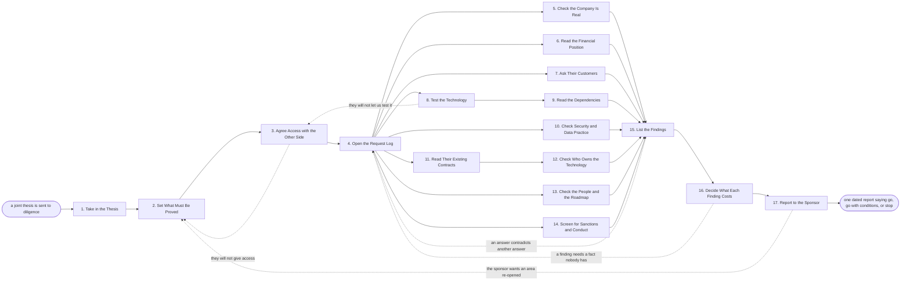

# Reference process: Run Alliance Diligence

`ref/prt/run-alliance-diligence v1`

**value stream:** [Opportunity-to-Alliance](../../streams/partners/opportunity-to-alliance.md)
A thesis says the two companies should work together. This process finds
out what the other company actually is. It sets what has to be proved,
agrees access with the other side, and then checks the company, its
money, its customers, its technology, its security, its contracts and
its people, each against evidence rather than against the pitch. Every
finding is rated and given an owner. The findings that survive are
priced into the terms or called a stop, and the sponsor hears one report
that says go, go with conditions, or stop.

## The activities

| # | Activity | What happens | Agents |
|---|---|---|---|
| 1 | Take in the Thesis | the thesis, and what it assumes about them | [diligence-coordinator](../../agents/diligence-coordinator.md) |
| 2 | Set What Must Be Proved | what has to be proved, and what is out of scope | diligence-coordinator · alliances lead (person) |
| 3 | Agree Access with the Other Side | who gives what, by when, and to whom | diligence-coordinator · alliances lead (person) |
| 4 | Open the Request Log | requests tracked, answers dated, nothing by memory | diligence-coordinator |
| 5 | Check the Company Is Real | registration, ownership and filings checked | [supplier-check](../../agents/supplier-check.md) |
| 6 | Read the Financial Position | revenue, runway and how concentrated it is | finance partner (person) · diligence-coordinator |
| 7 | Ask Their Customers | their own customers asked what it is like | [researcher](../../agents/researcher.md) · [partner-manager](../../agents/partner-manager.md) |
| 8 | Test the Technology | their product run against our real cases | [integration-planner](../../agents/integration-planner.md) · engineering lead (person) |
| 9 | Read the Dependencies | licenses, third parties and what they depend on | integration-planner · supplier-check |
| 10 | Check Security and Data Practice | how they hold data, and who can reach it | security reviewer (person) · supplier-check |
| 11 | Read Their Existing Contracts | exclusivity, change of control, favoured terms | legal reviewer (person) · supplier-check |
| 12 | Check Who Owns the Technology | who owns what we would embed or resell | legal reviewer (person) · diligence-coordinator |
| 13 | Check the People and the Roadmap | who builds it, and what they plan to build next | researcher · product lead (person) |
| 14 | Screen for Sanctions and Conduct | sanctions, ownership and conduct screening | supplier-check · legal reviewer (person) |
| 15 | List the Findings | every finding rated, with an owner and a date | diligence-coordinator |
| 16 | Decide What Each Finding Costs | each finding priced into terms, or called a stop | [deal-structurer](../../agents/deal-structurer.md) · finance partner (person) |
| 17 | Report to the Sponsor | go, go with conditions, or stop | executive sponsor (person) · diligence-coordinator |

## The graph



## The document, with the blanks marked

```
PROCESS: alliance diligence           id: <team>/run-alliance-diligence   v1
from: ref/prt/run-alliance-diligence v1
owner: <who>                          effective: <date>
trigger: a joint thesis is sent to diligence by <who>, in <your partner
         record>
         watch: record=<joint thesis> system=<your partner record>
                change=<a joint thesis is sent to diligence>
concurrency: runs may overlap - <how many> diligence runs live at once,
             and one candidate company is in one run at a time
goal: every claim the thesis rests on either proved with evidence or
      written down as unproved, each finding rated and owned, and one
      dated report to the sponsor
phases:
  take-in-thesis   - human: read the thesis and write down every claim
                     it rests on, as a numbered list to be proved or
                     disproved
                     owner: diligence-coordinator   after: trigger
                     automation: <level>
  set-scope        - convenes decide-and-announce: what must be proved,
                     what is deliberately out of scope, and how deep
                     each area goes. <who> confirms the scope
                     owner: <your alliances role>   after: take-in-thesis
                     by: <days>                     automation: <level>
  agree-access     - human: what the other side will give, to whom, by
                     when, and under which confidentiality agreement
                     owner: diligence-coordinator   after: set-scope
                     by: <days>                     automation: never
  open-log         - runs collect-and-report: one numbered request list,
                     every answer dated and attributed, nothing held in
                     anybody's memory or inbox
                     owner: diligence-coordinator   after: agree-access
                     automation: <level>
  check-company    - runs assessment: registration, ownership chain,
                     filings, litigation and whether the entity signing
                     is the entity that holds the product
                     owner: supplier-check          after: open-log
                     by: <days>                     automation: <level>
  read-financials  - runs assessment: revenue, growth, runway, customer
                     concentration, and how long they can fund what they
                     are promising to build
                     owner: <your finance role>     after: open-log
                     by: <weeks>                    automation: <level>
  ask-customers    - runs collect-and-report: <n> of their own customers
                     asked what the product does, what it does not do,
                     and how the company behaves when it breaks
                     owner: researcher              after: open-log
                     by: <weeks>                    automation: <level>
  test-technology  - runs assessment: their product run against <n> of
                     our real cases, at our volumes, by our engineers
                     owner: integration-planner     after: open-log
                     by: <weeks>                    automation: <level>
  read-dependencies - runs assessment: the licenses, the third-party
                     components and the services their product cannot
                     run without
                     owner: integration-planner  after: test-technology
                     by: <days>                     automation: <level>
  check-security   - runs assessment: how they hold customer data, who
                     inside their company can reach it, what they have
                     been certified against, and what they have breached
                     owner: <your security role>    after: open-log
                     by: <weeks>                    automation: never
  read-contracts   - runs assessment: their existing agreements read for
                     exclusivity, change of control, most favoured
                     terms, and anything that binds what they may sign
                     owner: <your legal role>       after: open-log
                     by: <weeks>                    automation: never
  check-ownership  - runs assessment: who owns the technology we would
                     embed or resell, what is licensed in, and what we
                     would still be allowed to use if they were bought
                     owner: <your legal role>    after: read-contracts
                     by: <days>                     automation: never
  check-people     - runs collect-and-report: who actually builds the
                     product, how many of them there are, how long they
                     stay, and what is on the roadmap after our work
                     owner: researcher              after: open-log
                     by: <weeks>                    automation: <level>
  screen-conduct   - runs assessment: sanctions, ownership screening,
                     conduct and any check <your regulator> requires
                     before a company may be contracted with
                     owner: supplier-check          after: open-log
                     by: <days>                     automation: <level>
  list-findings    - runs collect-and-report: every finding written
                     once, rated <your rating scale>, with the evidence
                     behind it, an owner and a date
                     owner: diligence-coordinator
                     after: check-company + read-financials +
                     ask-customers + read-dependencies + check-security +
                     check-ownership + check-people + screen-conduct
                     by: <days>                     automation: <level>
  price-findings   - convenes decide-and-announce: each surviving
                     finding either priced into the terms, covered by a
                     condition, accepted in writing, or called a stop
                     owner: deal-structurer         after: list-findings
                     by: <days>                     automation: <level>
  report-sponsor   - convenes approval: one dated report to <who>,
                     saying go, go with conditions, or stop, with every
                     unproved claim named as unproved
                     owner: <your executive sponsor role>
                     after: price-findings
                     by: <days>                     automation: never
run-scoped:
  request-status - runs roll-call            owner: diligence-coordinator
                   every: <cadence>
                   from: open-log     until: list-findings
  cost-log       - runs allocate-and-reconcile
                   owner: <your finance role>
                   from: agree-access until: run close
handoffs:
  take-in-thesis -> set-scope [claims-to-prove]: the numbered claims the
    thesis rests on, each marked as provable or as opinion
  set-scope -> agree-access [scope-and-evidence]: the areas in scope,
    how deep each goes, and what evidence would settle each claim
  agree-access -> open-log [access-agreed]: what the other side agreed
    to give, to whom, by when, and under which agreement
  open-log -> check-company [request-list]: the request list, and the
    person on each side who owns every open request
  check-company -> list-findings [company-record]: the entity, its
    owners, its filings and its litigation, each with the source and the
    date read
  read-financials -> list-findings [financial-position]: the financial
    position, the runway, and the customers they cannot afford to lose
  ask-customers -> list-findings [customer-accounts]: what their
    customers said, in their own words, with the count that would not
    speak to us
  test-technology -> read-dependencies [test-results]: the product as it
    ran on our cases, with every failure recorded rather than retried
    quietly
  read-dependencies -> list-findings [inherited-dependencies]: the
    licenses and third parties their product needs, and which of them we
    would inherit
  check-security -> list-findings [security-practice]: how they hold
    data, who can reach it, what is certified and what is only claimed
  read-contracts -> check-ownership [binding-clauses]: the clauses that
    limit what they may sign with us, quoted
  check-ownership -> list-findings [ownership-position]: who owns each
    piece we would embed, and what survives a change of control
  check-people -> list-findings [team-and-roadmap]: the team behind the
    product, its size and turnover, and what the roadmap puts after our
    work
  screen-conduct -> list-findings [screening-results]: the screens run,
    the date, the source and every hit with what was done about it
  list-findings -> price-findings [rated-findings]: every finding once,
    rated, with its evidence, its owner and the claim it settles or
    leaves open
  price-findings -> report-sponsor [priced-findings]: each finding
    priced, covered, accepted or called a stop, with the person who
    decided
deviations:
  agree-access -> set-scope [access-refused]: the other side will not
    give access, so the areas that cannot be proved are cut from scope
    in writing and reported as cut rather than clean
  test-technology -> agree-access [testing-refused]: they will not let
    us run the product on our own cases, so the access agreement is
    worked again before anything is called a test
  list-findings -> open-log [answers-contradict]: one answer contradicts
    another, so the request is reopened and both answers stay in the log
    with their dates
  price-findings -> open-log [fact-nobody-has]: pricing a finding needs
    a fact nobody has, so it goes back to the log as a new request
  report-sponsor -> set-scope [area-reopened]: the sponsor sends an area
    back, so the scope reopens for that area only and the earlier report
    is superseded rather than edited
bindings:
  roster:  <who holds each role - agents claiming the abstract agents
           above, and named people for the alliances lead, the finance
           partner, the security reviewer, the legal reviewer, the
           engineering lead, the product lead and the executive sponsor>
  systems: <your partner record> (write), the document room (write),
           the request log (write), <your screening service> (read),
           <your test environment> (write), the contract system (read),
           <your company registry sources> (read)
  data:    the joint thesis <version>, the confidentiality agreement,
           <your diligence checklist> <version>, <your rating scale>,
           <your security standard> <version>
policy:
  a claim with no evidence behind it is reported as unproved, and is
    never reported as proved because nobody objected
  every request and every answer lives in the request log, and an answer
    given only in a meeting is written into the log before it counts
  material received under confidentiality is read only by the people the
    access agreement names
  the security review and the contract review are human gates and are
    never delegated to an agent
  a screening hit stops the run until <who> has read it and written down
    what happens next
  a finding nobody will own is escalated to <who> rather than closed
  the report to the sponsor names every area that was cut from scope
measures:
  cycle time: <target> from the thesis arriving to the sponsor report
  evidence: <target> share of claims settled with evidence rather than
            with an assurance
  volume: <diligence runs per period>
  quality gate: every finding carries evidence, a rating and an owner,
                and no unproved claim is reported as proved
```

## The failure edges

- **The other side will not give access.** The request list stays open,
  the run goes back to the scope, and the areas that cannot be proved
  are cut from scope in writing. They are then reported as cut, not as
  clean. A company that gives no access at all ends the run.
- **They will not let us test the product.** The integration-planner
  agent records the refusal and the run returns to the access
  agreement. A demonstration run by the other company is recorded as a
  demonstration and never as a test.
- **Two answers contradict each other.** The diligence-coordinator agent
  reopens the request rather than choosing the answer that suits the
  thesis. Both answers stay in the log with their dates, and the
  contradiction is a finding whether or not it is resolved.
- **A screening hit comes back.** The run stops on that candidate until
  the named person has read the hit and written down what happens next.
  Continuing while the hit is open is not one of the choices, and a
  false positive is cleared on the record rather than in conversation.
- **Their contracts forbid what the thesis assumes.** The legal reviewer
  quotes the clause, and the finding goes to pricing as a structural
  problem rather than a risk. The shape of the arrangement changes or
  the run stops.
- **The technology does not do what the pitch said.** The findings carry
  what actually ran, on which cases, at what volume. The thesis is not
  quietly rewritten to match. Whether the gap is priced, conditioned or
  fatal is decided at pricing, by a named person.
- **A finding has no owner.** It goes up rather than closing itself. A
  finding closed because nobody claimed it is the one that arrives later
  as a surprise, and the run does not allow it.
- **The sponsor sends an area back.** The scope reopens for that area
  only, the request log carries the new requests, and the earlier report
  is superseded rather than edited. Both versions stay.
- **A run is abandoned.** The other side is told diligence has stopped
  and by whom. Material received under confidentiality is returned or
  destroyed as the agreement requires, and the destruction is recorded.
  The findings gathered so far are kept with the reason the run stopped,
  the request log is closed with its open items listed, and the cost
  line reconciles anyway.
