# Reference process: Set a Partner Tier

`ref/prt/set-a-partner-tier v1`

**value stream:** [Performance-to-Tier](../../streams/partners/performance-to-tier.md)
A tier is a promise about how the company will treat somebody, so the
rules that give it have to be published first and then applied the same
way to everybody. This run reads the rules at the version in force,
pulls the same evidence for every partner, and lets the rules produce
the tier before anybody argues. Every departure from the rules is
written down as an exception with a name against it. What the tier costs
is priced, the margin floor is checked, and the support behind the
promise is confirmed to have people. Each partner is told their tier,
the reason, and what would move it, and the systems are changed to match
before the round closes.

## The activities

| # | Activity | What happens | Agents |
|---|---|---|---|
| 1 | Open the Tiering Round | which partners, on which rules, from which date | [partner-manager](../../agents/partner-manager.md) · [tier-assessor](../../agents/tier-assessor.md) |
| 2 | Read the Rules in Force | the published rules at the version that applies | tier-assessor · legal reviewer (person) |
| 3 | Pull the Same Evidence for Everybody | one measure set, one period, one source | [analytics](../../agents/analytics.md) · [partner-monitor](../../agents/partner-monitor.md) |
| 4 | Check the Evidence Is Complete | a missing measure is not treated as a zero | analytics · tier-assessor |
| 5 | Apply the Rules | the tier the rules give, before anybody argues | tier-assessor |
| 6 | List Every Exception | where a proposal differs from the rules, and why | tier-assessor · partner lead (person) |
| 7 | Price What Each Tier Costs | margins, discounts, funds and support per tier | [margin-keeper](../../agents/margin-keeper.md) · finance partner (person) |
| 8 | Check the Margin Holds | the tier's discount against the floor | margin-keeper · finance partner (person) |
| 9 | Check the Support Can Be Given | the capacity behind what the tier promises | partner-manager · support lead (person) |
| 10 | Approve the Tiers and the Exceptions | a person signs each tier and each exception | channel leader (person) · finance partner (person) · tier-assessor |
| 11 | Set the Dates and the Notice | when a tier starts, and the notice a drop needs | partner-manager · legal reviewer (person) |
| 12 | Tell Each Partner Their Tier | the tier, the reason, and what would move it | partner-manager · partner lead (person) |
| 13 | Change the Systems | price lists, portal access, funds and routing | partner-manager · margin-keeper |
| 14 | Check the Partner Sees the Right Thing | the entitlement as the partner experiences it | partner-monitor · partner-manager |
| 15 | Publish the Round | the spread across tiers, and the rules used | [reporting-manager](../../agents/reporting-manager.md) · analytics |
| 16 | Record What the Rules Got Wrong | where the rules did not fit, and what to change | tier-assessor · partner-manager |

## The graph

```mermaid
flowchart LR
  T([the tiering cadence comes round, or a review refers a partner]) --> A1[1. Open the Tiering Round]
  A1 --> A2[2. Read the Rules in Force]
  A2 --> A3[3. Pull the Same Evidence for Everybody]
  A3 --> A4[4. Check the Evidence Is Complete]
  A4 -. a measure is missing for a partner .-> A3
  A4 --> A5[5. Apply the Rules]
  A5 --> A6[6. List Every Exception]
  A5 --> A7[7. Price What Each Tier Costs]
  A7 --> A8[8. Check the Margin Holds]
  A7 --> A9[9. Check the Support Can Be Given]
  A8 -. the discount breaks the floor .-> A7
  A9 -. the support cannot be staffed .-> A7
  A6 --> A10[10. Approve the Tiers and the Exceptions]
  A8 --> A10
  A9 --> A10
  A10 -. an exception has no reason behind it .-> A6
  A10 --> A11[11. Set the Dates and the Notice]
  A11 --> A12[12. Tell Each Partner Their Tier]
  A11 --> A13[13. Change the Systems]
  A12 -. the partner shows evidence the round missed .-> A3
  A12 --> A14[14. Check the Partner Sees the Right Thing]
  A13 --> A14
  A14 -. the entitlement does not match the tier .-> A13
  A14 --> A15[15. Publish the Round]
  A15 --> A16[16. Record What the Rules Got Wrong]
  A16 --> DONE([every partner holds the tier the published rules give them])
```



## The document, with the blanks marked

```
PROCESS: set a partner tier           id: <team>/set-a-partner-tier  v1
from: ref/prt/set-a-partner-tier v1
owner: <who>                          effective: <date>
trigger: the tiering cadence comes round every <cadence>, or <your
         partner review process> refers a partner whose result moves a
         tier
         watch: every=<cadence>
         or watch: record=<partner review result>
                system=<your partner record>
                change=<a review refers a partner whose result moves a
                tier>
concurrency: one round at a time for a given <program or region>, and a
             partner is tiered by one round at a time
goal: every partner in scope holding the tier the published rules give
      them, with every exception named and signed, the margin and the
      support behind each tier confirmed, and every partner told their
      tier, the reason, and what would move it
phases:
  open-round         - human: which partners are being tiered, on which
                       rules version, and from what date the result
                       applies
                       owner: partner-manager   after: trigger
                       automation: <level>
  read-rules         - human: the published tier rules at the version
                       in force, with the date they were published and
                       the notice each change to them requires
                       owner: tier-assessor     after: open-round
                       automation: <level>
  pull-evidence      - runs collect-and-report: the same measures for
                       every partner, over the same period, from the
                       same systems, each line naming its source
                       owner: analytics         after: read-rules
                       by: <days>               automation: <level>
  check-evidence     - runs assessment: every measure present for every
                       partner, and every absence marked as absent
                       rather than counted as nothing
                       owner: analytics         after: pull-evidence
                       by: <days>               automation: <level>
  apply-rules        - runs assessment: the rules applied to the
                       evidence, producing a tier per partner with the
                       inputs and the rules version recorded
                       owner: tier-assessor     after: check-evidence
                       automation: <level>
  list-exceptions    - human: every partner whose proposed tier differs
                       from the rules result, with the reason, the
                       person asking, and how long it runs
                       owner: tier-assessor     after: apply-rules
                       by: <days>               automation: <level>
  price-tiers        - runs allocate-and-reconcile: the margin, the
                       discount, the funds and the support hours each
                       tier carries, costed against <your plan>
                       owner: margin-keeper     after: apply-rules
                       by: <days>               automation: <level>
  check-margin       - runs assessment: each tier's discount set
                       against <your margin floor>, at the volume the
                       tier is expected to do
                       owner: margin-keeper     after: price-tiers
                       automation: <level>
  check-support      - runs assessment: the response times and the
                       named contacts each tier promises, set against
                       the people who would have to answer
                       owner: <your support leadership role>
                       after: price-tiers
                       by: <days>               automation: <level>
  approve-tiers      - convenes approval: a named signer for the tier
                       set and a named signer for every exception,
                       against a version of the round
                       owner: <your channel leadership role>
                       after: list-exceptions + check-margin + check-support
                       by: <days>               automation: never
  set-dates          - human: the date each tier starts, the notice a
                       drop gets, and the period a partner keeps their
                       old terms while the notice runs
                       owner: partner-manager   after: approve-tiers
                       automation: <level>
  tell-partners      - runs decide-and-announce: every partner hears
                       their tier, the rules version behind it, the
                       measures that produced it, and what would move
                       it
                       owner: partner-manager   after: set-dates
                       by: <days>               automation: <level>
  change-systems     - human: price lists, discount codes, portal
                       access, fund entitlement and support routing set
                       to match the approved tier from its start date
                       owner: partner-manager   after: set-dates
                       by: <days>               automation: <level>
  verify-entitlement - runs assessment: what the partner can actually
                       see, buy and claim, checked against the tier
                       they were told they hold
                       owner: partner-monitor
                       after: tell-partners + change-systems
                       by: <days>               automation: <level>
  publish-round      - runs collect-and-report: how many partners sit
                       in each tier, how many moved which way, and how
                       many exceptions were signed and by whom
                       owner: reporting-manager after: verify-entitlement
                       by: <days>               automation: <level>
  record-rule-gaps   - convenes debrief: where the rules gave a tier
                       nobody could defend, and what the next version
                       of the rules should say
                       owner: tier-assessor     after: publish-round
                       automation: <level>
run-scoped:
  exceptions - runs collect-and-report          owner: tier-assessor
               from: list-exceptions   until: run close
  cost       - runs allocate-and-reconcile      owner: margin-keeper
               from: price-tiers   until: run close
handoffs:
  open-round -> read-rules [partners-and-date]: the partners in scope,
    and the date the result has to apply from
  read-rules -> pull-evidence [rules-in-force]: the measures the rules
    name, so the evidence is pulled for what the rules actually use
  pull-evidence -> check-evidence [measures-pulled]: the measures for
    every partner, each line naming the system and the date it was read
    from
  check-evidence -> apply-rules [complete-evidence]: complete evidence,
    with every gap marked as a gap rather than filled with a zero
  apply-rules -> list-exceptions [rules-result]: the tier the rules gave
    each partner, and the inputs that produced it
  apply-rules -> price-tiers [tier-spread]: how many partners land in
    each tier, so the cost of the tier is priced against real numbers
  list-exceptions -> approve-tiers [departures]: every departure from
    the rules, the reason, the person asking, and the date it expires
  price-tiers -> check-margin [tier-cost]: the discount and the funds
    each tier carries, at the volume assumed
  price-tiers -> check-support [tier-promises]: the response times and
    the contacts each tier promises
  check-margin -> approve-tiers [margin-finding]: the tiers that hold
    the floor and the ones that do not, with the shortfall on each
  check-support -> approve-tiers [support-finding]: the tiers the
    support team can staff and the ones it cannot, with the headcount
    behind the answer
  approve-tiers -> set-dates [signed-tiers]: the signed tier set and the
    signed exceptions, at a version
  set-dates -> tell-partners [dates-and-notice]: the start date, the
    notice, and the period a dropped partner keeps their old terms
  set-dates -> change-systems [dates-for-systems]: the same dates, so
    what the partner is told and what the systems do start on the same
    day
  tell-partners -> verify-entitlement [tier-as-told]: what each partner
    was told they hold, so the systems can be checked against it
  change-systems -> verify-entitlement [systems-set]: what each system
    was set to, and the date it took effect
  verify-entitlement -> publish-round [entitlement-check]: the partners
    whose entitlement matches what they were told, and the ones whose
    does not
  publish-round -> record-rule-gaps [published-round]: the round as
    published, including the exception count
deviations:
  check-evidence -> pull-evidence [measure-missing]: a measure is
    missing for a partner, so it is pulled again rather than counted as
    a zero
  check-margin -> price-tiers [discount-breaks-floor]: the tier's
    discount breaks the margin floor, so the tier is priced again with
    the shortfall attached
  check-support -> price-tiers [support-cannot-be-staffed]: the support
    the tier promises cannot be staffed, so the promise is priced again
    against the people who would answer
  approve-tiers -> list-exceptions [exception-has-no-reason]: an
    exception has no reason behind it, so it goes back to be written
    with a reason and a named person or dropped
  tell-partners -> pull-evidence [evidence-round-missed]: a partner
    shows evidence the round did not see, so it is pulled in and the
    rules are applied again
  verify-entitlement -> change-systems [entitlement-mismatch]: what the
    partner can see, buy or claim does not match their tier, so the
    systems are set again before the round closes
bindings:
  roster:  <who holds each role - agents claiming the abstract agents
           above, the partner leads who ask for exceptions, the finance
           partner who signs the cost, the support leader who confirms
           the capacity, and the channel leader who approves the round>
  systems: the partner record (write), the partner portal (write),
           <your price list system> (write), <your finance system>
           (read), the agreement record (read),
           <your support ticketing system> (write),
           the notification channel (write)
  data:    <your published tier rules> <version>, <your margin floor>,
           the evidence set for the period, <your notice periods>,
           <your exception register>
policy:
  the tier rules are published before the round that applies them, and
    a partner can read the rules that decided their tier
  the same measures, over the same period, from the same systems, for
    every partner in scope
  a missing measure is recorded as missing and never counted as a zero
  any departure from the rules is an exception, is written down with a
    named person behind it, expires on <a date>, and is counted in the
    published round
  no tier is signed while its discount sits below <your margin floor>,
    unless <who> accepts the shortfall in writing
  no tier promises support the support team has not confirmed it can
    staff
  a partner moving down gets <notice period> before the new terms
    apply, and keeps their old terms while the notice runs
  approval is a human gate and is never delegated to an agent
  what the systems give a partner matches the tier they were told they
    hold, and a mismatch is fixed before the round closes
measures:
  cycle time: <target> from the round opening to every partner told
  coverage: <target> share of partners in scope tiered by the rules
            without an exception
  volume: <partners tiered per round>
  quality gate: <sample size> of tiers recomputed each <period> from
                the recorded inputs and the rules version
```

## The failure edges

- **A measure is missing for one partner.** The round does not fill the
  gap with a zero, because a zero is a tier decision made by accident.
  The run goes back to the evidence, and a partner whose evidence stays
  incomplete keeps their current tier with the reason recorded, rather
  than being dropped by a rule that never actually ran.
- **The rules give a tier nobody can defend.** The result stands for
  this round and goes on the record as an exception with a named person
  behind it. Quietly overriding the rules is not a choice, because a
  tier the rules did not give and nobody signed is the thing that makes
  the whole scheme unbelievable. What went wrong goes into the rule
  gaps at the end of the round.
- **Exceptions outnumber the rule.** The exception count is published
  with the round for this reason. When more partners sit outside the
  rules than inside them, the rules are wrong and the next version is
  written, rather than the exception list growing again.
- **The tier's discount breaks the margin floor.** The pricing goes back
  with the shortfall attached. Either the discount changes, the volume
  assumption changes, or the finance partner accepts the shortfall in
  writing and the acceptance is recorded against that tier.
- **The support behind a tier cannot be staffed.** The promise is cut to
  what the team can answer before anybody is told about it. A response
  time nobody can meet costs more trust than the tier was worth.
- **A partner produces evidence the round did not see.** The run goes
  back to the evidence step with what the partner sent, the rules are
  applied again, and the tier is either confirmed or reissued. It is
  reissued as a new decision with its own date, not edited over the old
  one.
- **The systems say something different from the letter.** The
  entitlement check finds a price list, a portal or a support queue
  still on the old tier. The round does not close until the systems
  match, and any partner who bought at the wrong terms in between is
  made whole by finance.
- **A partner is moving down.** The notice period runs before the new
  terms apply, the partner keeps the old terms while it runs, and they
  are told what would move them back. A drop announced and applied on
  the same day is a broken promise regardless of what the rules said.
- **A run is abandoned.** Every partner keeps the tier they already
  held, and no system is left half changed: any price list, portal
  entitlement or support route already moved is put back to the tier in
  force. Partners already told a new tier are told the round did not
  complete and their terms are unchanged, and the referrals that came
  in from a review are re-triggered rather than dropped.
