# Reference process: Sign a Partner Agreement

`ref/prt/sign-a-partner-agreement v1`

**value stream:** [Prospect-to-Partner](../../streams/partners/prospect-to-partner.md)
A candidate has been qualified and both sides want to work together.
This process writes the terms that govern that, negotiates them, and
gets them signed. The conditions the qualification attached to the
candidate are carried into the paper as obligations rather than left in
a report nobody reads again. Concessions are approved inside the
company before they are offered. The final text is read against the
agreed list term by term before anyone signs. What leaves the run is an
executed agreement, filed, with the people who have to work it holding
the same version.

## The activities

| # | Activity | What happens | Agents |
|---|---|---|---|
| 1 | Take in the Qualified Candidate | the decision, the conditions and the evidence | [agreement-writer](../../agents/agreement-writer.md) · [partner-manager](../../agents/partner-manager.md) |
| 2 | Set What the Agreement Must Do | the rights given and the duties owed, both ways | partner-manager · partner lead (person) |
| 3 | Carry the Conditions Across | every qualification condition becomes a term | agreement-writer · [partner-qualifier](../../agents/partner-qualifier.md) |
| 4 | Choose the Paper to Start From | which template, which schedules, which country | agreement-writer · legal reviewer (person) |
| 5 | Set the Terms and the Floor | margin, fees, targets, and what we will not go below | partner lead (person) · finance partner (person) · partner-manager |
| 6 | Draft the Agreement | the first full draft, with its schedules attached | agreement-writer |
| 7 | Review It Before It Goes Out | legal, finance and the partner lead read it first | legal reviewer (person) · finance partner (person) · partner-manager |
| 8 | Send the Draft and Take the Markup | the draft goes out at a version and comes back | partner-manager · agreement-writer |
| 9 | List Every Change They Ask For | the markup gathered into one numbered list | agreement-writer |
| 10 | Price and Sort the Changes | each change marked give, trade or refuse | agreement-writer · finance partner (person) |
| 11 | Approve the Concessions Inside | cleared inside before any of it is offered | partner lead (person) · finance partner (person) |
| 12 | Negotiate the Open Terms | the list worked through with the partner | partner lead (person) · partner-manager |
| 13 | Settle the Schedules | territory, products, targets, support and prices | partner-manager · agreement-writer · sales leader (person) |
| 14 | Check the Paper Against the Agreement | the final text read against the agreed list | agreement-writer · legal reviewer (person) |
| 15 | Clear the Partner for Signature | the entity that signs is screened once more | [supplier-check](../../agents/supplier-check.md) · legal reviewer (person) |
| 16 | Sign the Agreement | both sides sign, in the order the paper sets | signing authority (person) · partner lead (person) |
| 17 | Record It and Hand It On | the executed copy filed and given to the people | agreement-writer · partner-manager |

## The graph

```mermaid
flowchart LR
  T([a qualified candidate and the company agree to paper the deal]) --> A1[1. Take in the Qualified Candidate]
  A1 --> A2[2. Set What the Agreement Must Do]
  A2 --> A3[3. Carry the Conditions Across]
  A2 --> A4[4. Choose the Paper to Start From]
  A2 --> A5[5. Set the Terms and the Floor]
  A3 --> A6[6. Draft the Agreement]
  A4 --> A6
  A5 --> A6
  A6 --> A7[7. Review It Before It Goes Out]
  A7 -. the draft drops a condition .-> A6
  A7 --> A8[8. Send the Draft and Take the Markup]
  A8 --> A9[9. List Every Change They Ask For]
  A9 -. the markup is not the whole of it .-> A8
  A9 --> A10[10. Price and Sort the Changes]
  A10 --> A11[11. Approve the Concessions Inside]
  A11 -. a concession is refused inside .-> A10
  A11 --> A12[12. Negotiate the Open Terms]
  A12 -. an ask sits below the floor .-> A5
  A12 --> A13[13. Settle the Schedules]
  A13 --> A14[14. Check the Paper Against the Agreement]
  A14 -. the paper does not say what was agreed .-> A12
  A14 --> A15[15. Clear the Partner for Signature]
  A15 -. the screening finds something new .-> A12
  A15 --> A16[16. Sign the Agreement]
  A16 -. a signer will not sign as drafted .-> A12
  A16 --> A17[17. Record It and Hand It On]
  A17 --> DONE([an executed agreement, filed, held by everyone who works it])
```



## The document, with the blanks marked

```
PROCESS: sign a partner agreement  id: <team>/sign-a-partner-agreement  v1
from: ref/prt/sign-a-partner-agreement v1
owner: <who>                          effective: <date>
trigger: a candidate is marked qualified in <your partner record> and
         both sides agree to paper the relationship
         watch: record=<candidate> system=<your partner record>
                change=<a candidate is marked qualified and both sides
                agree to paper the relationship>
concurrency: runs may overlap - <how many> agreements live at once,
             and one partner is papered by one run at a time
goal: an executed agreement whose terms match the agreed list line for
      line, every qualification condition written in as an obligation,
      and every concession carrying a named approver
phases:
  take-in-candidate    - human: read the qualification decision, the
                         conditions attached to it, and the evidence
                         behind both
                         owner: agreement-writer   after: trigger
                         automation: <level>
  set-what-it-does     - convenes decide-and-announce: what each side
                         may do, must do and may not do, written before
                         any template is opened
                         owner: <your partner leadership role>
                         after: take-in-candidate
                         by: <days>                automation: <level>
  carry-conditions     - human: every condition the qualification
                         attached, rewritten as a term with a date, a
                         measure and a consequence
                         owner: agreement-writer
                         after: set-what-it-does   automation: <level>
  choose-paper         - convenes decide-and-announce: which template,
                         which schedules, which country's law, and what
                         the partner's own paper may not replace
                         owner: <your legal role>
                         after: set-what-it-does
                         by: <days>                automation: never
  set-commercials      - convenes decide-and-announce: margin, fees,
                         targets, payment terms, and the floor below
                         which <who> refuses to sign
                         owner: <your finance role>
                         after: set-what-it-does
                         by: <days>                automation: never
  draft                - runs build-by-talent: the full draft with its
                         schedules, every term traceable to the agreed
                         list or to the template
                         owner: agreement-writer
                         after: carry-conditions + choose-paper +
                                set-commercials
                         by: <days>                automation: <level>
  review-inside        - convenes approval: legal, finance and the
                         partner lead sign the draft as named signers
                         before it leaves the company
                         owner: <your legal role>  after: draft
                         by: <days>                automation: never
  send-and-take-markup - human: the draft goes to the partner at a
                         version, and their markup comes back against
                         that same version
                         owner: partner-manager    after: review-inside
                         by: <days>                automation: <level>
  list-changes         - runs collect-and-report: every requested
                         change gathered into one numbered list, in the
                         partner's own wording, clause by clause
                         owner: agreement-writer
                         after: send-and-take-markup
                         by: <days>                automation: <level>
  price-and-sort       - runs assessment: each change marked give,
                         trade or refuse, with what it costs and what
                         we ask for in return
                         owner: agreement-writer   after: list-changes
                         by: <days>                automation: <level>
  approve-concessions  - convenes approval: the give and trade list
                         signed inside, by the people whose numbers it
                         moves, before any of it is offered
                         owner: <your finance role>
                         after: price-and-sort
                         by: <days>                automation: never
  negotiate-open-terms - human: the numbered list worked through with
                         the partner, against the approved positions
                         and the floor
                         owner: <your partner leadership role>
                         after: approve-concessions
                         automation: <level>
  settle-schedules     - convenes decide-and-announce: territory,
                         products, targets, support duties and prices,
                         each agreed by the person who owns it
                         owner: partner-manager
                         after: negotiate-open-terms
                         by: <days>                automation: <level>
  check-paper          - runs assessment: the final text read against
                         the agreed list term by term, and every
                         difference named
                         owner: agreement-writer
                         after: settle-schedules
                         by: <days>                automation: <level>
  clear-for-signature  - runs assessment: the entity that will sign
                         screened again, and its signing authority
                         confirmed against <your screening service>
                         owner: supplier-check     after: check-paper
                         by: <days>                automation: <level>
  sign                 - convenes approval: both sides sign, in the
                         order the paper sets, and each signature is
                         dated and kept
                         owner: <your signing authority>
                         after: clear-for-signature
                         by: <days>                automation: never
  record-and-hand-on   - human: the executed copy filed, the terms
                         written into the partner record, and the
                         people who must work them told
                         owner: partner-manager    after: sign
                         by: <days>                automation: <level>
run-scoped:
  concessions - runs allocate-and-reconcile
                owner: agreement-writer
                from: price-and-sort   until: run close
  status      - runs roll-call
                owner: partner-manager
                every: <cadence>
                from: send-and-take-markup   until: run close
handoffs:
  take-in-candidate -> set-what-it-does [qualification-decision]: the
    qualification decision, the conditions attached to it, and the
    claims left unproven
  set-what-it-does -> carry-conditions [rights-and-duties]: what each
    side may do, must do and may not do, at a version both our own
    people hold
  set-what-it-does -> choose-paper [agreement-purpose]: the same
    statement, so the template is picked for the relationship rather
    than out of habit
  set-what-it-does -> set-commercials [duties-taken-on]: the duties
    each side takes on, so the money is set against real obligations
  carry-conditions -> draft [conditions-as-terms]: every condition as a
    term, with the date it bites, the measure it is read against, and
    what happens if it is missed
  choose-paper -> draft [template-and-schedules]: the template at a
    version, the schedules it needs, and the clauses that may not be
    changed
  set-commercials -> draft [commercial-terms]: margin, fees, targets,
    payment terms, and the floor, with the person who set the floor
    named
  draft -> review-inside [first-draft]: the full draft, every term
    traced to the agreed list or to the template it came from
  review-inside -> send-and-take-markup [approved-draft]: the draft at
    the signed internal version, and the reviewers who signed it
  send-and-take-markup -> list-changes [partner-markup]: the partner's
    markup, against the version it was sent at, with the date it came
    back
  list-changes -> price-and-sort [numbered-changes]: every requested
    change numbered, in the partner's own words, clause by clause
  price-and-sort -> approve-concessions [change-costing]: what each
    change costs, who carries it, and what we ask for in return
  approve-concessions -> negotiate-open-terms [approved-positions]: the
    approved give and trade positions, each with its approver and the
    date
  negotiate-open-terms -> settle-schedules [closed-changes]: every
    change closed as given, traded or refused, with the person on each
    side who agreed
  settle-schedules -> check-paper [settled-schedules]: the schedules as
    settled, each naming the person who owns the number in it
  check-paper -> clear-for-signature [text-against-agreed]: the final
    text, the agreed list, and every difference between the two
  clear-for-signature -> sign [signing-entity-cleared]: the entity that
    signs, its screening result at a date, and the person confirmed to
    sign for it
  sign -> record-and-hand-on [executed-agreement]: the executed
    agreement, the signatures with their dates, and the version that
    was signed
deviations:
  review-inside -> draft [condition-dropped]: the draft drops a
    qualification condition, so it is drafted again with the condition
    written in or with a named decision to drop it
  list-changes -> send-and-take-markup [markup-incomplete]: the markup
    is not the whole of what they want changed, so it goes back for a
    complete markup against the version that was sent
  approve-concessions -> price-and-sort [concession-refused]: an
    approver refuses a concession, so the change is priced and sorted
    again against the floor
  negotiate-open-terms -> set-commercials [ask-below-floor]: an ask
    sits below the floor, so the floor and the commercial terms are set
    again before anything is offered
  check-paper -> negotiate-open-terms [paper-disagrees]: the final text
    and the agreed list differ, so the difference goes back to the
    table rather than into the drafting
  clear-for-signature -> negotiate-open-terms [screening-finds-new]:
    the screening before signature finds something new, so signature is
    held and the terms are worked again
  sign -> negotiate-open-terms [signer-will-not-sign]: a signer will
    not sign as drafted, so the terms behind the refusal go back to the
    table
bindings:
  roster:  <who holds each role - agents claiming the abstract agents
           above, and named people for the partner lead, the legal
           reviewer, the finance partner, the sales leader and the
           person who signs>
  systems: the contract system (write), the partner record (write),
           the signing service (write), the approval system (write),
           <your screening service> (read),
           the pricing model (read, cap: <n> margin),
           the shared workspace with the partner (write)
  data:    <your partner agreement template> <version>, <your standard
           terms> <version>, <your margin policy> <version>, the
           qualification decision and its conditions, the agreed list
policy:
  every condition the qualification attached appears in the agreement
    as a term with a date and a consequence, or the run records who
    decided to drop it
  no concession is offered to the partner before it is approved
    inside, and the approval names a person
  a term below the floor is refused, and only <who> may move the floor
  the draft that goes out is a version, and a markup against any other
    version goes back for a fresh markup
  legal and finance review is a human gate and is never delegated to
    an agent
  nothing is signed while the final text and the agreed list differ on
    any term
  the screening runs again on the entity that actually signs, within
    <days> of signature
  the executed copy is filed within <days>, and the terms that other
    processes rely on are written into the partner record
measures:
  cycle time: <target> from a qualified candidate to an executed
              agreement
  drift: <target> for the gap between the draft as sent and the
         agreement as signed
  volume: <agreements per period>
  quality gate: no agreement is executed with an unapproved concession
                in it or a qualification condition missing from it
```

## The failure edges

- **A qualification condition never reaches the paper.** The
  agreement-writer agent finds a condition with no matching term during
  the internal review, and the draft goes back. Dropping a condition is
  allowed, and it is a decision with a name and a reason on it, not
  something that happens because a clause was hard to write.
- **The partner returns their own paper instead of a markup.** The run
  does not start again from their template. Their document is read into
  the numbered change list against our draft, clause by clause, and the
  negotiation runs on that list. If their paper must be the base, that
  is a decision the legal reviewer makes and the run returns to choosing
  the paper.
- **The markup arrives against an old version.** The changes are not
  merged. The partner is sent the current version and asked to mark it
  again, because a merge across versions is where a term nobody agreed
  to gets in.
- **A concession is offered before it is approved.** The offered term
  has no approval behind it, the run goes back to the approval, and the
  partner is told the term is not confirmed. Nobody treats it as agreed
  while the approval is missing.
- **An ask sits below the floor.** It is refused in writing, with the
  reason, and the rest of the list continues. Only the person who set
  the floor may move it, and moving it is recorded as a decision with a
  date.
- **The final text and the agreed list differ.** The check names the
  difference term by term, and the run goes back to the negotiation
  rather than to the drafting, because which of the two is wrong is a
  question for both sides. Signing to save a week and fixing it in an
  amendment is not one of the choices.
- **The screening before signature finds something new.** Ownership
  changed, a sanction landed, or the signing entity is not the one that
  was qualified. Signature is held, the finding goes to the legal
  reviewer and the partner lead, and the run returns to the negotiation
  or the agreement is refused.
- **The person who signs turns out not to have the authority.** The
  signature is treated as not given. The run confirms who actually
  holds the authority, and the paper is signed again by them. A
  countersigned copy from the wrong person is filed as evidence of the
  attempt, not as an agreement.
- **The trigger fires while runs are in flight.** Agreements overlap
  normally, and the concurrency line says how many. One partner is
  papered by one run, so a second relationship with the same partner is
  written as a schedule to the open agreement or waits for the run to
  close.
- **A run is abandoned.** The draft is withdrawn and marked stale in the
  contract system, the internal approvals given for concessions are
  cancelled so they cannot be reused on another partner, the partner is
  told the paper has stopped and who to speak to, and the qualification
  decision stays on the partner record with the date the run stopped and
  the reason.
