# Reference process: Structure an Alliance

`ref/prt/structure-an-alliance v1`

**value stream:** [Opportunity-to-Alliance](../../streams/partners/opportunity-to-alliance.md)
Diligence is done and both companies still want to proceed. This process
decides what the arrangement actually is: the shape, the money, the
exclusivity, the term, the exit and who decides what. Finance models the
economics until there is a number both sides can live with, and the
company agrees its own walk-away terms before anything goes across the
table. The shape is written on a term sheet, negotiated, signed, and
only then turned into a definitive agreement by legal. What leaves the
run is a signed agreement and a list of what it obliges each side to do.

## The activities

| # | Activity | What happens | Agents |
|---|---|---|---|
| 1 | Take in the Diligence Result | what diligence proved, and what it cost | [deal-structurer](../../agents/deal-structurer.md) · [diligence-coordinator](../../agents/diligence-coordinator.md) |
| 2 | Set What Each Side Must Get | the outcome each company needs to say yes | deal-structurer · [alliance-scout](../../agents/alliance-scout.md) |
| 3 | Choose the Shape | resell, embed, joint product, invest or buy | executive sponsor (person) · deal-structurer |
| 4 | Set the Money Model | who charges whom, and who keeps what | deal-structurer · finance partner (person) |
| 5 | Set Exclusivity and Territory | who may do this with whom else, and where | [supplier-check](../../agents/supplier-check.md) · legal reviewer (person) |
| 6 | Set the Term and the Exit | how long it runs, and how it ends | legal reviewer (person) · deal-structurer |
| 7 | Set the Governance | who decides, and how a dispute goes up | [partner-manager](../../agents/partner-manager.md) · alliances lead (person) |
| 8 | Model the Deal Economics | the number both sides can live with | deal-structurer · finance partner (person) |
| 9 | Get the Internal Mandate | the walk-away terms, agreed inside first | executive sponsor (person) · finance partner (person) |
| 10 | Draft the Term Sheet | the shape written on one document | deal-structurer · legal reviewer (person) |
| 11 | Negotiate the Term Sheet | their asks closed one at a time | alliances lead (person) · deal-structurer |
| 12 | Sign the Term Sheet | both sides hold the same shape | executive sponsor (person) · legal reviewer (person) |
| 13 | Draft the Definitive Agreement | legal turns the shape into paper | legal reviewer (person) · deal-structurer |
| 14 | Review the Redlines | every changed clause read against the term sheet | legal reviewer (person) · deal-structurer |
| 15 | Approve and Sign | signed by the person the mandate allows | executive sponsor (person) · legal reviewer (person) |
| 16 | Hand On the Obligations | the signed terms handed on as work to be done | partner-manager · deal-structurer |

## The graph

```mermaid
flowchart LR
  T([diligence reports go, or go with conditions]) --> A1[1. Take in the Diligence Result]
  A1 --> A2[2. Set What Each Side Must Get]
  A2 --> A3[3. Choose the Shape]
  A3 --> A4[4. Set the Money Model]
  A3 --> A5[5. Set Exclusivity and Territory]
  A3 --> A6[6. Set the Term and the Exit]
  A3 --> A7[7. Set the Governance]
  A4 --> A8[8. Model the Deal Economics]
  A5 --> A8
  A6 --> A8
  A7 --> A8
  A8 -. no shape makes the number work .-> A3
  A8 --> A9[9. Get the Internal Mandate]
  A9 -. the mandate will not cover it .-> A4
  A9 --> A10[10. Draft the Term Sheet]
  A10 --> A11[11. Negotiate the Term Sheet]
  A11 -. they ask past the mandate .-> A9
  A11 --> A12[12. Sign the Term Sheet]
  A12 --> A13[13. Draft the Definitive Agreement]
  A13 --> A14[14. Review the Redlines]
  A14 -. the paper does not match the term sheet .-> A13
  A14 -. they reopen a settled term .-> A11
  A14 --> A15[15. Approve and Sign]
  A15 -. a signer will not sign .-> A11
  A15 --> A16[16. Hand On the Obligations]
  A16 --> DONE([a signed agreement, and a list of what each side owes])
```



## The document, with the blanks marked

```
PROCESS: structure an alliance        id: <team>/structure-an-alliance   v1
from: ref/prt/structure-an-alliance v1
owner: <who>                          effective: <date>
trigger: diligence reports go, or go with conditions, and <who> tells
         the run to structure the arrangement
concurrency: runs may overlap - <how many> structurings live at once,
             and one candidate company is structured by one run at a
             time
goal: one signed agreement that carries the shape both sides agreed,
      inside the mandate the company set for itself, with every
      obligation it creates written down as work somebody owns
phases:
  take-in-diligence    - human: read the diligence report and write down
                         what was proved, what was conditioned, and what
                         each condition has to become a term
                         owner: deal-structurer      after: trigger
                         automation: <level>
  set-outcomes         - convenes decide-and-announce: what our side
                         must get to say yes, and what theirs must get,
                         written as outcomes rather than as terms
                         owner: deal-structurer  after: take-in-diligence
                         by: <days>                  automation: <level>
  choose-shape         - convenes decide-and-announce: resell, embed,
                         joint product, joint venture, investment or
                         acquisition, with why the others were refused
                         owner: <your executive sponsor role>
                         after: set-outcomes         automation: never
  set-money-model      - runs assessment: who charges the customer, who
                         pays whom, what the split is, who carries the
                         cost of support, and when money moves
                         owner: deal-structurer      after: choose-shape
                         by: <days>                  automation: <level>
  set-exclusivity      - convenes decide-and-announce: what each side
                         may do with anyone else, in which territories
                         and for how long, read against what we already
                         signed
                         owner: <your legal role>    after: choose-shape
                         by: <days>                  automation: never
  set-term-exit        - human: how long the agreement runs, how it
                         renews, what ends it, what each side keeps
                         afterwards, and what happens to customers
                         owner: <your legal role>    after: choose-shape
                         by: <days>                  automation: never
  set-governance       - human: who decides what, how often the two
                         companies meet, what each side reports, and
                         where a dispute goes when the owners disagree
                         owner: partner-manager      after: choose-shape
                         by: <days>                  automation: <level>
  model-economics      - runs assessment: the deal modelled over
                         <years>, from both sides, with a low case, and
                         the point at which either side stops caring
                         owner: <your finance role>
                         after: set-money-model + set-exclusivity +
                         set-term-exit + set-governance
                         by: <days>                  automation: <level>
  get-mandate          - convenes approval: the walk-away terms on
                         price, split, exclusivity, term and liability,
                         agreed inside before anything crosses the table
                         owner: <your executive sponsor role>
                         after: model-economics
                         by: <days>                  automation: never
  draft-term-sheet     - human: the shape on one document, in plain
                         terms, with every number the mandate allows and
                         nothing it does not
                         owner: deal-structurer      after: get-mandate
                         by: <days>                  automation: <level>
  negotiate-term-sheet - human: their asks worked through one at a time,
                         each closed as given, traded or refused, with
                         the person who agreed it named
                         owner: <your alliances role>
                         after: draft-term-sheet
                         by: <weeks>                 automation: <level>
  sign-term-sheet      - convenes approval: both sides sign the same
                         shape, dated, before legal drafting starts
                         owner: <your executive sponsor role>
                         after: negotiate-term-sheet
                         by: <days>                  automation: never
  draft-agreement      - human: legal turns the signed shape into the
                         definitive agreement, with the diligence
                         conditions written in as terms
                         owner: <your legal role>   after: sign-term-sheet
                         by: <weeks>                 automation: never
  review-redlines      - runs assessment: every changed clause read
                         against the term sheet, and every change that
                         moves a term reported rather than absorbed
                         owner: <your legal role>    after: draft-agreement
                         by: <weeks>                 automation: never
  approve-and-sign     - convenes approval: signed by the person the
                         mandate allows, or escalated to <who> when the
                         terms land outside it
                         owner: <your executive sponsor role>
                         after: review-redlines
                         by: <days>                  automation: never
  hand-on              - human: every obligation the agreement creates,
                         written as work, with the side that owes it and
                         the date it is owed by
                         owner: partner-manager    after: approve-and-sign
                         by: <days>                  automation: <level>
run-scoped:
  position-log - runs collect-and-report        owner: deal-structurer
                 from: negotiate-term-sheet   until: run close
  status       - runs roll-call
                 owner: <your alliances role>
                 every: <cadence>
                 from: draft-term-sheet       until: run close
handoffs:
  take-in-diligence -> set-outcomes: what diligence proved, what it
    conditioned, and the price it put on each finding
  set-outcomes -> choose-shape: the outcomes each side must get, and the
    ones either side called non-negotiable
  choose-shape -> set-money-model: the chosen shape, and the shapes that
    were refused with the reason for each refusal
  set-money-model -> model-economics: who charges whom, what the split
    is, who carries which cost, and when money moves
  set-exclusivity -> model-economics: what each side may do elsewhere,
    where, for how long, and which existing contract limits it
  set-term-exit -> model-economics: the term, the renewal, the ways it
    ends, and what each side keeps afterwards
  set-governance -> model-economics: who decides what, the meeting
    schedule, and the escalation path with names on it
  model-economics -> get-mandate: the modelled result for both sides,
    the low case, and the assumptions that carry the number
  get-mandate -> draft-term-sheet: the walk-away terms, the person who
    set them, and the date they expire
  draft-term-sheet -> negotiate-term-sheet: the shape on one document,
    at a version, with every number inside the mandate
  negotiate-term-sheet -> sign-term-sheet: every ask closed as given,
    traded or refused, with the person on each side who agreed
  sign-term-sheet -> draft-agreement: the signed shape, dated, and the
    diligence conditions that must appear as terms
  draft-agreement -> review-redlines: the draft at a version, with each
    clause traced to the term sheet line it comes from
  review-redlines -> approve-and-sign: the clauses that moved, each read
    against the term sheet, and the ones that changed a term
  approve-and-sign -> hand-on: the executed agreement, its date, its
    signers, and the obligations it creates
bindings:
  roster:  <who holds each role - agents claiming the abstract agents
           above, and named people for the executive sponsor, the
           alliances lead, the finance partner and the legal reviewer>
  systems: <your partner record> (write), the contract system (write),
           the approval system (write), <your financial model> (write),
           the signature system (trigger),
           the obligation register (write)
  data:    the diligence report <version>, <your standard partner
           terms> <version>, <your delegation of authority> <version>,
           <your pricing policy> <version>, the term sheet at a version
policy:
  no term crosses the table before the internal mandate covers it
  a term outside the mandate is refused, and only <who> may move the
    mandate, in writing, with a date
  the shape is signed on a term sheet before legal drafting starts
  a diligence condition that is not written into the agreement is
    escalated to <who> rather than dropped
  a clause that moves a term is reported to the mandate holder, and a
    silent absorption is treated as a failure of the review
  the signature is a human gate and is never delegated to an agent
  an agreement above <threshold> needs <who> to sign
measures:
  cycle time: <target> from the diligence report to a signed agreement
  mandate discipline: <target> for terms signed inside the mandate
  volume: <agreements per period>
  quality gate: every signed term traces to a term sheet line, and every
                diligence condition appears in the agreement or in a
                written waiver
```

## The failure edges

- **No shape makes the number work.** The economics come back below what
  either side needs, and the run returns to choosing the shape rather
  than to shaving the model. If no shape works, the run stops and the
  reason goes back to the sponsor who sent it to structuring.
- **The mandate will not cover the deal.** The walk-away terms and the
  money model disagree. The money model is reworked, or the mandate
  holder moves the mandate in writing with a date on it. Nobody offers a
  term the mandate does not cover while the disagreement is open.
- **They ask past the mandate.** The ask is refused at the table and
  taken back inside. Only the person who set the mandate may move it,
  and moving it is recorded as a decision with a date, not as a note in
  somebody's file.
- **The paper does not say what the term sheet said.** The redline
  review names the clause and the term sheet line it should match, and
  the run goes back to drafting. Whichever of the two is wrong is
  corrected on the record before anybody signs.
- **They reopen a settled term inside the redlines.** The term goes back
  to negotiation rather than being settled in the margin of a draft. The
  term sheet stays as signed until a new version is signed.
- **A diligence condition never becomes a term.** The deal-structurer
  agent finds the condition with no clause behind it, and the run stops
  at signing. The condition is written in, or waived in writing by the
  person who imposed it.
- **A signer will not sign.** The refusal is recorded with the reason,
  and the run goes back to negotiation on the terms that caused it.
  Signing around the refusing signer is not one of the choices.
- **The agreement is signed and nobody lists what it obliges.** The
  hand-on phase is the gate: an agreement with no obligation register is
  not handed on, and the integration cannot start from a document
  nobody has read into work.
- **A run is abandoned.** The term sheet is withdrawn in writing and the
  other side is told by whom. Any signed term sheet is released or
  allowed to expire on its own terms, the mandate is cancelled so it
  cannot be reused on another deal, the drafts are closed at their last
  version, and the reason the structuring stopped goes back to the
  sponsor and into the partner record.
