# Reference process: Write a Joint Plan

`ref/prt/write-a-joint-plan v1`

**value stream:** [Plan-to-Commitment](../../streams/partners/plan-to-commitment.md)
Two organizations sit down and write what the relationship is for over
the coming year. The plan names the numbers each side works to, the
accounts and segments both sides will go after together, and what each
side puts in by way of people, money and time. Every line gets an owner
and a date, both sponsors sign a version, and each commitment becomes a
tracked item rather than a sentence in a slide. The run does not close
until the plan is published where both sides read it and the first
review is on both calendars.

## The activities

| # | Activity | What happens | Agents |
|---|---|---|---|
| 1 | Take in the Planning Ask | which partner, which year, and why now | [partner-manager](../../agents/partner-manager.md) |
| 2 | Read Last Year | what the partnership actually did, dated | [partner-monitor](../../agents/partner-monitor.md) · [analytics](../../agents/analytics.md) |
| 3 | Agree Who Is in the Room | the people on both sides who can commit their side | partner-manager · partner lead (person) · partner's executive sponsor (person) |
| 4 | Set the Targets Each Side Works To | the numbers each side works to, agreed once | [joint-planner](../../agents/joint-planner.md) · sales leader (person) |
| 5 | Pick the Accounts and Segments | the named accounts and segments to work together | joint-planner · partner-monitor |
| 6 | Check the Accounts Against Coverage | overlap, conflicts, and accounts already spoken for | partner-monitor · account owner (person) |
| 7 | Agree What Each Side Puts In | people, money and time, named by side | joint-planner · partner-manager · partner lead (person) |
| 8 | Price the Plan | what the commitments cost, per side | joint-planner · finance partner (person) |
| 9 | Name the Plays | the motions meant to produce the pipeline | partner-manager · joint-planner |
| 10 | Set the Milestones and the Dates | what is true by when, with an owner on each line | joint-planner · [commitment-keeper](../../agents/commitment-keeper.md) |
| 11 | Write the Measures Both Sides Read | the numbers both sides will read, defined once | analytics · [reporting-manager](../../agents/reporting-manager.md) |
| 12 | Draft the Plan | the plan written at a version both sides can hold | joint-planner |
| 13 | Review with Both Sides | read line by line, with both sides arguing | partner-manager · partner lead (person) · sales leader (person) |
| 14 | Get the Signatures | both sponsors sign a version of the plan | executive sponsor (person) · partner's executive sponsor (person) |
| 15 | Record the Commitments | each one becomes an item with an owner and a date | commitment-keeper |
| 16 | Publish the Plan | the plan lands where both sides can read it | reporting-manager · partner-manager |
| 17 | Set the Review Cadence | the first review is dated before the plan closes | commitment-keeper · partner-manager |

## The graph

```mermaid
flowchart LR
  T([both sides agree to plan the coming year]) --> A1[1. Take in the Planning Ask]
  A1 --> A2[2. Read Last Year]
  A1 --> A3[3. Agree Who Is in the Room]
  A2 --> A4[4. Set the Targets Each Side Works To]
  A3 --> A4
  A4 --> A5[5. Pick the Accounts and Segments]
  A4 --> A11[11. Write the Measures Both Sides Read]
  A5 --> A6[6. Check the Accounts Against Coverage]
  A6 -. an account is already spoken for .-> A5
  A6 --> A7[7. Agree What Each Side Puts In]
  A7 --> A8[8. Price the Plan]
  A7 --> A9[9. Name the Plays]
  A8 -. neither side will fund the plan as written .-> A7
  A9 --> A10[10. Set the Milestones and the Dates]
  A8 --> A12[12. Draft the Plan]
  A10 --> A12
  A11 --> A12
  A12 -. a measure nobody can produce .-> A11
  A12 --> A13[13. Review with Both Sides]
  A13 -. a side will not commit to a line .-> A7
  A13 -. the targets are out of reach .-> A4
  A13 --> A14[14. Get the Signatures]
  A14 -. a sponsor will not sign .-> A13
  A14 --> A15[15. Record the Commitments]
  A15 --> A16[16. Publish the Plan]
  A16 --> A17[17. Set the Review Cadence]
  A17 --> DONE([a signed plan, every commitment tracked, the first review dated])
```



## The document, with the blanks marked

```
PROCESS: joint plan                   id: <team>/write-a-joint-plan   v1
from: ref/prt/write-a-joint-plan v1
owner: <who>                          effective: <date>
trigger: a partner at <your planning tier> enters the planning window
         in <your partner planning calendar>
         watch: record=<partner record>
                system=<your partner planning calendar>
                change=<a partner at the planning tier enters the
                planning window>
concurrency: runs may overlap - <how many> plans are written at once,
             and one partner has one plan at a time
goal: one plan both sides have signed, naming the numbers each side
      works to, the accounts to go after together, what each side puts
      in, and the date of the first review
phases:
  take-in-ask     - human: read why this partner is being planned with
                    this year, and what <who> expects the plan to
                    change
                    owner: partner-manager     after: trigger
                    automation: <level>
  read-last-year  - runs collect-and-report: what the partnership
                    actually produced, dated, with the system every
                    line came from
                    owner: partner-monitor     after: take-in-ask
                    by: <days>                 automation: <level>
  name-the-room   - human: the named people on both sides who can
                    commit their side, and the ones who only advise
                    owner: partner-manager     after: take-in-ask
                    automation: <level>
  set-targets     - convenes decide-and-announce: the numbers each side
                    works to for the year. <who> confirms ours and the
                    partner's sponsor confirms theirs
                    owner: joint-planner
                    after: read-last-year + name-the-room
                    by: <days>                 automation: <level>
  pick-accounts   - human: the named accounts and the segments both
                    sides will work, with a reason written on each one
                    owner: joint-planner       after: set-targets
                    by: <days>                 automation: <level>
  check-coverage  - runs assessment: each named account checked for
                    overlap, for channel conflict, and for an owner who
                    has already been promised it
                    owner: partner-monitor     after: pick-accounts
                    automation: <level>
  agree-inputs    - convenes decide-and-announce: the people, the money
                    and the time each side puts in, written per side
                    with a name against each line
                    owner: joint-planner       after: check-coverage
                    by: <days>                 automation: <level>
  price-inputs    - runs allocate-and-reconcile: what our side of the
                    plan costs, held against <your partner budget>
                    owner: joint-planner       after: agree-inputs
                    by: <days>                 automation: <level>
  name-plays      - convenes briefing: the motions meant to produce the
                    pipeline, heard by both sides at once
                    owner: partner-manager     after: agree-inputs
                    automation: <level>
  set-milestones  - human: what is true by when, with one named owner
                    on each line and a date <who> has agreed to
                    owner: joint-planner       after: name-plays
                    automation: <level>
  define-measures - human: the numbers both sides read at every review,
                    defined once, each naming the system it is computed
                    from and who publishes it
                    owner: analytics           after: set-targets
                    by: <days>                 automation: <level>
  draft-plan      - runs build-by-talent: the plan written at a
                    version, in the words both sides used
                    owner: joint-planner
                    after: price-inputs + set-milestones +
                           define-measures
                    by: <days>                 automation: <level>
  review-both     - convenes decide-and-announce: the draft read line
                    by line, each side saying yes or naming the change
                    it needs
                    owner: partner-manager     after: draft-plan
                    by: <days>                 automation: <level>
  get-signatures  - convenes approval: our sponsor and the partner's
                    sponsor sign, as named signers, against a version
                    of the plan
                    owner: <your partner leadership role>
                    after: review-both
                    by: <days>                 automation: never
  record-commits  - system: every commitment in the signed plan becomes
                    a tracked item with an owner, a date and a state
                    owner: commitment-keeper   after: get-signatures
                    automation: <level>
  publish-plan    - human: the signed plan lands at <your shared
                    location>, readable by both sides without asking
                    owner: reporting-manager   after: record-commits
                    by: <days>                 automation: <level>
  set-cadence     - human: the review dates for the year, the first one
                    <weeks> out, on the calendar of every person who
                    signed
                    owner: commitment-keeper   after: publish-plan
                    automation: <level>
run-scoped:
  status    - runs roll-call                  owner: partner-manager
              every: <cadence>
              from: take-in-ask   until: get-signatures
  cost      - runs allocate-and-reconcile     owner: joint-planner
              from: price-inputs   until: run close
handoffs:
  take-in-ask -> read-last-year [partner-and-year]: the partner, the
    year, and what the plan is being asked to change
  take-in-ask -> name-the-room [planning-ask]: the same ask, so both
    sides know what they are being asked into
  read-last-year -> set-targets [last-year-result]: what the
    partnership produced last year, dated, with the system behind every
    line, and the commitments from last year's plan that were never met
  name-the-room -> set-targets [people-who-can-commit]: the named
    people who can commit each side, and what each of them may commit
    to
  set-targets -> pick-accounts [agreed-targets]: the numbers each side
    works to, at a version both sides hold
  set-targets -> define-measures [target-numbers]: the same numbers, so
    the measures are defined against the targets and not around them
  pick-accounts -> check-coverage [account-list]: the named accounts
    and segments, each with the reason it is on the list
  check-coverage -> agree-inputs [cleared-accounts]: the accounts that
    survived, and every account removed with the conflict or the owner
    behind it
  agree-inputs -> price-inputs [side-inputs]: the people, the money and
    the time each side put in, per side, with a name on each line
  agree-inputs -> name-plays [staffing-in-hand]: the same inputs, so no
    play is named that nobody staffed
  price-inputs -> draft-plan [plan-cost]: what our side costs, held
    against the budget line it will be paid from
  name-plays -> set-milestones [named-plays]: the plays as both sides
    heard them
  set-milestones -> draft-plan [milestones]: what is true by when, with
    an owner and a date on every line
  define-measures -> draft-plan [measure-definitions]: each measure,
    its definition, its system, and who publishes it
  draft-plan -> review-both [plan-draft]: the plan at a version, with
    every blank filled or marked as still open
  review-both -> get-signatures [reviewed-plan]: the plan at the
    version both sides said yes to, and the changes each side asked for
  get-signatures -> record-commits [signed-plan]: the signed version,
    the signers, and the date each one signed. A later change voids the
    signatures
  record-commits -> publish-plan [tracked-commitments]: every
    commitment as a tracked item with an owner, a date and a state
  publish-plan -> set-cadence [published-plan]: the address the plan
    lives at, and who on each side has been given it
deviations:
  check-coverage -> pick-accounts [account-spoken-for]: an account is
    already contracted to another partner or promised to an owner, so
    the account list is picked again with the conflict recorded
  price-inputs -> agree-inputs [plan-not-funded]: neither side will
    fund the plan as written, so the inputs are agreed again against
    what the budgets carry
  draft-plan -> define-measures [measure-cannot-be-produced]: the draft
    names a number no system computes, so the measure is defined again
    against a system that exists or comes out of the plan
  review-both -> agree-inputs [line-not-committed]: a side will not
    commit to a line, so that line alone goes back to the inputs and
    the rest of the plan holds at its version
  review-both -> set-targets [targets-out-of-reach]: the targets are
    out of reach of what either side put in, so the numbers each side
    works to are set again
  get-signatures -> review-both [sponsor-will-not-sign]: a sponsor will
    not sign, so what they objected to goes back to the line-by-line
    review
bindings:
  roster:  <who holds each role - agents claiming the abstract agents
           above, and named people for the partner lead, the sales
           leader, the finance partner, the account owners and the two
           executive sponsors>
  systems: the CRM (read), the partner record (write),
           the partner portal (write), the commitment tracker (write),
           the shared plan location (write),
           the calendar of every signer (write),
           the budget record (read), analytics (read)
  data:    <your partner agreement> <version>, the partner tier
           definitions, <your territory map>, last year's plan and its
           closing record
policy:
  a plan without a named person on each side who can commit is not
    written; it goes back to <who> to be staffed
  no account enters the plan while another partner is contracted to it
  every commitment carries one owner and one date, and a commitment
    with neither is struck from the plan before signing
  signing is a human gate and is never delegated to an agent
  a plan changed after signing goes back through signatures for the
    lines that changed
  the plan is not closed until the first review is on the calendar of
    every person who signed it
measures:
  cycle time: <target> from the planning window opening to signature
  coverage: <target> share of commitments carrying an owner and a date
  volume: <plans per period>
  quality gate: no plan publishes unsigned, and no measure enters a
                plan without the system it is computed from
```

## The failure edges

- **The partner sends people who cannot commit.** The room is named
  before the targets are set for exactly this reason. If the partner's
  side can only advise, the run stops at activity 3 and the plan is not
  drafted. Drafting a plan against advisors produces a document both
  sides sign and neither side owns.
- **An account is already spoken for.** The partner-monitor agent finds
  another partner contracted to the account, or an owner who has been
  promised it, and the run goes back to the account list. The account
  comes out with the conflict recorded, and the owner who was promised
  it is told before the plan is published.
- **Neither side will fund the plan as written.** Pricing shows the
  inputs cost more than either budget carries. The run returns to the
  inputs, and the targets go back with it when the smaller inputs
  cannot reach them. A plan whose targets survive a funding cut nobody
  believes is the shape this edge exists to prevent.
- **A side will not commit to a line at review.** Only the line reopens.
  The run returns to the inputs for that line, and the rest of the plan
  holds at its version. What the side would not commit to is recorded
  with the reason, because the same line usually comes back next year.
- **A measure cannot be produced.** The draft names a number no system
  computes, and the run goes back to the measures. The measure is
  redefined against a system that exists or it comes out of the plan.
  A plan carrying a number nobody can pull is a plan whose first review
  has nothing to read.
- **A sponsor will not sign.** The plan goes back to review with what
  the sponsor objected to. Nothing is recorded as a commitment and
  nothing is published while a signature is outstanding, and the
  partner-manager agent tells both sides the plan is unsigned rather
  than letting it circulate as though it were agreed.
- **The plan is signed and never published.** The run is not closed by
  the signatures. The commitments are recorded, the plan lands where
  both sides can read it, and the first review is dated. A signed plan
  sitting in one side's drive is the failure this stream is named for.
- **The trigger fires while a plan is in flight.** Plans for different
  partners overlap normally, and the concurrency line says how many.
  One partner has one plan at a time, so a second planning ask for the
  same partner amends the plan in flight rather than starting beside
  it.
- **A run is abandoned.** The draft is marked abandoned at its version,
  both sides are told the plan was not agreed and why, and no
  commitment from the draft is tracked or reported. The partner keeps
  working under last year's plan, or under no plan, and the partner
  record says which. The cost line reconciles anyway.
