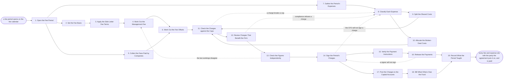

# Reference process: Allocate Fees and Expenses

`ref/pc/allocate-fees-and-expenses v1`

**value stream:** [Capital calls and investor reporting](../../streams/private-capital/commitment-to-statement.md)
Each fee period the fund owes its management fee and carries its share of
the costs of running it, and every charge has to land on the party the
partnership agreement puts it on: the fund, the firm, or a portfolio
company. This process works out each limited partner's (LP's) fee on the
basis the fund's stage requires, applies every discount and waiver its
side letter promised, and reduces the fee by the share of the fees the
firm took from portfolio companies that the agreement gives back to the
fund. Every expense is classified, shared costs are split by the written
policy, and the caps are tested. Compliance reads every charge that
benefits the firm itself, someone other than whoever worked the figures
works them out again, and the chief financial officer (CFO) signs the
period's charges. Payments go only to verified accounts, signed by two
people. The run closes when each capital account carries its share and
whatever the firm or a company owes the fund has been billed.

**delivers:** statement, fee and expense charges

## The goals

- Charge each fee period within [10 days]
- Recover [100%] of costs the agreement allows
- Keep charges over a cap at [zero]
- Keep fee errors investors find at [zero]

## The activities

| # | Activity | What happens | Agents |
|---|---|---|---|
| 1 | Open the Fee Period | the period, the fee basis, and the charges to allocate | [capital-account-keeper](../../agents/capital-account-keeper.md) |
| 2 | Set the Fee Basis | commitments or invested capital, as the fund's stage sets | capital-account-keeper |
| 3 | Apply the Side Letter Fee Terms | the discounts, early-closer rates and waivers promised | [side-letter-keeper](../../agents/side-letter-keeper.md) |
| 4 | Work Out the Management Fee | each investor's fee for the period, to the cent | capital-account-keeper |
| 5 | Collect the Fees Paid by Companies | transaction, monitoring, director and break-up fees | capital-account-keeper · CFO (person) |
| 6 | Work Out the Fee Offsets | the share of company fees that reduces the fee | capital-account-keeper · side-letter-keeper |
| 7 | Gather the Period's Expenses | every invoice and cost that names the fund or a deal | capital-account-keeper · controller (person) |
| 8 | Classify Each Expense | the fund's, the firm's or a company's, by the agreement | capital-account-keeper |
| 9 | Split the Shared Costs | costs shared across funds and co-investors by the policy | capital-account-keeper |
| 10 | Allocate the Broken-Deal Costs | the costs of deals that did not close, shared by the policy | capital-account-keeper |
| 11 | Check the Charges against the Caps | the expense caps in the agreement and each side letter | side-letter-keeper · capital-account-keeper |
| 12 | Review Charges That Benefit the Firm | anything that helps the firm itself, read by compliance | chief compliance officer (person) |
| 13 | Check the Figures Independently | the administrator or the controller works them out again | fund administrator (person) · controller (person) |
| 14 | Sign the Period's Charges | the CFO signs the fee, the offsets and the expenses | CFO (person) |
| 15 | Verify the Payment Instructions | each payee's account against the verified record | [wire-check](../../agents/wire-check.md) |
| 16 | Release the Payments | two people sign the fee and expense payments | CFO (person) · second signer (person) |
| 17 | Post the Charges to the Capital Accounts | each investor's share of fees and expenses booked | capital-account-keeper |
| 18 | Bill What Others Owe the Fund | the firm and companies billed for costs the fund paid | capital-account-keeper |
| 19 | Record What the Period Taught | what was moved, capped or refused, and why | capital-account-keeper |

**Venture and buyout.** In a buyout fund, the transaction and monitoring
fees the firm charges portfolio companies are offset against the
management fee, and the costs of deals that did not close are allocated
among those who would have invested. In a venture fund, portfolio
companies are rarely charged fees, so activities 5 and 6 seldom have
anything to work on.

The management fee is paid to the firm itself, so the review at activity
12 and the independent check at activity 13 are where the investors'
interest is held. An outside fund administrator may hold the
capital-account-keeper or the wire-check role for the firm, or check the
firm's figures at activity 13, and the roster says which it does. When
the fund does not hold the cash for the period's charges, they are called
first at `ref/pc/issue-a-capital-call`.

## The graph



## The document, with the blanks marked

```
PROCESS: allocate fees and expenses   id: <team>/allocate-fees-and-expenses   v1
from: ref/pc/allocate-fees-and-expenses v1
owner: <who>                          effective: <date>
trigger: a fee period opens on <your fee calendar>, <in advance or in
         arrears> as the partnership agreement sets
         watch: record=<fee period> system=<your fund accounting system>
                change=<a fee period opens>
concurrency: one fee period per fund is open at a time - the next
             period's run waits until this one is signed, and an expense
             that arrives after <the cut-off day> goes into the next
             period
goal: the period's fee and expenses charged within <days> of the period
      opening, each on the party the agreement puts it on, with every
      offset applied and no expense over a cap charged to the fund
phases:
  open-period          - system: the period opens with its dates, the
                         funds and vehicles it covers, and the cut-off
                         for expenses
                         owner: capital-account-keeper   after: trigger
                         automation: <level>
  set-fee-basis        - runs assessment: commitments during the
                         investment period, invested capital after it,
                         or whatever basis the agreement sets, with any
                         step-down in the rate of <rate>
                         owner: capital-account-keeper
                         after: open-period         automation: <level>
  apply-fee-terms      - runs assessment: each side letter read for fee
                         discounts, rates for investors who closed early,
                         waivers and most favoured nation elections
                         owner: side-letter-keeper
                         after: set-fee-basis       automation: <level>
  work-out-fee         - runs allocate-and-reconcile: each investor's fee
                         for the period from its basis, its rate and its
                         side letter terms, with partial periods for
                         investors who joined at a later close
                         owner: capital-account-keeper
                         after: apply-fee-terms     automation: <level>
  collect-company-fees - runs collect-and-report: every transaction,
                         monitoring, director and break-up fee that a
                         portfolio company paid the firm, an affiliate
                         or anyone at the firm in the period
                         owner: capital-account-keeper
                         after: open-period         by: <days>
                         automation: <level>
  work-out-offsets     - runs allocate-and-reconcile: the share of those
                         fees the agreement gives back to the fund, at
                         <offset share>, set against each investor's fee,
                         with any excess carried forward as it allows
                         owner: capital-account-keeper
                         after: work-out-fee + collect-company-fees
                         automation: <level>
  gather-expenses      - runs collect-and-report: every invoice and cost
                         that names the fund, a deal or a portfolio
                         company, received by <the cut-off day>
                         owner: capital-account-keeper
                         after: open-period         by: <days>
                         automation: <level>
  classify-expenses    - runs assessment: each expense classed as the
                         fund's, the firm's or a company's, with the
                         clause of the agreement that allows it, and an
                         expense the agreement does not name treated as
                         the firm's
                         owner: capital-account-keeper
                         after: gather-expenses     automation: <level>
  split-shared         - runs allocate-and-reconcile: costs shared across
                         funds, parallel funds and co-investment vehicles
                         split under <your expense allocation policy>
                         owner: capital-account-keeper
                         after: classify-expenses   automation: <level>
  allocate-broken-deal - runs allocate-and-reconcile: the costs of deals
                         that did not close, shared among the fund and
                         the co-investors who would have invested, under
                         the same policy
                         owner: capital-account-keeper
                         after: classify-expenses   automation: <level>
  check-caps           - runs assessment: the period's charges against
                         the caps on organizational costs and other
                         expenses in the agreement and every side letter,
                         with the running total for the year
                         owner: side-letter-keeper
                         after: work-out-offsets + split-shared +
                         allocate-broken-deal       automation: <level>
  review-conflicts     - runs assessment: every charge that benefits the
                         firm, an affiliate or a person at the firm read
                         for whether the agreement allows the fund to
                         carry it
                         owner: <your chief compliance officer role>
                         after: check-caps          by: <days>
                         automation: never
  check-figures        - runs assessment: the fee, the offsets and the
                         allocations worked out again from the same
                         inputs, without sight of the first answer, by
                         the outside fund administrator where the firm
                         uses one to check its work, or by <your
                         controller role>
                         owner: <your independent check role>
                         after: review-conflicts    by: <days>
                         automation: <level>
  sign-charges         - convenes approval: <your CFO role> signs the
                         period's fee, offsets and expenses as a named
                         signer
                         owner: <your CFO role>
                         after: check-figures       by: <days>
                         automation: never
  verify-instructions  - runs assessment: the account of every payee,
                         the firm included, checked against <your
                         verified payee record>, and any change confirmed
                         by a call to a number already on file
                         owner: wire-check
                         after: sign-charges        automation: <level>
  release-payments     - convenes approval: <your CFO role> and <your
                         second signer role> each sign the fee and
                         expense payments in the bank portal, against
                         the signed charges and the verified accounts
                         owner: <your CFO role>
                         after: verify-instructions by: <days>
                         automation: never
  post-charges         - system: each investor's share of the fee, the
                         offsets and the expenses booked to its capital
                         account
                         owner: capital-account-keeper
                         after: sign-charges        automation: <level>
  bill-others          - human: the firm billed for the firm's costs the
                         fund paid, and each company billed for its own,
                         with the date each bill is due
                         owner: capital-account-keeper
                         after: post-charges        by: <days>
                         automation: <level>
  record-learning      - convenes debrief: what was moved between the
                         fund and the firm, what a cap stopped, what
                         compliance refused, and what the next period
                         does differently
                         owner: capital-account-keeper
                         after: release-payments + bill-others
                         automation: <level>
run-scoped:
  cap-tracker - runs allocate-and-reconcile     owner: side-letter-keeper
                from: check-caps   until: run close
  close-date  - runs roll-call                  owner: capital-account-keeper
                every: <cadence>
                from: open-period  until: sign-charges
handoffs:
  open-period -> set-fee-basis [fee-period]: the period, the funds and
    vehicles it covers, and the cut-off for expenses
  set-fee-basis -> apply-fee-terms [fee-basis]: the basis and the rate
    for the period, with the clause each rests on
  apply-fee-terms -> work-out-fee [fee-terms]: each investor's fee terms
    from its side letter, with the clause for each
  work-out-fee -> work-out-offsets [gross-fees]: each investor's fee
    before offsets, summing to the fund's fee to the cent
  collect-company-fees -> work-out-offsets [company-fees]: every fee a
    company paid the firm or its people, with the invoice and the date
  work-out-offsets -> check-caps [net-fees]: each investor's fee after
    offsets, and any excess carried forward
  gather-expenses -> classify-expenses [period-expenses]: every expense
    received by the cut-off, with its invoice
  classify-expenses -> split-shared / allocate-broken-deal
    [classified-expenses]: each expense with its class and the clause
    that allows it
  split-shared -> check-caps [shared-cost-split]: each shared cost and
    the share each fund and vehicle carries
  allocate-broken-deal -> check-caps [broken-deal-split]: the costs of
    each deal that did not close, and who carries them
  check-caps -> review-conflicts [capped-charges]: the charges inside
    the caps, and any excess moved to the firm
  review-conflicts -> check-figures [reviewed-charges]: the charges
    compliance cleared, and the reason for each one it refused
  check-figures -> sign-charges [checked-charges]: the charges as both
    workings agree them, with the name of whoever checked them
  sign-charges -> verify-instructions / post-charges [signed-charges]:
    the signed fee, offsets and expenses. A change to any line voids the
    signature
  verify-instructions -> release-payments [verified-payees]: each
    payee's account, confirmed against the record, and the date
  release-payments -> record-learning [released-payments]: every
    payment signed, with its amount, payee and bank reference
  post-charges -> bill-others [posted-charges]: each capital account
    after the period's charges
  bill-others -> record-learning [bills-issued]: each bill to the firm
    or a company, with its amount and due date
deviations:
  check-caps -> classify-expenses [cap-broken]: a charge breaks a cap,
    so the excess is classed as the firm's and the split is worked again
  review-conflicts -> classify-expenses [charge-refused]: compliance
    refuses a charge the fund may not carry, so it is classed as the
    firm's
  check-figures -> work-out-fee [workings-disagree]: the two workings
    disagree, so the figures are worked out again and the difference is
    traced before anything is signed
  sign-charges -> classify-expenses [signer-refuses]: the CFO will not
    sign a charge, so it is classed again on the line the CFO named
  release-payments -> sign-charges [payment-not-signed]: a signer will
    not sign a payment, so the charge behind it goes back to the CFO
bindings:
  roster:  <who holds each role - agents claiming the abstract agents
           above, or the outside fund administrator where it holds
           capital-account-keeper or wire-check for the firm, and named
           people for the CFO, the second signer, the controller and the
           chief compliance officer>
  systems: the fund accounting system (write), the bank portal (read),
           the side letter register (read), the portfolio reporting
           system (read), <your accounts payable system> (write), <your
           verified payee record> (read), the notification channel
           (write)
  data:    the partnership agreement <version>, every side letter at
           its current version and the elections made under it, <your
           expense allocation policy> <version>, <your fee calendar>,
           the firm's conflicts policy <version>
policy:
  every expense charged to the fund names the clause of the partnership
    agreement that allows it, and an expense the agreement does not name
    is the firm's
  fees the firm or its people take from portfolio companies are offset
    at <offset share> as the agreement requires, whoever received them
  shared costs are split by <your expense allocation policy>, applied
    the same way to every fund and vehicle that shares them
  a charge over a cap is the firm's, and a cap is raised only with the
    consent the agreement requires, sought at
    ref/pc/seek-an-advisory-committee-consent
  every charge that benefits the firm is read by <your chief compliance
    officer role> before it is signed
  the figures are worked out again by someone other than whoever worked
    them first
  every payment is signed in the bank portal by two named people
    against a verified account, and no agent releases money
  the period's charges appear in the next quarterly report, line by
    line, as the agreement and <your regulator's rules> require
measures:
  cycle time: <days> from the period opening to the charges signed
  accuracy: <target> share of periods with no charge corrected later
  volume: <expenses per period>
  quality gate: every charge to the fund names its clause, and every
                company fee shows its offset
```

## The failure edges

- **A charge breaks a cap.** The side-letter-keeper agent names the cap
  and the running total. The excess is classed as the firm's and the
  split is worked again. A cap is raised only with the consent the
  agreement requires, and that consent is its own run at
  `ref/pc/seek-an-advisory-committee-consent`.
- **Compliance refuses a charge.** A cost that benefits the firm, an
  affiliate or a person at the firm, and that the agreement does not
  let the fund carry, is classed as the firm's. The reason is recorded
  with the charge, so the same cost is classed the same way next period.
- **The two workings disagree.** The figures are worked out again from
  the inputs both workings used, and the difference is traced to a
  basis, a rate, a side letter term or an offset. Nothing is signed while
  the two disagree.
- **The CFO will not sign a charge.** The charge is classed again on the
  line the CFO named, and the rest of the period waits for it, because
  the investors' shares depend on every charge.
- **The agreement is silent on an expense.** The expense is the firm's.
  A firm that believes the fund should carry it asks the LP advisory
  committee, and the fund carries it only once consent is recorded.
- **A company fee comes to light after the period is signed.** The
  offset is worked out at the rate that applied when the fee was paid,
  the period's charges are reissued as a new version, and each investor's
  account is corrected and told why in the next quarterly report.
- **A payee's account cannot be verified.** The wire-check agent holds
  the payment. The charge stays booked and owed, and it is paid once the
  account is confirmed by a call to a number already on file.
- **The fund does not hold the cash for the charges.** They are called
  from the investors first through `ref/pc/issue-a-capital-call`, and the
  payments wait for the call to reconcile.
- **The trigger fires while a run is in flight.** One fee period per
  fund is open at a time. The next period opens only once this one is
  signed, and an expense that arrives after the cut-off waits for it.
- **A run is abandoned.** No payment leaves the fund. The charges worked
  out so far are kept at their version with the reason the run stopped,
  nothing is booked to a capital account, and the CFO names who opens
  the period again and by when, because a fee left uncharged still
  appears in the quarter's report as owed.
