# Reference process: Answer a Due Diligence Questionnaire

`ref/pc/answer-a-due-diligence-questionnaire v1`

**value stream:** [Raising a fund](../../streams/private-capital/strategy-to-fund.md)
A prospective limited partner (LP), or the consultant advising it, sends
a due diligence questionnaire (DDQ), often an industry standard form with
its own questions added. This process answers it from the firm's library
of approved answers instead of from memory. The questionnaire responder
reads the form's rules, sorts the questions, matches each one to an
approved answer at its version, and reads every match back against the
policy, report or record it came from. Each question the library cannot
answer goes to the person who owns the fact, whether that is the chief
financial officer (CFO) on operations, the chief compliance officer on
compliance or a partner on the strategy and the team, and every new
answer is signed by that person. Compliance checks each performance
figure against the frozen track record, the investor relations lead reads
the whole response, and nothing leaves before the investor has signed a
confidentiality agreement. The run closes when the response has gone in
the investor's own format by its deadline and the library carries every
new answer at a version.

**delivers:** document, a due diligence questionnaire

## The goals

- Return every questionnaire within [10 days]
- Answer [85%] of questions from the library
- Keep answers corrected after sending at [zero]

## The activities

| # | Activity | What happens | Agents |
|---|---|---|---|
| 1 | Take in the Questionnaire | the form, the deadline and who sent it | [investor-relations-manager](../../agents/investor-relations-manager.md) |
| 2 | Check the Confidentiality Agreement | a signed agreement before any answer leaves | investor-relations-manager |
| 3 | Read the Rules of the Form | format, word limits, attachments and submission | [questionnaire-responder](../../agents/questionnaire-responder.md) |
| 4 | Sort and Deduplicate the Questions | questions grouped, repeats joined, each numbered | questionnaire-responder |
| 5 | Match the Library Answers | each question matched to an approved answer | questionnaire-responder |
| 6 | Read Each Match Against Its Source | the answer read back against its policy or record | questionnaire-responder |
| 7 | Route the Unanswered Questions | each gap sent to the person who owns the fact | questionnaire-responder · investor-relations-manager |
| 8 | Draft the New Answers | the owner's facts written as a draft answer | questionnaire-responder · answer owner (person) |
| 9 | Sign Each New Answer | the person who owns the fact signs it | answer owner (person) |
| 10 | Check the Figures and the Claims | figures against the frozen record and the rules | chief compliance officer (person) · questionnaire-responder |
| 11 | Attach the Evidence | policies, audits and statements at their versions | questionnaire-responder |
| 12 | Check the Form Against Its Rules | the finished form read against the form's rules | questionnaire-responder |
| 13 | Review the Whole Response | the investor relations lead reads it end to end | investor relations lead (person) · investor-relations-manager |
| 14 | Send the Response | in the investor's format, by the deadline | investor-relations-manager |
| 15 | Add the New Answers to the Library | each signed answer stored with its owner | questionnaire-responder |
| 16 | Answer the Follow-Up Questions | the investor's follow-ups, through the same checks | investor-relations-manager · questionnaire-responder |
| 17 | Record the Response | what was sent, to whom, when, at which version | investor-relations-manager |

## The graph

```mermaid
flowchart LR
  T([an investor or its consultant sends a due diligence questionnaire]) --> A1[1. Take in the Questionnaire]
  A1 --> A2[2. Check the Confidentiality Agreement]
  A1 --> A3[3. Read the Rules of the Form]
  A3 --> A4[4. Sort and Deduplicate the Questions]
  A4 --> A5[5. Match the Library Answers]
  A5 --> A6[6. Read Each Match Against Its Source]
  A5 --> A7[7. Route the Unanswered Questions]
  A6 -. the source no longer says it .-> A7
  A7 --> A8[8. Draft the New Answers]
  A8 --> A9[9. Sign Each New Answer]
  A9 -. the owner will not sign the draft .-> A8
  A6 --> A10[10. Check the Figures and the Claims]
  A9 --> A10
  A10 -. a figure does not match the record .-> A8
  A10 --> A11[11. Attach the Evidence]
  A11 --> A12[12. Check the Form Against Its Rules]
  A12 --> A13[13. Review the Whole Response]
  A13 -. the lead sends answers back .-> A8
  A2 --> A14[14. Send the Response]
  A13 --> A14
  A14 --> A15[15. Add the New Answers to the Library]
  A14 --> A16[16. Answer the Follow-Up Questions]
  A16 -. a follow-up needs a fact the library lacks .-> A7
  A15 --> A17[17. Record the Response]
  A16 --> A17
  A17 --> DONE([the response is with the investor by its deadline, and the library holds every new answer])
```



## The document, with the blanks marked

```
PROCESS: due diligence questionnaire  id: <team>/answer-a-due-diligence-questionnaire   v1
from: ref/pc/answer-a-due-diligence-questionnaire v1
owner: <who>                          effective: <date>
trigger: a prospective investor or its consultant sends a due diligence
         questionnaire, logged by <who> in <your CRM>, or
         ref/pc/work-an-investor-prospect sends one on
         watch: record=<due diligence questionnaire>
                system=<your CRM>
                change=<a questionnaire is logged against an investor>
concurrency: one run per questionnaire - <how many> run at once, and two
             questionnaires from one investor for one fund are answered
             in one run
goal: every questionnaire answered in the investor's own format by its
      deadline, at most <days> after it arrived, with every answer drawn
      from the approved library or signed by the person who owns the fact
phases:
  take-in-questionnaire - human: the form, the deadline, the investor,
                      the consultant if there is one, and the fund it is
                      about
                      owner: investor-relations-manager  after: trigger
                      automation: <level>
  check-confidentiality - runs assessment: a confidentiality agreement
                      signed by the investor and in force, covering the
                      material the answers will carry
                      owner: investor-relations-manager
                      after: take-in-questionnaire  automation: <level>
  read-form-rules   - runs assessment: the format, the word limits, the
                      attachments asked for, and how and where the
                      response must be submitted
                      owner: questionnaire-responder
                      after: take-in-questionnaire  automation: <level>
  sort-questions    - runs collect-and-report: every question numbered,
                      grouped by subject, and each repeat joined to the
                      first time it is asked
                      owner: questionnaire-responder
                      after: read-form-rules     automation: <level>
  match-answers     - runs assessment: each question matched to an
                      approved answer in <your answer library> at that
                      answer's version, and each question without one
                      marked
                      owner: questionnaire-responder
                      after: sort-questions      automation: <level>
  read-sources      - runs assessment: every match read back against the
                      policy, report or record it came from, at the
                      version the answer names
                      owner: questionnaire-responder
                      after: match-answers       automation: <level>
  route-gaps        - runs collect-and-report: each question the library
                      cannot answer sent to the person who owns the fact,
                      with the date the answer is needed by
                      owner: questionnaire-responder
                      after: match-answers or read-sources
                      by: <days>                 automation: <level>
  draft-answers     - human: the owner's facts written as a draft answer
                      in the form's style and inside its limits
                      owner: questionnaire-responder  after: route-gaps
                      by: <days>                 automation: <level>
  sign-answers      - convenes approval: the person who owns each fact
                      signs the answer that states it
                      owner: <your answer owner role>
                      after: draft-answers       by: <days>
                      automation: never
  check-figures     - runs assessment: every performance figure read
                      against the frozen track record, and every claim
                      against <your advertising rules>
                      owner: <your compliance role>
                      after: read-sources + sign-answers
                      by: <days>                 automation: <level>
  attach-evidence   - system: the policies, audited statements and
                      reports the answers name, attached at the versions
                      they name
                      owner: questionnaire-responder
                      after: check-figures       automation: <level>
  check-form        - runs assessment: the finished form read against
                      the form's own rules, field by field, before it
                      leaves
                      owner: questionnaire-responder
                      after: attach-evidence     automation: <level>
  review-response   - convenes approval: the investor relations lead
                      reads the whole response end to end, as the
                      investor will
                      owner: <your investor relations role>
                      after: check-form          by: <days>
                      automation: <level>
  send-response     - system: the response submitted in the investor's
                      format, through the route the form asks for, by the
                      deadline
                      owner: investor-relations-manager
                      after: check-confidentiality + review-response
                      automation: <level>
  update-library    - system: each signed answer added to the library at
                      a version, with its owner, its source and the date
                      it must be read again
                      owner: questionnaire-responder
                      after: send-response       automation: <level>
  answer-follow-ups - human: the investor's follow-up questions answered
                      through the same matching, signing and checks
                      owner: investor-relations-manager
                      after: send-response       by: <days>
                      automation: <level>
  record-response   - runs collect-and-report: what was sent, to whom,
                      on which date, at which version, and the follow-ups
                      still open
                      owner: investor-relations-manager
                      after: update-library + answer-follow-ups
                      automation: <level>
run-scoped:
  deadline  - runs roll-call             owner: investor-relations-manager
              every: <cadence>
              from: take-in-questionnaire  until: send-response
  gap-log   - runs collect-and-report    owner: questionnaire-responder
              from: route-gaps             until: run close
handoffs:
  take-in-questionnaire -> check-confidentiality / read-form-rules
    [questionnaire]: the form as received, its deadline, the investor
    and the fund it is about
  check-confidentiality -> send-response [confidentiality-check]: the
    agreement, its date and what it covers
  read-form-rules -> sort-questions [form-rules]: the format, limits,
    attachments and submission route the form requires
  sort-questions -> match-answers [question-list]: every question
    numbered and grouped, with repeats joined
  match-answers -> read-sources / route-gaps [answer-matches]: each
    question with its matched answer and version, or marked unmatched
  read-sources -> check-figures [checked-matches]: each match confirmed
    against its source, or marked as no longer true
  route-gaps -> draft-answers [routed-gaps]: each gap, its owner and the
    date the answer is needed
  draft-answers -> sign-answers [draft-answers]: each draft answer with
    the facts it states and the owner who must sign it
  sign-answers -> check-figures [signed-answers]: each new answer as
    signed, with the signer and the date
  check-figures -> attach-evidence [checked-figures]: every figure tied
    to the frozen record and every claim cleared against the rules
  attach-evidence -> check-form [evidence-set]: the attachments, each at
    the version its answer names
  check-form -> review-response [finished-form]: the finished response,
    checked against the form's rules
  review-response -> send-response [approved-response]: the response the
    lead approved, at a version
  send-response -> update-library / answer-follow-ups [sent-response]:
    what was sent, when, and to which address or portal
  update-library -> record-response [library-additions]: each new
    answer, its version, its owner and its review date
  answer-follow-ups -> record-response [follow-up-answers]: each
    follow-up and its answer, and any still open
deviations:
  read-sources -> route-gaps [source-changed]: the source no longer says
    what the library answer says, so the question goes to its owner and
    the old answer is marked for review in the library
  sign-answers -> draft-answers [owner-refuses]: the owner will not sign
    the draft, so it is drafted again from the owner's corrections
  check-figures -> draft-answers [figure-mismatch]: a figure does not
    match the frozen record, so the answer is drafted again from the
    record and signed again
  review-response -> draft-answers [lead-sends-back]: the investor
    relations lead sends answers back, so each one named is drafted
    again and goes through signing and the checks
  answer-follow-ups -> route-gaps [follow-up-gap]: a follow-up needs a
    fact the library does not hold, so it is routed to its owner
bindings:
  roster:  <who holds each role - agents claiming the abstract agents
           above, and named people for the investor relations lead, the
           chief compliance officer and each answer owner>
  systems: <your answer library> (write), the CRM (write), the data room
           (read), the document store (read), <the investor's portal>
           (write), the fund accounting system (read)
  data:    the questionnaire as received, the frozen track record
           <version>, <your advertising rules>, <your policies> at their
           versions, the audited statements, the signed confidentiality
           agreement
policy:
  every answer comes from the approved library or is signed by the
    person who owns the fact, and no answer is written from memory
  a library answer whose source no longer says it is never sent
  every performance figure matches the frozen track record, gross with
    net beside it
  nothing leaves before the investor has signed a confidentiality
    agreement
  the response follows the investor's own format word for word
  every new answer enters the library with its owner and the date it
    must be read again, at most <months> later
  the signature on a new answer is a person's and is never delegated to
    an agent
measures:
  cycle time: <days> from the questionnaire arriving to the response sent
  reuse: <target> share of questions answered from the library
  volume: <questionnaires per period>
  quality gate: every answer traces to a library version or a signed new
                answer, and every figure ties to the frozen record
```

## The failure edges

- **The source no longer says it.** The questionnaire-responder agent
  finds a library answer that its policy or record has moved past. The
  question goes to the owner as a gap, and the old answer is marked for
  review in the library so the next questionnaire does not use it either.
- **The owner will not sign the draft.** The owner's corrections go into
  a new draft, and the answer is signed again. An answer is never sent
  under a signature it does not have, and it is never signed by someone
  who does not own the fact.
- **A figure does not match the frozen record.** The answer is drafted
  again from the frozen record and signed again. A newer figure from
  outside the frozen set is never used to answer one investor, because
  every investor must see the same numbers.
- **The investor relations lead sends answers back.** Each answer named
  goes back through drafting, signing and the checks. The lead's change
  is never made directly in the form, because the library would then
  disagree with what was sent.
- **No confidentiality agreement is signed.** The answers are prepared,
  and nothing is sent. The investor relations lead chases the agreement,
  and a deadline that will pass without it is raised with the investor
  before it passes.
- **The deadline will be missed.** The deadline roll-call raises it at
  the warning point the firm sets. The investor relations lead asks the
  investor for more time in writing, or sends the answers that are ready
  with a date for the rest.
- **A follow-up needs a fact the library lacks.** It is routed to its
  owner like any other gap, and the answer joins the library when it is
  signed.
- **The trigger fires while a run is in flight.** A second questionnaire
  from the same investor for the same fund joins the open run, and its
  questions are deduplicated against the first. A questionnaire from a
  different investor is its own run, drawing on the same library.
- **A run is abandoned.** The investor is told the questionnaire will not
  be answered and why, by the investor relations lead. Answers already
  signed join the library anyway, the gaps still open are closed with
  their owners told, and nothing partial is sent.
