# Reference process: Build the Investment Model

`ref/pc/build-the-investment-model v1`

**value stream:** [Opportunity-to-Recommendation](../../streams/private-capital/opportunity-to-recommendation.md)
Before the firm offers terms, it needs to know what the fund would earn
at each outcome, including the bad ones. This process builds that
answer. The returns-modeler agent starts from the entry price and the
structure, and takes the numbers financial diligence agreed and the
capitalization the cap-table-keeper agent rebuilt. The cap-table-keeper
agent models the fund's ownership and what each share class takes at
each exit value, and the financial-analyst agent projects the company's
operations. The model runs a loss case, a low case, the plan and a high
case, and states the fund's multiple of money and internal rate of
return (IRR) at each one, with the breakeven named. Every assumption
carries its source and its owner. Someone who did not build the model
checks it, the deal lead partner agrees the cases, and it is issued at a
version for the mandate check, the memo and the term sheet.

**delivers:** sheet

## The goals

- Issue the model within [5 days] of the numbers
- Keep errors found after issue at [zero]
- Land actual exits within [20%] of the base case

## The activities

| # | Activity | What happens | Agents |
|---|---|---|---|
| 1 | Take in the Agreed Numbers | the figures diligence agreed, with their sources | [returns-modeler](../../agents/returns-modeler.md) · [financial-analyst](../../agents/financial-analyst.md) |
| 2 | Set the Entry Price | the price or valuation, and what it is a multiple of | returns-modeler · deal lead partner (person) |
| 3 | Set the Structure | the security, the amount, and any debt or rollover | returns-modeler · deal lead partner (person) |
| 4 | Model the Ownership | the fund's share before and after, fully diluted | [cap-table-keeper](../../agents/cap-table-keeper.md) |
| 5 | Model the Preferences | what each share class takes at each exit price | cap-table-keeper |
| 6 | Project the Operating Case | revenue, margins and cash, from the agreed numbers | financial-analyst |
| 7 | Model the Later Rounds or the Debt | dilution and reserves, or the debt and its repayment | returns-modeler · financial-analyst |
| 8 | Set the Exit Cases | loss, low, plan and high, each with its exit value | returns-modeler · deal lead partner (person) |
| 9 | Compute the Return at Each Case | multiple of money and IRR, case by case | returns-modeler |
| 10 | Test the Sensitivities | the assumptions that move the return the most | returns-modeler |
| 11 | Find the Breakeven | the outcome below which the fund loses money | returns-modeler |
| 12 | Size the Reserve | the money held back for later rounds or add-ons | returns-modeler · deal lead partner (person) |
| 13 | Write Down Every Assumption | each input with its source, its owner and its date | returns-modeler |
| 14 | Check the Model | formulas, links and totals checked by a second reader | financial-analyst · deal team associate (person) |
| 15 | Agree the Cases | the deal lead agrees the cases the memo will carry | deal lead partner (person) · returns-modeler |
| 16 | Issue the Model at a Version | dated, locked, and handed on as one version | returns-modeler |
| 17 | Hand the Model On | to the mandate check, the memo and the term sheet | returns-modeler · cap-table-keeper |

**Venture and buyout.** For a venture deal, the model follows the
fund's ownership through later rounds, the reserve the company will
need, and the exit size that would return the whole fund. For a buyout,
the model carries the debt, the cash flow that pays it down, the
covenants and the exit multiple.

The issued model goes to `ref/pc/check-the-deal-against-the-fund-mandate`
and `ref/pc/write-the-investment-memo`, and later to
`ref/pc/issue-a-term-sheet`. A model changes during negotiation as terms
move, and each change is a new run of this process that issues a new
version.

## The graph

```mermaid
flowchart LR
  T([financial diligence agrees the numbers, or a term the model rests on changes]) --> A1[1. Take in the Agreed Numbers]
  A1 --> A2[2. Set the Entry Price]
  A1 --> A6[6. Project the Operating Case]
  A2 --> A3[3. Set the Structure]
  A3 --> A4[4. Model the Ownership]
  A4 --> A5[5. Model the Preferences]
  A3 --> A7[7. Model the Later Rounds or the Debt]
  A6 --> A7
  A5 --> A8[8. Set the Exit Cases]
  A7 --> A8
  A8 --> A9[9. Compute the Return at Each Case]
  A9 --> A10[10. Test the Sensitivities]
  A9 --> A11[11. Find the Breakeven]
  A10 --> A12[12. Size the Reserve]
  A11 --> A12
  A12 --> A13[13. Write Down Every Assumption]
  A13 --> A14[14. Check the Model]
  A14 -. the check finds an error .-> A9
  A14 --> A15[15. Agree the Cases]
  A15 -. the deal lead changes a case .-> A8
  A15 -. no price gives the return the fund needs .-> A2
  A15 --> A16[16. Issue the Model at a Version]
  A16 --> A17[17. Hand the Model On]
  A17 --> DONE([a checked model at a version, stating the fund's return at each outcome])
```



## The document, with the blanks marked

```
PROCESS: investment model             id: <team>/build-the-investment-model   v1
from: ref/pc/build-the-investment-model v1
owner: <who>                          effective: <date>
trigger: financial diligence agrees the numbers for an opportunity in
         <your deal pipeline>, or a price, a structure or a finding an
         issued model rests on changes
         watch: record=<agreed numbers> system=<your deal pipeline>
                change=<financial diligence agrees the numbers>
         and watch: record=<issued model> system=<your deal pipeline>
                change=<a term or finding the model rests on changes>
concurrency: one opportunity has one model run open at a time, and a
             change that arrives while a run is open joins that run
goal: a checked model issued at a version within <days> of the agreed
      numbers and before any terms are offered, stating the fund's
      return at every case, with the breakeven named and every
      assumption sourced and owned
phases:
  take-in-numbers      - human: the numbers financial diligence agreed,
                         the rebuilt capitalization and the commercial
                         findings read in, with every figure's source
                         carried across
                         owner: returns-modeler         after: trigger
                         automation: <level>
  set-entry-price      - convenes decide-and-announce: the price or
                         valuation the model starts from, what it is a
                         multiple of, and the comparable sales and listed
                         companies behind it
                         owner: <your deal lead role>
                         after: take-in-numbers         automation: <level>
  set-structure        - convenes decide-and-announce: the security the
                         fund would hold, the amount, the debt the company
                         would carry, and any rollover by the owners or
                         management
                         owner: <your deal lead role>
                         after: set-entry-price         automation: <level>
  model-ownership      - runs assessment: the fund's share before and
                         after the investment, fully diluted for every
                         option, warrant and convertible, from the
                         rebuilt capitalization
                         owner: cap-table-keeper   after: set-structure
                         automation: <level>
  model-preferences    - runs assessment: what each share class takes at
                         each exit value through its preference,
                         conversion and participation rights, and what
                         reaches the fund
                         owner: cap-table-keeper   after: model-ownership
                         automation: <level>
  project-operations   - runs assessment: revenue, margins and cash over
                         <years> from the agreed numbers, with
                         management's plan and the deal team's own case
                         side by side
                         owner: financial-analyst  after: take-in-numbers
                         by: <days>                     automation: <level>
  model-rounds-or-debt - runs assessment: the later rounds, their size and
                         the dilution they bring, or the debt, its
                         interest, its repayment and its covenants, year
                         by year
                         owner: returns-modeler
                         after: set-structure + project-operations
                         automation: <level>
  set-exit-cases       - convenes decide-and-announce: a loss case, a low
                         case, the plan case and a high case, each with an
                         exit year, an exit value and the source of its
                         multiple
                         owner: <your deal lead role>
                         after: model-preferences + model-rounds-or-debt
                         automation: <level>
  compute-returns      - runs assessment: the multiple of money and the
                         IRR to the fund at each case, gross of fees and
                         carried interest, and net where
                         <your net return policy> asks
                         owner: returns-modeler    after: set-exit-cases
                         automation: <level>
  test-sensitivities   - runs assessment: the return as the price, the
                         growth, the margin, the exit multiple and the
                         timing each move, with the assumptions that move
                         it most named
                         owner: returns-modeler    after: compute-returns
                         automation: <level>
  find-breakeven       - runs assessment: the exit value below which the
                         fund gets back less than it put in, and the exit
                         value that returns
                         <the multiple the strategy needs>
                         owner: returns-modeler    after: compute-returns
                         automation: <level>
  size-reserve         - convenes decide-and-announce: the money the fund
                         holds back for this company's later rounds or
                         add-on acquisitions, set against the fund's
                         reserve plan
                         owner: <your deal lead role>
                         after: test-sensitivities + find-breakeven
                         automation: <level>
  record-assumptions   - runs collect-and-report: every input written down
                         with its source, its owner and its date, and
                         every input with no source marked as the deal
                         team's assumption
                         owner: returns-modeler    after: size-reserve
                         automation: <level>
  check-model          - runs assessment: the formulas, links, signs and
                         totals checked by a second reader who did not
                         build the model, with each error found recorded
                         owner: financial-analyst
                         after: record-assumptions      by: <days>
                         automation: <level>
  agree-cases          - convenes decide-and-announce: the deal lead
                         agrees the cases, the assumptions and the price
                         range the memo will carry
                         owner: <your deal lead role>
                         after: check-model             by: <days>
                         automation: <level>
  issue-model          - system: the model locked and issued at a version
                         with its date, its cases and its assumption list
                         owner: returns-modeler    after: agree-cases
                         automation: <level>
  hand-on              - convenes briefing: the issued model handed to the
                         mandate check, the memo and the term sheet, and
                         the modeled position to the cap table record
                         owner: returns-modeler    after: issue-model
                         automation: <level>
run-scoped:
  version-log - runs collect-and-report         owner: returns-modeler
                from: take-in-numbers   until: run close
handoffs:
  take-in-numbers -> set-entry-price / project-operations
    [diligence-inputs]: the agreed numbers, the rebuilt capitalization and
    the commercial findings, each with its source
  set-entry-price -> set-structure [entry-price]: the price, what it is a
    multiple of, and the comparables behind it
  set-structure -> model-ownership / model-rounds-or-debt [deal-structure]:
    the security, the amount, the debt and any rollover
  model-ownership -> model-preferences [ownership]: the fund's share
    before and after, fully diluted
  model-preferences -> set-exit-cases [preference-payouts]: what reaches
    the fund at each exit value, class by class
  project-operations -> model-rounds-or-debt [operating-case]: the
    projected revenue, margins and cash, in both cases
  model-rounds-or-debt -> set-exit-cases [rounds-or-debt]: the dilution
    from later rounds, or the debt and its repayment, by year
  set-exit-cases -> compute-returns [exit-cases]: the four cases, each
    with its exit year, its value and the source of its multiple
  compute-returns -> test-sensitivities / find-breakeven [case-returns]:
    the multiple and the IRR at each case, gross and net
  test-sensitivities -> size-reserve [sensitivities]: how far the return
    moves with each assumption, ranked
  find-breakeven -> size-reserve [breakeven]: the breakeven exit value
    and the value that meets the strategy's need
  size-reserve -> record-assumptions [reserve]: the reserve held for the
    company, and its place in the fund's reserve plan
  record-assumptions -> check-model [assumption-list]: every input with
    its source, its owner and its date
  check-model -> agree-cases [model-check]: the second reader's check,
    with every error found and how it was fixed
  agree-cases -> issue-model [agreed-cases]: the cases, assumptions and
    price range the deal lead agreed
  issue-model -> hand-on [issued-model]: the model at a version, with its
    date, its cases and its assumption list
deviations:
  check-model -> compute-returns [error-found]: the check finds an error,
    so the returns are computed again from the corrected model and the
    check runs again
  agree-cases -> set-exit-cases [case-changed]: the deal lead changes a
    case, so the cases are set again with the reason and the evidence
    for the change written down
  agree-cases -> set-entry-price [return-too-low]: no price in the range
    gives the return the fund needs, so the price and the structure are
    set again before any terms are offered
bindings:
  roster:  <who holds each role - agents claiming the abstract agents
           above, and named people for the deal lead partner and the
           second reader>
  systems: <your financial model> (write), the cap table record (read),
           the deal pipeline (write), <your market data sources> (read)
  data:    the agreed numbers <version>, the rebuilt capitalization
           <version>, the fund's reserve plan <version>,
           <your target return>, <your modeling standard> <version>
policy:
  every input carries its source, and an input with no source is marked
    as the deal team's assumption with its owner
  the ownership and the preferences come from the rebuilt
    capitalization, and never from the company's own summary
  a loss case is always modeled, and the memo always carries it
  the deal team's own operating case is modeled beside management's plan
  returns are stated gross of fees and carried interest and labeled as
    gross, and net returns are added where <your net return policy> asks
  the model is checked by someone who did not build it before it is
    issued
  an issued model is never edited: a change makes a new version, and the
    earlier version stays
  every exit multiple cites the sales or listed companies it comes from
  no price is offered to a company from a model that has not been issued
measures:
  cycle time: <days> from the agreed numbers to the issued model
  sourcing: <target> share of inputs with a source
  checks: <target> share of issued models with no error found after
          issue
  accuracy: <target> distance between the realized return and the plan
            case, read at exit
  volume: <models issued per period>
  quality gate: every issued model carries a loss case, a breakeven, a
                second reader's check and a sourced assumption list
```

## The failure edges

- **Diligence has not agreed the numbers yet.** The model can start on
  the seller's figures when a deadline forces it, and every such input
  is marked as the seller's. The model is not issued for the memo until
  the agreed numbers replace them.
- **The preferences leave the fund little at a modest exit.** The
  cap-table-keeper agent shows what the fund receives at each exit value
  through the existing preferences, and the low case carries it. A good
  headline price that pays the fund nothing in the low case goes to the
  deal lead in those words.
- **No price gives the return the fund needs.** The run goes back to the
  price and the structure. Moving the exit cases upward to make the
  number work is a failure of this process, and the check looks for it.
- **The check finds an error.** The second reader records it, the
  returns are computed again from the corrected model, and the check
  runs again. A model with an error found after issue is reissued at a
  new version with the error named.
- **The deal lead changes a case.** The change is recorded with its
  reason and the evidence for it. A case moved without new evidence is
  labeled as the deal lead's view, so the committee can see which
  numbers came from diligence and which from judgment.
- **The low case breaks a covenant or runs out of money.** For a buyout,
  a covenant the low case breaks is named with the year. For a venture
  deal, a company that needs more than the reserve before it reaches the
  next milestone is named with the month. Either one goes into the memo
  as a risk.
- **A term or a finding changes after the model is issued.** A new run
  issues a new version, and the earlier version stays. Everything that
  read the old version, the mandate check and the memo among them, is
  told which version replaced it.
- **The trigger fires while a run is in flight.** One opportunity has
  one model run open at a time. A change that arrives while a run is
  open joins it, and the version issued at the end carries every change
  that arrived before the cases were agreed.
- **A run is abandoned.** No version is issued from a half-built model.
  The work so far is kept with the reason the run stopped and the
  inputs it had reached, and the deal pipeline shows the opportunity has
  no current model, so no price can be offered from it.
