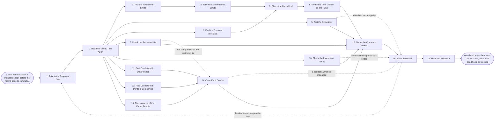

# Reference process: Check the Deal Against the Fund Mandate

`ref/pc/check-the-deal-against-the-fund-mandate v1`

**value stream:** [Opportunity-to-Recommendation](../../streams/private-capital/opportunity-to-recommendation.md)
A deal the partners like can still be one the fund may not make. This
process tests the proposed investment against what the fund promised
its limited partners (LPs) before the memo goes to the committee. The
mandate-check agent reads the limited partnership agreement (LPA) and
every side letter at their versions, and tests the deal against the
fund's limits on size, sector, region, stage and concentration, its
exclusions, the investors excused from this kind of deal, the investment
period and the restricted list. The fund-modeler agent shows the capital
left to invest after fees and reserves and what the deal does to the
fund as a whole. Conflicts with the firm's other funds, its portfolio
companies and its own people are found and decided by the chief
compliance officer. The run closes with one dated result the memo
carries, whether clear, clear with conditions, or blocked, with every
consent the deal would need named.

## The activities

| # | Activity | What happens | Agents |
|---|---|---|---|
| 1 | Take in the Proposed Deal | the company, the amount, the structure and the fund | [mandate-check](../../agents/mandate-check.md) |
| 2 | Read the Limits That Apply | the partnership agreement and side letters, at a version | mandate-check |
| 3 | Test the Investment Limits | size, sector, region, stage and type of security | mandate-check |
| 4 | Test the Concentration Limits | the deal as a share of commitments, alone and combined | mandate-check · [fund-modeler](../../agents/fund-modeler.md) |
| 5 | Test the Exclusions | the activities and places the fund may not invest in | mandate-check |
| 6 | Find the Excused Investors | investors whose side letters excuse them from it | mandate-check |
| 7 | Check the Restricted List | the company and its parties against the restricted list | mandate-check |
| 8 | Check the Capital Left | uncalled capital after fees, reserves and the pipeline | fund-modeler |
| 9 | Model the Deal's Effect on the Fund | diversification, reserves and the fund's expected return | fund-modeler |
| 10 | Check the Investment Period | the fund may still make new investments on this date | mandate-check |
| 11 | Find Conflicts with Other Funds | another of the firm's funds in the same company or deal | mandate-check |
| 12 | Find Conflicts with Portfolio Companies | competitors, customers or suppliers of holdings | mandate-check |
| 13 | Find Interests of the Firm's People | personal holdings, board seats and fees | mandate-check · chief compliance officer (person) |
| 14 | Clear Each Conflict | resolved, managed with a condition, or sent for consent | chief compliance officer (person) · mandate-check |
| 15 | Name the Consents Needed | advisory committee or investor consents, with the clause | mandate-check · chief compliance officer (person) |
| 16 | Issue the Result | clear, clear with conditions, or blocked, dated | mandate-check |
| 17 | Hand the Result On | to the memo, and to the consent process if needed | mandate-check |

The result travels with the memo to `ref/pc/decide-at-investment-committee`.
A deal that needs a consent goes on to
`ref/pc/seek-an-advisory-committee-consent`, and the committee may
approve it only on the condition that the consent is given. The same
tests run again in `ref/pc/offer-a-co-investment` when the share of the
deal the fund will not take is allocated.

## The graph



## The document, with the blanks marked

```
PROCESS: fund mandate check   id: <team>/check-the-deal-against-the-fund-mandate   v1
from: ref/pc/check-the-deal-against-the-fund-mandate v1
owner: <who>                          effective: <date>
trigger: a deal team asks for a mandate check in <your deal pipeline>
         before the memo goes to committee, or the amount, the structure,
         the fund or the co-investment of a checked deal changes
         watch: record=<opportunity> system=<your deal pipeline>
                change=<a mandate check is requested, or a checked
                term changes>
concurrency: runs may overlap - one deal at one version is one run, and
             runs for the same fund count each other's capital
goal: every deal checked against every limit, exclusion, excused
      investor and conflict within <days> and before the memo goes to
      committee, with a dated result that names its clauses and the
      consents it needs
phases:
  take-in-deal         - human: the company, the amount, the structure,
                         the fund or funds that would invest, the issued
                         model's version and any co-investment proposed,
                         read in
                         owner: mandate-check           after: trigger
                         automation: <level>
  read-limits          - runs collect-and-report: the limited partnership
                         agreement, every side letter, the strategy the
                         offering memorandum stated, and any advisory
                         committee decision in force, each at its version
                         owner: mandate-check     after: take-in-deal
                         automation: <level>
  test-limits          - runs assessment: size, sector, region, stage,
                         type of security, and control or minority against
                         the fund's investment limits, with the clause
                         behind each result
                         owner: mandate-check     after: read-limits
                         automation: <level>
  test-concentration   - runs assessment: the deal as a share of total
                         commitments alone, and combined with the fund's
                         other holdings in the same sector, region or
                         company, against the concentration limits
                         owner: mandate-check     after: test-limits
                         automation: <level>
  test-exclusions      - runs assessment: the company's activities and
                         places against the fund's exclusion list and
                         every side letter exclusion, with any doubt sent
                         to <your compliance role>
                         owner: mandate-check     after: read-limits
                         automation: <level>
  find-excused         - runs assessment: every investor whose side
                         letter excuses or excludes it from this kind of
                         deal, and the share of the deal the others would
                         have to carry
                         owner: mandate-check     after: read-limits
                         automation: <level>
  check-restricted     - runs assessment: the company, its owners and the
                         counterparties against the firm's restricted list
                         and watch list
                         owner: mandate-check     after: read-limits
                         automation: <level>
  check-capital-left   - runs assessment: uncalled capital after the
                         management fee, the reserves already set, the
                         excused investors' share, and the deals ahead of
                         this one in the pipeline
                         owner: fund-modeler
                         after: test-concentration + find-excused
                         automation: <level>
  model-fund-effect    - runs assessment: what the deal does to the
                         fund's diversification, its reserves and the
                         return the strategy needs, against the fund model
                         at its version
                         owner: fund-modeler   after: check-capital-left
                         automation: <level>
  check-period         - runs assessment: the fund's investment period,
                         any extension or suspension, and whether a key
                         person event has stopped new investment
                         owner: mandate-check     after: read-limits
                         automation: <level>
  fund-conflicts       - runs assessment: another of the firm's funds or
                         vehicles holding the company, investing beside
                         this fund, or on the other side of the deal, with
                         the allocation policy that applies
                         owner: mandate-check     after: read-limits
                         automation: <level>
  portfolio-conflicts  - runs assessment: portfolio companies that compete
                         with, sell to or buy from the company, and
                         directors who would sit on both sides
                         owner: mandate-check     after: read-limits
                         automation: <level>
  people-conflicts     - runs collect-and-report: the personal holdings,
                         board seats, fees and relationships of the
                         firm's people that touch the company or the
                         seller, from their declarations
                         owner: mandate-check     after: read-limits
                         automation: <level>
  clear-conflicts      - convenes decide-and-announce: each conflict, and
                         any restricted list hit, resolved, managed with a
                         condition, or sent for consent, decided by the
                         chief compliance officer on the record
                         owner: <your compliance role>
                         after: fund-conflicts + portfolio-conflicts +
                         people-conflicts
                         by: <days>                     automation: <level>
  name-consents        - runs assessment: every consent the deal would
                         need from the LP advisory committee or from
                         investors, with the clause that requires it and
                         the date it would be needed by
                         owner: mandate-check
                         after: test-exclusions + check-restricted +
                         model-fund-effect + check-period +
                         clear-conflicts
                         automation: <level>
  issue-result         - convenes decide-and-announce: one dated result,
                         whether clear, clear with conditions, or blocked,
                         naming every clause it rests on and every consent
                         it needs
                         owner: mandate-check
                         after: name-consents or test-exclusions or
                         check-period or clear-conflicts
                         by: <days>                     automation: <level>
  hand-on              - convenes briefing: the result handed to the memo,
                         the consents to the advisory committee process,
                         and the conditions to the deal lead partner
                         owner: mandate-check     after: issue-result
                         automation: <level>
run-scoped:
  pipeline-watch - runs collect-and-report      owner: fund-modeler
                   from: check-capital-left  until: run close
handoffs:
  take-in-deal -> read-limits [proposed-deal]: the deal as proposed,
    with the fund, the model version and any co-investment
  read-limits -> test-limits / test-exclusions / find-excused /
    check-restricted / check-period / fund-conflicts /
    portfolio-conflicts / people-conflicts [limits-in-force]: every
    clause that applies, each with its document and its version
  test-limits -> test-concentration [investment-limits]: each investment
    limit met or failed, with its clause
  test-concentration -> check-capital-left [concentration-result]: the
    deal's share of commitments alone and combined, against each limit
  find-excused -> check-capital-left [excused-investors]: the excused
    investors, their share, and what the others would carry
  check-capital-left -> model-fund-effect [capital-left]: the capital
    left after fees, reserves, excused shares and the pipeline
  model-fund-effect -> name-consents [fund-effect]: what the deal does to
    diversification, reserves and the fund's expected return
  test-exclusions -> name-consents [exclusion-result]: each exclusion
    tested, with any doubt and who settled it
  check-restricted -> name-consents [restricted-result]: the lists read,
    the date, and any hit
  check-period -> name-consents [period-result]: the investment period,
    its end date, and any suspension in force
  fund-conflicts -> clear-conflicts [fund-conflicts-found]: each conflict
    with another of the firm's funds, and the allocation policy that
    applies
  portfolio-conflicts -> clear-conflicts [portfolio-conflicts-found]: each
    portfolio company that touches the company, and how
  people-conflicts -> clear-conflicts [people-interests]: each interest a
    person at the firm holds in the company or the seller
  clear-conflicts -> name-consents [conflict-decisions]: each conflict
    with the compliance officer's decision and any condition
  name-consents -> issue-result [consents-needed]: each consent, its
    clause, who gives it and the date it is needed by
  issue-result -> hand-on [mandate-result]: the dated result with its
    clauses, its conditions and its consents
deviations:
  test-exclusions -> issue-result [hard-exclusion]: a hard exclusion
    applies, so the result is blocked and the other tests are recorded
    as not needed
  check-restricted -> clear-conflicts [restricted-hit]: the company or a
    party is on the restricted list, so the compliance officer decides
    whether the firm may go on before anything else is reported
  check-period -> issue-result [period-ended]: the investment period has
    ended or a key person event has suspended it, so the result is
    blocked unless the agreement allows this kind of deal after the
    period
  clear-conflicts -> issue-result [conflict-unmanageable]: a conflict
    cannot be managed or consented to, so the result is blocked
  issue-result -> take-in-deal [deal-changed]: the deal team changes the
    amount, the structure, the fund or the co-investment, so the check
    runs again on the new version and the earlier result is withdrawn
bindings:
  roster:  <who holds each role - agents claiming the abstract agents
           above, and named people for the chief compliance officer, fund
           counsel and the deal lead partner>
  systems: the fund accounting system (read), the deal pipeline (write),
           the restricted list (read), the conflicts register (write),
           the side letter register (read), <your fund model> (read),
           the notification channel (write)
  data:    the limited partnership agreement <version>, the side letters
           at their versions, the offering memorandum <version>,
           <your allocation policy> <version>,
           <your conflicts policy> <version>, the advisory committee
           decisions in force
policy:
  every result names the clause it rests on, at the version of the
    document that was read
  where a limit can be read two ways, the chief compliance officer and
    fund counsel decide the reading in writing, and the check records it
  an agent never waives a limit and never reads one generously
  every conflict is decided by a person, and every decision is recorded
    in the conflicts register
  a deal that needs a consent goes to committee with the consent named as
    a condition, and the consent is sought through
    ref/pc/seek-an-advisory-committee-consent
  the share an excused investor does not take is spread across the other
    investors only as the partnership agreement allows
  deals in the pipeline that draw on the same capital are counted against
    it
  the check runs again whenever the amount, the structure, the fund or
    the co-investment changes, and a result for an earlier version is
    withdrawn
measures:
  cycle time: <days> from the request to the result
  coverage: <target> share of deals at committee with a current result
  conflicts: <target> share of conflicts decided within <days>
  volume: <checks per period>
  quality gate: every result names its clauses at their versions, and
                every conflict carries the compliance officer's decision
```

## The failure edges

- **A hard exclusion applies.** The mandate-check agent names the
  exclusion and the clause, and the result is blocked. The other tests
  are recorded as not needed, and the deal team is told the same day so
  no more diligence money is spent on a deal the fund may not make.
- **A limit can be read two ways.** The agent reports both readings and
  the clause, and the chief compliance officer and fund counsel decide
  the reading in writing. The agent never picks the reading that lets
  the deal through, and the decision is kept so the next deal is read
  the same way.
- **The deal breaches a concentration limit.** The result names the
  limit and by how much it is exceeded. The deal team can reduce the
  fund's share and offer the rest as a co-investment, or seek the
  consent the agreement allows, and either one is a condition on the
  result.
- **Excused investors leave a hole.** When investors excused from the
  deal leave a share the others cannot carry under the agreement, the
  fund-modeler agent shows the gap. The deal is made smaller, the gap is
  offered as a co-investment, or the result is blocked.
- **The capital left will not cover it.** The fund-modeler agent shows
  the shortfall after fees, reserves and the deals ahead in the
  pipeline. The partners decide which call on the capital comes first,
  and the result reflects their decision.
- **The investment period has ended, or a key person event has stopped
  it.** The result is blocked for a new investment. A follow-on into a
  company the fund already holds is tested against what the agreement
  allows after the period.
- **The company is on the restricted list.** The chief compliance
  officer decides whether the firm may go on before anything else is
  reported, and the decision is recorded with its reason.
- **A conflict cannot be managed.** A conflict the policy does not allow
  and no consent can cure blocks the result. A conflict that can be
  consented to goes to the advisory committee as a named consent.
- **The deal changes after the result.** A new amount, structure, fund
  or co-investment starts the check again on the new version, and the
  earlier result is withdrawn so the memo cannot carry a result for a
  deal that no longer exists.
- **The trigger fires while a run is in flight.** One deal at one version
  is one run. A change that arrives during a run ends that run and
  starts a new one on the new version, and two deals for the same fund
  each count the other's draw on the capital.
- **A run is abandoned.** No result is issued, and the deal pipeline
  shows the deal has no current result, so it cannot go to committee
  without one. Conflicts already found stay in the conflicts register
  with the reason the run stopped.
