# Reference process: Close the Year-End Audit and Tax Documents

`ref/pc/close-the-year-end-audit-and-tax-documents v1`

**value stream:** [Commitment-to-Statement](../../streams/private-capital/commitment-to-statement.md)
The fund's financial year has ended. This process closes the year's
books, drafts the fund's financial statements, and takes the auditor
through the year: the valuation behind every mark, the capital accounts,
the calls and distributions, the fees and the carried interest. Each
finding the auditor raises is settled, a mark moves only when the
valuation committee approves the change, and the chief financial officer
(CFO) and a partner sign the statements before the auditor signs its
opinion. Each limited partner (LP) receives the audited statements. The
tax adviser reviews each investor's share of the fund's income, gains,
losses and deductions, the fund's own returns are signed and any tax it
owes is paid by people, and each investor receives its own tax documents,
with estimates first for any investor that needs them early. The run
closes when every investor holds the audited statements and its own tax
documents by the dates the partnership agreement and the law set.

## The goals

- Issue audited statements within [90 days]
- Send investor tax documents by [March 15]
- Close the audit with [zero] material adjustments
- Hold audit fees within [5%] of last year

## The activities

| # | Activity | What happens | Agents |
|---|---|---|---|
| 1 | Open the Year-End Close | the timetable, the auditor's list and the tax deadlines | [capital-account-keeper](../../agents/capital-account-keeper.md) · CFO (person) |
| 2 | Close the Year's Books | the last quarter closed and every account final | capital-account-keeper · controller (person) |
| 3 | Draft the Financial Statements | the fund's statements and notes, ready for audit | capital-account-keeper · controller (person) |
| 4 | Answer the Auditor's Requests | every item on the auditor's list, logged and dated | capital-account-keeper |
| 5 | Support the Valuations under Test | each mark's method, inputs and evidence for the auditor | [valuation-analyst](../../agents/valuation-analyst.md) |
| 6 | Support the Capital Accounts and Fees | calls, distributions, fees and carry traced to source | capital-account-keeper |
| 7 | Confirm the Cash and the Holdings | confirmations from the banks and the companies | capital-account-keeper · auditor (person) |
| 8 | Settle the Auditor's Findings | each proposed adjustment agreed, booked or answered | CFO (person) · capital-account-keeper |
| 9 | Approve Any Change to a Mark | the valuation committee approves a mark that moves | valuation committee (person) · valuation-analyst |
| 10 | Sign the Statements | the statements and the representation letter signed | CFO (person) · managing partner (person) |
| 11 | Receive the Auditor's Opinion | the auditor signs its opinion on the final statements | auditor (person) |
| 12 | Issue the Audited Statements | the statements on every investor's portal, by the date | [portal-keeper](../../agents/portal-keeper.md) |
| 13 | Work Out Each Investor's Tax Share | its share of income, gain, loss and deductions | capital-account-keeper · tax adviser (person) |
| 14 | Apply Each Investor's Tax Status | exempt, foreign and withholding cases as each one filed | capital-account-keeper |
| 15 | Send Tax Estimates to Investors | estimates for investors that need them before the documents | capital-account-keeper · portal-keeper |
| 16 | Review and Sign the Tax Returns | the adviser reviews, the CFO signs and pays any tax owed | tax adviser (person) · CFO (person) |
| 17 | Issue Each Investor's Tax Documents | each investor's own documents on its portal, by the date | portal-keeper |
| 18 | Answer the Investors' Tax Questions | each answered, and corrections issued as new versions | investor relations lead (person) · capital-account-keeper |
| 19 | Record What the Year Taught | the auditor's points, and what changes next year | capital-account-keeper · CFO (person) |

The marks are set at `ref/pc/value-the-portfolio`, and the fourth
quarter's report at `ref/pc/issue-the-quarterly-report-and-statements`
shares the books this process closes. An outside fund administrator may
hold the capital-account-keeper role for the firm, preparing the
statements and the tax documents, or check the firm's work in them, and
the roster says which it does. The auditor, the tax adviser and the
valuation committee decide what their signatures cover, and no agent
signs for any of them.

## The graph

```mermaid
flowchart LR
  T([the fund's financial year ends]) --> A1[1. Open the Year-End Close]
  A1 --> A2[2. Close the Year's Books]
  A2 --> A3[3. Draft the Financial Statements]
  A3 --> A4[4. Answer the Auditor's Requests]
  A4 --> A5[5. Support the Valuations under Test]
  A4 --> A6[6. Support the Capital Accounts and Fees]
  A4 --> A7[7. Confirm the Cash and the Holdings]
  A5 --> A8[8. Settle the Auditor's Findings]
  A6 --> A8
  A7 --> A8
  A8 -. the auditor challenges a mark .-> A9[9. Approve Any Change to a Mark]
  A8 -. an adjustment changes the statements .-> A3
  A9 -. the committee moves the mark .-> A3
  A9 --> A10[10. Sign the Statements]
  A8 --> A10
  A10 -. a signer will not sign .-> A8
  A10 --> A11[11. Receive the Auditor's Opinion]
  A11 -. the auditor will not give a clean opinion .-> A8
  A11 --> A12[12. Issue the Audited Statements]
  A2 --> A13[13. Work Out Each Investor's Tax Share]
  A13 --> A14[14. Apply Each Investor's Tax Status]
  A14 --> A15[15. Send Tax Estimates to Investors]
  A11 -. the audit changed the books .-> A13
  A11 --> A16[16. Review and Sign the Tax Returns]
  A15 --> A16
  A16 --> A17[17. Issue Each Investor's Tax Documents]
  A17 --> A18[18. Answer the Investors' Tax Questions]
  A18 -. an investor finds an error .-> A13
  A12 --> A19[19. Record What the Year Taught]
  A18 --> A19
  A19 --> DONE([every investor holds the audited statements and its own tax documents, on time])
```



## The document, with the blanks marked

```
PROCESS: year-end audit and tax   id: <team>/close-the-year-end-audit-and-tax-documents   v1
from: ref/pc/close-the-year-end-audit-and-tax-documents v1
owner: <who>                          effective: <date>
trigger: the fund's financial year ends on <your year end>
         watch: record=<financial year> system=<your fund accounting
                system> change=<the financial year closes>
concurrency: one run per fund per year - the run shares the fourth
             quarter's closed books with the quarterly report, and the
             next year's run opens only once this one has issued the tax
             documents
goal: the audited statements with every investor within <days> of the
      year end, estimates by <date> to every investor owed them, each
      investor's tax documents by <date>, and no adjustment left unsettled
phases:
  open-close           - human: the timetable agreed with the auditor and
                         the tax adviser, the auditor's request list, and
                         every date the agreement, the side letters and
                         the law set for the statements and the tax
                         documents
                         owner: capital-account-keeper   after: trigger
                         automation: <level>
  close-books          - runs allocate-and-reconcile: the fourth quarter
                         closed with the approved marks, every accrual
                         booked, and each capital account final for the
                         year
                         owner: capital-account-keeper
                         after: open-close          by: <days>
                         automation: <level>
  draft-statements     - human: the fund's balance sheet, its results,
                         its changes in partners' capital, its cash flows
                         and the notes, under <your accounting framework>
                         owner: capital-account-keeper
                         after: close-books         by: <days>
                         automation: <level>
  answer-requests      - runs collect-and-report: every item on the
                         auditor's list answered from the books, logged
                         with the date asked and the date answered, and
                         nothing given by memory or by email alone
                         owner: capital-account-keeper
                         after: draft-statements    automation: <level>
  support-valuations   - runs collect-and-report: for each mark the
                         auditor tests, the method, the inputs, the
                         comparables and the committee's approval, as
                         written at the quarter it was set
                         owner: valuation-analyst
                         after: answer-requests     by: <days>
                         automation: <level>
  support-accounts     - runs collect-and-report: each call,
                         distribution, fee, expense, offset and carry
                         allocation the auditor samples, traced to the
                         notice, the bank record and the clause behind it
                         owner: capital-account-keeper
                         after: answer-requests     by: <days>
                         automation: <level>
  confirm-balances     - human: the auditor's confirmations of cash from
                         each bank and of holdings from each portfolio
                         company and custodian, chased until each one
                         answers
                         owner: capital-account-keeper
                         after: answer-requests     by: <days>
                         automation: <level>
  settle-findings      - convenes decide-and-announce: each finding and
                         proposed adjustment agreed and booked, or
                         answered with evidence, and the unbooked
                         differences listed for the signers
                         owner: <your CFO role>
                         after: support-valuations + support-accounts +
                         confirm-balances           by: <days>
                         automation: <level>
  approve-mark-change  - convenes approval: <your valuation committee>
                         approves any mark the audit moves, as a new
                         version of that mark, with the reason recorded
                         owner: <your valuation committee role>
                         after: settle-findings     by: <days>
                         automation: never
  sign-statements      - convenes approval: <your CFO role> and <your
                         managing partner role> sign the final statements
                         and the representation letter as named signers
                         owner: <your CFO role>
                         after: settle-findings, and approve-mark-change
                         when one ran               automation: never
  receive-opinion      - human: <your auditor> signs its opinion on the
                         signed statements, and the opinion is filed
                         with them
                         owner: <your auditor role>
                         after: sign-statements     by: <days>
                         automation: never
  issue-statements     - system: the audited statements and the opinion
                         published to every investor's area of the
                         investor portal at a version, and every named
                         contact told
                         owner: portal-keeper       after: receive-opinion
                         by: <days after the year end>
                         automation: <level>
  work-out-tax-shares  - runs allocate-and-reconcile: each investor's
                         share of the fund's income, gains, losses,
                         deductions and credits for the year, by the
                         allocation rules in the agreement, with
                         <your tax adviser role> reviewing the method
                         owner: capital-account-keeper
                         after: close-books         automation: <level>
  apply-tax-status     - runs assessment: each investor's tax status as
                         it filed it: exempt, foreign, or subject to
                         withholding, and the forms and reports each one
                         needs
                         owner: capital-account-keeper
                         after: work-out-tax-shares automation: <level>
  send-estimates       - system: an estimate of each investor's tax
                         share sent by <date> to every investor that the
                         agreement or its side letter says is owed one,
                         marked as an estimate
                         owner: capital-account-keeper
                         after: apply-tax-status    automation: <level>
  sign-returns         - convenes approval: <your tax adviser role>
                         reviews and signs as preparer, <your CFO role>
                         signs the fund's returns, and any tax the fund
                         owes is paid, signed by two people in the bank
                         portal
                         owner: <your CFO role>
                         after: receive-opinion + send-estimates
                         by: <the filing deadline>  automation: never
  issue-tax-documents  - system: each investor's own tax documents, on
                         <your tax forms>, published only to that
                         investor at a version, and its contacts told
                         owner: portal-keeper       after: sign-returns
                         by: <date>                 automation: <level>
  answer-tax-questions - human: every investor question about its tax
                         documents answered and logged, and a correction
                         issued as a new version with the reason
                         owner: <your investor relations lead role>
                         after: issue-tax-documents by: <days>
                         automation: <level>
  record-learning      - convenes debrief: the auditor's points to
                         management, the findings, what was late, what
                         was corrected, and what next year's close does
                         differently
                         owner: capital-account-keeper
                         after: issue-statements + answer-tax-questions
                         automation: <level>
run-scoped:
  request-log - runs collect-and-report         owner: capital-account-keeper
                from: answer-requests   until: receive-opinion
  deadlines   - runs roll-call                  owner: capital-account-keeper
                every: <cadence>
                from: open-close        until: issue-tax-documents
handoffs:
  open-close -> close-books [year-end-timetable]: the timetable, the
    auditor's request list and every date the run must meet
  close-books -> draft-statements / work-out-tax-shares [closed-year]:
    the year's books closed, each capital account final, and the marks
    at their approved version
  draft-statements -> answer-requests [draft-statements]: the draft
    statements and notes, at a version
  answer-requests -> support-valuations / support-accounts /
    confirm-balances [request-log]: every request, its owner, and the
    date it is due
  support-valuations -> settle-findings [valuation-support]: the support
    for each mark tested, and anything the auditor questioned
  support-accounts -> settle-findings [account-support]: each sampled
    entry traced to its notice, bank record and clause
  confirm-balances -> settle-findings [confirmations]: every
    confirmation received, and any that differed from the books
  settle-findings -> approve-mark-change / sign-statements
    [settled-findings]: each finding agreed, booked or answered, and the
    unbooked differences
  approve-mark-change -> sign-statements [approved-mark-change]: the
    mark as the committee approved it, at its new version
  sign-statements -> receive-opinion [signed-statements]: the signed
    statements and representation letter. A change to any figure voids
    the signatures
  receive-opinion -> issue-statements / sign-returns [audit-opinion]:
    the auditor's signed opinion and the final statements it covers
  issue-statements -> record-learning [issued-statements]: the
    statements' version, who can see them, and the date issued
  work-out-tax-shares -> apply-tax-status [tax-shares]: each investor's
    share of each tax item, summing to the fund's totals
  apply-tax-status -> send-estimates [investor-tax-status]: each
    investor's tax treatment and the forms it needs
  send-estimates -> sign-returns [tax-estimates]: the estimates sent,
    to whom and on what date
  sign-returns -> issue-tax-documents [signed-returns]: the fund's
    signed returns, the tax paid, and each investor's final figures
  issue-tax-documents -> answer-tax-questions [issued-tax-documents]:
    each investor's documents, their version and the date issued
  answer-tax-questions -> record-learning [tax-question-log]: every
    question, its answer, and any correction issued
deviations:
  settle-findings -> approve-mark-change [mark-challenged]: the auditor
    challenges a mark, so the valuation committee decides whether it
    moves
  settle-findings -> draft-statements [adjustment-booked]: an adjustment
    is booked, so the statements are drafted again at a new version
  approve-mark-change -> draft-statements [mark-moved]: the committee
    moves the mark, so the statements and the capital accounts are
    drafted again on the new mark
  sign-statements -> settle-findings [signer-refuses]: a signer will not
    sign, so the findings are settled again on the lines the signer
    named
  receive-opinion -> settle-findings [opinion-not-clean]: the auditor
    will not give a clean opinion, so the findings behind it are
    settled again or the opinion is issued as the auditor writes it
  receive-opinion -> work-out-tax-shares [books-changed]: the audit
    changed the books after the tax work began, so each investor's tax
    share is worked out again
  answer-tax-questions -> work-out-tax-shares [error-found]: an
    investor finds an error, so its share is worked out again and its
    documents are reissued as a new version
bindings:
  roster:  <who holds each role - agents claiming the abstract agents
           above, or the outside fund administrator where it holds
           capital-account-keeper for the firm, and named people for the
           CFO, the controller, the managing partner, the valuation
           committee, the auditor, the tax adviser and the investor
           relations lead>
  systems: the fund accounting system (write), the portfolio reporting
           system (read), the investor portal (write), the bank portal
           (read), the side letter register (read), the cap table record
           (read), <your audit request portal> (write), the notification
           channel (write)
  data:    the partnership agreement <version>, every side letter at
           its current version, <your accounting framework>, the
           valuation policy <version>, each investor's tax forms on
           file, <your tax forms>
policy:
  every auditor request and its answer live in one log, and an answer
    given in a meeting is written into the log before it counts
  a mark moves only when the valuation committee approves the change,
    as a new version of the mark
  the statements are signed by <your CFO role> and <your managing
    partner role> before the auditor signs, and nothing is issued
    before the opinion is signed
  the audited statements reach every investor within <days> of the year
    end, as the partnership agreement requires
  tax returns are signed by people and any tax the fund owes is paid by
    people, and no agent signs a return or releases money
  each investor sees only its own tax documents, and an estimate is
    always marked as an estimate
  a correction is issued as a new version, the investor is told what
    changed and why, and the old version stays where it was
measures:
  cycle time: <days> from the year end to the audited statements issued
  on time: <target> share of investors with their tax documents by the
           date promised
  volume: <investors and entities per fund>
  quality gate: every audit adjustment is booked or answered with
                evidence, and every investor's tax share ties to the
                audited books
```

## The failure edges

- **The auditor challenges a mark.** The valuation-analyst agent puts
  the method, the inputs and the evidence in front of the auditor again.
  If the challenge stands, the valuation committee decides whether the
  mark moves. A moved mark is a new version, the statements and the
  capital accounts are drafted again on it, and the investors are told
  which quarter's figures it changes.
- **An adjustment changes the statements.** The statements are drafted
  again at a new version, and every investor figure that depends on the
  adjustment is worked out again before anything is signed.
- **A signer will not sign.** The findings are settled again on the
  lines the signer named. Issuing around the refusing signer is not one
  of the choices, and the investors are told before the deadline if the
  statements will be late.
- **The auditor will not give a clean opinion.** The findings behind it
  are worked again with the auditor. If they cannot be settled, the
  opinion is issued as the auditor writes it, and the CFO tells the
  investors in the letter that goes with it what the opinion says and
  why.
- **The audit changed the books after the tax work began.** Each
  investor's tax share is worked out again on the audited books. An
  estimate already sent is followed by a revised estimate where the
  change is large enough to matter to the investor.
- **A portfolio company is late with its own figures.** The marks and
  the tax shares that depend on it wait, the confirmation is chased, and
  the investors owed estimates are told when theirs will arrive.
- **The tax documents will miss their date.** The investors are told
  before the date passes, with the date they will arrive and an estimate
  if they do not already hold one.
- **An investor finds an error in its tax documents.** Its share is
  worked out again, its documents are reissued as a new version with the
  reason, and any other investor the same error touched is corrected at
  the same time.
- **The trigger fires while a run is in flight.** One year is one run
  per fund. The fourth quarter's closed books serve both this run and
  the quarterly report, and the next year's run opens only once this
  one has issued the tax documents.
- **A run is abandoned.** The auditor resigns or the firm changes
  auditor partway through. Nothing unsigned is issued. The request log
  and every answer pass to whoever takes the work on, the investors are
  told when the statements and the tax documents will arrive, and the
  fund's tax returns are still filed by their deadline, on an extension
  where the law allows one.
