# Reference process: Collect the Portfolio Company Reports

`ref/pc/collect-the-portfolio-company-reports v1`

**value stream:** [Quarterly valuations](../../streams/private-capital/quarter-to-mark.md)
A month or a quarter closes, and every company in the portfolio owes the
fund its numbers. This process reads what each company is obliged to
send, sends the firm's reporting template with the date it is due, and
takes in the accounts, the operating measures and any covenant
certificate that come back from each company's chief financial officer
(CFO). Each package is checked for completeness and tied to the
company's own accounts before anyone reads meaning into it. The results
are then read against the budget, the value creation plan and the prior
period, the cash runway is worked out, and each loan covenant is tested
for the headroom left. A covenant at risk, a short runway or a number
that does not tie goes to the deal lead the day it is found. The run
closes when every company's reports are on the record, read, confirmed
by the deal lead and handed to the quarter's valuation.

**delivers:** report, portfolio company reports

**starts:** on a schedule, a reporting period closes for the portfolio

## The goals

- Receive every company package within [20 days]
- Tie [100%] of packages to the accounts
- Flag every covenant risk within [1 day]
- Keep each company's reporting to [1 day] of work

## The activities

| # | Activity | What happens | Agents |
|---|---|---|---|
| 1 | Open the Reporting Period | the period, the companies that owe reports, the due dates | [portfolio-monitor](../../agents/portfolio-monitor.md) |
| 2 | Read What Each Company Owes | information rights and loan reporting terms, by company | portfolio-monitor |
| 3 | Send the Template and the Due Date | one template for every company, with the date it is due | portfolio-monitor |
| 4 | Take in What Each Company Sends | accounts, measures and certificates, as they were sent | portfolio-monitor |
| 5 | Chase a Late Report | one reminder, then the deal lead and the company's CFO | portfolio-monitor · deal lead partner (person) |
| 6 | Check the Package Is Complete | every template line filled in, or the gap explained | portfolio-monitor |
| 7 | Tie the Numbers to the Accounts | revenue, cash and debt traced to the company's accounts | [financial-analyst](../../agents/financial-analyst.md) |
| 8 | Ask the Company What Is Missing or Wrong | one list of questions, sent once, with a date | financial-analyst · portfolio company CFO (person) |
| 9 | Read the Results against Plan | actuals against budget, the plan and the prior period | financial-analyst · portfolio-monitor |
| 10 | Work Out the Cash Runway | months of cash left at the current burn or cash flow | financial-analyst |
| 11 | Test the Covenants | each covenant against the loan terms, with its headroom | financial-analyst |
| 12 | Read the Operating Measures | the company's own measures, against their trend | portfolio-monitor |
| 13 | Raise a Warning the Same Day | a breach, a short runway or a miss, to the deal lead | portfolio-monitor · deal lead partner (person) |
| 14 | Write the Company Summary | one page per company: results, cash, covenants, risks | portfolio-monitor |
| 15 | Confirm the Reading with the Deal Lead | the deal lead confirms the reading or corrects it | deal lead partner (person) · portfolio-monitor |
| 16 | Hand the Reports to the Valuation | the period's reports, read and confirmed, to the marks | portfolio-monitor |
| 17 | Record What Arrived Late or Wrong | which company was late, and what had to be fixed | portfolio-monitor |

**Venture and buyout.** A venture firm gets what its information rights
allow, which is often a quarterly package, and anything more is a
request the company may refuse. A buyout firm gets monthly management
accounts and the covenant certificates the company also sends its
lenders, so the covenant test runs every month.

A warning raised here does not wait for the quarter's review. A company
that is short of cash or close to breaching a covenant starts
`ref/pc/work-a-company-in-trouble` the day the warning is confirmed. The
reports this process collects go on to `ref/pc/value-the-portfolio`,
and from there to `ref/pc/run-the-portfolio-review`.

## The graph

```mermaid
flowchart LR
  T([a reporting period closes for the portfolio]) --> A1[1. Open the Reporting Period]
  A1 --> A2[2. Read What Each Company Owes]
  A2 --> A3[3. Send the Template and the Due Date]
  A3 --> A4[4. Take in What Each Company Sends]
  A4 -. a package is past its due date .-> A5[5. Chase a Late Report]
  A5 -. the package arrives .-> A4
  A5 -. nothing arrives by the final date .-> A14[14. Write the Company Summary]
  A4 --> A6[6. Check the Package Is Complete]
  A6 -. a line is missing .-> A8[8. Ask the Company What Is Missing or Wrong]
  A6 --> A7[7. Tie the Numbers to the Accounts]
  A7 -. a number does not tie .-> A8
  A8 -. the company has answered .-> A7
  A7 --> A9[9. Read the Results against Plan]
  A7 --> A10[10. Work Out the Cash Runway]
  A7 --> A11[11. Test the Covenants]
  A7 --> A12[12. Read the Operating Measures]
  A9 -. a miss past the threshold .-> A13[13. Raise a Warning the Same Day]
  A10 -. the runway is under the floor .-> A13
  A11 -. a covenant is at risk .-> A13
  A9 --> A14
  A10 --> A14
  A11 --> A14
  A12 --> A14
  A13 --> A14
  A14 --> A15[15. Confirm the Reading with the Deal Lead]
  A15 -. the deal lead corrects the reading .-> A9
  A15 --> A16[16. Hand the Reports to the Valuation]
  A16 --> A17[17. Record What Arrived Late or Wrong]
  A17 --> DONE([every company's reports read, confirmed and with the valuation])
```



## The document, with the blanks marked

```
PROCESS: collect the portfolio company reports
                       id: <team>/collect-the-portfolio-company-reports   v1
from: ref/pc/collect-the-portfolio-company-reports v1
owner: <who>                          effective: <date>
trigger: a reporting period closes, on <the day after month end or
         quarter end>, for every company the fund holds
         watch: record=<reporting period>
                system=<your portfolio reporting system>
                change=<a reporting period closes>
concurrency: one reporting period is one run. A monthly run and a
             quarterly run may be open at once, and a company's
             quarterly package is read in the quarter's run only
goal: every company's package in by <days> after the period ends, tied
      to its accounts, read against plan and confirmed by its deal lead
      within <days>, with every covenant at risk and every runway under
      <months> raised to the deal lead on the day it is found
phases:
  open-period         - system: the period opened in the portfolio
                        reporting system, with every company the fund
                        holds at its end and the date each package is due
                        owner: portfolio-monitor    after: trigger
                        automation: <level>
  read-obligations    - runs assessment: each company's information
                        rights, its loan agreement's reporting terms and
                        any promise made at the close, read for what it
                        owes this period and by when
                        owner: portfolio-monitor    after: open-period
                        automation: <level>
  send-template       - system: the reporting template at its version,
                        sent to each company's CFO with the due date and
                        the lines this company owes
                        owner: portfolio-monitor
                        after: read-obligations     automation: <level>
  take-in-reports     - system: each package lands as the company sent
                        it, dated, with the person who sent it, and is
                        mapped line by line to the template
                        owner: portfolio-monitor    after: send-template
                        automation: <level>
  chase-late          - human: one reminder <days> after the due date,
                        then the deal lead and the company's CFO
                        together, with the final date the package is
                        needed by
                        owner: portfolio-monitor
                        after: take-in-reports      by: <days>
                        automation: <level>
  check-complete      - runs assessment: every template line filled in
                        or the gap explained, the period right, and the
                        covenant certificate signed where the loan terms
                        require one
                        owner: portfolio-monitor    after: take-in-reports
                        automation: <level>
  tie-to-accounts     - runs assessment: revenue, cash, debt and
                        headcount traced to the company's own accounts
                        and bank balances, and the prior period checked
                        for anything restated
                        owner: financial-analyst    after: check-complete
                        automation: <level>
  ask-company         - human: one list of questions to the company's
                        CFO, sent once, naming each line that is missing
                        or does not tie, with the date an answer is
                        needed by
                        owner: financial-analyst
                        after: check-complete or tie-to-accounts,
                        whichever could not finish
                        by: <days>                  automation: <level>
  read-against-plan   - runs assessment: actuals against the budget, the
                        value creation plan and the prior period, with
                        each variance over <threshold> explained
                        owner: financial-analyst    after: tie-to-accounts
                        automation: <level>
  work-out-runway     - runs assessment: months of cash left at the
                        current burn or cash flow, with undrawn
                        facilities and committed funding counted
                        separately
                        owner: financial-analyst    after: tie-to-accounts
                        automation: <level>
  test-covenants      - runs assessment: each financial covenant
                        calculated as the loan agreement defines it,
                        with the headroom left and the next test date
                        owner: financial-analyst    after: tie-to-accounts
                        automation: <level>
  read-measures       - runs collect-and-report: the company's operating
                        measures on the template's definitions, set
                        against their trend and the plan's targets
                        owner: portfolio-monitor    after: tie-to-accounts
                        automation: <level>
  raise-warning       - convenes briefing: the warning to the deal lead
                        and <who else>, with the numbers behind it and
                        the date the breach or the shortfall would land
                        owner: portfolio-monitor
                        after: read-against-plan or work-out-runway or
                        test-covenants, whichever finds it
                        by: <hours>                 automation: <level>
  write-summary       - runs collect-and-report: one page per company
                        with results, cash, covenants, measures and
                        risks, each figure traced to the line it came
                        from
                        owner: portfolio-monitor
                        after: read-against-plan + work-out-runway +
                        test-covenants + read-measures
                        automation: <level>
  confirm-reading     - convenes approval: the deal lead confirms the
                        reading of the company, or corrects it in
                        writing with the reason
                        owner: <your deal lead role>
                        after: write-summary        by: <days>
                        automation: <level>
  hand-to-valuation   - convenes briefing: the period's confirmed
                        reports and summaries handed to the valuation,
                        with every company that did not report named
                        owner: portfolio-monitor    after: confirm-reading
                        automation: <level>
  record-lessons      - convenes debrief: which company was late, what
                        had to be fixed, and what the template should
                        ask for next period
                        owner: portfolio-monitor
                        after: hand-to-valuation    automation: <level>
run-scoped:
  clock    - runs roll-call                     owner: portfolio-monitor
             every: <cadence>
             from: send-template    until: hand-to-valuation
  warnings - runs collect-and-report            owner: portfolio-monitor
             from: tie-to-accounts  until: run close
handoffs:
  open-period -> read-obligations [period-roster]: the period, the
    companies the fund holds at its end, and the date each package is
    due
  read-obligations -> send-template [reporting-obligations]: what each
    company owes this period, under which right or loan term, and by
    when
  send-template -> take-in-reports [template-sent]: the template at its
    version, who it went to at each company, and the due date
  chase-late -> take-in-reports [chased-package]: the late package as it
    finally arrived, with the dates of each reminder
  take-in-reports -> check-complete [company-package]: each package as
    the company sent it, dated and mapped to the template line by line
  check-complete -> tie-to-accounts [complete-package]: the complete
    package, with every gap the company explained
  ask-company -> tie-to-accounts [company-answers]: the company's
    answers, dated, so the tie-out resumes where it stopped
  tie-to-accounts -> read-against-plan / work-out-runway /
    test-covenants / read-measures [tied-figures]: the figures that tie,
    each traced to the account it came from, and any still marked
    untied
  read-against-plan -> write-summary [plan-variances]: each variance
    against budget, plan and the prior period, with the company's
    explanation
  work-out-runway -> write-summary [cash-runway]: months of cash left,
    the burn it rests on, and the funding counted separately
  test-covenants -> write-summary [covenant-headroom]: each covenant as
    calculated, its headroom, and the next test date
  read-measures -> write-summary [operating-measures]: the operating
    measures on the template's definitions, with their trend
  raise-warning -> write-summary [warning-raised]: the warning, who
    heard it, when, and what they decided to do
  write-summary -> confirm-reading [company-summary]: the one-page
    summary, at a version, with every figure traced
  confirm-reading -> hand-to-valuation [confirmed-reading]: the
    confirmed summary, or the deal lead's correction and its reason
  hand-to-valuation -> record-lessons [valuation-inputs]: what went to
    the valuation, and which companies went without a package
deviations:
  take-in-reports -> chase-late [report-late]: a package is past its
    due date, so the company is chased once and the reading of the
    companies that have reported goes ahead
  chase-late -> write-summary [no-report-by-final-date]: nothing
    arrives by the final date, so the summary says so, carries the last
    figures the fund holds with their date, and goes on marked as stale
  check-complete -> ask-company [line-missing]: a line the company owes
    is empty and unexplained, so it goes into the one list of questions
  tie-to-accounts -> ask-company [number-does-not-tie]: a figure does
    not tie to the company's accounts, so it is marked untied and goes
    into the one list of questions
  read-against-plan / work-out-runway / test-covenants -> raise-warning
    [warning-found]: a miss past <threshold>, a runway under <months>
    or a covenant within <headroom> of breach, so the deal lead hears
    it that day
  confirm-reading -> read-against-plan [reading-corrected]: the deal
    lead corrects the reading, so it runs again from the results
    against plan with the correction recorded
bindings:
  roster:  <who holds each role - agents claiming the abstract agents
           above, and named people for each deal lead, the operating
           partner and each portfolio company's CFO>
  systems: the portfolio reporting system (write), the company's
           upload area in the portfolio reporting system (read),
           the value creation plan (read),
           the notification channel (write)
  data:    the reporting template <version>, <your measure definitions>
           <version>, <your warning thresholds> <version>, each
           company's information rights and loan agreement from its
           closing documents, the value creation plan <version>
policy:
  a figure that does not tie to the company's accounts is marked untied
    and is not used in a valuation until the company has answered
  a warning goes to the deal lead the day it is found and does not wait
    for the portfolio review
  what a company is not obliged to send is asked for as a request, and
    a refusal is recorded rather than treated as a breach
  each company's own format is mapped to the template, so every company
    in the fund is read on the same definitions
  a covenant is calculated as the loan agreement defines it, and the
    company's own calculation is checked against it rather than copied
  the company is asked once, in one list, for everything that is
    missing or does not tie
  company reports are held under the confidentiality terms the fund
    signed and are shared only with <who>
  a package that may carry information the market does not have about
    a company with listed shares or listed debt is handled under <your
    restricted list rules>
measures:
  cycle time: <days> from period end to every company confirmed
  coverage: <target> share of companies reporting by the due date
  early warning: <target> share of covenant breaches and cash
                 shortfalls raised at least <months> before they land
  volume: <companies per period>
  quality gate: every figure in a summary traces to a template line and
                to the company's accounts, and every company that did
                not report is named
```

## The failure edges

- **A package arrives late.** The portfolio-monitor agent sends one
  reminder, then brings in the deal lead and the company's CFO together
  with a final date. The companies that have reported are read in the
  meantime, because one late company does not hold up the portfolio.
- **Nothing arrives by the final date.** The company's summary says so
  plainly, carries the last figures the fund holds with their date, and
  goes to the valuation marked as stale. The deal lead adds what they
  know from the board, dated and attributed, and a package the
  information rights required becomes a finding in the debrief.
- **A number does not tie.** The financial-analyst agent names the line
  and the account it should tie to, and the company is asked once,
  together with everything else that is missing. The figure stays
  marked as untied until the answer arrives, and an untied figure never
  reaches the valuation looking sound.
- **A covenant is at risk or the cash is short.** The warning goes to
  the deal lead that day, with the numbers and the date the breach or
  the shortfall would land. A confirmed warning starts
  `ref/pc/work-a-company-in-trouble`, and the rest of the company's
  reading carries on beside it.
- **The company restates an earlier period.** The tie-out finds a prior
  period that moved. The restatement is recorded with the company's
  reason, the earlier summary is superseded and kept rather than edited,
  and the valuation is told which earlier figures changed.
- **The deal lead corrects the reading.** The correction is written
  down with its reason, and the reading runs again from the results
  against plan. Something the deal lead knows that the package does not
  show goes into the summary as the deal lead's own account.
- **The trigger fires while a run is in flight.** One period is one
  run. A month that closes while the quarter's run is open starts its
  own run, and a company's quarterly package is read once, in the
  quarter's run, so no company is asked for the same numbers twice.
- **A run is abandoned.** The companies are told what is still owed and
  when it is now needed, the packages already received stay on the
  record with their dates, and the valuation is told which companies
  were read and which were not. A warning already raised stays raised,
  because stopping the collection does not make the covenant safe.
