# Reference process: Decide at Investment Committee

`ref/pc/decide-at-investment-committee v1`

**value stream:** [Recommendation-to-Close](../../streams/private-capital/recommendation-to-close.md)
The deal team has finished its investment memo and wants a decision. The
decision-coordinator agent writes down what the committee has to settle
and by when, the memo-writer agent confirms that every claim in the memo
rests on a diligence finding, and the mandate-check agent tests the deal
once more against the fund's limits, its exclusions, the investors excused
from it and the conflicts with other funds and portfolio companies. The
pack reaches the members ahead of the meeting, their questions are
answered in writing, and the committee questions the deal team,
deliberates without it and votes. The vote stays with the members. The
run closes when the decision is recorded with its conditions and any
dissent, confirmed by the chair, and either handed to the term sheet or
recorded as a decline with its reason.

**delivers:** verdict

## The goals

- Decide every deal within [7 days] of its memo
- Hold losses on approved deals under [15%]
- Keep conflicted votes at [zero]

## The activities

| # | Activity | What happens | Agents |
|---|---|---|---|
| 1 | Take in the Memo | the memo, the model and the terms proposed | [decision-coordinator](../../agents/decision-coordinator.md) · [memo-writer](../../agents/memo-writer.md) |
| 2 | Set What the Committee Must Decide | the question, the terms asked for, the date due | decision-coordinator · deal lead partner (person) |
| 3 | Confirm the Memo Is Final | every claim tied to a finding, every risk stated | memo-writer |
| 4 | Check the Deal Against the Mandate | limits, exclusions, excused investors, conflicts | [mandate-check](../../agents/mandate-check.md) |
| 5 | Check Who May Vote | the quorum, declared conflicts, who sits out | decision-coordinator · chief compliance officer (person) |
| 6 | Send the Committee Pack | memo, model and mandate check, sent ahead | decision-coordinator |
| 7 | Collect the Members' Questions | every question in writing before the meeting | decision-coordinator |
| 8 | Answer the Questions in Writing | each answer tied to a finding, or marked open | memo-writer · deal lead partner (person) |
| 9 | Hold the Committee Meeting | the deal team presents and is questioned | investment committee (person) · decision-coordinator |
| 10 | Deliberate Without the Deal Team | the members talk it through on their own | investment committee (person) |
| 11 | Vote on the Investment | approve, approve with conditions, decline or defer | investment committee (person) |
| 12 | Record the Decision and the Dissent | each vote, each condition, each dissent and why | decision-coordinator |
| 13 | Confirm the Record with the Chair | the chair confirms the record as what was decided | committee chair (person) · decision-coordinator |
| 14 | Tell the Deal Team | the decision, the conditions, the limits on terms | decision-coordinator · deal lead partner (person) |
| 15 | Hand the Approved Terms On | the terms and conditions go to the term sheet | decision-coordinator · memo-writer |
| 16 | Record a Decline with Its Reason | why the answer was no, for the next look | memo-writer · decision-coordinator |
| 17 | Update the Deal Pipeline | the deal's stage and the decision on its record | decision-coordinator |

A committee often meets more than once on one deal, for example to
approve an offer and again before the definitive agreements are signed.
Each meeting is its own run, and the later run reads the earlier decision
and the conditions it set. A deal whose terms move past what the committee
approved, while the term sheet or the definitive agreements are being
negotiated, comes back here as a new run.

## The graph

```mermaid
flowchart LR
  T([a deal team marks its investment memo final and asks for a decision]) --> A1[1. Take in the Memo]
  A1 --> A2[2. Set What the Committee Must Decide]
  A2 --> A3[3. Confirm the Memo Is Final]
  A2 --> A4[4. Check the Deal Against the Mandate]
  A2 --> A5[5. Check Who May Vote]
  A3 -. a claim has no finding under it .-> A1
  A4 -. the deal breaks a fund limit .-> A2
  A5 -. too few members without a conflict .-> A2
  A3 --> A6[6. Send the Committee Pack]
  A4 --> A6
  A5 --> A6
  A6 --> A7[7. Collect the Members' Questions]
  A7 --> A8[8. Answer the Questions in Writing]
  A8 --> A9[9. Hold the Committee Meeting]
  A9 --> A10[10. Deliberate Without the Deal Team]
  A10 --> A11[11. Vote on the Investment]
  A11 -. the committee defers for more work .-> A2
  A11 --> A12[12. Record the Decision and the Dissent]
  A12 --> A13[13. Confirm the Record with the Chair]
  A13 -. the chair corrects the record .-> A12
  A13 --> A14[14. Tell the Deal Team]
  A14 --> A15[15. Hand the Approved Terms On]
  A14 --> A16[16. Record a Decline with Its Reason]
  A15 --> A17[17. Update the Deal Pipeline]
  A16 --> A17
  A17 --> DONE([a confirmed decision on the record, and the deal moved on or stopped])
```



## The document, with the blanks marked

```
PROCESS: investment committee  id: <team>/decide-at-investment-committee   v1
from: ref/pc/decide-at-investment-committee v1
owner: <who>                          effective: <date>
trigger: a deal team marks its investment memo final and asks for a
         committee decision, in <your deal pipeline>
         watch: record=<investment memo> system=<your deal pipeline>
                change=<a memo is marked final and sent to committee>
concurrency: runs may overlap - several deals may be before the
             committee at once, and one deal is in one committee run
             at a time
goal: every deal brought to the committee decided within <days> of its
      memo being marked final, by a quorum of members without a
      conflict, with the decision, its conditions and any dissent
      confirmed by the chair within <days> of the vote
phases:
  take-in-memo       - human: the memo, the investment model, the
                       proposed terms and the mandate check as the deal
                       team finished them, each at a version
                       owner: decision-coordinator   after: trigger
                       automation: <level>
  set-question       - convenes decide-and-announce: what the committee
                       must settle, the terms the deal team asks it to
                       approve, the meeting date, and any outside
                       deadline such as a bid date
                       owner: decision-coordinator   after: take-in-memo
                       by: <days>                    automation: <level>
  confirm-memo-final - runs assessment: every claim in the memo tied to
                       the diligence finding under it, every risk stated
                       with what would reduce it, and every open
                       question named as open
                       owner: memo-writer            after: set-question
                       automation: <level>
  check-mandate      - runs assessment: the deal against the fund's
                       limits on size, sector, stage and geography, its
                       exclusions, the investors excused from it, the
                       capital left to invest, and conflicts with other
                       funds and portfolio companies
                       owner: mandate-check          after: set-question
                       automation: <level>
  check-voters       - runs roll-call: each member marked voting,
                       conflicted or absent against the quorum in <your
                       committee charter>, with <your compliance role>
                       ruling on each declared conflict
                       owner: decision-coordinator   after: set-question
                       automation: <level>
  send-pack          - system: the memo, the model, the mandate check
                       and the question sent to every voting member at
                       least <days> before the meeting
                       owner: decision-coordinator
                       after: confirm-memo-final + check-mandate +
                       check-voters
                       automation: <level>
  collect-questions  - runs collect-and-report: every member's questions
                       in writing by <hours> before the meeting, each
                       numbered and sent to the deal team
                       owner: decision-coordinator   after: send-pack
                       automation: <level>
  answer-questions   - human: each question answered in writing and tied
                       to a finding, or marked as open with what it
                       would take to close it
                       owner: <your deal lead role>
                       after: collect-questions      by: <hours>
                       automation: <level>
  hold-meeting       - convenes briefing: the deal team presents the case
                       and is questioned on the memo and the written
                       answers, and every question and answer is noted
                       owner: <your committee chair role>
                       after: answer-questions       automation: <level>
  deliberate         - human: the members discuss the deal among
                       themselves with the deal team out of the room
                       owner: <your committee chair role>
                       after: hold-meeting           automation: never
  vote               - convenes decide-and-announce: each voting member
                       votes to approve, approve with conditions,
                       decline or defer, under the majority <your
                       committee charter> sets
                       owner: <your committee chair role>
                       after: deliberate             automation: never
  record-decision    - runs collect-and-report: the decision, each vote,
                       each condition written so it can be checked, the
                       limits each term may move within, and each
                       dissent with its reason
                       owner: decision-coordinator   after: vote
                       by: <hours>                   automation: <level>
  confirm-record     - convenes approval: the chair confirms the record
                       as what the committee decided, and the confirmed
                       version is the only one anyone acts on
                       owner: <your committee chair role>
                       after: record-decision        by: <days>
                       automation: never
  tell-deal-team     - convenes briefing: the deal team hears the
                       decision, each condition, the limits on each
                       term, and the date the approval lapses
                       owner: decision-coordinator   after: confirm-record
                       automation: <level>
  hand-on-terms      - human: the approved terms, the conditions and the
                       limits handed to ref/pc/issue-a-term-sheet, and
                       any amount the fund will not take alone handed to
                       ref/pc/offer-a-co-investment
                       owner: decision-coordinator   after: tell-deal-team
                       automation: <level>
  record-decline     - convenes debrief: the reason the answer was no,
                       written against the memo, with what would have to
                       change for the deal to come back
                       owner: memo-writer            after: tell-deal-team
                       automation: <level>
  update-pipeline    - system: the deal's stage, the decision and the
                       date the approval lapses written to the deal's
                       record
                       owner: decision-coordinator
                       after: hand-on-terms or record-decline
                       automation: <level>
run-scoped:
  clock    - runs roll-call                     owner: decision-coordinator
             every: <cadence>
             from: take-in-memo      until: vote
  evidence - runs collect-and-report            owner: decision-coordinator
             from: set-question      until: run close
handoffs:
  take-in-memo -> set-question [final-memo]: the memo, the model and the
    proposed terms, each at the version the deal team marked final
  set-question -> confirm-memo-final / check-mandate / check-voters
    [committee-question]: the question the committee must settle, the
    terms asked for, the meeting date and any outside deadline
  confirm-memo-final -> send-pack [memo-check]: the memo with each claim
    marked as resting on a finding, and the open questions listed
  check-mandate -> send-pack [mandate-result]: the deal read against each
    limit and exclusion, the excused investors, the capital left, and
    every conflict found
  check-voters -> send-pack [voting-members]: the members who vote, the
    members who sit out and why, and the quorum met
  send-pack -> collect-questions [committee-pack]: the pack as each
    member received it, with the date it went out
  collect-questions -> answer-questions [member-questions]: every
    question, numbered, with the member who asked it
  answer-questions -> hold-meeting [written-answers]: each answer tied to
    a finding or marked open, at a version
  hold-meeting -> deliberate [meeting-notes]: what was asked in the room
    and what the deal team answered
  deliberate -> vote [motion]: the motion put to the vote, with the terms
    and the conditions it carries
  vote -> record-decision [votes-cast]: each member's vote, the
    conditions, and the reasons any member gave for dissent
  record-decision -> confirm-record [draft-record]: the decision written
    up at a version for the chair to confirm
  confirm-record -> tell-deal-team [confirmed-decision]: the confirmed
    decision, its conditions, the limits on the terms and the lapse date
  tell-deal-team -> hand-on-terms [approval-to-act]: what the deal team
    may now offer, and what it must bring back to the committee
  tell-deal-team -> record-decline [decline-reason]: the reason for a
    decline, in the committee's own words
  hand-on-terms -> update-pipeline [term-sheet-run]: the term sheet run
    the deal now belongs to, and its identifier
  record-decline -> update-pipeline [decline-record]: the decline and its
    reason, written where the next look at the company will find it
deviations:
  confirm-memo-final -> take-in-memo [memo-not-final]: a claim has no
    finding under it, so the memo goes back to the deal team under
    ref/pc/write-the-investment-memo and the run resumes when the new
    version arrives
  check-mandate -> set-question [mandate-breach]: the deal breaks a fund
    limit or an exclusion, so the question is set again, either on a
    deal restructured to fit or after a consent from the limited
    partners' advisory committee under
    ref/pc/seek-an-advisory-committee-consent
  check-voters -> set-question [no-quorum]: too few members without a
    conflict can vote, so the meeting moves or the members <your
    committee charter> names stand in
  vote -> set-question [committee-defers]: the committee defers for more
    work, so the question is set again with the work it asked for and a
    new date
  confirm-record -> record-decision [record-corrected]: the chair
    corrects the record, so it is written again and the corrected
    version replaces the draft, which is kept
bindings:
  roster:  <who holds each role - agents claiming the abstract agents
           above, and named people for the deal lead partner, the
           committee members, the committee chair and the chief
           compliance officer>
  systems: the deal pipeline (write), the data room (read),
           the decision record (write), the meeting calendar (write),
           the notification channel (write)
  data:    the investment memo <version>, <your committee charter>
           <version>, the fund's partnership agreement at its current
           version, <your conflicts policy> <version>, the restricted
           list <version>
policy:
  only members without a conflict vote, and each declared conflict is
    ruled on by <your compliance role> before the pack goes out
  no vote is taken without the quorum <your committee charter> sets
  the vote is a human gate and is never delegated to an agent
  every dissent is recorded with its reason, and no dissent is left out
    of the record at anyone's request
  each condition is written so that a person can later check it was met
  the deal team offers only terms inside the approved limits, and a term
    outside them comes back to the committee as a new run
  an approval lapses <days> after the vote, or sooner on a material
    change to the company or to the terms
  a deal that breaks a fund limit is not voted on until it fits the
    limit or the advisory committee's consent is recorded
  a decline names its reason
measures:
  cycle time: <days> from the memo marked final to a confirmed decision
  pack lead time: <target> share of packs sent at least <days> before
                  the meeting
  volume: <decisions per period>
  quality gate: every decision names its voters, its conditions and its
                dissent, and every approval carries a lapse date
```

## The failure edges

- **The memo is not final.** A claim with no finding under it sends the
  memo back to the deal team before the pack goes out. The members never
  read a memo that the memo-writer agent could not tie to the evidence,
  and the run picks up where it stopped when the new version arrives.
- **The deal breaks a fund limit.** The mandate-check agent names the
  limit or the exclusion, and the committee does not vote on the deal as
  it stands. The deal team restructures it to fit, or the firm first
  seeks the advisory committee's consent, and the question is set again
  either way.
- **Too few members can vote.** When conflicts or absences leave the
  committee short of a quorum, the meeting moves or the members the
  charter names stand in. A vote taken without a quorum is not a
  decision, and the run records none.
- **The committee defers.** The work the members asked for is written
  down with a date and goes back to the deal team, and the question is
  set again. A deferral is recorded as a deferral, so that it can never
  later be read as a quiet decline or a quiet approval.
- **The chair corrects the record.** The record is written again and the
  corrected version replaces the draft, which stays on file. Nobody acts
  on a decision until the chair has confirmed it.
- **The terms move after the vote.** When the term sheet or the
  definitive agreements move a term past the approved limits, or a
  material fact about the company changes, the deal comes back to the
  committee as a new run that reads this one. The deal team does not
  stretch an approval to cover terms the committee never saw.
- **The trigger fires while a run is in flight.** Several deals may be
  before the committee at once, and one deal is in one run at a time. A
  second memo for a deal already in a run is taken in as a new version
  of the first, and the members are told which version they vote on.
- **A run is abandoned.** The deal team withdraws the deal, or the
  company goes to another investor. The withdrawal is recorded with its
  reason, the members are told the item is off the agenda, the pack is
  closed at its last version, and the deal's record says it was
  withdrawn before a vote.
