# Reference process: Fill a Key Role at a Portfolio Company

`ref/pc/fill-a-key-role-at-a-portfolio-company v1`

**value stream:** [Growing portfolio companies](../../streams/private-capital/close-to-value.md)
A portfolio company needs someone in a role its plan depends on, such as a
chief financial officer, a head of sales or a new chief executive. The
meeting-scheduler agent books the session where the company's chief
executive and the firm's talent partner write down what the role must
deliver, and the pay and equity range the company can offer. The
relationship-mapper agent finds the people the firm already knows who
fit, with the warmest path to each, and the researcher agent builds the
rest of the list, alongside a search firm when the company uses one.
Candidates are approached, interviewed and chosen by the company's chief
executive with the firm's view beside the choice, and the researcher
agent takes the references and runs the background checks with the
candidate's consent. The run closes when the chosen candidate has
accepted, the board has approved the equity grant, a start date is set,
and the search is recorded for the next one.

**delivers:** shortlist, a candidate shortlist

**starts:** on an event, a portfolio company asks the firm for help filling a role

## The goals

- Fill each key role within [12 weeks]
- Keep [90%] of hires in the role after a year
- Stay inside the agreed pay range on [100%] of offers
- Use an outside search on under [50%] of roles

## The activities

| # | Activity | What happens | Agents |
|---|---|---|---|
| 1 | Take in the Request | the role, the reason and the date it is needed | talent partner (person) · [meeting-scheduler](../../agents/meeting-scheduler.md) |
| 2 | Book the Specification Meeting | the chief executive and the talent partner meet | meeting-scheduler |
| 3 | Write the Role Specification | what the role must deliver against the plan | portfolio company chief executive (person) · talent partner (person) |
| 4 | Agree the Pay and the Equity Range | the pay and equity the company can offer | portfolio company chief executive (person) · deal lead partner (person) |
| 5 | Decide Whether to Use an Outside Search | the firm's network alone, or a search firm too | talent partner (person) · portfolio company chief executive (person) |
| 6 | Find Candidates in the Firm's Network | people the firm knows, with the path to each | [relationship-mapper](../../agents/relationship-mapper.md) |
| 7 | Find Candidates Outside the Network | candidates from research and from the search firm | [researcher](../../agents/researcher.md) · search firm (person) |
| 8 | Build the Long List | every candidate once, with where each came from | researcher · relationship-mapper |
| 9 | Agree the Short List | the candidates worth meeting, with the reason | portfolio company chief executive (person) · talent partner (person) |
| 10 | Approach the Candidates | each one approached through the path the map names | talent partner (person) · relationship-mapper |
| 11 | Run the Interviews | interviews booked, briefed and written up | meeting-scheduler · portfolio company chief executive (person) |
| 12 | Choose the Candidate | the chief executive's choice, with the firm's view | portfolio company chief executive (person) · deal lead partner (person) |
| 13 | Take the References | references the candidate named, and others by consent | researcher |
| 14 | Run the Background Checks | identity, record and conflicts, with consent | researcher · portfolio company people lead (person) |
| 15 | Make the Offer | pay and equity inside the agreed range | portfolio company chief executive (person) · talent partner (person) |
| 16 | Approve the Equity Grant | the board approves the hire's equity | portfolio company board (person) |
| 17 | Confirm the Start | the start date and the first meetings booked | meeting-scheduler · talent partner (person) |
| 18 | Record the Search | where the hire came from, and what it took | relationship-mapper · researcher |

**Venture and buyout.** In venture, the founders make the hire, and the
firm helps find the candidates. In a buyout, the firm can make the
appointment itself, and the hire's equity comes from the management
incentive plan.

## The graph

```mermaid
flowchart LR
  T([a portfolio company asks the firm for help filling a role]) --> A1[1. Take in the Request]
  A1 --> A2[2. Book the Specification Meeting]
  A2 --> A3[3. Write the Role Specification]
  A3 --> A4[4. Agree the Pay and the Equity Range]
  A4 -. the pay is past what the plan can fund .-> A3
  A4 --> A5[5. Decide Whether to Use an Outside Search]
  A5 --> A6[6. Find Candidates in the Firm's Network]
  A5 --> A7[7. Find Candidates Outside the Network]
  A6 --> A8[8. Build the Long List]
  A7 --> A8
  A8 --> A9[9. Agree the Short List]
  A9 -. no candidate is worth meeting .-> A5
  A9 --> A10[10. Approach the Candidates]
  A10 --> A11[11. Run the Interviews]
  A11 --> A12[12. Choose the Candidate]
  A12 -. no candidate is right for the role .-> A9
  A12 --> A13[13. Take the References]
  A13 -. a reference raises a concern .-> A12
  A13 --> A14[14. Run the Background Checks]
  A14 -. a check comes back with a finding .-> A12
  A14 --> A15[15. Make the Offer]
  A15 -. the candidate declines .-> A12
  A15 --> A16[16. Approve the Equity Grant]
  A16 --> A17[17. Confirm the Start]
  A17 --> A18[18. Record the Search]
  A18 --> DONE([the role is filled, the equity approved, and a start date set])
```



## The document, with the blanks marked

```
PROCESS: key role search  id: <team>/fill-a-key-role-at-a-portfolio-company   v1
from: ref/pc/fill-a-key-role-at-a-portfolio-company v1
owner: <who>                          effective: <date>
trigger: a portfolio company's chief executive or board asks the firm for
         help filling a role, or the value creation plan names a hire,
         in <your portfolio reporting system>
         watch: record=<talent request>
                system=<your portfolio reporting system>
                change=<a company asks for help filling a role>
concurrency: runs may overlap freely - one role is one run, and a company
             may have <how many> searches open at once
goal: the role filled within <weeks> of the request by a candidate who
      meets the specification, inside the agreed pay and equity range,
      with references and background checks complete before the offer
phases:
  take-in-request       - human: the role, why the plan needs it, the
                          date it is needed by, and who at the company
                          makes the hire
                          owner: <your talent role>   after: trigger
                          automation: <level>
  book-spec-meeting     - system: the session where the chief executive
                          and the talent partner write the specification,
                          booked and briefed
                          owner: meeting-scheduler   after: take-in-request
                          by: <days>                 automation: <level>
  write-spec            - human: what the role must deliver against the
                          value creation plan, the experience it needs,
                          and who the hire reports to
                          owner: <your talent role>
                          after: book-spec-meeting   automation: <level>
  agree-pay-range       - convenes decide-and-announce: the pay and the
                          equity range the company can offer, read
                          against the plan's budget and <your incentive
                          plan rules>
                          owner: <your deal lead role>
                          after: write-spec          by: <days>
                          automation: <level>
  decide-search         - convenes decide-and-announce: the firm's network
                          alone, or a search firm as well, engaged on
                          terms <your talent role> approves
                          owner: <your talent role>  after: agree-pay-range
                          automation: <level>
  find-in-network       - runs collect-and-report: people the firm knows
                          who fit the specification, with how well the
                          firm knows each and the path to each
                          owner: relationship-mapper after: decide-search
                          automation: <level>
  find-outside          - runs collect-and-report: candidates from
                          research and from the search firm, each with the
                          source they were found in and its date
                          owner: researcher          after: decide-search
                          automation: <level>
  build-long-list       - runs collect-and-report: every candidate once,
                          read against the specification, with where each
                          came from
                          owner: researcher
                          after: find-in-network + find-outside
                          automation: <level>
  agree-short-list      - convenes decide-and-announce: the candidates
                          worth meeting, with the reason each made the
                          list
                          owner: <your talent role>
                          after: build-long-list     automation: <level>
  approach-candidates   - human: each candidate approached by the person
                          the map names as the warmest path, with what
                          may be said about the role
                          owner: <your talent role>
                          after: agree-short-list    automation: <level>
  run-interviews        - convenes briefing: interviews booked, every
                          interviewer briefed on the specification, and
                          each view written down the same day
                          owner: meeting-scheduler
                          after: approach-candidates automation: <level>
  choose-candidate      - convenes decide-and-announce: the chief
                          executive chooses, with the firm's view written
                          beside the choice
                          owner: <the portfolio company's chief executive>
                          after: run-interviews      automation: never
  take-references       - runs collect-and-report: references from the
                          people the candidate named, and from others only
                          as <your reference policy> allows
                          owner: researcher        after: choose-candidate
                          by: <days>                 automation: <level>
  run-background-checks - runs assessment: identity, qualifications,
                          record and conflicts, run with the candidate's
                          written consent through <your screening
                          service>
                          owner: researcher        after: take-references
                          by: <days>                 automation: <level>
  make-offer            - convenes approval: the offer signed by the
                          company, with pay and equity inside the agreed
                          range
                          owner: <the portfolio company's chief executive>
                          after: run-background-checks
                          automation: never
  approve-equity        - convenes decide-and-announce: the company's
                          board approves the hire's equity grant from
                          <your incentive plan>
                          owner: <your board director role>
                          after: make-offer          automation: never
  confirm-start         - system: the start date confirmed, and the first
                          meetings with the chief executive and the firm
                          booked
                          owner: meeting-scheduler   after: approve-equity
                          automation: <level>
  record-search         - convenes debrief: where the hire came from, how
                          long each step took, what it cost, and what the
                          next search should do differently
                          owner: relationship-mapper after: confirm-start
                          automation: <level>
run-scoped:
  status   - runs roll-call                     owner: <your talent role>
             every: <cadence>
             from: decide-search      until: make-offer
  personal - runs collect-and-report            owner: researcher
             from: find-outside       until: run close
handoffs:
  take-in-request -> book-spec-meeting [talent-request]: the role, the
    reason, the date and the person who makes the hire
  book-spec-meeting -> write-spec [spec-meeting]: the booked session and
    the brief each attendee read
  write-spec -> agree-pay-range [role-specification]: the specification
    at a version
  agree-pay-range -> decide-search [pay-range]: the pay and equity range,
    and the budget it was read against
  decide-search -> find-in-network / find-outside [search-route]: the
    network alone or a search firm too, and the firm's terms
  find-in-network -> build-long-list [network-candidates]: each person,
    how well the firm knows them, and the path in
  find-outside -> build-long-list [outside-candidates]: each candidate,
    the source and its date
  build-long-list -> agree-short-list [long-list]: every candidate once,
    against the specification
  agree-short-list -> approach-candidates [short-list]: the candidates to
    meet, with the reason for each
  approach-candidates -> run-interviews [interested-candidates]: the
    candidates who agreed to talk, and who approached each
  run-interviews -> choose-candidate [interview-views]: each
    interviewer's view, written the same day
  choose-candidate -> take-references [chosen-candidate]: the choice, and
    the firm's view beside it
  take-references -> run-background-checks [references]: what each
    referee said, attributed, with what they agreed could be shared
  run-background-checks -> make-offer [check-results]: each check, its
    source, its date and anything it found
  make-offer -> approve-equity [accepted-offer]: the offer as signed and
    accepted, with the equity proposed
  approve-equity -> confirm-start [equity-approved]: the grant as the
    board approved it
  confirm-start -> record-search [start-confirmed]: the start date and
    the first meetings booked
deviations:
  agree-pay-range -> write-spec [pay-past-budget]: the pay the role needs
    is past what the plan can fund, so the specification is written again
    or the plan's budget goes to the board
  agree-short-list -> decide-search [list-too-thin]: no candidate is worth
    meeting, so the search route is decided again, with a search firm or a
    wider specification
  choose-candidate -> agree-short-list [no-fit]: no candidate is right for
    the role, so the short list is drawn again from the long list or the
    search widens
  take-references -> choose-candidate [reference-concern]: a reference
    raises a concern, so the choice is made again with the concern on the
    record
  run-background-checks -> choose-candidate [check-finding]: a check comes
    back with a finding, so the chief executive decides again with the
    finding in hand
  make-offer -> choose-candidate [candidate-declines]: the candidate
    declines, so the next candidate is chosen or the short list reopens
bindings:
  roster:  <who holds each role - agents claiming the abstract agents
           above, and named people for the talent partner, the deal lead
           partner, the portfolio company's chief executive, its people
           lead and its board>
  systems: the customer relationship management system, or CRM (write),
           the calendar (write), the contact database (read),
           <your screening service> (read), the consent record (read),
           the portfolio reporting system (read)
  data:    the role specification <version>, the value creation plan
           <version>, <your incentive plan> <version>, <your reference
           policy> <version>, <your data protection policy> <version>
policy:
  the company makes the hire, and the firm's part is the one <your
    governance rights> give it
  a candidate's personal data is held only for this search, under <your
    data protection policy>, and removed <days> after the search closes
  references the candidate did not name are taken only as <your
    reference policy> allows, and the candidate is told they may be
  background checks run only with the candidate's written consent
  the offer stays inside the pay and equity range agreed at the start,
    and a change goes back to <who>
  the choice of candidate, the offer and the equity grant are human
    gates and are never delegated to an agent
  nobody at another company the fund holds is approached unless <your
    non-solicitation rules> allow it
  a search firm's fee is charged as <your expense policy> sets
measures:
  cycle time: <weeks> from the request to an accepted offer
  network share: <target> share of hires found through the firm's network
  volume: <searches per period>
  quality gate: every hire had references and background checks complete
                before the offer, and every offer stayed inside its range
```

## The failure edges

- **The pay is past what the plan can fund.** The specification is
  written again for a role the plan can pay for, or the budget goes to
  the board as a change to the plan. An offer is never made above the
  range in the hope that the board approves it afterward.
- **No candidate is worth meeting.** The search route is decided again,
  with a search firm or a wider specification. The short list is not
  filled with weak candidates to keep the dates.
- **No candidate is right for the role.** The short list is drawn again
  from the long list, or the search widens. The chief executive does not
  settle for a candidate the specification rules out.
- **A reference or a check raises a concern.** The chief executive
  decides again with the concern on the record. A concern found after
  the offer is signed costs far more to handle than one found before it,
  so the checks always run before the offer.
- **The candidate declines.** The next candidate is chosen, or the short
  list reopens. The reason the candidate gave is recorded, because a
  pattern of declines usually means the pay or the role is wrong.
- **A candidate works at another company the fund holds.** The approach
  waits until the non-solicitation rules are read. Hiring away from one
  portfolio company to fill another moves a problem around the fund.
- **The trigger fires while a run is in flight.** One role is one run,
  and a company may have several searches open. Two requests for the
  same role are treated as one, and the later one is closed as a
  duplicate.
- **A run is abandoned.** The company decides it no longer needs the
  role, or it is sold. Every candidate in play is told the search has
  stopped, the search firm is told in writing under its terms,
  candidates' personal data is removed as the data protection policy
  requires, and the reason is recorded.
