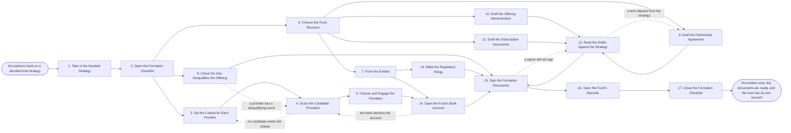

# Reference process: Form the Fund

`ref/pc/form-the-fund v1`

**value stream:** [Strategy-to-Fund](../../streams/private-capital/strategy-to-fund.md)
The partners have decided the strategy, and the fund now has to exist in
law before it can take a single commitment. This process sets up the
fund's entities with fund counsel and the tax adviser: the fund
partnership, its general partner (GP), and any parallel or feeder fund
that some investors need for tax or regulatory reasons. Counsel drafts
the limited partnership agreement (LPA), the offering memorandum and the
subscription documents from the decided terms, and the partners read
each draft against the strategy. The chief financial officer (CFO)
chooses the fund administrator, the auditor, the bank and any placement
agent from candidates scored against criteria written before any of them
was seen, and the firm's own people and agents are checked for anything
that would disqualify the offering. The close plan keeper holds one
checklist with an owner and a date on every step. The run closes when the
entities exist, the documents are ready to show investors, the providers
are engaged, and the fund has a bank account in its own name.

**delivers:** agreement, fund formation documents

## The goals

- Ready the fund to take commitments by [June 30]
- Hold formation costs under [0.5%] of commitments
- Keep regulatory filing issues at [zero]

## The activities

| # | Activity | What happens | Agents |
|---|---|---|---|
| 1 | Take in the Decided Strategy | the strategy and the fund model at their version | [close-plan-keeper](../../agents/close-plan-keeper.md) · CFO (person) |
| 2 | Open the Formation Checklist | every step owed, each with one owner and one date | close-plan-keeper |
| 3 | Set the Criteria for Each Provider | what each provider must meet, written first | [supplier-check](../../agents/supplier-check.md) · CFO (person) |
| 4 | Score the Candidate Providers | each candidate scored against the criteria | supplier-check |
| 5 | Choose and Engage the Providers | the CFO chooses, and the engagements are signed | CFO (person) · [signature-manager](../../agents/signature-manager.md) |
| 6 | Choose the Fund Structure | the main fund, parallel and feeder funds, the GP | fund counsel (person) · tax adviser (person) |
| 7 | Form the Entities | each entity registered and its filings made | fund counsel (person) · close-plan-keeper |
| 8 | Check No One Disqualifies the Offering | the firm's people and agents checked for bars | supplier-check · chief compliance officer (person) |
| 9 | Draft the Partnership Agreement | the LPA drafted from the decided terms | fund counsel (person) · close-plan-keeper |
| 10 | Draft the Offering Memorandum | strategy, terms, risks and conflicts disclosed | fund counsel (person) · chief compliance officer (person) |
| 11 | Draft the Subscription Documents | the subscription agreement and investor questionnaire | fund counsel (person) · close-plan-keeper |
| 12 | Read the Drafts Against the Strategy | every term traced to the decided strategy | managing partner (person) · CFO (person) |
| 13 | Make the Regulatory Filings | the registrations and notices the offering needs | chief compliance officer (person) · close-plan-keeper |
| 14 | Open the Fund's Bank Account | an account in the fund's own name, signers named | CFO (person) · signature-manager |
| 15 | Sign the Formation Documents | entity papers signed, the full LPA kept for close | managing partner (person) · signature-manager |
| 16 | Open the Fund's Records | the fund's books, data room and investor portal | CFO (person) · close-plan-keeper |
| 17 | Close the Formation Checklist | what slipped and why, and the fund ready to market | close-plan-keeper |

The full partnership agreement is not signed here. The GP and an initial
limited partner sign a short agreement that brings the partnership into
existence, and the full agreement, with every investor's comments
settled, is signed at the first close under `ref/pc/hold-a-fund-close`.

## The graph



## The document, with the blanks marked

```
PROCESS: form the fund                id: <team>/form-the-fund   v1
from: ref/pc/form-the-fund v1
owner: <who>                          effective: <date>
trigger: a decided fund strategy is handed on by
         ref/pc/set-the-fund-strategy, and <who> starts the formation
         watch: record=<fund strategy> system=<your document store>
                change=<a fund strategy is decided and handed on>
concurrency: one run per fund - the parallel and feeder funds of one
             fund are formed in the same run, and <how many> funds may
             be in formation at once
goal: the fund's entities formed, its partnership agreement, offering
      memorandum and subscription documents ready to show investors, and
      its providers engaged, by <date>, inside <the formation cost cap>
phases:
  take-in-strategy  - human: read the decided strategy and write down
                      every term the documents must carry, from the size
                      and the fees to the mandate and the key persons
                      owner: close-plan-keeper     after: trigger
                      automation: <level>
  open-checklist    - runs collect-and-report: every formation step as
                      one list, each with one owner and one date, counted
                      back from <the target first close>
                      owner: close-plan-keeper  after: take-in-strategy
                      automation: <level>
  set-criteria      - convenes decide-and-announce: what the fund
                      administrator, the auditor, the bank and any
                      placement agent must each meet, written before any
                      candidate is seen
                      owner: <your finance role>  after: open-checklist
                      by: <days>                  automation: <level>
  score-providers   - runs assessment: each candidate scored against the
                      criteria at their version, with the evidence behind
                      every verdict and the checks it could not run
                      owner: supplier-check       after: set-criteria
                      by: <weeks>                 automation: <level>
  engage-providers  - human: the CFO chooses each provider from the
                      scores, and each engagement letter goes out to be
                      signed with its fee and its term
                      owner: <your finance role>  after: score-providers
                      by: <days>                  automation: never
  choose-structure  - convenes decide-and-announce: the main fund, any
                      parallel or feeder fund, the GP and the domicile of
                      each, with the investors each vehicle serves
                      owner: <your fund counsel role>
                      after: open-checklist       by: <weeks>
                      automation: <level>
  form-entities     - system: each entity registered in its domicile,
                      with its registered agent and its filings
                      owner: <your fund counsel role>
                      after: choose-structure     by: <days>
                      automation: <level>
  check-bars        - runs assessment: the firm's partners, officers and
                      any placement agent checked for an event that would
                      disqualify the offering under <your offering rules>
                      owner: supplier-check       after: open-checklist
                      by: <days>                  automation: <level>
  draft-lpa         - human: the partnership agreement drafted from the
                      decided terms, with every economic term and every
                      governance term traced to the strategy
                      owner: <your fund counsel role>
                      after: choose-structure     by: <weeks>
                      automation: <level>
  draft-memorandum  - human: the offering memorandum, with the strategy,
                      the terms, the risks and every conflict of interest
                      the firm knows of
                      owner: <your fund counsel role>
                      after: choose-structure     by: <weeks>
                      automation: <level>
  draft-subscription - human: the subscription agreement and the
                      investor questionnaire, asking for every fact the
                      close will have to check
                      owner: <your fund counsel role>
                      after: choose-structure     by: <weeks>
                      automation: <level>
  read-drafts       - convenes approval: the partners read each draft
                      against the strategy, and every term that departs
                      from it is named
                      owner: <your managing partner role>
                      after: draft-lpa + draft-memorandum +
                      draft-subscription
                      by: <days>                  automation: <level>
  file-regulatory   - human: the registrations and notices the offering
                      and the firm need in <your jurisdictions>, each
                      filed and dated
                      owner: <your compliance role>
                      after: form-entities        by: <days>
                      automation: <level>
  open-account      - human: the fund's bank account opened in its own
                      name, with the signers and the payment approvals
                      named
                      owner: <your finance role>
                      after: form-entities + engage-providers
                      by: <days>                  automation: never
  sign-formation    - convenes approval: the entity documents and the
                      initial partnership agreement signed by <who>,
                      with the provider engagements already in force
                      owner: <your managing partner role>
                      after: check-bars + read-drafts + file-regulatory
                      + open-account
                      by: <days>                  automation: never
  open-records      - system: the fund set up in the fund accounting
                      system, the data room and the investor portal, each
                      empty and ready for the first investor
                      owner: <your finance role>  after: sign-formation
                      automation: <level>
  close-checklist   - convenes debrief: what slipped and why, what the
                      formation cost against the cap, and the fund
                      handed on as ready to market
                      owner: close-plan-keeper    after: open-records
                      automation: <level>
run-scoped:
  checklist - runs roll-call                    owner: close-plan-keeper
              every: <cadence>
              from: open-checklist   until: close-checklist
  cost-log  - runs allocate-and-reconcile
              owner: <your finance role>
              from: open-checklist   until: run close
handoffs:
  take-in-strategy -> open-checklist [formation-terms]: every term the
    documents must carry, each with the line of the strategy it comes
    from
  open-checklist -> set-criteria / choose-structure / check-bars
    [formation-checklist]: the checklist, with the owner and the date on
    each step
  set-criteria -> score-providers [provider-criteria]: the criteria for
    each provider, at a version, fixed before any candidate is scored
  score-providers -> engage-providers [provider-scores]: each candidate's
    verdicts, the evidence behind them, and what could not be tested
  engage-providers -> open-account [engaged-providers]: the providers
    chosen, their fees and terms, and the signed engagement letters
  choose-structure -> form-entities / draft-lpa / draft-memorandum /
    draft-subscription [fund-structure]: the vehicles, the domicile of
    each, the GP, and which investors each vehicle serves
  form-entities -> file-regulatory / open-account [formed-entities]: each
    entity, its registration number and its registered agent
  check-bars -> sign-formation [bar-check]: the people and agents
    checked, the sources, the date, and every event found
  draft-lpa / draft-memorandum / draft-subscription -> read-drafts
    [document-drafts]: each draft at a version, with each term traced to
    the strategy
  read-drafts -> sign-formation [reviewed-drafts]: the drafts the
    partners accepted, and every departure they approved in writing
  file-regulatory -> sign-formation [regulatory-filings]: each filing,
    its date and its reference
  open-account -> sign-formation [fund-account]: the account, the bank,
    the signers and the payment approvals
  sign-formation -> open-records [signed-formation]: the signed entity
    documents and the initial partnership agreement, with their signers
  open-records -> close-checklist [fund-records]: the fund's books, data
    room and investor portal, each opened and empty
deviations:
  score-providers -> set-criteria [no-candidate-fits]: no candidate
    meets the criteria, so the criteria are read again and any change is
    recorded with its reason before more candidates are scored
  check-bars -> score-providers [provider-disqualified]: a placement
    agent or another provider has a disqualifying event, so it is dropped
    and the next candidate is scored
  read-drafts -> draft-lpa [term-departs]: a term in the drafts departs
    from the strategy, so counsel drafts it again, or the partners
    change the strategy in a recorded decision
  open-account -> score-providers [bank-declines]: the bank declines to
    open the account, so the next bank on the scored list is engaged
  sign-formation -> read-drafts [signer-refuses]: a signer will not sign,
    so the terms behind the refusal go back to the partners
bindings:
  roster:  <who holds each role - agents claiming the abstract agents
           above, and named people for the managing partner, the CFO,
           the chief compliance officer, fund counsel and the tax
           adviser>
  systems: the document store (write), the signature system (trigger),
           the fund accounting system (write), the data room (write),
           the investor portal (write), the bank portal (read),
           <your entity registry> (write), <your screening service>
           (read), <your regulatory filing system> (write)
  data:    the fund strategy <version>, the fund model <version>, <your
           provider criteria> <version>, the formation checklist, <your
           offering rules>, the drafts at their version
policy:
  every provider is scored against criteria written before any candidate
    was seen, and the criteria do not move to fit a favored candidate
  no offering material leaves the firm until the check for
    disqualifying events is complete
  every term in the drafts traces to the decided strategy, and a change
    to a term is a recorded decision of the partners
  the fund's money is held in an account in the fund's own name and is
    never mixed with the firm's
  formation costs charged to the fund stop at <the cap the partnership
    agreement sets>, and the firm pays the rest
  every signature is a person's and is never delegated to an agent
  the documents shown to investors are the versions counsel released,
    each carrying its version
measures:
  cycle time: <weeks> from the strategy handed on to the fund ready to
              market
  cost: formation costs against <the formation cost cap>
  volume: <funds formed per period>
  quality gate: every provider was chosen from scores against written
                criteria, and every term in the documents traces to the
                strategy
```

## The failure edges

- **No candidate meets the criteria.** The supplier-check agent reports
  each criterion every candidate failed. The CFO reads the criteria
  again, and any change is recorded with its reason before more
  candidates are scored. A provider is never chosen by loosening the
  criteria quietly after the scores are in.
- **A provider has a disqualifying event.** A placement agent or another
  provider with an event that would disqualify the offering is dropped,
  and the next candidate is scored. When the event belongs to one of the
  firm's own people, the run stops for the managing partner and counsel,
  and no material leaves the firm until they have recorded what happens.
- **A term departs from the strategy.** The partners name the term and
  the line of the strategy it should match. Counsel drafts it again, or
  the partners change the strategy in a recorded decision and the fund
  model moves to a new version with it.
- **The bank declines the account.** The next bank on the scored list is
  engaged. The fund does not take money into any other account while it
  waits, and no investor is asked to wire anything.
- **A signer will not sign.** The refusal is recorded with its reason,
  and the terms behind it go back to the partners. Nobody signs around
  the refusing signer.
- **Formation costs run past the cap.** The cost log shows the fund's
  share reaching the cap the partnership agreement sets. The firm pays
  the rest, and the CFO records the overrun so the next fund's cap is set
  from what formation actually cost.
- **The trigger fires while a run is in flight.** A changed strategy
  arriving during formation joins the open run as a new version, and
  every draft built on the old version is read again against it. A
  second fund of a different strategy is its own run.
- **A run is abandoned.** Counsel is told to stop, and any entity already
  formed is either kept dormant or dissolved as the partners decide. The
  engagements are ended on their terms, the bank account is closed if it
  was opened, the costs are reconciled and charged to the firm, and the
  checklist is closed with its open steps listed.
