# Reference process: Hand Over to the Portfolio Team

`ref/pc/hand-over-to-the-portfolio-team v1`

**value stream:** [Close-to-Value](../../streams/private-capital/close-to-value.md)
The deal has closed, and the people who will work with the company from
now on are often different from the people who did the deal. The
handover-coordinator agent gathers what the deal team learned and promised
into one package: the investment thesis and the findings under it, the
risks, the committee's conditions, what was said to management, the
co-investors and the lenders, and the rights and duties the agreements
give the fund. The value-creation-planner agent turns the thesis into the
starting points for the value creation plan, and the portfolio-monitor
agent agrees the reporting template with the company and sets it up from
the first month. The deal team walks the portfolio team through the
package before management hears anything. The run closes when the first
month's report has arrived on the template and management has confirmed
who it works with at the firm.

## The goals

- Hand over every deal within [10 days] of closing
- Give [100%] of deal promises an owner
- Receive the first monthly report within [45 days]
- Keep deal team time on a handover under [2 days]

## The activities

| # | Activity | What happens | Agents |
|---|---|---|---|
| 1 | Take in the Closed Deal | the executed set, the memo and the committee record | [handover-coordinator](../../agents/handover-coordinator.md) |
| 2 | Name the Portfolio Team | the board director, the operating partner, the owner | deal lead partner (person) · handover-coordinator |
| 3 | Collect What the Deal Team Learned | the findings, the risks and the open questions | handover-coordinator |
| 4 | Record What Was Promised | to management, the co-investors and the lenders | handover-coordinator |
| 5 | List the Fund's Rights and Duties | information rights, consents and director rights | handover-coordinator · [portfolio-monitor](../../agents/portfolio-monitor.md) |
| 6 | Write the Company Picture | the thesis, the people and the risks in one place | handover-coordinator |
| 7 | Carry the Committee's Conditions | each condition with an owner and a date | handover-coordinator · [value-creation-planner](../../agents/value-creation-planner.md) |
| 8 | Draft the Starting Points for the Plan | the changes the thesis rests on | value-creation-planner |
| 9 | Hold the Internal Handover | the deal team walks the portfolio team through | deal lead partner (person) · operating partner (person) |
| 10 | Agree the Reporting Template | the measures, the format and the due dates | portfolio-monitor · portfolio company finance lead (person) |
| 11 | Set Up the First Month's Reporting | the template, the access and the first due date | portfolio-monitor |
| 12 | Introduce the Team to Management | management meets the people it now works with | deal lead partner (person) · handover-coordinator |
| 13 | Confirm the First Report Arrived | the first month's report, on the template | portfolio-monitor |
| 14 | Confirm Management Knows Who to Call | management confirms the contacts and the rhythm | handover-coordinator · portfolio company chief executive (person) |
| 15 | Close Out the Deal Side | the deal team's open items closed or handed on | handover-coordinator |
| 16 | Record What the Handover Missed | what the portfolio team had to ask for again | handover-coordinator |

**Venture and buyout.** In venture, the deal lead usually stays on as
the company's board member, so the handover is mostly the setting up of
the reporting.

## The graph

```mermaid
flowchart LR
  T([a deal closes and the fund holds the company]) --> A1[1. Take in the Closed Deal]
  A1 --> A2[2. Name the Portfolio Team]
  A2 --> A3[3. Collect What the Deal Team Learned]
  A2 --> A4[4. Record What Was Promised]
  A2 --> A5[5. List the Fund's Rights and Duties]
  A3 --> A6[6. Write the Company Picture]
  A4 --> A6
  A5 --> A6
  A6 --> A7[7. Carry the Committee's Conditions]
  A7 --> A8[8. Draft the Starting Points for the Plan]
  A8 --> A9[9. Hold the Internal Handover]
  A9 -. the portfolio team finds a gap .-> A3
  A9 --> A10[10. Agree the Reporting Template]
  A10 --> A11[11. Set Up the First Month's Reporting]
  A9 --> A12[12. Introduce the Team to Management]
  A11 --> A13[13. Confirm the First Report Arrived]
  A12 --> A13
  A13 -. the report is late or off the template .-> A10
  A13 --> A14[14. Confirm Management Knows Who to Call]
  A14 -. management is unsure who to call .-> A12
  A14 --> A15[15. Close Out the Deal Side]
  A15 --> A16[16. Record What the Handover Missed]
  A16 --> DONE([the portfolio team holds the company, and its reporting has started])
```



## The document, with the blanks marked

```
PROCESS: portfolio handover    id: <team>/hand-over-to-the-portfolio-team   v1
from: ref/pc/hand-over-to-the-portfolio-team v1
owner: <who>                          effective: <date>
trigger: a closing is recorded complete and the fund's position is on
         its books, in <your deal pipeline>
         watch: record=<closed deal> system=<your deal pipeline>
                change=<a closing is recorded complete>
concurrency: runs may overlap freely - one closed deal is one run, and a
             follow-on or an add-on into a company the fund already
             holds runs a shorter handover into the same team
goal: every closed deal handed to a named portfolio team within <days>
      of closing, with the package complete, every promise and condition
      owned, and the first month's report in on the template by <date
      rule>
phases:
  take-in-deal          - human: the executed set, the memo, the
                          committee record and the closing plan, each at
                          its final version
                          owner: handover-coordinator   after: trigger
                          automation: <level>
  name-team             - convenes decide-and-announce: <who> names the
                          board director, the operating partner and the
                          person who owns the holding from now on
                          owner: <your deal lead role>  after: take-in-deal
                          by: <days>                    automation: <level>
  collect-learning      - runs collect-and-report: every diligence finding,
                          risk and open question, with its source and the
                          date it was found
                          owner: handover-coordinator   after: name-team
                          automation: <level>
  record-promises       - runs collect-and-report: every promise made to
                          management, the co-investors and the lenders,
                          with who made it, when, and whether a document
                          binds it
                          owner: handover-coordinator   after: name-team
                          automation: <level>
  list-rights           - runs assessment: the fund's information rights,
                          consent rights, director rights and reporting duties,
                          read from the executed agreements
                          owner: portfolio-monitor      after: name-team
                          automation: <level>
  write-picture         - runs build-by-talent: the company picture, with
                          the thesis, the people, the risks and the source
                          behind every claim
                          owner: handover-coordinator
                          after: collect-learning + record-promises +
                          list-rights
                          automation: <level>
  carry-conditions      - human: each condition the committee set, with an
                          owner on the portfolio team and a date it must be
                          met by
                          owner: handover-coordinator   after: write-picture
                          automation: <level>
  draft-starting-points - runs build-by-talent: the changes the thesis
                          rests on, written as starting points for the
                          value creation plan, each with the finding
                          behind it
                          owner: value-creation-planner
                          after: carry-conditions       automation: <level>
  hold-handover         - convenes briefing: the deal team walks the
                          portfolio team through the package, and every
                          question the package did not answer is written
                          down with its answer
                          owner: <your deal lead role>
                          after: draft-starting-points  by: <days>
                          automation: <level>
  agree-template        - convenes decide-and-announce: the measures, the
                          format and the due dates of the company's
                          reports, inside what the information rights give
                          owner: portfolio-monitor      after: hold-handover
                          automation: <level>
  set-up-reporting      - system: the template, the access to <your
                          portfolio reporting system> and the first due
                          date set up for the company
                          owner: portfolio-monitor   after: agree-template
                          automation: <level>
  introduce-team        - convenes briefing: management meets the people it
                          now works with, hears who does what, and agrees
                          the rhythm of contact
                          owner: <your deal lead role>
                          after: hold-handover          automation: <level>
  confirm-first-report  - runs assessment: the first month's report
                          received on the template, complete and on time
                          owner: portfolio-monitor
                          after: set-up-reporting + introduce-team
                          by: <date rule>               automation: <level>
  confirm-contacts      - convenes approval: management confirms who it
                          calls at the firm for what, and the confirmation
                          is dated
                          owner: handover-coordinator
                          after: confirm-first-report   automation: <level>
  close-deal-side       - human: the deal team's open items closed or
                          handed on by name, and the deal team stays
                          reachable for <days>
                          owner: handover-coordinator
                          after: confirm-contacts       automation: <level>
  record-misses         - convenes debrief: what the portfolio team had to
                          ask for again, and what the next deal team should
                          capture the first time
                          owner: handover-coordinator
                          after: close-deal-side        automation: <level>
run-scoped:
  promises - runs allocate-and-reconcile        owner: handover-coordinator
             from: record-promises   until: run close
  status   - runs roll-call                     owner: handover-coordinator
             every: <cadence>
             from: name-team         until: confirm-contacts
handoffs:
  take-in-deal -> name-team [closed-deal]: the executed set, the memo, the
    committee record and the closing plan at their final versions
  name-team -> collect-learning / record-promises / list-rights
    [portfolio-team]: the named director, operating partner and owner
  collect-learning -> write-picture [deal-learning]: every finding, risk
    and open question, with its source and date
  record-promises -> write-picture [promise-list]: every promise, who made
    it, to whom, and whether a document binds it
  list-rights -> write-picture [rights-and-duties]: each right and duty,
    with the clause it comes from
  write-picture -> carry-conditions [company-picture]: the picture with
    the source behind every claim, at a version
  carry-conditions -> draft-starting-points [owned-conditions]: each
    committee condition with an owner and a date
  draft-starting-points -> hold-handover [plan-starting-points]: the
    starting points for the plan, each with the finding behind it
  hold-handover -> agree-template / introduce-team [handover-package]:
    the package as the portfolio team accepted it, with the questions and
    answers from the handover, and the starting points sent on to
    ref/pc/write-the-value-creation-plan
  agree-template -> set-up-reporting [reporting-template]: the measures,
    format and due dates the company agreed
  set-up-reporting -> confirm-first-report [reporting-setup]: the access
    granted and the first due date
  introduce-team -> confirm-first-report [introduction-record]: who met
    whom, what management was told, and the agreed rhythm
  confirm-first-report -> confirm-contacts [first-report]: the first
    report as received, and anything missing from it
  confirm-contacts -> close-deal-side [management-confirmation]: what
    management confirmed, and the date
  close-deal-side -> record-misses [deal-side-closed]: each open item
    closed or handed on, and to whom
deviations:
  hold-handover -> collect-learning [package-gap]: the portfolio team
    finds a gap in the package, so the missing material is collected and
    the picture is issued again before management is introduced
  confirm-first-report -> agree-template [report-off-template]: the first
    report is late or does not follow the template, so the template is
    agreed again with the company's finance lead
  confirm-contacts -> introduce-team [management-unsure]: management is
    unsure who to call for what, so the introduction is held again with
    the people it missed
bindings:
  roster:  <who holds each role - agents claiming the abstract agents
           above, and named people for the deal lead partner, the
           operating partner, the board director, the portfolio company's
           chief executive and its finance lead>
  systems: the deal pipeline (write), the data room (read),
           the portfolio reporting system (write), the decision record
           (read), the commitment tracker (write), the calendar (write)
  data:    the executed agreements <version>, the investment memo
           <version>, the committee decision <version>, <your reporting
           template> <version>, <your handover checklist> <version>
policy:
  the package is complete before management hears from the new team, and
    any gap in it is named
  every promise made to management, the co-investors or the lenders is
    written down with who made it, and a promise no document binds is
    marked as such
  every committee condition has an owner on the portfolio team and a date
    before the deal team steps back
  the reporting template asks for what the information rights give, and
    more only where the company agrees
  material non-public information from the company is handled under
    <your information barrier policy>
  a handover that management never confirmed is not closed
  the deal team stays reachable for <days> after the handover
measures:
  cycle time: <days> from closing to management's confirmation
  first report: <target> share of companies whose first monthly report
                arrives on the template and on time
  volume: <handovers per period>
  quality gate: every promise and every condition has an owner, and the
                package names its gaps
```

## The failure edges

- **The portfolio team finds a gap.** A finding with no source, a promise
  nobody wrote down, or a right the package does not mention sends the
  run back to collect what is missing. The picture is issued again before
  management meets the new team, so management is never asked to repeat
  what it already told the deal team.
- **The first report is late or off the template.** The portfolio-monitor
  agent records what was missing, and the template is agreed again with
  the company's finance lead. A template the company cannot fill is
  changed rather than chased every month.
- **Management is unsure who to call.** The introduction is held again
  with the people it missed. A deal lead who is still taking every call
  long after closing is a sign that the handover did not land.
- **Nobody will take the company.** The handover-coordinator agent holds
  the run at the naming step and raises it to the managing partner. A
  holding with no named owner on the portfolio team is the one whose
  warnings nobody reads.
- **A promise was made that no document binds.** It is marked as such
  and goes to the deal lead partner, who decides whether the firm honors
  it. Management hears the answer from the firm before it finds out by
  asking.
- **The trigger fires while a run is in flight.** One closed deal is one
  run. A follow-on round or an add-on acquisition that closes into a
  company already held runs a shorter handover into the same portfolio
  team, adding to its package and its promise list.
- **A run is abandoned.** The company is sold or written off before the
  handover finishes. The deal team keeps the holding by name until the
  portfolio team or the exit process takes it, the promise list is
  closed with what happens to each promise, and the reason goes onto the
  deal's record.
