# Reference process: Hold a Fund Close

`ref/pc/hold-a-fund-close v1`

**value stream:** [Raising a fund](../../streams/private-capital/strategy-to-fund.md)
The investors who have committed are ready to be admitted, and the fund
holds a close on a set date. This process sends each investor its
subscription documents, checks that every subscription is complete and
that every investor is eligible to invest, and screens each investor and
the people who own and control it against sanctions lists and the
anti-money laundering rules. The chief compliance officer clears every
hit before an investor can be admitted. The general partner (GP) accepts
each subscription, in part when the fund would otherwise pass its hard
cap, and the managing partner signs the close. Each new investor's
capital account is opened at its commitment. At a later close, the
newly admitted limited partners (LPs) are trued up with the earlier ones:
they pay their share of what has already been called, with an interest
charge, and the earlier investors receive that money back. The chief
financial officer (CFO) approves every amount that moves. After the final
close, each investor makes its elections under its most favored nation
(MFN) clause. The run closes when every investor admitted is on the
register with its account open and its side letter in force.

**delivers:** sheet, an investor register at close

## The goals

- Hold each close on [the set date]
- Screen [100%] of investors before acceptance
- Admit [95%] of committed investors on time

## The activities

| # | Activity | What happens | Agents |
|---|---|---|---|
| 1 | Take in the Close | the close date, the investors and their commitments | [subscription-reviewer](../../agents/subscription-reviewer.md) · investor relations lead (person) |
| 2 | Send the Subscription Documents | each investor's pack, its signers and its order | [signature-manager](../../agents/signature-manager.md) |
| 3 | Check Each Subscription Is Complete | every page, form and signature present | subscription-reviewer |
| 4 | Check Each Investor Is Eligible | investor status, tax forms and authority to sign | subscription-reviewer |
| 5 | Screen Each Investor and Its Owners | sanctions, money laundering and who controls it | [supplier-check](../../agents/supplier-check.md) |
| 6 | Clear the Screening Hits | each hit read and decided by compliance | chief compliance officer (person) · supplier-check |
| 7 | Load the Side Letters to Be Signed | each agreed letter held as obligations | [side-letter-keeper](../../agents/side-letter-keeper.md) |
| 8 | Check the Total Against the Hard Cap | the commitments beside the target and the cap | [capital-account-keeper](../../agents/capital-account-keeper.md) · CFO (person) |
| 9 | Accept the Subscriptions | the GP accepts each, in whole or in part | managing partner (person) · subscription-reviewer |
| 10 | Sign the Close | the partnership agreement and side letters signed | managing partner (person) · signature-manager |
| 11 | Open Each Capital Account | each new investor entered at its commitment | capital-account-keeper |
| 12 | Calculate the Later Investors' True-Up | their share of past calls, fees and interest | capital-account-keeper |
| 13 | Approve the True-Up | the CFO approves what moves, and to whom | CFO (person) · capital-account-keeper |
| 14 | Confirm the Close to Every Investor | the date, the commitment and the signed pages | signature-manager · investor relations lead (person) |
| 15 | Run the Side Letter Elections | after the final close, each investor elects | side-letter-keeper |
| 16 | Record the Elections as Obligations | each elected term added with its owner | side-letter-keeper |
| 17 | File the Close Record | signed documents, register and screening on file | signature-manager · subscription-reviewer |

The money in a true-up moves through the fund's own processes. The later
investors pay under `ref/pc/issue-a-capital-call` and the earlier
investors are repaid under `ref/pc/make-a-distribution`, where every
receipt and payment is checked against verified instructions. This
process works out the amounts and has them approved. An outside fund
administrator may hold the capital account keeper's role here for the
firm, or check the firm's figures before the CFO approves them.

## The graph

```mermaid
flowchart LR
  T([a close date is set and committed investors are ready to subscribe]) --> A1[1. Take in the Close]
  A1 --> A2[2. Send the Subscription Documents]
  A2 --> A3[3. Check Each Subscription Is Complete]
  A3 -. pages or forms are missing .-> A2
  A3 --> A4[4. Check Each Investor Is Eligible]
  A4 -. the investor is not eligible .-> A9
  A4 --> A5[5. Screen Each Investor and Its Owners]
  A5 --> A6[6. Clear the Screening Hits]
  A6 -. a hit cannot be cleared .-> A9
  A1 --> A7[7. Load the Side Letters to Be Signed]
  A6 --> A8[8. Check the Total Against the Hard Cap]
  A7 --> A8
  A8 --> A9[9. Accept the Subscriptions]
  A9 -. an investor is not ready by the close date .-> A1
  A9 --> A10[10. Sign the Close]
  A10 -. a signer will not sign .-> A9
  A10 --> A11[11. Open Each Capital Account]
  A11 --> A12[12. Calculate the Later Investors' True-Up]
  A12 --> A13[13. Approve the True-Up]
  A13 -. the CFO questions the amounts .-> A12
  A11 --> A14[14. Confirm the Close to Every Investor]
  A13 --> A14
  A14 --> A15[15. Run the Side Letter Elections]
  A15 --> A16[16. Record the Elections as Obligations]
  A14 --> A17[17. File the Close Record]
  A16 --> A17
  A17 --> DONE([every investor admitted is on the register, its account open and its side letter in force])
```



## The document, with the blanks marked

```
PROCESS: hold a fund close            id: <team>/hold-a-fund-close   v1
from: ref/pc/hold-a-fund-close v1
owner: <who>                          effective: <date>
trigger: <who> sets a close date for the fund, and the investors joining
         it have their terms agreed under
         ref/pc/negotiate-the-fund-terms-and-side-letters
         watch: record=<fund close> system=<your CRM>
                change=<a close date is set for the fund>
concurrency: one run per close - the next close of the same fund starts
             only after this one is signed, and an investor that misses
             this close moves to the next run
goal: every investor joining the close checked, screened, accepted and
      on the register by the close date, with its capital account open,
      any true-up approved within <days>, and the final close held by
      <the final close deadline in the partnership agreement>
phases:
  take-in-close     - human: the close date, whether it is the first, a
                      later or the final close, the investors joining and
                      the commitment each has stated
                      owner: subscription-reviewer  after: trigger
                      automation: <level>
  send-documents    - system: each investor's subscription pack sent for
                      signature, with the signers, the order and the
                      date it is due back
                      owner: signature-manager     after: take-in-close
                      by: <days>                   automation: <level>
  check-complete    - runs assessment: every page signed, every form
                      filled, every tax form attached and the commitment
                      amount matching what the investor stated
                      owner: subscription-reviewer after: send-documents
                      automation: <level>
  check-eligible    - runs assessment: the investor's status under <your
                      offering rules>, its tax position, any benefit plan
                      status, and the authority of the person who signed
                      owner: subscription-reviewer after: check-complete
                      automation: <level>
  screen-investor   - runs assessment: the investor, its owners above
                      <the ownership threshold> and its controllers
                      screened against sanctions lists and <your
                      anti-money laundering checks>, with the source of
                      its money
                      owner: supplier-check        after: check-eligible
                      by: <days>                   automation: <level>
  clear-hits        - convenes decide-and-announce: each hit read, and
                      cleared as a false match on the record, or the
                      investor refused
                      owner: <your compliance role>
                      after: screen-investor       by: <days>
                      automation: <level>
  load-letters      - system: each side letter agreed for this close held
                      as a list of obligations, ready to be in force at
                      signing
                      owner: side-letter-keeper    after: take-in-close
                      automation: <level>
  check-cap         - runs assessment: the commitments cleared for this
                      close, added to those already admitted, against
                      the target and <the hard cap>, with the cut each
                      investor would take if the cap is passed
                      owner: capital-account-keeper
                      after: clear-hits + load-letters
                      automation: <level>
  accept            - convenes approval: the GP accepts each
                      subscription in whole or in part, and refuses the
                      ones that cannot be admitted
                      owner: <your managing partner role>
                      after: check-cap             by: <the close date>
                      automation: never
  sign-close        - convenes approval: the partnership agreement and
                      each side letter signed by <who>, at the versions
                      agreed
                      owner: <your managing partner role>
                      after: accept                by: <the close date>
                      automation: never
  open-accounts     - system: each new investor's capital account opened
                      in the fund accounting system at its commitment,
                      with its side letter terms attached
                      owner: capital-account-keeper  after: sign-close
                      automation: <level>
  calculate-true-up - runs allocate-and-reconcile: at a later close,
                      each new investor's share of every call and fee so
                      far, with interest at <the rate the partnership
                      agreement sets>, and what each earlier investor
                      receives back
                      owner: capital-account-keeper  after: open-accounts
                      automation: <level>
  approve-true-up   - convenes approval: the CFO approves every amount
                      that moves, and the calls and distributions that
                      carry the money are started
                      owner: <your finance role>
                      after: calculate-true-up     by: <days>
                      automation: never
  confirm-close     - system: each investor sent the close date, its
                      accepted commitment and its signed pages, and its
                      investor portal access opened
                      owner: signature-manager
                      after: open-accounts or approve-true-up
                      automation: <level>
  run-elections     - runs collect-and-report: after the final close,
                      each investor with an MFN right sent the terms it
                      may elect, and its elections collected by <days>
                      owner: side-letter-keeper    after: confirm-close
                      automation: <level>
  record-elections  - system: each elected term added to the investor's
                      obligations, with its owner and the date it takes
                      effect
                      owner: side-letter-keeper    after: run-elections
                      automation: <level>
  file-record       - runs collect-and-report: the signed documents, the
                      investor register, the screening results and the
                      acceptances filed for the close
                      owner: signature-manager
                      after: confirm-close or record-elections
                      automation: <level>
run-scoped:
  close-clock - runs roll-call                owner: subscription-reviewer
                every: <cadence>
                from: take-in-close   until: sign-close
  register    - runs collect-and-report       owner: capital-account-keeper
                from: open-accounts   until: run close
handoffs:
  take-in-close -> send-documents / load-letters [close-list]: the close
    date, its kind, the investors joining and each stated commitment
  send-documents -> check-complete [returned-subscriptions]: each
    subscription pack as returned, with the date it came back
  check-complete -> check-eligible [complete-subscriptions]: each
    subscription confirmed complete, with any amount that differs
  check-eligible -> screen-investor [eligibility-results]: each investor's
    status, tax position and signing authority, each with its evidence
  screen-investor -> clear-hits [screening-results]: the screens run,
    the sources, the date, and every hit
  clear-hits -> check-cap [cleared-investors]: each investor cleared, or
    refused with the reason
  load-letters -> check-cap [letters-loaded]: each side letter's
    obligations, ready to be in force at signing
  check-cap -> accept [cap-check]: the total against the target and the
    cap, and any cut proposed per investor
  accept -> sign-close [accepted-subscriptions]: each subscription
    accepted, in whole or in part, or refused
  sign-close -> open-accounts [signed-close]: the signed agreement and
    side letters, at their versions, with the signers and the date
  open-accounts -> calculate-true-up / confirm-close [opened-accounts]:
    each capital account and its commitment
  calculate-true-up -> approve-true-up [true-up-amounts]: what each new
    investor owes, what each earlier investor receives, and the interest
  approve-true-up -> confirm-close [approved-true-up]: the approved
    amounts, and the call and distribution runs that carry them
  confirm-close -> run-elections / file-record [close-confirmations]:
    each confirmation sent, with its date
  run-elections -> record-elections [elections]: each investor's
    elections, and the investors that elected nothing
  record-elections -> file-record [elected-obligations]: the elected
    terms as obligations with owners and dates
deviations:
  check-complete -> send-documents [pages-missing]: pages or forms are
    missing, so the investor is sent one list of what is missing, once,
    with the date it is needed
  check-eligible -> accept [not-eligible]: the investor is not eligible
    to invest, so it goes to acceptance to be refused, with the reason
  clear-hits -> accept [hit-not-cleared]: a screening hit cannot be
    cleared, so the investor goes to acceptance to be refused, and no
    money is taken from it
  accept -> take-in-close [not-ready]: an investor is not ready by the
    close date, so it moves to the next close and this close goes ahead
    without it
  sign-close -> accept [signer-refuses]: a signer will not sign, so the
    acceptances behind the refusal are read again
  approve-true-up -> calculate-true-up [amounts-questioned]: the CFO
    questions the amounts, so they are worked again with the lines named
bindings:
  roster:  <who holds each role - agents claiming the abstract agents
           above, named people for the managing partner, the CFO, the
           chief compliance officer and the investor relations lead, and
           the outside fund administrator where it holds a role>
  systems: the fund accounting system (write), the investor portal
           (write), the signature system (trigger), the CRM (read),
           <your screening service> (read), <your side letter register>
           (write), the document store (write)
  data:    the partnership agreement <version>, the signed side letters,
           the subscription documents <version>, <your offering rules>,
           <your anti-money laundering policy> <version>, the investor
           register
policy:
  no investor is admitted with a subscription incomplete or a screening
    hit open
  the fund never passes its hard cap, and a cut is applied by <your
    allocation rule> and recorded per investor
  every acceptance and every signature is a person's and is never
    delegated to an agent
  the true-up is worked by the method the partnership agreement sets,
    and the CFO approves every amount before any money moves
  money moves only through the fund's call and distribution processes,
    to verified instructions
  a side letter is in force from the signing, and its obligations are
    held from that moment
  the final close is held by <the deadline the partnership agreement
    sets>, or extended only with the consent it requires
measures:
  cycle time: <days> from the subscription documents sent to the close
              signed
  completeness: <target> share of subscriptions complete on first return
  volume: <investors admitted per close>
  quality gate: every investor admitted has a complete subscription, a
                cleared screen, an acceptance and an open capital account
```

## The failure edges

- **Pages or forms are missing.** The subscription-reviewer agent sends
  the investor one list of what is missing, once, with a date. The
  investor is not accepted on a promise to send the rest later.
- **The investor is not eligible.** It goes to acceptance to be refused,
  with the reason in the terms of the offering rules. Investor relations
  tells the investor before the close date, and no money is taken from
  it.
- **A screening hit cannot be cleared.** The chief compliance officer
  records the hit and the decision. The investor is refused, nothing is
  taken from it, and any report the anti-money laundering rules require
  is made without telling the investor that it was made.
- **An investor is not ready by the close date.** The close goes ahead
  without it, and the investor moves to the next close. It will then be
  trued up with the investors admitted before it.
- **The commitments pass the hard cap.** The capital account keeper
  proposes the cut per investor under the allocation rule, and the GP
  applies it at acceptance. Each investor is told its accepted amount
  before the close is signed.
- **A signer will not sign.** The refusal is recorded with its reason,
  and the acceptances behind it are read again. The close is not signed
  around the refusing signer.
- **The CFO questions the true-up amounts.** The amounts are worked again
  with the lines named. When an outside fund administrator holds or
  checks the role, its figures and the firm's are reconciled before the
  CFO approves either.
- **The final close deadline is near.** The close clock raises it at the
  point the firm sets. An extension past the date the partnership
  agreement allows needs the consent it names, sought under
  `ref/pc/seek-an-advisory-committee-consent`.
- **The trigger fires while a run is in flight.** A second close date set
  for the same fund waits for this close to be signed, and investors not
  ready for this close move to that run. Two closes of one fund are never
  open at once.
- **A run is abandoned.** Every investor in the close is told it will not
  happen on the date, and by whom. No subscription is accepted, no
  account is opened, and the subscription documents are held for the
  next close or returned as each investor asks.
