# Reference process: Issue a Capital Call

`ref/pc/issue-a-capital-call v1`

**value stream:** [Commitment-to-Statement](../../streams/private-capital/commitment-to-statement.md)
The fund needs money for an investment, a follow-on, its fees and
expenses, or a repayment of the credit line it borrowed against its
investors' commitments. This process works out what each of its limited
partners (LPs) owes from what it has left to give, takes out the
investors excused from the investment, and applies what each side letter
promised about notice and caps. Someone other than whoever worked out
the shares works them out again, the fund's bank details on each notice
are checked against the verified record, and the chief financial officer
(CFO) signs the call before any notice goes out. Every receipt is
matched to its investor and its amount, a late payer is chased, and a
default is decided only by a person. The run closes when the call
reconciles to the cent and the cash is with the closing or the payment
it was called for.

## The activities

| # | Activity | What happens | Agents |
|---|---|---|---|
| 1 | Take in the Call Request | the amount, the purpose, and the date the money is due | [capital-account-keeper](../../agents/capital-account-keeper.md) |
| 2 | Check the Call Is Allowed | the purpose and timing against the partnership agreement | capital-account-keeper |
| 3 | Read What Each Investor Has Left | commitment, paid in, recallable, and what is left to call | capital-account-keeper |
| 4 | Take Out the Excused Investors | who is excused from this investment, and who carries it | [side-letter-keeper](../../agents/side-letter-keeper.md) · capital-account-keeper |
| 5 | Apply the Side Letter Terms | the notice, caps and delivery each investor was promised | side-letter-keeper |
| 6 | Work Out Each Investor's Share | each share of the call, summing to the total to the cent | capital-account-keeper |
| 7 | Check the Shares Independently | the administrator or the controller works them out again | fund administrator (person) · controller (person) |
| 8 | Draft the Notices | one notice per investor, with its amount, date and purpose | capital-account-keeper |
| 9 | Confirm the Fund's Bank Instructions | the receiving account on each notice against the record | [wire-check](../../agents/wire-check.md) |
| 10 | Sign the Call | the CFO signs before any notice goes out | CFO (person) |
| 11 | Publish the Notices | each notice on the investor's portal, its contacts told | [portal-keeper](../../agents/portal-keeper.md) |
| 12 | Match Each Receipt | every payment matched to an investor, a call and an amount | wire-check |
| 13 | Chase a Late or Short Payment | a reminder before the date and a written notice after it | investor relations lead (person) · capital-account-keeper |
| 14 | Decide on a Default | the remedies the agreement allows, applied by a person | managing partner (person) · CFO (person) |
| 15 | Post the Call to the Capital Accounts | contributions booked and unfunded commitment reduced | capital-account-keeper |
| 16 | Reconcile the Call | called, received and booked agree to the cent | capital-account-keeper · wire-check |
| 17 | Hand the Cash to Its Use | the cash to the closing or payment it was called for | capital-account-keeper · CFO (person) |
| 18 | Record What the Call Taught | late payers, notice errors, and what the next call changes | capital-account-keeper |

The cash is spent elsewhere. An investment is paid at
`ref/pc/run-the-closing` and a fee or an expense at
`ref/pc/allocate-fees-and-expenses`, and a repayment of the credit line
is released in the bank portal by the same two signers those processes
use. An outside fund administrator may hold the capital-account-keeper
or the wire-check role for the firm, or check the firm's shares at
activity 7, and the roster says which it does.

## The graph

```mermaid
flowchart LR
  T([the fund needs money from its investors, and the CFO opens a call]) --> A1[1. Take in the Call Request]
  A1 --> A2[2. Check the Call Is Allowed]
  A2 -. the agreement does not allow the call .-> A1
  A2 --> A3[3. Read What Each Investor Has Left]
  A3 --> A4[4. Take Out the Excused Investors]
  A4 --> A5[5. Apply the Side Letter Terms]
  A5 --> A6[6. Work Out Each Investor's Share]
  A6 --> A7[7. Check the Shares Independently]
  A7 -. the two workings disagree .-> A6
  A7 --> A8[8. Draft the Notices]
  A8 --> A9[9. Confirm the Fund's Bank Instructions]
  A9 -. the instructions do not match the record .-> A8
  A9 --> A10[10. Sign the Call]
  A10 -. the CFO will not sign .-> A6
  A10 --> A11[11. Publish the Notices]
  A11 --> A12[12. Match Each Receipt]
  A12 -. a payment is late, short or from an unknown account .-> A13[13. Chase a Late or Short Payment]
  A13 -. the investor has paid .-> A12
  A13 --> A14[14. Decide on a Default]
  A12 --> A15[15. Post the Call to the Capital Accounts]
  A14 --> A15
  A15 --> A16[16. Reconcile the Call]
  A16 -. the call does not reconcile .-> A12
  A16 --> A17[17. Hand the Cash to Its Use]
  A17 --> A18[18. Record What the Call Taught]
  A18 --> DONE([every share is paid or in default, and the call reconciles to the cent])
```



## The document, with the blanks marked

```
PROCESS: issue a capital call         id: <team>/issue-a-capital-call   v1
from: ref/pc/issue-a-capital-call v1
owner: <who>                          effective: <date>
trigger: <your CFO role> opens a call with its amount, purpose and due
         date in <your fund accounting system>
         watch: record=<capital call> system=<your fund accounting system>
                change=<a call is opened with its amount and due date>
concurrency: runs may overlap across funds - one call is one run, and a
             fund has <how many> calls open at once, so a second call on
             the same fund waits until the first reconciles unless <who>
             allows both
goal: every notice out at least <days> before the due date, <target>
      share of the money received by the due date, and the call
      reconciled to the cent within <days> of it
phases:
  take-in-request      - system: the call lands with its amount, its
                         purpose, the investment or payment it is for,
                         and the date the money is due
                         owner: capital-account-keeper   after: trigger
                         automation: <level>
  check-allowed        - runs assessment: the purpose, the amount and
                         the timing against what the partnership
                         agreement lets the fund call for, including the
                         investment period, the notice period and any
                         limit on calls for follow-ons, fees or expenses
                         owner: capital-account-keeper
                         after: take-in-request     automation: <level>
  read-unfunded        - runs collect-and-report: each investor's
                         commitment, what it has paid in, what was
                         returned to it that may be called again, and
                         what is left to call, read at a date
                         owner: capital-account-keeper
                         after: check-allowed       automation: <level>
  remove-excused       - runs assessment: the investors the agreement or
                         their side letters excuse or exclude from this
                         investment, and how their share is spread over
                         the others under <your partnership agreement>
                         owner: side-letter-keeper
                         after: read-unfunded       automation: <level>
  apply-side-letters   - runs assessment: each side letter read for
                         notice periods, caps on calls, limits on any one
                         investment, currency, and how the investor wants
                         its notice delivered
                         owner: side-letter-keeper
                         after: remove-excused      automation: <level>
  work-out-shares      - runs allocate-and-reconcile: each investor's
                         share of the call, split between investment,
                         fees and expenses, by unfunded commitment unless
                         the agreement says otherwise, with the shares
                         summing to the call to the cent under <your
                         rounding rule>
                         owner: capital-account-keeper
                         after: apply-side-letters  automation: <level>
  check-shares         - runs assessment: every share worked out again
                         from the same inputs, without sight of the first
                         answer, by the outside fund administrator where
                         the firm uses one to check its work, or by
                         <your controller role>
                         owner: <your independent check role>
                         after: work-out-shares     by: <days>
                         automation: <level>
  draft-notices        - human: one notice per investor with its amount,
                         the purpose, the due date, the commitment it has
                         left after the call, and the fund's receiving
                         account, on <your notice template>
                         owner: capital-account-keeper
                         after: check-shares        automation: <level>
  confirm-instructions - runs assessment: the receiving account on every
                         notice checked against <your verified bank
                         record>, and any change to it confirmed with the
                         bank on a number already on file
                         owner: wire-check
                         after: draft-notices       automation: <level>
  sign-call            - convenes approval: <your CFO role> signs the
                         call, the shares and the notices as a named
                         signer before any notice goes out
                         owner: <your CFO role>
                         after: confirm-instructions   by: <days>
                         automation: never
  publish-notices      - system: each notice published to the investor's
                         area of the investor portal at a version, and
                         its named contacts told it is there, at least
                         <days> before the due date
                         owner: portal-keeper       after: sign-call
                         automation: <level>
  match-receipts       - runs allocate-and-reconcile: every incoming
                         payment matched to an investor, a call and an
                         amount, and anything late, short, over, or sent
                         from an account not on the investor's record
                         held aside with the reason
                         owner: wire-check          after: publish-notices
                         automation: <level>
  chase-late           - human: a reminder to every investor not yet
                         paid <days> before the due date, and a written
                         notice after it that starts the cure period
                         owner: <your investor relations lead role>
                         after: match-receipts      by: <days>
                         automation: <level>
  decide-default       - convenes decide-and-announce: whether to
                         declare a default once the cure period of
                         <days> has passed, and which of the remedies
                         the agreement allows are applied
                         owner: <your managing partner role>
                         after: chase-late          automation: never
  post-call            - system: each contribution booked to the
                         investor's capital account, its unfunded
                         commitment reduced, and any default recorded
                         against it
                         owner: capital-account-keeper
                         after: match-receipts, and decide-default when
                         one ran                    automation: <level>
  reconcile-call       - runs allocate-and-reconcile: called, received
                         and booked compared investor by investor, and
                         the bank balance agreed to the fund accounting
                         system
                         owner: capital-account-keeper
                         after: post-call           by: <days>
                         automation: <level>
  hand-cash            - human: the cash handed to the closing, the fee,
                         the expense or the credit line repayment it was
                         called for, with the call reference, for the
                         process that pays it
                         owner: capital-account-keeper
                         after: reconcile-call      automation: <level>
  record-learning      - convenes debrief: who paid late, which notices
                         were wrong, what the checks caught, and what the
                         next call does differently
                         owner: capital-account-keeper
                         after: hand-cash           automation: <level>
run-scoped:
  due-date - runs roll-call                     owner: wire-check
             every: <cadence>
             from: publish-notices  until: post-call
  ledger   - runs allocate-and-reconcile        owner: capital-account-keeper
             from: work-out-shares  until: run close
handoffs:
  take-in-request -> check-allowed [call-request]: the amount, the
    purpose, the investment or payment it is for, and the due date
  check-allowed -> read-unfunded [allowed-call]: the clauses the call
    rests on, and the notice period it must give
  read-unfunded -> remove-excused [unfunded-commitments]: each
    investor's commitment, paid in, recallable amounts and what is left
    to call, read at a date
  remove-excused -> apply-side-letters [excused-investors]: the
    investors excused or excluded, the clause behind each, and how their
    share is spread over the others
  apply-side-letters -> work-out-shares [side-letter-terms]: the terms
    each side letter sets on this call, with the clause for each
  work-out-shares -> check-shares [call-shares]: every investor's share,
    its split, and the inputs it was worked out from
  check-shares -> draft-notices [checked-shares]: the shares as both
    workings agree them, with the name of whoever checked them
  draft-notices -> confirm-instructions [draft-notices]: one notice per
    investor, at a version
  confirm-instructions -> sign-call [confirmed-instructions]: the
    receiving account on each notice, confirmed against the record, and
    the date it was confirmed
  sign-call -> publish-notices [signed-call]: the signed call and its
    notices. A change to any share voids the signature
  publish-notices -> match-receipts [published-notices]: each notice,
    its version, and the date its contacts were told
  match-receipts -> chase-late [open-receipts]: the investors not yet
    paid in full, and anything held aside with the reason
  chase-late -> decide-default [unpaid-after-notice]: the investors
    still unpaid when the cure period ends, with every reminder and
    notice sent to them
  match-receipts -> post-call [matched-receipts]: every receipt matched
    to an investor and a notice, with its bank reference
  decide-default -> post-call [default-decision]: the decision, the
    remedies applied, and the person who decided
  post-call -> reconcile-call [posted-call]: each capital account after
    the call, and the receivable still open
  reconcile-call -> hand-cash [reconciled-call]: called, received and
    booked agreed, with any difference named and owned
  hand-cash -> record-learning [cash-handed-over]: the cash handed on,
    to which closing or payment, and on what date
deviations:
  check-allowed -> take-in-request [call-not-allowed]: the agreement
    does not allow the call as asked, so it goes back to the CFO with
    the clause named, to be changed or withdrawn
  check-shares -> work-out-shares [workings-disagree]: the two workings
    disagree, so the shares are worked out again and the difference is
    traced before anything is drafted
  confirm-instructions -> draft-notices [instructions-do-not-match]:
    the receiving account on a notice does not match the verified
    record, so every notice is held and drafted again once the bank has
    confirmed the account
  sign-call -> work-out-shares [signer-refuses]: the CFO will not sign,
    so the shares are worked out again on the lines the CFO named
  match-receipts -> chase-late [payment-late-or-unknown]: a payment is
    late, short, or from an account not on the investor's record, so it
    is held aside and the investor is chased
  chase-late -> match-receipts [investor-pays]: the investor pays, so
    the payment is matched like any other
  reconcile-call -> match-receipts [call-does-not-reconcile]: called,
    received and booked do not agree, so the matching is done again
    from the bank's own record
bindings:
  roster:  <who holds each role - agents claiming the abstract agents
           above, or the outside fund administrator where it holds
           capital-account-keeper or wire-check for the firm, and named
           people for the CFO, the controller, the investor relations
           lead and the managing partner>
  systems: the fund accounting system (write), the investor portal
           (write), the bank portal (read), the side letter register
           (read), <your verified bank record> (read), the CRM (read),
           the notification channel (write)
  data:    the partnership agreement <version>, every side letter at
           its current version and the elections made under it, <your
           capital call policy> <version>, <your notice template>
           <version>, <your anti-money-laundering procedure> <version>
policy:
  no notice goes out before <your CFO role> has signed the call, and a
    change to any share after signing voids the signature
  the shares are worked out again by someone other than whoever worked
    them out first, and the call waits until both workings agree
  an investor excused from an investment is never called for it, and
    the clause that excuses it is named in the run
  the fund's receiving account changes only after the bank confirms the
    change on a number already on file, and a change announced by email
    alone is reported to <who> as an attempt at fraud
  every notice tells the investor to confirm the fund's bank details by
    telephone before it pays
  a payment from an account not on the investor's record is held until
    <who> clears it under <your anti-money-laundering procedure>
  a default is declared only by a person, only after the cure period,
    and only with the remedies the agreement allows
  every investor gets the notice period the agreement and its side
    letter promise, and a shorter notice needs <who> to agree in writing
measures:
  cycle time: <days> from the call opening to the call reconciled
  on time: <target> share of the money received by the due date
  volume: <calls per fund per year>
  quality gate: every share traces to a commitment and a clause, and
                every receipt traces to an investor and a notice
```

## The failure edges

- **The agreement does not allow the call.** The purpose falls outside
  what the fund may call for, the investment period has ended for new
  investments, or the notice period cannot be met by the date asked. The
  capital-account-keeper agent names the clause, and the request goes
  back to the CFO to be changed or withdrawn. No call goes out on a
  reading of the agreement that nobody has written down.
- **The two workings disagree.** The shares are worked out again from
  the inputs both workings used, and the difference is traced to a
  commitment, a transfer between investors, an excusal or a rounding
  rule. The call waits for the two to agree, and the investors never see
  the figures that happened to be ready first.
- **The bank details on a notice do not match the record.** Every notice
  is held. The wire-check agent confirms the account with the bank on a
  number already on file, and the notices are drafted again. A request
  to change the fund's account that arrived by email alone is reported
  to the CFO the same day as an attempt at fraud.
- **The CFO will not sign.** The call goes back to the shares with the
  lines the CFO named. Any notice drafted from the old shares is
  destroyed at its version, and the signature covers only the shares it
  was given.
- **An investor pays late, short, or from an account not on its
  record.** The wire-check agent holds the payment aside and names it.
  A late or short payer is reminded and then sent a written notice that
  starts the cure period. A payment from an unknown account is booked
  only once it clears the anti-money-laundering procedure, and one that
  cannot be cleared is returned to the account it came from, with the
  return signed by two people in the bank portal.
- **An investor defaults.** The cure period passes and the money has not
  arrived. A person decides whether to declare a default and applies
  only the remedies the agreement allows. The investors who paid are
  called for the shortfall only where the agreement allows it, and that
  call is a new run with its own notices.
- **An excused investor was called.** The amount it paid is returned,
  signed by two people, its notice is reissued as a new version, and
  the shortfall is called from the investors who carry the investment as
  a new run. The excusal is added to the side letter register if it was
  missing.
- **The call does not reconcile.** The matching is done again from the
  bank's own record. The capital accounts stay open on the difference
  until it is traced, and the CFO decides in writing whether the cash
  already received may go to the closing while the difference is open.
- **The trigger fires while a run is in flight.** A second call on the
  same fund waits until the first reconciles, unless a named person
  allows both. When both run, each notice shows each call on its own
  line, so an investor never pays one amount against two calls.
- **A run is abandoned.** The notices are withdrawn on the portal and the
  investors are told in writing. Money already received is returned,
  signed by two people, or held as an advance against the next call
  where the investor agrees in writing. Nothing is booked to a capital
  account that the run did not finish, and the closing or payment the
  cash was for is told it is not coming.
