# Reference process: Issue a Term Sheet

`ref/pc/issue-a-term-sheet v1`

**value stream:** [Recommendation-to-Close](../../streams/private-capital/recommendation-to-close.md)
The investment committee has approved a deal on stated terms, with limits
on how far each term may move. The deal-structurer agent writes those terms
onto a term sheet and checks every line against the approval before the
firm's counsel reads it. The company's asks come back one at a time, the
returns-modeler agent prices what each one does to the return, and the
deal lead partner gives, trades or refuses it inside the limits. A change
past the limits goes back to the committee, and only the committee moves
them. Both sides sign, and the exclusivity period and the other terms that
bind before closing are recorded with their dates. The run closes when the
signed term sheet is on the deal's record and has been handed to the
lawyers for the definitive agreements.

**delivers:** agreement, a signed term sheet

## The goals

- Sign the term sheet within [10 days] of approval
- Keep [100%] of terms inside the committee limits
- Win [60%] of the term sheets offered

## The activities

| # | Activity | What happens | Agents |
|---|---|---|---|
| 1 | Take in the Committee Decision | the approved terms, the conditions and the limits | [deal-structurer](../../agents/deal-structurer.md) |
| 2 | Set the Walk-Away Terms | how far each term may move inside the approval | deal lead partner (person) · [returns-modeler](../../agents/returns-modeler.md) |
| 3 | Draft the Term Sheet | the approved terms written onto one document | deal-structurer |
| 4 | Check the Draft Against the Approval | every line traced to what the committee approved | deal-structurer |
| 5 | Review the Draft with Counsel | the firm's counsel reads the draft before it goes | outside counsel (person) · deal-structurer |
| 6 | Send the Term Sheet | the draft, its expiry date and who to answer | deal lead partner (person) · deal-structurer |
| 7 | Log the Other Side's Asks | each change the company asks for, one at a time | deal-structurer |
| 8 | Price Each Ask | what each change does to the return and the risk | returns-modeler |
| 9 | Answer Each Ask | given, traded or refused, inside the limits | deal lead partner (person) · deal-structurer |
| 10 | Take a Change Past the Limits to Committee | the change goes back to the committee for a vote | deal lead partner (person) · deal-structurer |
| 11 | Agree the Final Text | one clean text both sides call the term sheet | deal-structurer · outside counsel (person) |
| 12 | Check the Final Return | the agreed terms modeled once more | returns-modeler |
| 13 | Sign the Term Sheet | signed for the firm and for the company | fund signatory (person) · company signatory (person) |
| 14 | Record the Exclusivity and What Binds | the dates, and the terms that bind before closing | deal-structurer |
| 15 | Hand On the Signed Terms | to the definitive agreements and any co-investment | deal-structurer |
| 16 | Record the Term Sheet | the signed version and its dates on the deal record | deal-structurer |

**Venture and buyout.** In venture, the term sheet sets a priced round of
preferred shares, with the liquidation preference, the board representation and
the pro rata rights. In a buyout, it is a letter of intent that states
the price, how the purchase is financed, what management rolls over into
the new company, and an exclusivity period.

## The graph

```mermaid
flowchart LR
  T([the committee approves a deal on stated terms]) --> A1[1. Take in the Committee Decision]
  A1 --> A2[2. Set the Walk-Away Terms]
  A2 --> A3[3. Draft the Term Sheet]
  A3 --> A4[4. Check the Draft Against the Approval]
  A4 -. a line does not match the approval .-> A3
  A4 --> A5[5. Review the Draft with Counsel]
  A5 --> A6[6. Send the Term Sheet]
  A6 --> A7[7. Log the Other Side's Asks]
  A7 --> A8[8. Price Each Ask]
  A8 --> A9[9. Answer Each Ask]
  A9 -. the company asks past the limits .-> A10[10. Take a Change Past the Limits to Committee]
  A10 -. the committee moves the limits .-> A2
  A10 -. the committee holds the limits .-> A9
  A9 --> A11[11. Agree the Final Text]
  A11 --> A12[12. Check the Final Return]
  A12 -. the return falls below the approval .-> A10
  A12 --> A13[13. Sign the Term Sheet]
  A13 -. a signer will not sign .-> A9
  A13 --> A14[14. Record the Exclusivity and What Binds]
  A14 --> A15[15. Hand On the Signed Terms]
  A15 --> A16[16. Record the Term Sheet]
  A16 --> DONE([a signed term sheet on the deal's record, with its exclusivity dated])
```



## The document, with the blanks marked

```
PROCESS: issue a term sheet           id: <team>/issue-a-term-sheet   v1
from: ref/pc/issue-a-term-sheet v1
owner: <who>                          effective: <date>
trigger: the committee's confirmed decision approves a deal on stated
         terms, in <your decision record>
         watch: record=<committee decision> system=<your decision record>
                change=<a decision to approve is confirmed by the chair>
concurrency: runs may overlap - <how many> term sheets may be out at
             once, and one deal has one term sheet run at a time
goal: a term sheet signed within <days> of the committee's approval,
      with every term inside the limits the committee set, every ask
      closed with the person who decided it, and the exclusivity period
      recorded with its end date
phases:
  take-in-decision   - human: the confirmed decision read for the terms
                       approved, each condition, the limits on each term
                       and the date the approval lapses
                       owner: deal-structurer        after: trigger
                       automation: <level>
  set-walk-away      - convenes decide-and-announce: how far each term
                       may move at the table, inside the committee's
                       limits, with the return at each walk-away point
                       owner: <your deal lead role>
                       after: take-in-decision       by: <days>
                       automation: <level>
  draft-term-sheet   - human: the approved terms written onto one
                       document in <your term sheet form>, with the
                       expiry date and the terms that bind marked
                       owner: deal-structurer        after: set-walk-away
                       by: <days>                    automation: <level>
  check-draft        - runs assessment: every line of the draft traced to
                       the approval, and every line the approval does not
                       cover named as new
                       owner: deal-structurer
                       after: draft-term-sheet       automation: <level>
  review-with-counsel - human: the firm's counsel reads the draft, and
                       confirms which terms bind before closing and which
                       do not
                       owner: <your counsel role>    after: check-draft
                       by: <days>                    automation: <level>
  send-term-sheet    - human: the draft sent to the company, or to the
                       seller when the fund is buying control, with the
                       expiry date and the person to answer
                       owner: <your deal lead role>
                       after: review-with-counsel    automation: <level>
  log-asks           - runs collect-and-report: every change the other
                       side asks for, one item each, with the date it
                       came in and the term it touches
                       owner: deal-structurer        after: send-term-sheet
                       automation: <level>
  price-asks         - runs assessment: what each ask does to the return,
                       the ownership or the risk, read against the
                       walk-away terms
                       owner: returns-modeler        after: log-asks
                       automation: <level>
  answer-asks        - human: each ask given, traded or refused inside the
                       walk-away terms, with the person who agreed it
                       owner: <your deal lead role>  after: price-asks
                       by: <days>                    automation: <level>
  take-to-committee  - convenes decide-and-announce: a change past the
                       limits taken back to the committee as a new run of
                       ref/pc/decide-at-investment-committee, with its
                       price and the reason the company wants it
                       owner: <your deal lead role>
                       after: answer-asks or check-final-return
                       by: <days>                    automation: <level>
  agree-final-text   - human: one clean text both sides call the term
                       sheet, with every ask closed and nothing left in
                       the margin
                       owner: deal-structurer        after: answer-asks
                       automation: <level>
  check-final-return - runs assessment: the agreed terms modeled once
                       more, and the return set beside what the committee
                       approved
                       owner: returns-modeler
                       after: agree-final-text       automation: <level>
  sign-term-sheet    - convenes approval: <your fund signatory role> signs
                       for the firm under <your delegation of authority>,
                       and the company's signatory signs for the company
                       owner: <your fund signatory role>
                       after: check-final-return     by: <days>
                       automation: never
  record-exclusivity - system: the exclusivity period, its end date, and
                       each term that binds before closing, such as
                       confidentiality and costs, written to the deal
                       owner: deal-structurer        after: sign-term-sheet
                       automation: <level>
  hand-on-terms      - human: the signed terms and the committee's
                       conditions handed to
                       ref/pc/negotiate-the-definitive-agreements, and the
                       co-investment amount to ref/pc/offer-a-co-investment
                       owner: deal-structurer
                       after: record-exclusivity     automation: <level>
  record-term-sheet  - system: the signed version, its signers, its dates
                       and every closed ask written to the deal's record
                       owner: deal-structurer        after: hand-on-terms
                       automation: <level>
run-scoped:
  position-log - runs collect-and-report        owner: deal-structurer
                 from: log-asks           until: run close
  expiry       - runs roll-call                 owner: deal-structurer
                 every: <cadence>
                 from: send-term-sheet    until: sign-term-sheet
handoffs:
  take-in-decision -> set-walk-away [approved-terms]: the terms the
    committee approved, its conditions, the limits on each term and the
    lapse date
  set-walk-away -> draft-term-sheet [walk-away-terms]: how far each term
    may move, the return at each point, and the person who set them
  draft-term-sheet -> check-draft [term-sheet-draft]: the draft at a
    version, with the terms that bind marked
  check-draft -> review-with-counsel [traced-draft]: every line traced to
    the approval, and any line named as new
  review-with-counsel -> send-term-sheet [cleared-draft]: the draft as
    counsel cleared it, with the binding terms confirmed
  send-term-sheet -> log-asks [term-sheet-sent]: the version sent, to
    whom, on what date, and when it expires
  log-asks -> price-asks [ask-log]: every ask as one item, with the term
    it touches and the date it came in
  price-asks -> answer-asks [priced-asks]: each ask with its effect on the
    return and where it sits against the walk-away terms
  answer-asks -> agree-final-text [closed-asks]: every ask closed as
    given, traded or refused, with the person who agreed it
  take-to-committee -> set-walk-away / answer-asks [committee-answer]:
    the committee's answer on the change, and any new limits it set
  agree-final-text -> check-final-return [agreed-text]: the clean text
    both sides call the term sheet, at a version
  check-final-return -> sign-term-sheet [final-return]: the return on the
    agreed terms beside the return the committee approved
  sign-term-sheet -> record-exclusivity [signed-term-sheet]: the signed
    term sheet, its signers and the date it was signed
  record-exclusivity -> hand-on-terms [binding-terms]: the exclusivity end
    date and every term that binds before closing
  hand-on-terms -> record-term-sheet [next-runs]: the definitive
    agreements run and any co-investment run, with their identifiers
deviations:
  check-draft -> draft-term-sheet [line-off-approval]: a line does not
    match the approval, so it is drafted again against the term the
    committee approved
  answer-asks -> take-to-committee [ask-past-limits]: the company asks
    past the limits, so the ask is refused at the table and taken back to
    the committee with its price
  take-to-committee -> set-walk-away [limits-moved]: the committee moves
    the limits, so the walk-away terms are set again inside the new ones
  take-to-committee -> answer-asks [limits-held]: the committee holds the
    limits, so the ask is refused and the answer goes back to the company
  check-final-return -> take-to-committee [return-below-approval]: the
    agreed terms give a return below what the committee approved, so the
    terms go back to the committee before anything is signed
  sign-term-sheet -> answer-asks [signer-will-not-sign]: a signer will not
    sign, so the terms behind the refusal go back to the table
bindings:
  roster:  <who holds each role - agents claiming the abstract agents
           above, and named people for the deal lead partner, the outside
           counsel and the fund signatory>
  systems: the deal pipeline (write), the decision record (read),
           the contract system (write), the investment model (write),
           the signature system (trigger), the data room (write)
  data:    the committee decision <version>, <your term sheet form>
           <version>, <your delegation of authority> <version>,
           the investment model <version>, the investment memo <version>
policy:
  no term goes to the other side that the committee's approval does not
    cover
  a change past the limits is refused at the table and taken back to the
    committee, and only the committee moves its limits
  every ask is logged and closed as given, traded or refused, with the
    person who decided it
  the term sheet says which of its terms bind before closing, and <your
    counsel role> confirms them before it goes out
  the signature is a human gate and is never delegated to an agent
  a term sheet unsigned by its expiry date lapses, and a new one is sent
    only while the committee's approval is still in force
  the exclusivity end date is on the deal's record, and an extension is
    agreed in writing before the date passes
measures:
  cycle time: <days> from the committee's approval to a signed term sheet
  limit discipline: <target> share of signed terms inside the limits the
                    committee first set
  volume: <term sheets per period>
  quality gate: every signed term traces to the approval, and every ask
                is closed with the person who decided it
```

## The failure edges

- **A line does not match the approval.** The deal-structurer agent names
  the line and the approved term it should match, and the draft is
  written again before counsel reads it. A term the committee never
  approved does not reach the company as a drafting slip.
- **The company asks past the limits.** The ask is refused at the table
  and taken back to the committee with what it does to the return. The
  deal lead partner does not agree it subject to approval, because the
  company then hears a yes the committee has not given.
- **The committee moves the limits or holds them.** When it moves them,
  the walk-away terms are set again inside the new limits and the
  negotiation carries on from there. When it holds them, the ask is
  refused and the company is told plainly.
- **The final return falls below the approval.** Several asks that were
  each inside the limits can add up to a deal the committee did not
  approve. The returns-modeler agent reads the whole of it once more,
  and a shortfall goes back to the committee before anyone signs.
- **A signer will not sign.** The refusal is recorded with its reason and
  the terms behind it go back to the table. Signing around the refusing
  signer is not one of the choices.
- **The company signs with another investor, or the term sheet
  expires.** The term sheet lapses on its own date and the company is
  told it has. The deal's record carries the reason, and a later term
  sheet for the same company starts a new run against a committee
  approval that is still in force.
- **The exclusivity runs out before the agreements are done.** The
  deal-structurer agent raises the end date ahead of time, and an
  extension is agreed in writing or the firm accepts that the company
  may talk to others. Nobody assumes an extension that was never signed.
- **The trigger fires while a run is in flight.** One deal has one term
  sheet run at a time. A second approval for the same deal, from a new
  committee run, replaces the limits of the first, and the walk-away
  terms are set again before the next answer goes to the company.
- **A run is abandoned.** The term sheet is withdrawn in writing and the
  company is told by whom. Any signed exclusivity is released or left to
  expire on its own terms, the drafts are closed at their last version,
  and the reason the deal stopped goes onto the deal's record and back
  to the committee.
