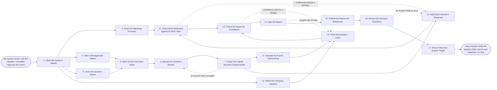

# Reference process: Issue the Quarterly Report and Statements

`ref/pc/issue-the-quarterly-report-and-statements v1`

**value stream:** [Capital calls and investor reporting](../../streams/private-capital/commitment-to-statement.md)
The quarter has closed and the valuation committee has approved the
marks. This process closes the fund's books for the quarter, works out
the fund's net asset value and each limited partner's (LP's) share of
it, and calculates the fund's performance, its internal rate of return
(IRR) and its multiples of paid-in capital, gross and net, under the
firm's written method. Someone other than whoever kept the capital
accounts works them out again. The quarter's letter says what happened
in the portfolio and why the numbers moved, every investor's statement
is built from its own capital account, and each statement is read
against what that investor's side letter promised about reporting.
Compliance reads the report for how performance is shown and what fees
are disclosed, and the chief financial officer (CFO) and a partner sign
it. The run closes when each investor holds the letter and its own
statement on the investor portal by the date it was promised.

**delivers:** report, a quarterly investor report

## The goals

- Deliver every investor statement within [45 days]
- Keep restated figures at [zero]
- Meet [100%] of side letter reporting promises
- Keep investor questions per report under [10]

## The activities

| # | Activity | What happens | Agents |
|---|---|---|---|
| 1 | Open the Quarter's Report | what it covers, when it is due, and who it goes to | [reporting-manager](../../agents/reporting-manager.md) |
| 2 | Read the Reporting Promises | each side letter's terms on content, format and timing | [side-letter-keeper](../../agents/side-letter-keeper.md) |
| 3 | Take in the Approved Marks | each holding's fair value as the committee approved it | reporting-manager |
| 4 | Close the Quarter's Books | every call, distribution, fee and expense booked | [capital-account-keeper](../../agents/capital-account-keeper.md) · controller (person) |
| 5 | Work Out the Net Asset Value | the fund's value, and each investor's share of it | capital-account-keeper |
| 6 | Allocate the Quarter's Results | gains, losses, income and accrued carry, by the waterfall | capital-account-keeper |
| 7 | Check the Capital Accounts Independently | the administrator or the controller works them out again | fund administrator (person) · controller (person) |
| 8 | Calculate the Fund's Performance | the IRR and multiples, gross and net, by the written method | [performance-calculator](../../agents/performance-calculator.md) |
| 9 | Collect the Company Updates | each company's quarter, as the portfolio review read it | reporting-manager |
| 10 | Write the Quarter's Letter | what happened, why the numbers moved, what comes next | reporting-manager · managing partner (person) |
| 11 | Build Each Investor's Statement | committed, paid in, received back, and what it is worth | capital-account-keeper |
| 12 | Check Each Statement against Its Side Letter | every promised item, format and extra report present | side-letter-keeper |
| 13 | Check the Report for Compliance | performance shown fairly, and fees and expenses disclosed | chief compliance officer (person) · reporting-manager |
| 14 | Sign the Report | the CFO and a partner sign before it goes out | CFO (person) · managing partner (person) |
| 15 | Publish the Report and Statements | each investor sees its own statement, at a version | [portal-keeper](../../agents/portal-keeper.md) |
| 16 | Answer the Investors' Questions | each question answered and logged for the next report | investor relations lead (person) · reporting-manager |
| 17 | Record What the Quarter Taught | what was late, corrected or asked, and what changes | reporting-manager |

The marks are set elsewhere. They come from `ref/pc/value-the-portfolio`,
approved by the valuation committee, and the company updates come from
`ref/pc/run-the-portfolio-review`. A mark that has to change goes back
through that committee, and the report follows the new mark. An outside
fund administrator may hold the capital-account-keeper role for the
firm, or check the firm's capital accounts at activity 7, and the roster
says which it does.

## The graph



## The document, with the blanks marked

```
PROCESS: quarterly report   id: <team>/issue-the-quarterly-report-and-statements   v1
from: ref/pc/issue-the-quarterly-report-and-statements v1
owner: <who>                          effective: <date>
trigger: the quarter ends on <your fiscal calendar>, and the run waits
         for the marks <your valuation committee> approves
         watch: record=<quarter-end marks> system=<your fund accounting
                system> change=<the valuation committee approves the
                quarter's marks>
concurrency: one run per fund per quarter - the next quarter's run opens
             only when this one has published, and the fourth quarter's
             run shares its closed books with the year-end audit
goal: every investor holds the quarter's letter and its own statement
      within <days> of the quarter end, and by the earlier date any side
      letter promised, with every figure tied to the closed books and
      the approved marks
phases:
  open-report          - human: the period, the due date the agreement
                         and the side letters set, the investors the
                         report goes to, and the same request to every
                         source it draws on
                         owner: reporting-manager   after: trigger
                         automation: <level>
  read-promises        - runs collect-and-report: each side letter read
                         for what the investor was promised: content,
                         template, currency, timing, and any extra report
                         such as its own template of fees and expenses
                         owner: side-letter-keeper  after: open-report
                         automation: <level>
  take-in-marks        - system: the marks as the valuation committee
                         approved them, at their version, with the
                         method and inputs behind each one
                         owner: reporting-manager   after: open-report
                         automation: <level>
  close-books          - runs allocate-and-reconcile: every call,
                         distribution, fee, expense and accrual for the
                         quarter booked, and the bank and the holdings
                         agreed to the fund accounting system
                         owner: capital-account-keeper
                         after: open-report         by: <days>
                         automation: <level>
  work-out-value       - runs allocate-and-reconcile: the fund's net
                         asset value from the approved marks, its cash
                         and other assets less what it owes, and each
                         investor's share of it
                         owner: capital-account-keeper
                         after: take-in-marks + close-books
                         automation: <level>
  allocate-results     - runs allocate-and-reconcile: the quarter's
                         gains, losses, income, fees and expenses
                         allocated to each capital account, with the
                         carry the general partner would earn if the
                         fund sold everything at the marks, accrued under
                         <your waterfall>
                         owner: capital-account-keeper
                         after: work-out-value      automation: <level>
  check-accounts       - runs assessment: every capital account worked
                         out again from the same inputs, without sight of
                         the first answer, by the outside fund
                         administrator where the firm uses one to check
                         its work, or by <your controller role>
                         owner: <your independent check role>
                         after: allocate-results    by: <days>
                         automation: <level>
  calculate-performance - runs assessment: the IRR, the multiple of
                         total value to paid-in capital and the multiple
                         of distributions to paid-in capital, gross and
                         net, for the fund and each holding, from the
                         cash flows and the approved marks under <your
                         performance method> <version>, with the effect
                         of the credit line shown
                         owner: performance-calculator
                         after: check-accounts      automation: <level>
  collect-updates      - runs collect-and-report: each company's quarter
                         as the portfolio review read it, its condition,
                         its plan and anything the investors must hear,
                         with any company that has not reported named
                         owner: reporting-manager   after: open-report
                         by: <days>                 automation: <level>
  write-letter         - convenes draft-review-merge: the letter drafted
                         from the performance, the marks and the company
                         updates, saying what happened, why the numbers
                         moved and what comes next, read by <your
                         managing partner role>
                         owner: reporting-manager
                         after: calculate-performance + collect-updates
                         by: <days>                 automation: <level>
  build-statements     - system: each investor's statement from its own
                         capital account: commitment, contributions,
                         distributions, fees, expenses, offsets, carry
                         and closing value, for the quarter, the year and
                         since it joined
                         owner: capital-account-keeper
                         after: check-accounts      automation: <level>
  check-statements     - runs assessment: each statement and its package
                         against the investor's side letter reporting
                         terms, including the template, the currency and
                         every extra report it was promised
                         owner: side-letter-keeper
                         after: read-promises + build-statements
                         automation: <level>
  check-compliance     - runs assessment: performance shown with net
                         figures beside gross ones, every fee, expense
                         and offset disclosed, and nothing in the letter
                         that the figures do not carry, under <your
                         regulator's rules>
                         owner: <your chief compliance officer role>
                         after: write-letter + check-statements
                         by: <days>                 automation: never
  sign-report          - convenes approval: <your CFO role> and <your
                         managing partner role> sign the letter, the
                         fund figures and the statements as named
                         signers
                         owner: <your CFO role>
                         after: check-compliance    by: <days>
                         automation: never
  publish-report       - system: the letter and the fund figures to
                         every investor, each statement only to the
                         investor it belongs to, at a version, and every
                         named contact told it is there
                         owner: portal-keeper       after: sign-report
                         by: <the reporting deadline>
                         automation: <level>
  answer-questions     - human: every investor question answered, logged
                         against the report version it asks about, and
                         an answer given to one investor on a fund matter
                         offered to all
                         owner: <your investor relations lead role>
                         after: publish-report      by: <days>
                         automation: <level>
  record-learning      - convenes debrief: what was late, which sources
                         did not answer, what was corrected, what the
                         investors asked, and what the next quarter's
                         report changes
                         owner: reporting-manager
                         after: answer-questions    automation: <level>
run-scoped:
  deadline - runs roll-call                     owner: reporting-manager
             every: <cadence>
             from: open-report    until: publish-report
  ledger   - runs allocate-and-reconcile        owner: capital-account-keeper
             from: close-books    until: build-statements
handoffs:
  open-report -> read-promises / take-in-marks / close-books /
    collect-updates [report-scope]: the period, the due date, the
    investors, and what every source is asked for
  read-promises -> check-statements [reporting-promises]: each
    investor's reporting terms, with the clause for each
  take-in-marks -> work-out-value [approved-marks]: the marks at their
    version, with the committee's approval and date
  close-books -> work-out-value [closed-books]: the quarter's books
    closed, with the bank and holdings agreed
  work-out-value -> allocate-results [net-asset-value]: the fund's net
    asset value and each investor's share of it
  allocate-results -> check-accounts [capital-accounts]: every capital
    account at the quarter end, and the accrued carry
  check-accounts -> calculate-performance / build-statements
    [checked-accounts]: the capital accounts as both workings agree
    them, with the name of whoever checked them
  calculate-performance -> write-letter [fund-performance]: the
    performance figures, gross and net, with the method version and the
    cash flows they came from
  collect-updates -> write-letter [company-updates]: each company's
    quarter, and every company that has not reported
  write-letter -> check-compliance [letter-draft]: the letter at a
    version, with each figure tied to its source
  build-statements -> check-statements [investor-statements]: one
    statement per investor, at a version
  check-statements -> check-compliance [checked-statements]: each
    statement matched to its side letter terms, with anything extra it
    was promised attached
  check-compliance -> sign-report [cleared-report]: the report as
    compliance cleared it, with any change it asked for made
  sign-report -> publish-report [signed-report]: the signed report and
    statements. A change to any figure voids the signatures
  publish-report -> answer-questions [published-report]: each document,
    its version, who can see it, and the date its contacts were told
  answer-questions -> record-learning [question-log]: every question,
    its answer, and any correction it caused
deviations:
  check-accounts -> allocate-results [account-does-not-agree]: an
    account does not agree between the two workings, so the results are
    allocated again and the difference traced before anything is built
  check-statements -> build-statements [promise-missed]: a statement
    misses something its side letter promised, so it is built again with
    the missing item
  check-compliance -> write-letter [compliance-change]: compliance asks
    for a change, so the letter is drafted again on the lines it named
  sign-report -> write-letter [signer-refuses]: a signer will not sign,
    so the report goes back on the lines the signer named
  answer-questions -> build-statements [error-found]: an investor finds
    an error, so the statement is built again and published as a new
    version
bindings:
  roster:  <who holds each role - agents claiming the abstract agents
           above, or the outside fund administrator where it holds
           capital-account-keeper for the firm, and named people for the
           CFO, the controller, the managing partner, the chief
           compliance officer and the investor relations lead>
  systems: the fund accounting system (read), the portfolio reporting
           system (read), the investor portal (write), the side letter
           register (read), the CRM (write), <your report store>
           (write), the notification channel (write)
  data:    the partnership agreement <version>, every side letter at
           its current version, the approved marks at their version,
           <your performance method> <version>, <your report template>
           <version>, <your regulator's rules>
policy:
  the report uses the marks as the valuation committee approved them,
    and a mark changes only through that committee
  each investor sees only its own statement, and the letter and the
    fund figures go to every investor alike
  performance is calculated under the written method at its version,
    net figures are shown beside gross ones with equal weight, and the
    effect of the credit line on the IRR is stated
  every fee, expense and offset charged in the quarter is shown, as the
    agreement and <your regulator's rules> require
  the report goes out by the date the agreement sets and by the earlier
    date any side letter promised, and a source that has not answered is
    named in the report
  nothing is published unsigned
  a correction goes out as a new version, the investors who had the old
    version are told what changed, and the old version stays where it
    was
  the capital accounts are worked out again by someone other than
    whoever kept them
measures:
  cycle time: <days> from the quarter end to the report published
  on time: <target> share of investors who receive everything by the
           earliest date they were promised
  volume: <investors per fund>
  quality gate: every figure ties to the closed books or the approved
                marks, and every side letter reporting term is met
```

## The failure edges

- **The marks are not approved in time.** The statements wait for the
  marks, because a statement built on unapproved marks would have to be
  withdrawn. The deadline does not move, so the reporting-manager agent
  tells the investors before the date passes when the report will
  arrive, and the delay is recorded against the side letters it breaks.
- **A capital account does not agree.** The two workings are traced back
  to the entry that differs, the results are allocated again, and no
  statement is built from an account that only one working supports.
- **A statement misses what a side letter promised.** The
  side-letter-keeper agent names the clause and the missing item, and the
  statement is built again. An investor promised its own template
  receives it with the report, on the same date.
- **Compliance asks for a change.** The letter is drafted again on the
  lines compliance named. A performance figure shown gross without its
  net figure beside it does not go out, whatever the deadline.
- **A signer will not sign.** The report goes back on the lines the
  signer named. Publishing around the refusing signer is not one of the
  choices.
- **A company has not reported.** The letter names the company and says
  what is known, and the mark stands as the committee approved it. The
  gap is raised with the portfolio team for the next quarter.
- **An investor finds an error after publication.** The statement is
  built again and published as a new version. Every investor whose
  figures moved is told what changed and why, and the old version stays
  on the portal marked as replaced.
- **A mark changes after the report is out.** The change goes through
  the valuation committee, and the affected figures and statements are
  reissued as new versions, with the investors told which figures moved.
- **The trigger fires while a run is in flight.** One quarter is one run
  per fund. A late quarter's run finishes before the next opens, and the
  fourth quarter's closed books are shared with the year-end audit
  without being closed a second time.
- **A run is abandoned.** Nothing unsigned is published. The investors
  are told the report is late, when it will arrive and who now holds it,
  the drafts are kept at their last version, and the missed dates are
  recorded against each side letter they break.
