# Reference process: Make a Distribution

`ref/pc/make-a-distribution v1`

**value stream:** [Commitment-to-Statement](../../streams/private-capital/commitment-to-statement.md)
The fund has cash it may give back: the proceeds of a sale, a dividend or
interest from a portfolio company, or the cash from shares it has sold
after a listing. This process confirms the cash has cleared into the
fund's account, sets what the fund keeps back, and runs the rest through
the waterfall in the partnership agreement to work out each limited
partner's (LP's) share and the general partner's carried interest, with
any tax the law requires withheld. Someone other than whoever ran the
waterfall works it out again, and a partner and the chief financial
officer (CFO) approve the amount. Every investor's payment instructions
are checked against the verified record, two people sign the payments in
the bank portal, and every payment is confirmed where it landed. The run
closes when each capital account shows what was paid and what may be
called again, and the distribution reconciles to the cent.

## The activities

| # | Activity | What happens | Agents |
|---|---|---|---|
| 1 | Take in the Proceeds | the cash, where it came from, and the holding it closes | [capital-account-keeper](../../agents/capital-account-keeper.md) |
| 2 | Confirm the Cash Has Arrived | the proceeds cleared into the fund's bank account | [wire-check](../../agents/wire-check.md) |
| 3 | Set the Amount to Distribute | the cash less what the fund must keep back | capital-account-keeper · CFO (person) |
| 4 | Characterize the Proceeds | return of capital, gain or income, and its tax character | capital-account-keeper · tax adviser (person) |
| 5 | Run the Waterfall | capital back, preferred return, catch-up, then carry | capital-account-keeper |
| 6 | Work Out Each Investor's Share | each investor's amount, with excusals and transfers applied | capital-account-keeper |
| 7 | Work Out the Carried Interest | the general partner's carry, and the part held back | capital-account-keeper |
| 8 | Work Out the Tax to Withhold | what the law requires withheld for each investor | capital-account-keeper · tax adviser (person) |
| 9 | Check the Waterfall Independently | the administrator or the controller works it out again | fund administrator (person) · controller (person) |
| 10 | Approve the Distribution | the amount, the split and the carry, signed by people | managing partner (person) · CFO (person) |
| 11 | Draft the Distribution Notices | each investor's amount, its character and the pay date | capital-account-keeper |
| 12 | Publish the Notices | each notice on the investor's portal, its contacts told | [portal-keeper](../../agents/portal-keeper.md) |
| 13 | Verify Each Investor's Payment Instructions | every account against the record, changes called back | wire-check |
| 14 | Release the Payments | two people sign the payments in the bank portal | CFO (person) · second signer (person) |
| 15 | Confirm Each Payment Landed | every payment matched to its bank confirmation | wire-check |
| 16 | Post the Distribution | each capital account, the carry, and what may be recalled | capital-account-keeper |
| 17 | Reconcile the Distribution | approved, paid, withheld and booked agree to the cent | capital-account-keeper · wire-check |
| 18 | Record What the Run Taught | what was held, returned or corrected, and why | capital-account-keeper |

The sale itself is run elsewhere. Proceeds arrive from
`ref/pc/run-a-sale-process` and `ref/pc/sell-down-a-public-position`, and
when the fund hands shares to its investors in kind, the same waterfall
runs at the value the partnership agreement sets and the transfer agent
delivers the shares in place of a bank payment. An outside fund
administrator may hold the capital-account-keeper or the wire-check role
for the firm, or check the firm's waterfall at activity 9, and the roster
says which it does.

## The graph

```mermaid
flowchart LR
  T([cash the fund may distribute arrives, or the partners decide to distribute]) --> A1[1. Take in the Proceeds]
  A1 --> A2[2. Confirm the Cash Has Arrived]
  A2 -. the cash has not cleared .-> A1
  A2 --> A3[3. Set the Amount to Distribute]
  A3 --> A4[4. Characterize the Proceeds]
  A4 --> A5[5. Run the Waterfall]
  A5 --> A6[6. Work Out Each Investor's Share]
  A5 --> A7[7. Work Out the Carried Interest]
  A6 --> A8[8. Work Out the Tax to Withhold]
  A7 --> A9[9. Check the Waterfall Independently]
  A8 --> A9
  A9 -. the two workings disagree .-> A5
  A9 --> A10[10. Approve the Distribution]
  A10 -. the partners change the amount .-> A3
  A10 --> A11[11. Draft the Distribution Notices]
  A11 --> A12[12. Publish the Notices]
  A10 --> A13[13. Verify Each Investor's Payment Instructions]
  A12 --> A14[14. Release the Payments]
  A13 --> A14
  A14 -. a signer will not sign .-> A10
  A14 --> A15[15. Confirm Each Payment Landed]
  A15 -. a payment is returned or lands wrongly .-> A13
  A15 --> A16[16. Post the Distribution]
  A16 --> A17[17. Reconcile the Distribution]
  A17 -. the distribution does not reconcile .-> A15
  A17 --> A18[18. Record What the Run Taught]
  A18 --> DONE([every investor is paid its share to a verified account, and the books agree])
```



## The document, with the blanks marked

```
PROCESS: make a distribution          id: <team>/make-a-distribution   v1
from: ref/pc/make-a-distribution v1
owner: <who>                          effective: <date>
trigger: proceeds the fund may distribute arrive in <your fund bank
         account>, or <your managing partner role> decides to
         distribute cash the fund already holds
         watch: record=<proceeds receipt> system=<your fund accounting
                system> change=<proceeds are booked against a holding>
concurrency: runs may overlap across funds - one distribution is one
             run, and proceeds that arrive while a run is open join it
             only if <who> decides so before the waterfall is approved
goal: proceeds distributed within <days> of clearing, every payment to a
      verified account, the tax withheld paid over by <date>, and the
      distribution reconciled to the cent within <days> of the pay date
phases:
  take-in-proceeds     - system: the proceeds land with their amount,
                         their currency, the holding they came from and
                         the sale or payment that produced them
                         owner: capital-account-keeper   after: trigger
                         automation: <level>
  confirm-cash         - runs assessment: the proceeds seen cleared in
                         the fund's account in the bank portal, with any
                         escrow, holdback or later payment named
                         owner: wire-check
                         after: take-in-proceeds    automation: <level>
  set-amount           - runs assessment: the cash available less what
                         the fund keeps for expenses, fees, the credit
                         line, escrows and <your reserve policy>, put
                         forward as a proposal for the partners
                         owner: capital-account-keeper
                         after: confirm-cash        automation: <level>
  characterize         - runs assessment: each part of the proceeds
                         named as return of capital, gain, income or an
                         amount that may be called again, with the tax
                         character <your tax adviser role> confirms
                         owner: capital-account-keeper
                         after: set-amount          automation: <level>
  run-waterfall        - runs allocate-and-reconcile: the amount run
                         through <your waterfall> in the partnership
                         agreement, deal by deal or across the whole
                         fund, through return of capital, the preferred
                         return of <rate>, the catch-up and the carry
                         split
                         owner: capital-account-keeper
                         after: characterize        automation: <level>
  work-out-shares      - runs allocate-and-reconcile: each investor's
                         share by its interest in the holding, with
                         excused investors, transfers and any carry
                         terms in its side letter applied, summing to
                         the amount to the cent
                         owner: capital-account-keeper
                         after: run-waterfall       automation: <level>
  work-out-carry       - runs allocate-and-reconcile: the general
                         partner's carried interest on this
                         distribution, the part held back under <your
                         clawback terms>, and the running total against
                         the clawback test
                         owner: capital-account-keeper
                         after: run-waterfall       automation: <level>
  work-out-withholding - runs assessment: the tax the law requires
                         withheld for each investor, from the tax forms
                         it filed, with <your tax adviser role>
                         confirming any case the rules do not settle
                         owner: capital-account-keeper
                         after: work-out-shares     automation: <level>
  check-waterfall      - runs assessment: the waterfall, the shares, the
                         carry and the withholding worked out again from
                         the same inputs, without sight of the first
                         answer, by the outside fund administrator where
                         the firm uses one to check its work, or by
                         <your controller role>
                         owner: <your independent check role>
                         after: work-out-carry + work-out-withholding
                         by: <days>                 automation: <level>
  approve-distribution - convenes approval: <your managing partner role>
                         and <your CFO role> approve the amount, the
                         split, the carry and the pay date as named
                         signers
                         owner: <your CFO role>
                         after: check-waterfall     by: <days>
                         automation: never
  draft-notices        - human: one notice per investor with its amount,
                         the part that is return of capital, gain or
                         income, the tax withheld, what may be called
                         again, and the pay date
                         owner: capital-account-keeper
                         after: approve-distribution
                         automation: <level>
  publish-notices      - system: each notice published to the investor's
                         area of the investor portal at a version, and
                         its named contacts told, <days> before the pay
                         date
                         owner: portal-keeper       after: draft-notices
                         automation: <level>
  verify-instructions  - runs assessment: every investor's receiving
                         account checked against <your verified investor
                         bank record>, and any change since the last
                         payment confirmed by a call to a number already
                         on file
                         owner: wire-check
                         after: approve-distribution
                         automation: <level>
  release-payments     - convenes approval: <your CFO role> and <your
                         second signer role> each sign the payments, the
                         carry and the tax withheld in the bank portal,
                         against the approved distribution and the
                         verified accounts
                         owner: <your CFO role>
                         after: publish-notices + verify-instructions
                         by: <the pay date>         automation: never
  confirm-landed       - runs allocate-and-reconcile: every payment
                         matched to its bank confirmation, and anything
                         rejected or returned held aside with the reason
                         owner: wire-check
                         after: release-payments    automation: <level>
  post-distribution    - system: each distribution booked to the
                         investor's capital account, the carry to the
                         general partner, amounts that may be called
                         again added back to unfunded commitment, and
                         the holdback recorded
                         owner: capital-account-keeper
                         after: confirm-landed      automation: <level>
  reconcile-distribution - runs allocate-and-reconcile: approved, paid,
                         withheld and booked compared investor by
                         investor, and the bank balance agreed to the
                         fund accounting system
                         owner: capital-account-keeper
                         after: post-distribution   by: <days>
                         automation: <level>
  record-learning      - convenes debrief: what was held, returned or
                         corrected, what the check caught, and what the
                         next distribution does differently
                         owner: capital-account-keeper
                         after: reconcile-distribution
                         automation: <level>
run-scoped:
  pay-date - runs roll-call                     owner: wire-check
             every: <cadence>
             from: approve-distribution  until: confirm-landed
  ledger   - runs allocate-and-reconcile        owner: capital-account-keeper
             from: run-waterfall  until: run close
handoffs:
  take-in-proceeds -> confirm-cash [proceeds]: the amount, the currency,
    the holding and the sale or payment the proceeds came from
  confirm-cash -> set-amount [cleared-cash]: the cash cleared, the date
    it cleared, and anything held in escrow or still to come
  set-amount -> characterize [amount-proposed]: the amount proposed for
    distribution and each amount kept back with its reason
  characterize -> run-waterfall [characterized-proceeds]: each part of
    the amount with its character and its tax treatment
  run-waterfall -> work-out-shares / work-out-carry [waterfall-result]:
    the amount at each tier of the waterfall, and the clauses each tier
    rests on
  work-out-shares -> work-out-withholding [investor-shares]: every
    investor's gross share, summing to the amount to the cent
  work-out-carry -> check-waterfall [carry-result]: the carry, the part
    held back, and the clawback test after this distribution
  work-out-withholding -> check-waterfall [withholding]: the tax to
    withhold for each investor, and the form or ruling behind it
  check-waterfall -> approve-distribution [checked-waterfall]: the
    waterfall as both workings agree it, with the name of whoever
    checked it
  approve-distribution -> draft-notices / verify-instructions
    [approved-distribution]: the signed amount, split, carry and pay
    date. A change to any of them voids the approval
  draft-notices -> publish-notices [distribution-notices]: one notice
    per investor, at a version
  publish-notices -> release-payments [published-notices]: each notice,
    its version, and the date its contacts were told
  verify-instructions -> release-payments [verified-accounts]: each
    investor's receiving account, confirmed against the record, and the
    date it was confirmed
  release-payments -> confirm-landed [released-payments]: every payment
    signed, with its amount, payee and bank reference
  confirm-landed -> post-distribution [confirmed-payments]: every
    payment confirmed, and anything returned or rejected with its
    reason
  post-distribution -> reconcile-distribution [posted-distribution]:
    each capital account after the distribution, and the carry booked
  reconcile-distribution -> record-learning [reconciled-distribution]:
    approved, paid, withheld and booked agreed, with any difference
    named and owned
deviations:
  confirm-cash -> take-in-proceeds [cash-not-cleared]: the cash has not
    cleared, so nothing is worked out until the bank shows it
  check-waterfall -> run-waterfall [workings-disagree]: the two
    workings disagree, so the waterfall is run again and the difference
    traced before anything is approved
  approve-distribution -> set-amount [amount-changed]: the partners
    change the amount, so it is set again and the waterfall run on the
    new amount
  release-payments -> approve-distribution [signer-refuses]: a signer
    will not sign, so the distribution goes back for approval on the
    lines the signer named
  confirm-landed -> verify-instructions [payment-returned]: a payment
    is returned or lands in the wrong account, so the instructions are
    verified again before anything is paid to that investor
  reconcile-distribution -> confirm-landed [does-not-reconcile]:
    approved, paid and booked do not agree, so the confirmations are
    matched again from the bank's own record
bindings:
  roster:  <who holds each role - agents claiming the abstract agents
           above, or the outside fund administrator where it holds
           capital-account-keeper or wire-check for the firm, and named
           people for the managing partner, the CFO, the second signer,
           the controller and the tax adviser>
  systems: the fund accounting system (write), the bank portal (read),
           the investor portal (write), <your verified investor bank
           record> (read), the side letter register (read), the cap
           table record (read), the notification channel (write)
  data:    the partnership agreement <version>, every side letter at
           its current version, <your waterfall> <version>, <your
           reserve policy> <version>, each investor's tax forms on file,
           <your clawback terms>
policy:
  no distribution is worked out from cash that has not cleared into the
    fund's account
  the waterfall is worked out again by someone other than whoever ran it
    first, and nothing is approved until both workings agree
  every payment is signed in the bank portal by two named people, and no
    agent releases money
  money is paid only to an account on the investor's verified record,
    and a change asked for by email is confirmed by a call to a number
    already on file before anything is paid to it
  a payment that cannot be verified is held, and the investor's share
    stays owed to it on the books until it is paid
  carry is paid only as <your waterfall> allows, and <share> of it is
    held back while <your clawback terms> require
  tax is withheld as the law requires for each investor and paid to the
    authority by <date>
  every notice says what part of the distribution may be called again
measures:
  cycle time: <days> from the cash clearing to the last payment landed
  accuracy: <target> share of distributions with no payment corrected
  volume: <distributions per fund per year>
  quality gate: every payment traces to an approved waterfall and a
                verified account, and every capital account agrees to
                the bank
```

## The failure edges

- **The cash has not cleared.** The sale has signed but the money is
  still with the buyer, the escrow agent or the paying bank. Nothing is
  worked out until the wire-check agent sees the cash cleared in the
  fund's account, and a holdback or a later payment is recorded as its
  own receipt when it arrives.
- **The two workings disagree.** The waterfall is run again from the
  inputs both workings used, and the difference is traced to a tier, a
  transfer, an excusal or a side letter term. Nothing goes to the
  partners for approval while the two disagree.
- **The partners change the amount.** They keep more back or distribute
  more. The amount is set again and the waterfall runs on the new
  figure, because a different amount can move the carry from one tier
  to another.
- **The carry would be paid ahead of what the investors are owed.** The
  capital-account-keeper agent shows the clawback test failing, and the
  carry is held back in full until the test passes. The carry is never
  paid on a promise to repay it later.
- **A signer will not sign.** The payments stay unsent, and the
  distribution goes back for approval on the lines the signer named.
  Signing around the refusing signer is not one of the choices, and the
  investors are told of any new pay date before the old one passes.
- **An investor's account cannot be verified.** The wire-check agent
  holds that investor's payment and the rest go on. The investor's
  share stays owed to it on the books, and it is paid once the account
  is confirmed by a call to a number already on file.
- **A payment is returned or lands in the wrong account.** The CFO
  asks the bank to recall it the same day. The instructions are verified
  again before anything is paid to that investor, and a payment sent to
  an account that was changed by email is reported as a fraud.
- **The distribution does not reconcile.** The confirmations are matched
  again from the bank's own record. The capital accounts stay open on
  the difference until it is traced, and the next quarter's statements
  show the distribution as it was paid.
- **The trigger fires while a run is in flight.** One distribution is
  one run. Proceeds that arrive while a run is open join it only if a
  named person decides so before the waterfall is approved, and
  otherwise they wait for a run of their own.
- **A run is abandoned.** The cash stays in the fund's account and the
  notices are withdrawn on the portal with the investors told why.
  Payments already released are confirmed and booked, every investor
  still unpaid keeps its share owed on the books, and the partners
  decide when a new run pays them.
