# Reference process: Map a Sector

`ref/pc/map-a-sector v1`

**value stream:** [Lead-to-Opportunity](../../streams/private-capital/lead-to-opportunity.md)
A partner believes a sector holds companies the fund should own, and
wants to find them before a banker or a rival firm brings them to
market. This process writes that belief down as a thesis the firm can
test: what is changing in the sector, which kind of company gains from
the change, and what such a company looks like in terms the fund can
invest in. The researcher agent gathers the outside evidence, and the
thesis is kept, narrowed or dropped against it. The company-scout agent
lists every company that fits, says why each one fits, and watches the
list for signs that a company is ready to talk. Each ready company goes
to the partner who owns it and on to the outreach process. The run
closes when the map reaches its review date and the partners keep it,
refresh it or retire it.

## The goals

- Map a new sector within [6 weeks]
- Reach [50%] of fitting companies before a banker
- Turn [10%] of mapped companies into opportunities

## The activities

| # | Activity | What happens | Agents |
|---|---|---|---|
| 1 | Take in the Sector Proposal | the sector, the partner who owns it, and why now | [company-scout](../../agents/company-scout.md) · sector partner (person) |
| 2 | Write the Sector Thesis | what is changing, and which kind of company wins from it | sector partner (person) · company-scout |
| 3 | Gather the Outside Evidence | market size, growth, regulation and recent deals, sourced | [researcher](../../agents/researcher.md) |
| 4 | Test the Thesis Against the Evidence | each claim in the thesis held, weakened or dropped | researcher · company-scout |
| 5 | Check the Thesis Fits the Fund | stage, size and region against the fund's limits | company-scout |
| 6 | Set What a Fitting Company Looks Like | size, stage, business model, ownership and location | sector partner (person) · company-scout |
| 7 | List the Companies That Fit | every company found, with the source it was found in | company-scout · researcher |
| 8 | Say Why Each Company Fits | each company scored against the thesis, with the reason | company-scout |
| 9 | Match the List to What the Firm Holds | met before, passed on, or held by another deal team | company-scout |
| 10 | Agree Which Companies to Watch | the watch list, with one partner owning each company | sector partner (person) · company-scout |
| 11 | Issue the Map at a Version | the thesis, the list and the reasons, dated | company-scout |
| 12 | Set the Signs to Watch For | the events that say a company may be ready to talk | sector partner (person) · company-scout |
| 13 | Watch the Companies | each sign recorded with its source and its date | company-scout · researcher |
| 14 | Pass On a Company That Is Ready | the company, the sign and the case, sent to outreach | company-scout · sector partner (person) |
| 15 | Add a Company Found Later | a new company scored and added at a new version | company-scout |
| 16 | Review the Map | keep, refresh or retire the thesis, with the reason | sector partner (person) · company-scout |
| 17 | Record What the Map Produced | approaches, meetings and deals the map led to | company-scout |

**Venture and buyout.** For a venture fund, the signs that a company may
be ready to talk are a new product, a key hire or a coming round. For a
buyout fund, they are an owner ready to sell, another investor near the
end of its hold, or a parent company selling a division.

No company is approached here. A company that is ready to talk goes to
`ref/pc/reach-out-to-a-company`, a company that pitches the firm first is
screened in `ref/pc/screen-an-inbound-pitch`, and a company a banker
offers for sale is answered in `ref/pc/respond-to-a-sale-process`. Each
of those reads the map to see whether the company was already on it.

## The graph

```mermaid
flowchart LR
  T([a partner proposes a sector, or a map reaches its review date]) --> A1[1. Take in the Sector Proposal]
  A1 --> A2[2. Write the Sector Thesis]
  A2 --> A3[3. Gather the Outside Evidence]
  A3 --> A4[4. Test the Thesis Against the Evidence]
  A4 -. the evidence does not hold the thesis .-> A2
  A4 --> A5[5. Check the Thesis Fits the Fund]
  A5 -. the sector is outside the fund's limits .-> A16[16. Review the Map]
  A5 --> A6[6. Set What a Fitting Company Looks Like]
  A6 --> A7[7. List the Companies That Fit]
  A7 --> A8[8. Say Why Each Company Fits]
  A8 --> A9[9. Match the List to What the Firm Holds]
  A9 --> A10[10. Agree Which Companies to Watch]
  A10 -. the list shows the criteria are wrong .-> A6
  A10 --> A11[11. Issue the Map at a Version]
  A11 --> A12[12. Set the Signs to Watch For]
  A12 --> A13[13. Watch the Companies]
  A13 --> A14[14. Pass On a Company That Is Ready]
  A13 --> A15[15. Add a Company Found Later]
  A14 -. another deal team already holds the company .-> A9
  A15 -. the list changes .-> A11
  A13 --> A16
  A14 --> A16
  A16 -. the thesis is refreshed .-> A2
  A16 --> A17[17. Record What the Map Produced]
  A17 --> DONE([the map has run to its review date, and every ready company went to outreach])
```



## The document, with the blanks marked

```
PROCESS: map a sector                 id: <team>/map-a-sector   v1
from: ref/pc/map-a-sector v1
owner: <who>                          effective: <date>
trigger: a partner proposes a sector to map in <your deal pipeline>, or
         an issued map reaches its review date
         watch: record=<sector map> system=<your deal pipeline>
                change=<a sector is proposed, or a map's review date
                arrives>
concurrency: runs may overlap - one sector is one run, and <how many>
             maps may be live at once. A company may sit on more than
             one map, and the CRM holds one owner for it
goal: every sector the firm hunts in carries a written thesis tested
      against evidence and a list of the companies that fit it, each
      with its reason, and <target> share of ready companies reach
      outreach within <days> of the sign
phases:
  take-in-proposal  - system: the proposal lands in the deal pipeline
                      with the sector, the partner who owns it, and why
                      it is worth mapping now
                      owner: company-scout      after: trigger
                      automation: <level>
  write-thesis      - human: the partner states what is changing in the
                      sector, which kind of company gains from it, and
                      what would prove the thesis wrong
                      owner: <your sector partner role>
                      after: take-in-proposal   by: <days>
                      automation: <level>
  gather-evidence   - runs collect-and-report: market size and growth,
                      regulation, recent rounds and sales, and the
                      firms already active, each with its source and
                      the date it was read
                      owner: researcher         after: write-thesis
                      by: <days>                automation: <level>
  test-thesis       - runs assessment: each claim in the thesis marked
                      held, weakened or dropped against the evidence,
                      with the source that settled it
                      owner: researcher         after: gather-evidence
                      automation: <level>
  check-fit         - runs assessment: the sector, the stage, the size
                      of company and the regions against the fund's
                      strategy and limits at their version
                      owner: company-scout      after: test-thesis
                      automation: <level>
  set-criteria      - convenes decide-and-announce: what a fitting
                      company looks like in size, stage, business model,
                      ownership and location, fixed at a version before
                      any company is scored
                      owner: <your sector partner role>
                      after: check-fit          automation: <level>
  list-companies    - runs collect-and-report: every company that meets
                      the criteria, from <your company data sources>,
                      each with the source it was found in
                      owner: company-scout      after: set-criteria
                      by: <days>                automation: <level>
  score-companies   - runs assessment: each company scored against the
                      criteria at their version, with the reason it
                      fits and the facts that are still missing
                      owner: company-scout      after: list-companies
                      automation: <level>
  match-records     - runs assessment: each company read against the CRM
                      and the deal pipeline for a past meeting, a past
                      pass, an open thread or an owner on another team
                      owner: company-scout      after: score-companies
                      automation: <level>
  agree-watch-list  - convenes decide-and-announce: which companies the
                      firm will watch, with one partner owning each, and
                      which are set aside with the reason
                      owner: <your sector partner role>
                      after: match-records      by: <days>
                      automation: <level>
  issue-map         - convenes decide-and-announce: the thesis, the
                      criteria, the watch list and the reasons issued at
                      a version, with a review date
                      owner: company-scout      after: agree-watch-list
                      automation: <level>
  set-signs         - convenes briefing: the events that say a company
                      on the list may be ready to talk, and where each
                      one would first show
                      owner: <your sector partner role>
                      after: issue-map          automation: <level>
  watch-companies   - runs collect-and-report: each company on the list
                      watched for the signs, every sign recorded with its
                      source and its date
                      owner: company-scout      after: set-signs
                      every: <cadence>          automation: <level>
  pass-on-ready     - convenes briefing: a company showing a sign goes to
                      its owning partner with the sign and the case, and
                      on to the outreach process
                      owner: company-scout      after: watch-companies
                      by: <days>                automation: <level>
  add-late-company  - runs assessment: a company found after the map was
                      issued, scored against the same criteria and added
                      at a new version of the map
                      owner: company-scout      after: watch-companies
                      automation: <level>
  review-map        - convenes decide-and-announce: on the review date,
                      or sooner when the thesis fails, the partners keep
                      the map, refresh it, or retire it
                      owner: <your sector partner role>
                      after: watch-companies or check-fit
                      by: <the review date>     automation: <level>
  record-results    - convenes debrief: the approaches, meetings and deals
                      the map led to, and the companies it missed that
                      reached the firm another way
                      owner: company-scout      after: review-map
                      automation: <level>
run-scoped:
  watch-status - runs roll-call                 owner: company-scout
                 every: <cadence>
                 from: issue-map        until: review-map
  source-log   - runs collect-and-report        owner: researcher
                 from: gather-evidence  until: run close
handoffs:
  take-in-proposal -> write-thesis [sector-proposal]: the sector, the
    partner who owns it, and the reason it is worth mapping now
  write-thesis -> gather-evidence [draft-thesis]: the thesis as numbered
    claims, with what would prove each one wrong
  gather-evidence -> test-thesis [sector-evidence]: the evidence, each
    item with its source and the date it was read
  test-thesis -> check-fit [tested-thesis]: each claim marked held,
    weakened or dropped, with the source that settled it
  check-fit -> set-criteria [fund-fit]: the fund's limits the sector
    meets, and the ones it comes close to
  set-criteria -> list-companies [fit-criteria]: the criteria for a
    fitting company, at a version
  list-companies -> score-companies [company-list]: every company found,
    with the source it was found in
  score-companies -> match-records [scored-companies]: each company's
    score, its reason, and the facts still missing
  match-records -> agree-watch-list [matched-companies]: each company
    with what the firm already holds on it and who owns it now
  agree-watch-list -> issue-map [watch-list]: the companies to watch,
    the owning partner for each, and the ones set aside with the reason
  issue-map -> set-signs [sector-map]: the map at a version, with its
    review date
  set-signs -> watch-companies [readiness-signs]: the signs to watch for,
    and where each one would first show
  watch-companies -> pass-on-ready / add-late-company [company-signals]:
    each sign with its source and date, and each new company found
  pass-on-ready -> review-map [handed-on-companies]: the companies sent
    to outreach, and the outreach run each one now belongs to
  add-late-company -> issue-map [late-company]: the new company's score
    and reason, for the next version of the map
  review-map -> record-results [map-review]: the decision to keep,
    refresh or retire the map, with the reason
deviations:
  test-thesis -> write-thesis [thesis-not-held]: the evidence does not
    hold the thesis, so the partner rewrites it narrower or lets it go,
    and the companies are not listed against a thesis the evidence
    dropped
  check-fit -> review-map [outside-fund-limits]: the sector is outside
    what the fund may invest in, so the map goes straight to review to
    be retired or held for a later fund
  agree-watch-list -> set-criteria [criteria-wrong]: the list shows the
    criteria let in the wrong companies, so the criteria are fixed again
    at a new version and every company is scored again
  pass-on-ready -> match-records [already-held]: another deal team
    already holds the company, so its owner is found and the company
    goes to that team
  review-map -> write-thesis [thesis-refreshed]: the partners refresh the
    thesis, so the map is built again from the thesis at a new version
bindings:
  roster:  <who holds each role - agents claiming the abstract agents
           above, and named people for the sector partner and the
           partners who agree the watch list>
  systems: the deal pipeline (write), the CRM (read),
           <your company data sources> (read),
           <your market data sources> (read), the research library
           (write), the notification channel (write)
  data:    the fund's strategy and limits <version>, the sector thesis
           at its version, the do-not-contact list,
           <your information barrier policy> <version>
policy:
  every company on the map carries the source it was found in and the
    date that source was read
  every company is scored against the criteria at the version they were
    fixed at, and the criteria are never bent to admit a company a
    partner likes
  a company owned by another deal team is approached only through that
    team's owner
  the map is for the firm's own people, and nothing on it is shared
    outside the firm
  material non-public information about a listed company is never put
    on the map, and anything received is sent the same day to
    <your compliance role>
  a sign of readiness reaches the owning partner within <days>
  a map past its review date is not used to start an approach
measures:
  cycle time: <weeks> from the proposal to the map issued
  lead time: <days> from a sign of readiness to the owning partner told
  coverage: <target> share of the firm's deals in the sector that were
            on the map before they reached the firm
  volume: <maps live, and companies watched, per period>
  quality gate: every company on the map carries its source, its reason
                and its owner, and every map carries a review date
```

## The failure edges

- **The evidence does not hold the thesis.** The researcher agent marks
  each claim the evidence weakens or drops, and the partner rewrites the
  thesis narrower or lets it go. Companies are listed only against a
  thesis that survived its own test.
- **The sector is outside the fund's limits.** The company-scout agent
  names the limit and the clause behind it, and the map goes straight to
  review. The partners retire it, or hold it for a later fund with the
  reason written down. They do not stretch the current fund to fit it.
- **The criteria let in the wrong companies.** When the list shows the
  criteria were drawn too wide or too narrow, they are fixed again at a
  new version and every company is scored again against them, so the
  list never mixes two sets of criteria.
- **Another deal team already holds the company.** The company goes to
  the team that owns it, with the sign and the case attached. The firm
  makes one approach to a company, and two partners writing to the same
  founder in the same month is the failure this check exists to stop.
- **A sign turns out to be wrong.** A rumored sale that is denied or a
  hire that never happened is recorded against its source, and the
  source's later signs are read with that in mind. The company stays on
  the list.
- **Material non-public information turns up.** A sign that comes from
  inside a listed company, or from someone bound to keep it, goes to
  the chief compliance officer the same day and is taken off the map.
  The company may be placed on the restricted list before anyone acts on
  it.
- **The trigger fires while a run is in flight.** One sector is one run.
  A second partner proposing the same sector joins the open run as a
  second voice on the thesis, and a review date that arrives while a
  map is being rebuilt is carried into that rebuild.
- **A run is abandoned.** The map is marked retired with the reason, so
  nobody starts an approach from it. Companies already passed to
  outreach stay with their outreach runs, every owner on the watch list
  is told the map has stopped, and the sources gathered so far stay in
  the research library for the next partner who looks at the sector.
